# Liberational Pack

Liberational is a private memory for a household. It watches and listens through your own cameras and microphones,
learns the people and pets you name, writes a journal of each day, and answers questions about what happened with
the recording to back it up. Everything runs on a computer in your home: recordings, transcripts, and names never
leave it unless you turn on an outside service yourself.

<picture>
  <source media="(prefers-color-scheme: dark)" srcset="docs/images/demo-live-dark.png">
  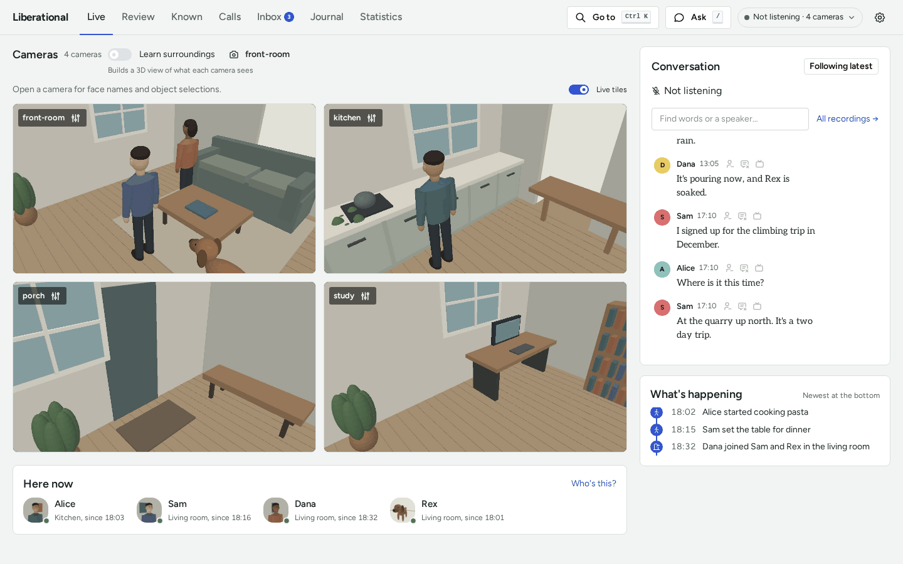
</picture>

Why it exists is in the [manifesto](MANIFESTO.md): AI should give you superpowers.

## What it looks like

Every picture here is the demo household: Alice, Dana, Sam, and Rex the dog, in a made-up house. `pack-demo` opens
the same dashboard on your machine, with none of your data ([a first look at the pack](docs/TUTORIAL.md)).

**Live** is the home now: every camera, who is here and in which room, the conversation as it is said, and what is
happening. The picture above is Live.

**The Journal** goes from a month down to a moment. A day's page says where people were, what happened, and what was
talked about. An hour has its events, and what it says links to its evidence.

<picture>
  <source media="(prefers-color-scheme: dark)" srcset="docs/images/demo-journal-day-dark.png">
  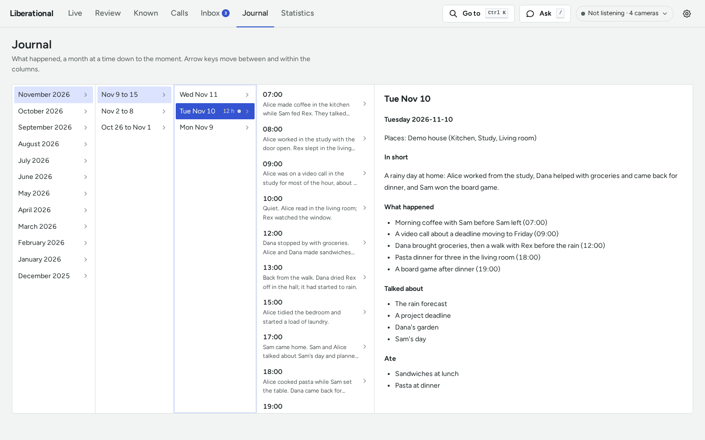
</picture>

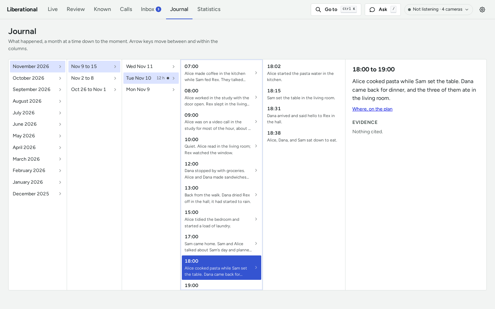

**Known** holds everyone and everything you named. Faces and voices nobody has named wait under "Who's this?" with
the best guess first, and every answer teaches the pack. A card has the person's or pet's pictures, recent video, and
the pictures recognition learned from, and a wrong picture can be taken out.

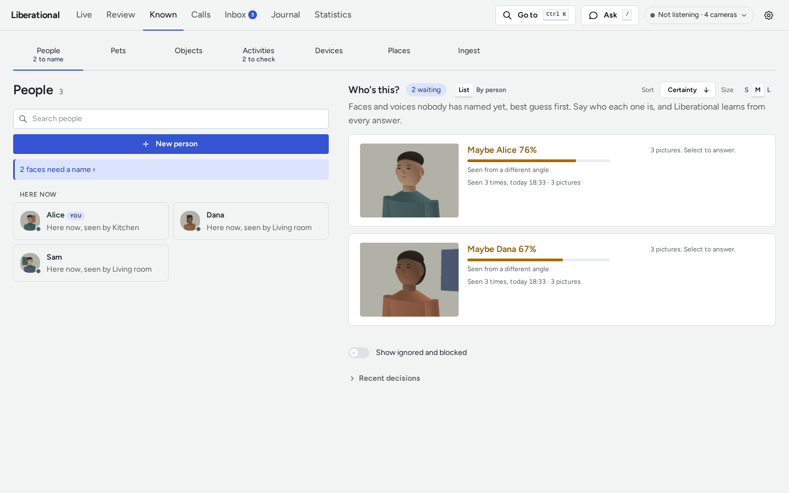

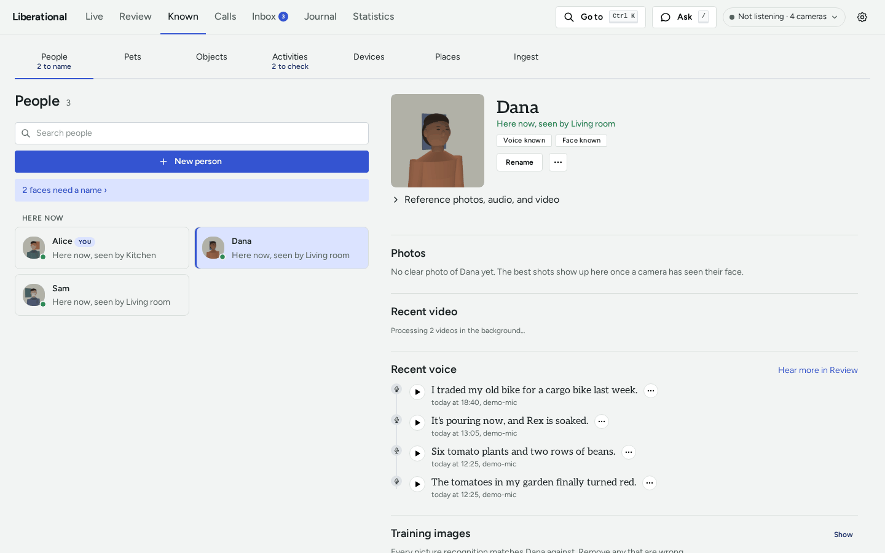

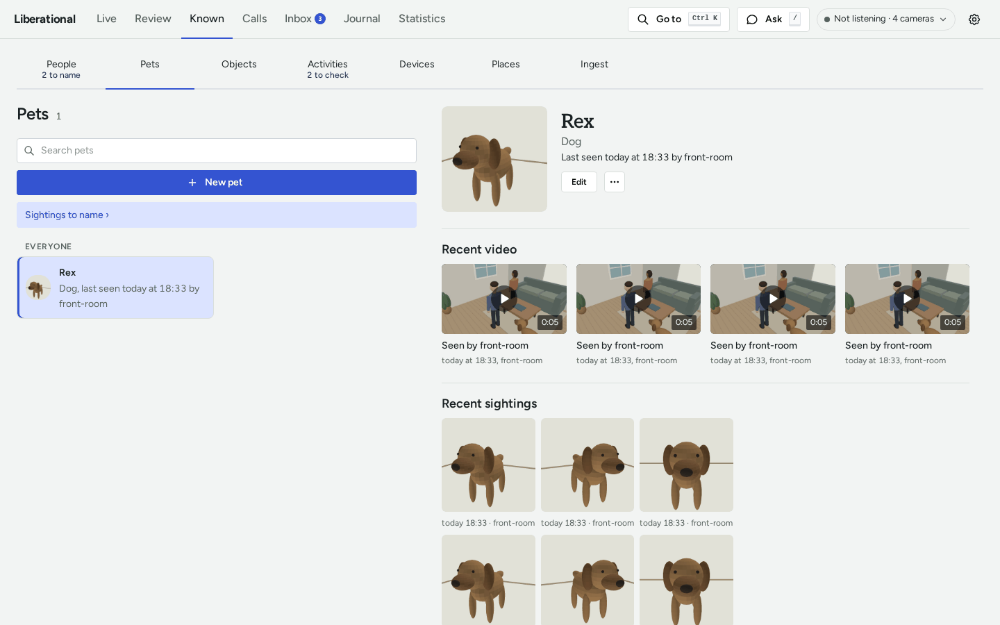

**Activities** are the movements you teach it to count. It shows a clip and asks whether it is what it guessed, and a
kind starts to count once it has enough answers.

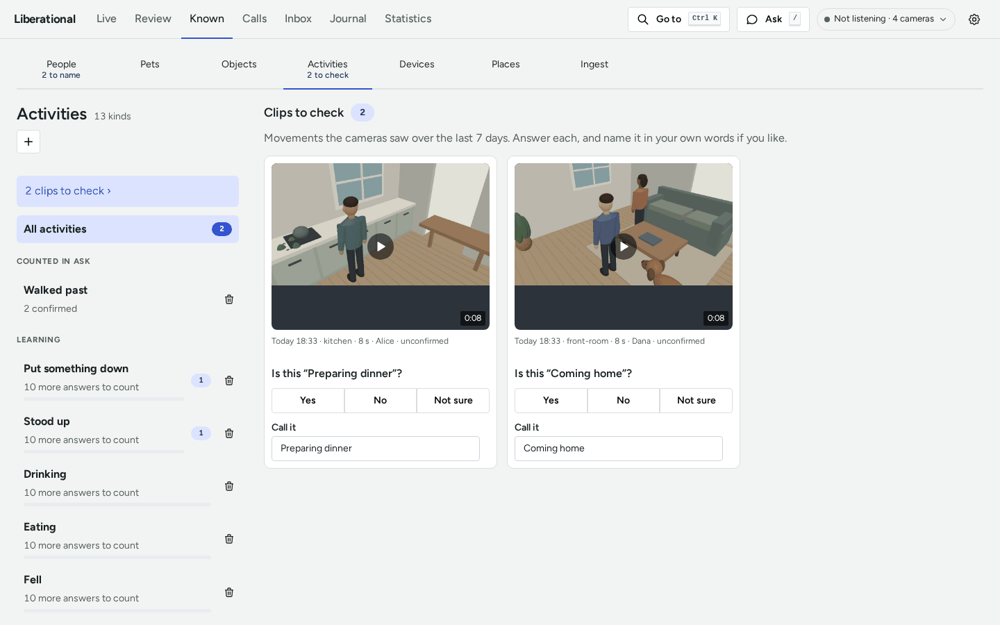

**Places** has a plan of each place. You draw it in the plan editor and give each camera its spot, and people and pets
are drawn on the plan where the cameras saw them. The 3D view shows what each camera sees as a cloud of points, fitted
to the room on your plan.

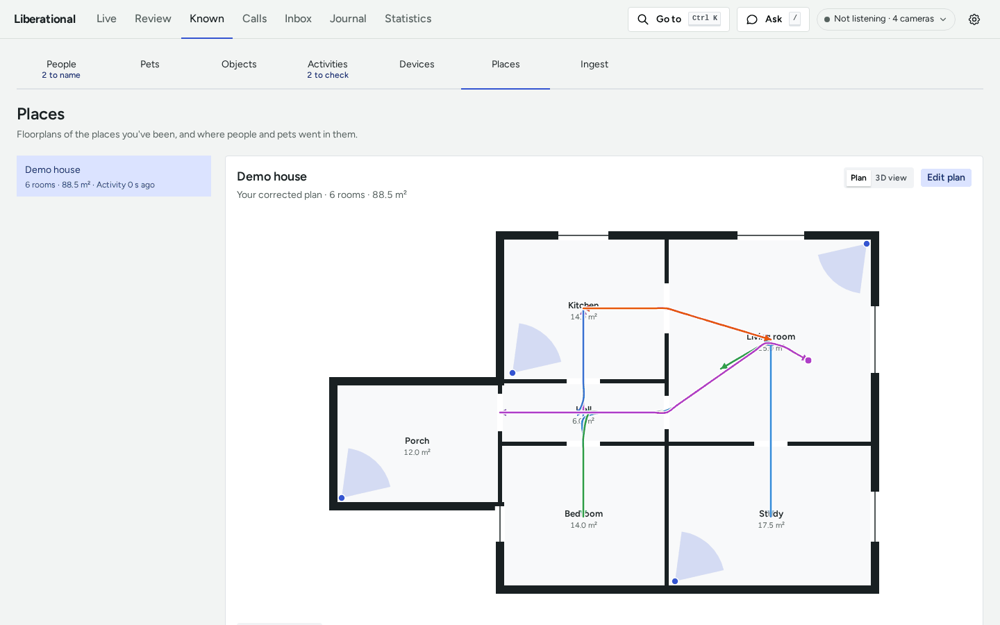

<picture>
  <source media="(prefers-color-scheme: dark)" srcset="docs/images/demo-plan-editor-dark.png">
  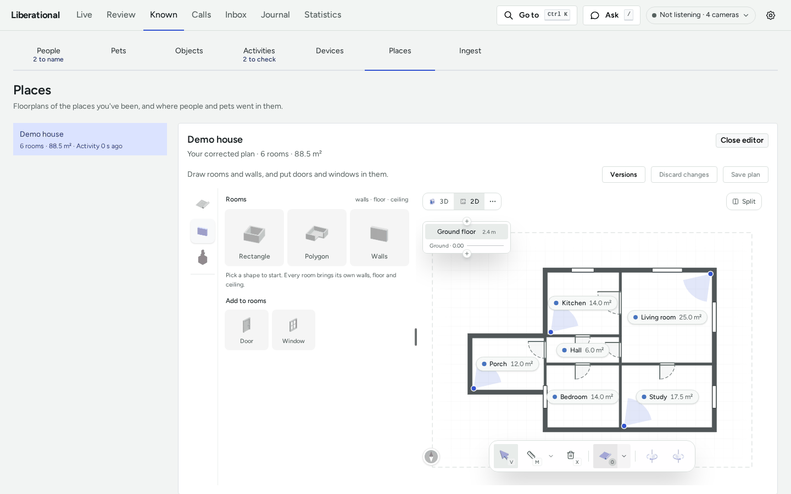
</picture>

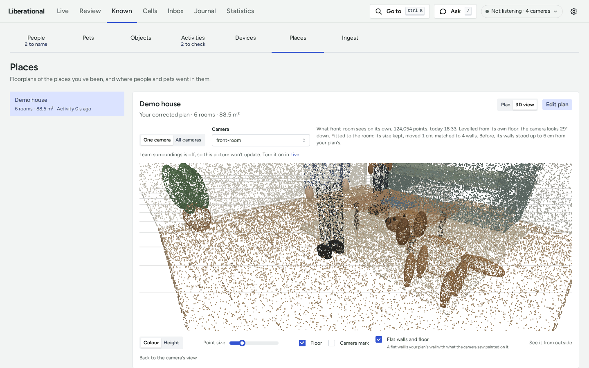

**Statistics** charts who was around and when, conversations, and activity.

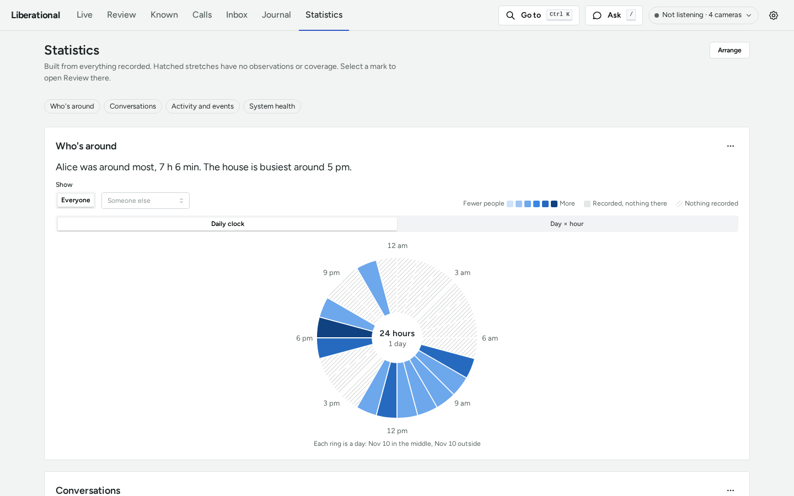

**Ask** answers a question from the record, from any page. A harder question can go to Deep research, whose report
arrives in the Inbox.

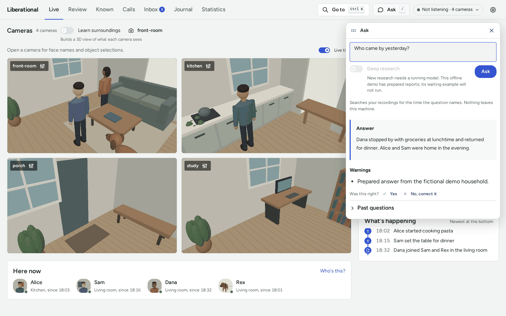

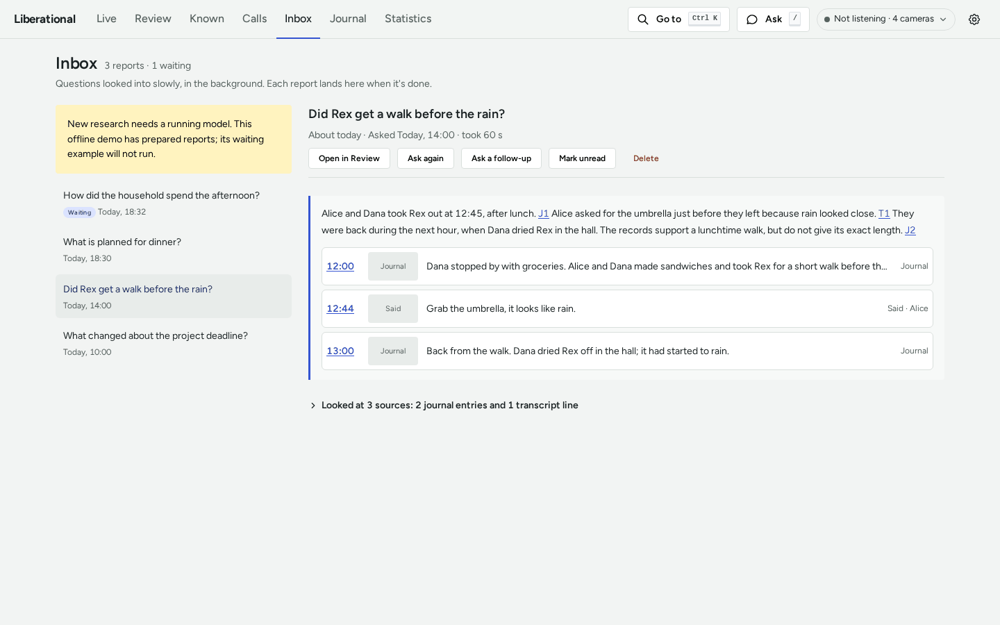

**Review** is one day, replayed: the recordings from every camera, a timeline to move through, filters by camera,
person, and event, and the transcript beside it. Pick a line and the video goes there.

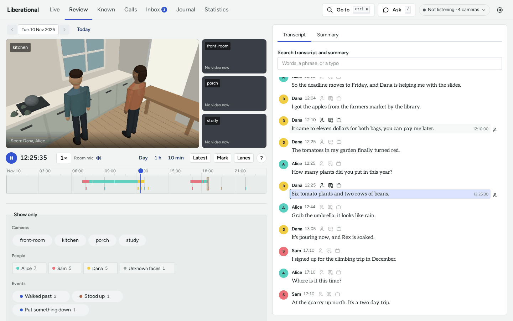

## What you need

| | |
|---|---|
| **Computer** | A Linux x86-64 machine with an NVIDIA GPU, or an Apple Silicon Mac. It is developed on a workstation with two 24 GB GPUs and on a 64 GB Mac; smaller machines are untested |
| **Operating system** | Ubuntu 24.04 or 26.04, Debian 12 or 13, or macOS 14 or later on Apple Silicon |
| **Cameras** | Any USB webcam, or network cameras that serve H.264 over RTSP |
| **Microphone** | Any USB or built-in microphone |
| **Disk** | Several GB for models, plus recordings: video is kept for 30 days by default ([Storage](docs/STORAGE.md)) |

## Install

On Ubuntu or Debian, from the project's apt repository:

```sh
sudo install -d /etc/apt/keyrings
curl -fsSL https://github.com/liseman/liberation.al/releases/download/apt/liberational-archive-keyring.gpg \
  | sudo tee /etc/apt/keyrings/liberational.gpg > /dev/null
echo "deb [signed-by=/etc/apt/keyrings/liberational.gpg] https://github.com/liseman/liberation.al/releases/download/apt ./" \
  | sudo tee /etc/apt/sources.list.d/liberational.list
sudo apt update && sudo apt install liberational
pack-setup    # as yourself, not with sudo: builds your environment and fetches the models
```

On a Mac, or any other supported machine, install the release's wheels with [uv](https://docs.astral.sh/uv/):
[Releases](docs/RELEASES.md#install-with-uv) has the commands. To work on the code, [install from a
clone](docs/INSTALL.md).

## First run

1. Open Liberational from the applications menu, or run `pack-app`. Its window says whether it is recording, and
   quitting it stops everything.
2. Press **Open the dashboard** in that window (<http://localhost:8765/>).
3. Follow the **Getting started** list on Live: pick a camera and a microphone, name yourself, record your voice,
   and tag your face.
4. As people and pets turn up, say who they are in **Known**, under "Who's this?". It never guesses a name it
   was not taught ([Naming](docs/NAMING.md)).
5. The next morning, read yesterday in the **Journal**, or ask about it with **Ask**.

To look around first with nothing of your own, run `pack-demo` and follow [a first look at the
pack](docs/TUTORIAL.md).

## Documentation

[docs/README.md](docs/README.md) is the map of every document. By what you came to do:

- **Learn it:** [a first look at the pack](docs/TUTORIAL.md), a fifteen-minute lesson on the demo household.
- **Get a task done:** [add a camera](docs/CAMERAS.md), [name people and pets](docs/NAMING.md),
  [draw a place's plan](docs/PLAN-EDITOR.md), [run and restart it](docs/RUNNING.md),
  [upgrade](MIGRATING.md), and the other [how-to guides](docs/README.md#how-to-guides-get-a-task-done).
- **Look something up:** every setting is in [config/defaults.toml](config/defaults.toml), and every service and
  state file in [Components](docs/COMPONENTS.md). The map lists the rest of the
  [reference](docs/README.md#reference-look-something-up).
- **Understand it:** [Architecture](docs/ARCHITECTURE.md) for how it works, and the [Roadmap](docs/ROADMAP.md) for
  where it is going.

## Status and limits

This is version 0.1.0 of a research project. It runs every day in its developers' homes, and it changes fast.

- An upgrade can reset recorded history. What you taught it (names, faces, voices, pets, and plans) is kept, and
  each version's [release notes](docs/RELEASES.md#notes) say what it resets.
- It needs a capable machine: an NVIDIA GPU on Linux, or Apple Silicon. There is no macOS installer package, and no
  phone app.
- The 3D view is optional and set up by hand. It shows what each camera sees, one camera at a time or every camera
  placed on your plan; it does not blend them into one model of a place. The model behind it is licensed for
  non-commercial use.
- Recognition is only as good as what you taught it, and a count covers only what the cameras were looking at.
  Answers say when there is a gap.
- The wearable in the [original plan](docs/history/plan-2026-10.md) is not built. It runs on a computer with
  ordinary cameras and microphones.

## Contributing

[CONTRIBUTING.md](CONTRIBUTING.md) has the development setup and how a change gets merged, and
[AGENTS.md](AGENTS.md) the rules for coding agents. This repository is public and the system records real homes:
[Conventions](docs/CONVENTIONS.md) says what may never appear here.

## License

Apache License 2.0: see [LICENSE](LICENSE). Bundled third-party files (the fonts, the plan editor's static files, and
the vendored skills under `.claude/skills/`) keep their own licenses, each stated beside the files it covers.
