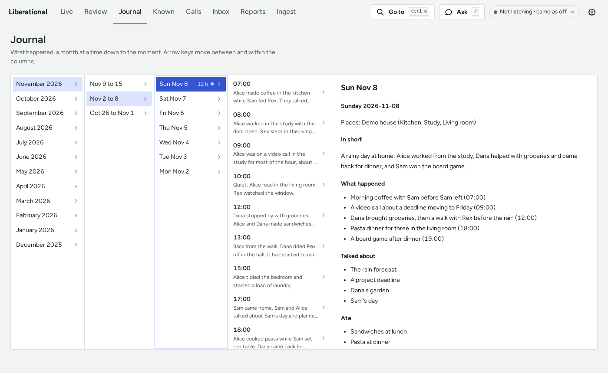
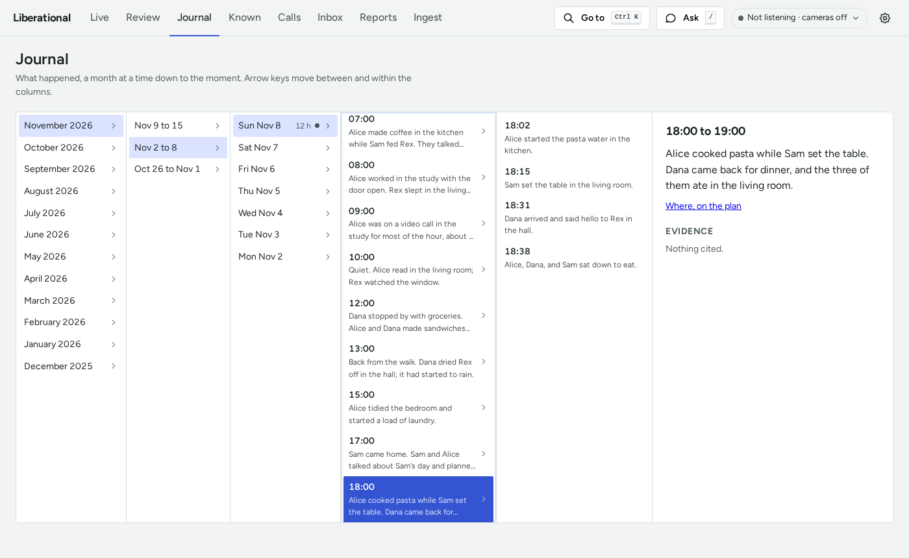
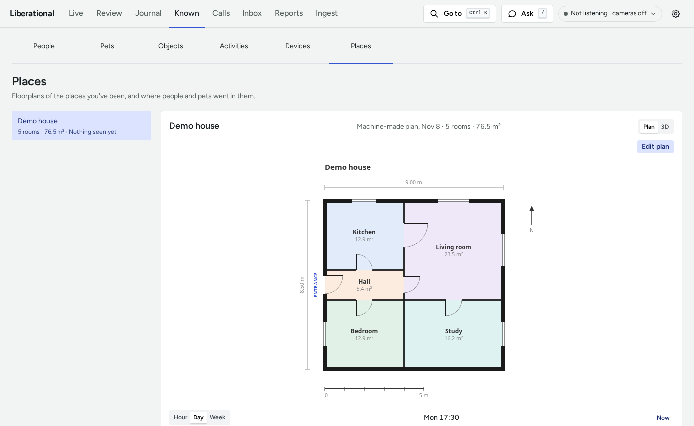

# Liberational Pack

A local-first ambient assistant. It records what its cameras and microphones observe, learns the people, pets,
and things its owner names, and answers questions with evidence from that history. Everything runs on your own
machine: recordings, transcripts, and names never leave it unless you turn on an optional outside service.

The reason it exists is in the [manifesto](MANIFESTO.md): AI should give you superpowers.

This is a research project. It runs every day on its developers' machines, and it changes fast. Expect rough
edges, and expect a reset of recorded history now and then (what you taught it is kept; see
[storage](docs/STORAGE.md)).

## What runs today

- **Continuum**, a Rust data layer, captures video and audio, keeps a rolling window of recordings, and serves live
  and recorded media to the dashboard.
- **Python workers** transcribe speech, identify speakers and faces, track people and animals, describe scenes, and
  build a searchable journal with day, week, and month pages.
- **The dashboard** has Live, Review, Journal, Known (people, pets, objects, activities, devices, and places),
  Calls, Inbox, Reports, Ingest, and Debug. Answers link to the recording they came from, and say so when there's
  a gap in coverage.
- **Spatial memory** keeps a point cloud and a floorplan of each indoor place, from what the cameras see, and
  draws where people and pets were on the plan.

[docs/ARCHITECTURE.md](docs/ARCHITECTURE.md) describes the running system. The wearable hardware in
[docs/history](docs/history/plan-2026-10.md) is the original idea, not a list of what's built.

## Screenshots

These come from demo mode: a made-up household (Alice, Dana, Sam, and Rex the dog), one made-up house, and one
day of journal. Once the install below is done, `mise run demo` opens the same dashboard on
<http://localhost:8780/>, with its own data in a temporary directory and nothing from `data/`.

The Journal, a day's page:

<picture>
  <source media="(prefers-color-scheme: dark)" srcset="docs/images/demo-journal-day-dark.png">
  
</picture>

An hour of that day, and its events:

<picture>
  <source media="(prefers-color-scheme: dark)" srcset="docs/images/demo-journal-dark.png">
  
</picture>

Known, Places, with the house's floorplan:

<picture>
  <source media="(prefers-color-scheme: dark)" srcset="docs/images/demo-places-dark.png">
  
</picture>

## What you need

| | |
|---|---|
| **Computer** | A Linux x86-64 machine with an NVIDIA GPU, or an Apple Silicon Mac. Development happens on a Linux workstation with two 24 GB GPUs and 128 GB of RAM, and on an Apple Silicon Mac with 64 GB of memory. Smaller machines are untested: expect to turn services off. |
| **Operating system** | Ubuntu or Debian (setup installs system packages with apt), or macOS on Apple Silicon (with Homebrew). On another Linux, `uv run pack-system check` lists the packages to install yourself. |
| **GPU software** | On Linux, a working NVIDIA driver (`nvidia-smi` lists the GPU). The CUDA toolkit is optional; with it, whisper-server builds for the GPU. On a Mac, nothing extra: models run on MLX and Metal. |
| **Cameras** | Any USB (UVC) webcam, or network cameras that serve H.264 over RTSP. Settings discovers UniFi Protect and ONVIF cameras, and sets up Wyze cameras. |
| **Microphone** | Any USB or built-in microphone. A ReSpeaker XVF3800 array adds direction of arrival. |
| **Disk** | Several GB for models on first setup, plus recordings: video is kept for a rolling window (30 days by default) and deleted after it. [docs/STORAGE.md](docs/STORAGE.md) has the sizes. |
| **Optional** | An ESP32 board for Bluetooth presence, a Twilio number for phone calls, and an agent gateway for requests that need tools. None is needed to start. |

A successful install is not a hardware validation: check the service status and the Live tab once it's up.

## Install

These steps install from a clone, which is also the development setup. To install a release instead, with no
clone and nothing to compile, see [docs/RELEASES.md](docs/RELEASES.md).

1. **Install a compiler, `curl`, `git`, and [mise](https://mise.jdx.dev)**, which installs the project's tools (the
   `[tools]` table of [mise.toml](mise.toml)). On macOS, install the Xcode Command Line Tools
   (`xcode-select --install`) and [Homebrew](https://brew.sh) first.

   ```sh
   # Ubuntu or Debian only:
   sudo apt-get update && sudo apt-get install -y curl git build-essential

   curl -fsSL https://mise.run | sh
   export PATH="$HOME/.local/bin:$HOME/.local/share/mise/shims:$PATH"
   ```

   Add `eval "$(~/.local/bin/mise activate bash)"` (or `zsh`) to your shell rc file, so new terminals have `mise` and
   its tools on `PATH`.

2. **Install a Rust toolchain** with [rustup](https://rustup.rs), and add Cargo to `PATH` in this terminal. The next
   step compiles one of the tools, and setup builds Continuum's SDK from source.

   ```sh
   curl --proto '=https' --tlsv1.2 -sSf https://sh.rustup.rs | sh
   . "$HOME/.cargo/env"
   ```

3. **Clone, and install the tools.**

   ```sh
   git clone https://github.com/liseman/liberation.al.git
   cd liberation.al
   mise trust
   mise install
   ```

4. **Start Ollama**, which setup pulls its models through. In another terminal:

   ```sh
   mise run ollama
   ```

   Leave it running until setup ends, then stop it with Ctrl-C: the application runs Ollama itself, as its `ollama`
   service. If another Ollama already serves port 11434 on this machine, skip the command, and stop that server
   before the first run ([MIGRATING.md](MIGRATING.md#the-shared-ollama-is-a-pack-service) has the commands).

5. **Run setup.** It lists the system packages this machine is missing and asks before installing them, installs
   the Python dependencies, builds `whisper-server` and the dashboard, turns on the Git hooks, and fetches the models
   for your platform. The first run downloads several GB. It is safe to run again: it skips what is already there.

   ```sh
   mise run setup
   ```

   `uv run pack-models --list` shows what the model step fetches and what is already present. No default model
   needs a Hugging Face account. If you point a model at a gated repository yourself, setup fetches every other
   model, lists the gated ones, and exits with an error.

6. **Export the face recognition model.** Its weights carry a dataset license: read the model card that
   `[models.adaface]` in [config/defaults.toml](config/defaults.toml) names, then export the ONNX model from the
   files setup downloaded.

   ```sh
   uv run python tools/export_adaface.py \
     --source data/models/adaface/model.py \
     --checkpoint data/models/adaface/model.pt \
     --output data/models/adaface/adaface_ir50_webface4m_rgb.onnx
   ```

7. **Build Continuum's services.** The first release build takes several minutes.

   ```sh
   mise run continuum-release
   ```

The install is done. Before you point it at your own home, take the
[first look at the pack](docs/TUTORIAL.md): a short lesson on a made-up household, which needs no camera, no
microphone, and no settings.

## Configure

Two files hold your settings. Both are gitignored, so they stay on your machine.

```sh
cp config/pack.example.toml pack.toml
cp config/devices.example.toml config/devices.toml
uv run pack-config --check
```

- `pack.toml` holds your name, the assistant's name, and any setting you want to change.
  [config/defaults.toml](config/defaults.toml) documents every one. You can skip the copy: without a `pack.toml` the
  dashboard opens on a setup screen and writes it for you.
- `config/devices.toml` lists the cameras and microphones to capture, one `[[device]]` each. The example has a USB
  camera matched by its USB ID (`lsusb` shows yours) and a microphone matched by name. Edit both to match what's
  plugged in, and delete what you don't have.
- `pack-config --check` lists the settings and services in `pack.toml` that don't exist, or says that every one
  exists.

## First run

1. **Try the dashboard on its own.** It works with an empty `data/` directory.

   ```sh
   mise run dashboard
   ```

   Open <http://localhost:8765/>, then stop it with Ctrl-C.

2. **Open the application.** It runs every service, the dashboard included, and stops them all when you quit it. It
   refuses to start while one of its services already runs outside it, so first stop what you started by hand (the
   dashboard above). The demo can stay open: it runs apart from the application. Stop `mise run ollama` too: the
   application's own Ollama needs its port.

   ```sh
   uv run pack-services list       # every service; * marks the ones that run on this machine
   uv run pack-app                 # the application window
   uv run pack-services status     # in another terminal: each service's state
   ```

   `uv run pack-supervisor run` is the application without a window. Nothing starts at login unless you tick
   "Start at login" in the application's window.

3. **Follow the Getting started card.** Open <http://localhost:8765/> again. The Live tab lists six steps, each
   with a button to the control that does it: system packages installed, models downloaded, pick a camera and a
   microphone, name yourself, record your voice reference, and tag your face. Live fills in as each one is done.

`uv run pack-services stop <name>` stops a service, and `start <name>` starts it again. `disable <name>` takes it
out of the set that runs, in `pack.toml`, without stopping it. [docs/SERVICES.md](docs/SERVICES.md) explains the
application and its services.

## Add cameras

- **USB:** plug it in, add a `[[device]]` with `kind = "camera"` and its USB ID to `config/devices.toml`, and
  restart capture: `uv run pack-services restart continuum-capture`.
- **Network:** in Settings, under Network cameras, discover UniFi Protect and ONVIF cameras and add the ones you
  want, or set up Wyze cameras. To add one by hand, write a `[[device]]` with `kind = "rtsp"` and the camera's RTSP
  URL. The URL often contains a password: it belongs only in `config/devices.toml`, with `chmod 600`.

Each camera is a view, not a room: name it for what it sees. A camera can be paused from the header's status menu,
and nothing from it is recorded until it's resumed. [docs/CAMERAS.md](docs/CAMERAS.md) is the full guide, lens
calibration included.

## Name people

The system never guesses a name it wasn't taught. Start with yourself (the Getting started card), then:

- **Known** lists people, pets, objects, activities, devices, and places. Add a person, give them a few face photos
  and a voice sample, and correct a wrong match there.
- **Who's this?**, in Known under People, asks about faces and voices it has seen often and can't name. Answering
  teaches it.
- A correction is kept as something you taught, apart from the machine-made history, and survives a reset.

[docs/NAMING.md](docs/NAMING.md) has the steps for every naming card, and [docs/PEOPLE.md](docs/PEOPLE.md)
explains how voices and faces are named.

## When something's wrong

| Symptom | Check |
|---|---|
| A service isn't running | `uv run pack-services status`, then the Debug tab, which shows each service's log by level |
| The application refuses to start | It names the services that run outside it: stop those (a dashboard started by hand, for one) |
| "missing system package" | `uv run pack-system check`, then `mise run system` |
| A model is missing | `uv run pack-models --list`, then `mise run models` |
| No answers or captions | The `ollama` service isn't running (`uv run pack-services status`), or another Ollama holds port 11434 |
| A camera or microphone doesn't appear | Its `[[device]]` match in `config/devices.toml` (`lsusb` for a USB ID), then `uv run pack-services restart continuum-capture` |
| Continuum won't start | `mise run continuum-status`; build it with `mise run continuum-release` if the binaries are missing |
| Services fail after an update | A plain `uv sync` removes optional packages. Run `mise run setup` again, and read [MIGRATING.md](MIGRATING.md) |
| A setting is refused | `uv run pack-config --check` lists settings that were renamed or removed |

## Privacy

`data/` holds real recordings of real people. It's gitignored, and nothing in this repository reads it into a
commit. If you contribute, `mise run setup` turns on Git hooks that refuse private data (keys and tokens, personal
details such as phone numbers and addresses, and the credentials in your own config) before it can be committed or
pushed. They don't know names, so keeping real people out of what you write is up to you.
[docs/CONVENTIONS.md](docs/CONVENTIONS.md) says what may appear in this public repository.

## Contributing and documentation

[docs/README.md](docs/README.md) is the map of every document, grouped by what you came to do:

- **Learn it:** the [first look at the pack](docs/TUTORIAL.md) on a made-up household, then "Install" to
  "Name people" above for a pack of your own.
- **Get a task done:** [upgrade an install](MIGRATING.md), [install a release](docs/RELEASES.md), or
  [contribute a change](CONTRIBUTING.md) ([AGENTS.md](AGENTS.md) has the stricter rules for coding agents). The
  map lists the other [how-to guides](docs/README.md#how-to-guides-get-a-task-done).
- **Look something up:** every setting is in [config/defaults.toml](config/defaults.toml), every service in
  [services/services.toml](services/services.toml), and every task in [mise.toml](mise.toml). The map lists the
  rest of the [reference](docs/README.md#reference-look-something-up).
- **Understand it:** the [manifesto](MANIFESTO.md) for why, [Architecture](docs/ARCHITECTURE.md) for the running
  system, and the [Roadmap](docs/ROADMAP.md) for where it's going.

## License

Apache License 2.0: see [LICENSE](LICENSE). Bundled third-party files (the fonts, the plan editor's static files, and the
vendored skills under `.claude/skills/`) keep their own licenses, each stated beside the files it covers.
