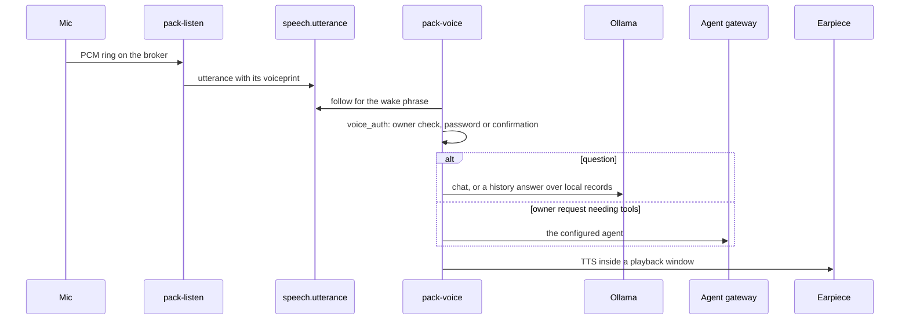

# Questions, the journal, and the voice turn

How the pack answers questions about what happened, and how it writes its own record. Paths are relative to
`src/liberational/`.

## The rules answers follow

- An answer comes from evidence it can cite: transcript lines, captions, journal entries, visits, spans, or frames.
- Counts and times are computed by code from spans over coverage. A model never counts.
- Time no coverage covers is unknown, never zero. Missing search results are partial evidence, not proof of absence.
- A model's activity kind is unverified until the owner's ratings pass the gate, and the answer says so.
- A caption is model evidence, not truth. People visible in one frame are not unique people or a passage count.

## Reading a question

`memory/question.py` makes one call to the search loop's model (`recall.model`). The model fills a fixed form:
whether the question is about recorded history, the measure, the people named, and its time words. The form is
schema-constrained and checked against the question's own words.

`memory/history_qa.py:parse` turns that reading into a query and works out the time window itself, so the model never
computes a time. "Last night" is 18:00 the previous local day to 05:00. Weeks begin Monday. Open-ended phrases are read
the same way (`open_window`): the whole history (since recording started, ever, so far), since a day or a month, in a
month, between two days, and the last N weeks, months, or years. A question with no time, or with a time that can't be
read, is answered over the whole history, and every answer says the window it looked through. Cameras, activities,
zones, pets, and linked devices are looked up from what the owner configured (`question.Vocabulary`), not read by the
model. Ask, the voice loop, and the forgotten-person check share the one reading.

## Ask

`memory/ask.py` (`pack-ask`, and `POST /pack-ask/jobs` on the dashboard) runs each question in a worker subprocess:
it collects evidence, then answers from it with the local model. There is one Ask, opened the same way from every
page ([How to ask the pack a question](ASK.md)). Opened from Review, it adds the day Review shows as a hint. Ask
answers only from the pack's own records: no question goes to an outside model.

A question is answered quickly by default. With `deep` set on the request, the same route hands it to research
([Research](#research)). Both replies carry `reach`: the search rounds at most, the time they may take, the sources
they can read, and the model that writes the answer, so neither path claims more than it searches.

Evidence gathering (`memory/recall.py`, on by `recall.enabled`) is a loop of up to `recall.max_rounds` rounds. Each
round the local model searches the journal, a person's facts, the transcript, captions, visits, or recorded frames.
Journal search fuses full-text and embedding matches by reciprocal rank, filtered by time and person first. Every hit
is read back from the memory log, so nothing superseded or purged is evidence.

Answers lead with one short sentence, then the explanation and coverage. Recorded-frame analysis needs
`review.recorded_frame_analysis = true`.

An answer's links stay inside the dashboard: a link in an answer or in its evidence is made a link only when the
dashboard answers that path (`frontend/src/dashboard/ask/links.ts` holds the list), so a model's `/recordings`, a bare
`/audio`, or `/camera/query` stays plain text. The gateway serves `/camera/query` on its own port, so a same-origin
link to it would 404.

Ask uses `ask.model` when set, else the agent gateway's default model when that is a local one, else
`models.ollama.llm`. With `ask.ollama_url` pointing at the `ask-ollama` service, Ask's model stays loaded at its own
context without reloading the shared server's model.

Exchanges are saved on the memory log (`ask.question`, `ask.state`, `ask.answer`, `memory/ask_history.py`). A saved
answer depends on its source ids: purging a source removes the answer. Saved exchanges never become context for a new
question.

## Deterministic answers

These questions bypass model synthesis: code computes the answer from records and says what it could not see. This
section is reference: each row names the question, where its numbers come from, and the module that answers it.

| Question | Source | Module |
|---|---|---|
| Walk-bys | `walkby.span` over `walkby.coverage`, per camera and direction, never summed across cameras | `memory/crossing_counts.py` |
| Zone visits ("how many times did the cat use the litter box") | `zone.visit` over `zone.coverage` | `memory/zone_counts.py` |
| Came into view | `presence.span` over `action.coverage` | `memory/presence_counts.py` |
| Entries and exits at a camera's edge | Durable track fragments, with coverage; partial coverage is a lower bound | `memory/movement_counts.py` |
| Activity counts ("how many times did I sit down") | Promoted `action.span` kinds over `action.coverage` | `memory/event_counts.py` |
| Usual counts ("how often does the cat usually use the litter box") | The median and range of per-day or per-night counts over periods with enough coverage | `memory/typical_counts.py` |
| When and what ("what was I doing at 3") | `action.span` times; top classes of `action.window`, as guesses | `memory/activity_questions.py` |
| An animal's last visit to a zone | Its newest `zone.visit` | `memory/subject_activity.py` |
| How many times someone said a word or phrase | The transcript's lines in the window; a single word counts its plain forms too | `memory/history_qa.py` (`said_count`) |
| Who was here, last seen | Encounters from face visits and resolved speech | `memory/timeline.py` |
| Device presence and arrivals | Linked devices' sightings, with coverage | `memory/device_answers.py` |
| What a camera shows now | Its newest caption of the last ten minutes | `vision/camera_history.py` |
| Where an object was last seen | The Objects page, asked by voice | `memory/objects_voice.py` |
| Lights | Colour cast of recordings over one to three whole days; anything else is unknown | `memory/lights_color.py` |

The owner's steps for the inputs are in [ACTIVITIES.md](ACTIVITIES.md) (what counts in Ask), [ZONES.md](ZONES.md)
(zones and their visits), [OBJECTS.md](OBJECTS.md) (remembered objects), and [NAMING.md](NAMING.md) (people and
pets).

## Activities

`memory/events.py` reads activity spans (`walkby.span` and `action.span`) with the owner's names and Right or Wrong
ratings (`activity.named`, `activity.feedback`).

- A kind counts in Ask once it has `activity.promotion_min_ratings` ratings with a Right share of at least
  `activity.promotion_min_precision`. A camera angle with enough ratings of its own overrides the kind-wide
  result. Walk-bys count until ratings say otherwise. A Wrong span never counts.
- The list of activities is the owner's (`memory/activity_kinds.py`, `activity.kind` records). Each maps to model
  classes: those its name matched when added, plus those it learned from answers. A deleted activity is a tombstone
  and can be restored.
- Naming a span never proves the detector right, and rating precision is not held-out accuracy. How the owner rates
  and names clips is in [ACTIVITIES.md](ACTIVITIES.md).

## The journal

`pack-journal` (`memory/journal.py`) writes an entry for every 30 seconds of speech, replies, and captions, then
rolls entries up through longer windows (`journal.levels`).

Every level is written in the third person and the past tense, as an account of the household from its fixed cameras
and microphones. People go by the names the pack knows them by, the owner by `owner.name`, and someone unnamed stays
"someone": a name is never guessed. Speech is reported indirectly where a quote would bring in first-person words. A
guard checks each entry: one that narrates as "I" or "we" is sent back once to be rewritten, and is rejected if it
comes back the same way.

Each entry keeps references to the source records the model selected, so a summary line can be traced to evidence. A
speaker is stored as a token and becomes a name only when read, so renaming someone rewrites nothing. `memory/facts.py`
derives person facts from finished hours. `memory/embedding.py` embeds each entry through Ollama; a vector from other
weights than the index's is dropped.

`memory/journal_pages.py` writes day, week, and month pages on top of the hours: third-person Markdown with fixed
sections. The model writes the prose; code writes People present, Counts, and Evidence, because a model never counts.
`journal.page_model` writes the pages: a day at `journal.page_batch_at` the next morning, a week early Monday, a month
on the 1st. If that model does not fit beside the others, the daily batch stops `journal.page_window_services`,
unloads Ollama's models, and restores both when done.

`memory/review_summary.py` rewrites entries as the shorter lines Review's Summary tab shows (`review.summary`), with
their evidence. `pack-journal --day YYYY-MM-DD` rebuilds a day.

An entry is never changed in place. A correction is a new entry that supersedes the original, with the same evidence,
and readers follow the corrections, so only the newest version of an entry shows.
`pack-journal --rewrite-third-person` corrects stored entries that narrate in the first person this way
([the upgrade step](../MIGRATING.md#the-journal-is-written-in-the-third-person)).

Background model calls yield to a voice turn through `voice_turn.wait_quiet()`, for at most
`voice.background_max_wait_s`.

## Research

`pack-research` (`memory/research.py`) runs an Ask question slowly: more search rounds (`research.max_rounds`), a
long answer budget, one job at a time at idle priority. A question reaches it only through Ask, with Deep research
on. It waits while an instant Ask question runs
(`state/ask/busy/`). Each finished job is a report in the Inbox with its citations. Jobs live in `state/research/`.

## The voice turn

- `speech/playback_guard.py` records when the pack speaks (`state/playback_windows.json`), so listen never
  transcribes or obeys its own voice.
- `assistant/voice_auth.py` checks the speaker is the owner. Wrong passwords are counted per voice and per phone
  number in `state/voice_lockout.json`, with cooldowns that survive a restart.
- Replies use `speech/tts.py`: the owner's cloned voice when a reference exists, else Kokoro. Outside macOS,
  synthesized chunks play as they are made.
- A history answer can start speaking from its finished short answer while the explanation is still being written.

### Phone calls

Calls run the same turn over Twilio. `phone/bridge.py` answers Twilio voice webhooks and a media WebSocket;
`phone/outbound.py` and `phone/call.py` place calls. The local model answers a call's turns. An owner turn that needs
tools goes to the agent's phone agent when one is configured. "Hang up" or goodbye from any caller ends the call
without a model turn. `pack-phone-call --hangup CALL_SID` and the Calls tab end a live call and report success only
after Twilio confirms it.
