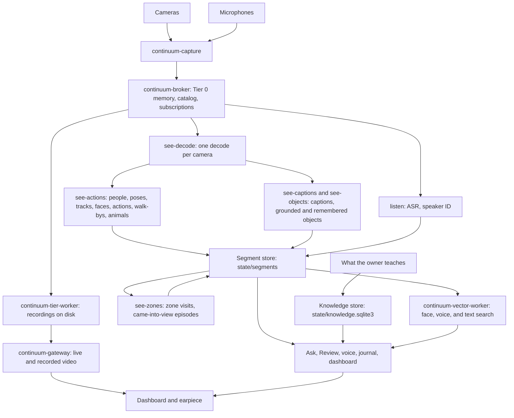

# Architecture

The Liberational Pack is a wearable ambient assistant. It listens through microphones, watches through cameras, keeps
a local record of what was said and seen, learns who people are, and answers questions out loud. Speech recognition,
speech synthesis, captioning, speaker and face recognition, and the language model all run on the machine you carry.
Hosted services are optional. [MANIFESTO.md](../MANIFESTO.md) says why.

This document is the map: what the parts are, how data flows between them, where the code lives, and which document
has the detail. It describes `main`. Plans are in [ROADMAP.md](ROADMAP.md), and hardware is in
[hardware/BOM.md](hardware/BOM.md).

Paths are relative to `src/liberational/` unless they start with another top-level directory.

## System overview

1. **Capture** owns the devices. It writes frames and audio into the broker's shared memory.
2. **The tier worker** keeps the recordings as chunk files, which the broker catalogs.
3. **Workers** derive everything else (speech, people, actions, captions, zones) and write it to the segment store.
4. **The owner** teaches names, pets, zones, and ratings. Those go to the knowledge store.
5. **Readers** (Ask, Review, the voice loop, the journal, and the dashboard) combine the two stores.
6. **The gateway** streams live and recorded video to the browser.

Three rules hold everywhere:

- **Models perceive, geometry counts.** Models find people, poses, faces, and actions. Plain geometry decides zone
  visits, counting lines, and track boundaries.
- **Unknown is not zero.** Every stream that answers "how many" or "when" has a coverage stream saying what was
  analyzed (`action.coverage`, `walkby.coverage`, `zone.coverage`). Time without coverage is unknown. A model kind
  the owner hasn't rated is reported as unverified.
- **Machine-made data is expendable; taught data is not.** A reset deletes recordings and derived rows and keeps the
  knowledge store and the face gallery.

## Where code lives

| Path | Contents |
|---|---|
| `src/liberational/` | The Python package, one subpackage per area (below) |
| `continuum/` | The data layer: a Rust workspace of daemons and the `continuum_py` SDK ([CONTINUUM.md](CONTINUUM.md)) |
| `frontend/` | The dashboard: TypeScript, React, and Mantine, built by Vite ([DASHBOARD.md](DASHBOARD.md)) |
| `config/` | `defaults.toml` (every setting, documented), example owner files, and system packages |
| `services/services.toml` | Every daemon and scheduled job, declared once |
| `tools/` | Benchmarks, probes, and maintenance scripts; each docstring says how to run it |
| `tests/` | Python tests and fixtures; frontend tests sit beside their code |
| `firmware/esp32-ble-scanner/` | The passive BLE receiver's firmware |

| Subpackage | Area |
|---|---|
| `listen/`, `speech/`, `audio/` | Transcription and speaker ID; ASR, TTS, and playback; device integration |
| `see/`, `vision/` | The vision workers; the models and readers they share |
| `people/` | Identity, the registry, faces, voices, pets, and profiles |
| `memory/` | The journal, Ask, recall, activities, counts, places, and object memory |
| `assistant/`, `phone/` | The voice loop and its authorization; the Twilio bridge |
| `spatial/` | Place maps, floorplans, camera registration, and positions |
| `proximity/` | Bluetooth, network, and Wi-Fi device sightings |
| `ingest/` | Imported photos, video, and audio |
| `dashboard/` | The web server, one module per area |
| `domain/` | The domain model's plain types, with no I/O ([DOMAIN-MODEL.md](DOMAIN-MODEL.md)) |
| `demo/` | Demo mode's made-up household |

Top-level modules are shared plumbing: `config.py` (settings and paths), `services.py` and `supervisor.py` (running
services), `knowledge.py` (the knowledge store), `segment_log.py` (segment stream schemas and reads), `memory_log.py`
(records on broker streams), `ollama.py` (every model server call), `json_state.py` (atomic JSON state files), and
`logs.py` (logging).

## Where data lives

Runtime data is under `data/` in a checkout (gitignored) and under `~/.local/share/liberational/` for an installed
package. `state/` below means `paths.state`. [SERVICES.md](SERVICES.md#install-layout) has the full layout.

| Store | Path | Holds | Kept |
|---|---|---|---|
| Recordings | `state/continuum/tier/` | Camera video and microphone audio as chunk files | Video 30 days; speech audio until a reset |
| Broker catalog | `state/continuum/catalog.redb` | Chunk metadata, the memory log (journal, facts, Ask history), subscriptions | Until a reset |
| Segment store | `state/segments/<stream>/<slot>/` | Everything derived: Arrow IPC parts per stream, slot, and UTC hour | Until a reset; forgets write tombstones |
| Knowledge store | `state/knowledge.sqlite3` | What the owner taught: people, names, pets, zones, ratings, device links, place plans | Kept by `--keep-taught` |
| Face gallery | `faces/` | Enrolled face embeddings, negatives, and photos | Kept by `--keep-taught` |
| Places | `state/places/<place>/` | Machine-made maps, floorplans, and camera poses per place | Until a reset |
| Vector index | `state/continuum/vector/` | LanceDB tables for face, voice, and journal search | Rebuilt from its streams |

- **The video window.** `pack-video-window` runs nightly. It condenses dense rows of days past the window, keeps a
  short clip of each moment the journal cites, then ages out camera video older than `video_window.days` (30) and
  audio no speech touches. Derived rows stay, and Review says the footage expired.
- **The reset.** `pack-reset-catalog --keep-taught` deletes the machine-made stores and keeps taught state.
  `--fresh` deletes taught state too. `pack-knowledge export` and `import` move taught state between installs.

[STORAGE.md](STORAGE.md) covers retention and sizes. [MIGRATING.md](../MIGRATING.md) has the reset steps. The
[state contract](#state) below lists every file.

## Running it

`services/services.toml` declares each daemon and scheduled job. `pack-app` is the application the owner opens: a
supervisor (`supervisor.py`) with a small window. It starts each selected service as a child process, restarts one
that exits, runs the scheduled jobs, and stops everything on quit. `pack-supervisor run` is the same without the
window. `pack-services` is its client (`status`, `start`, `stop`, `restart`, `install`, `uninstall`).

Start order is broker, capture, then readers. Services marked `wait_for_broker` start only after a real broker
request succeeds. `ollama` and `see-actions` also wait for the GPU driver. The dashboard and gateway are ungated, so
diagnostics and playback work while the broker is down. A restart that includes the broker or capture runs as one
cascade: stop readers, stop and restart the core, check devices deliver, start readers.

[SERVICES.md](SERVICES.md) has readiness, the cascade, the supervisor, logs, and the install layout.
[PROFILING.md](PROFILING.md) has the opt-in CPU profiler.

## Capture and recording

Continuum is the data layer: five Rust daemons under `continuum/crates/` and a Python SDK.

- `continuum-capture` reads `config/devices.toml` and runs one worker per camera or microphone. Local MJPEG cameras
  are encoded to H.264 on the GPU; RTSP cameras are stored as they arrive.
- `continuum-broker` owns the Tier 0 shared memory arena, the catalog, subscriptions, jobs, and purges. Clients talk
  to it over a Unix socket.
- `continuum-tier-worker` writes chunk files (a camera's one a minute, a microphone's every 15 seconds as Opus) and
  carries out purges on them.
- `continuum-vector-worker` indexes embeddings and journal text in LanceDB and answers searches.
- `continuum-gateway` serves live and recorded frames with overlays to the browser over WebSockets.

A privacy pause (`paused = true` on a device in `config/devices.toml`) stops that device's worker within a second.

[CONTINUUM.md](CONTINUUM.md) is the design and its contracts.

## Vision

- `pack-see-decode` decodes each camera once (NVDEC for H.264) and shares the pictures with every reader.
- `pack-see-actions` is the person pipeline. Per frame: RF-DETR finds people and animals, a tracker follows them, and
  RTMPose finds joints. From the tracks it derives faces, actions (ST-GCN++), movement, walk-bys, and animals.
- `pack-see-captions` describes each view with the vision language model when it changes, and grounds its objects.
- `pack-see-objects` finds objects the owner outlined, by feature matching.
- `pack-see-zones` turns tracks into zone visits and came-into-view episodes with geometry alone.

All of them write segment streams. [VISION.md](VISION.md) describes the pipeline, and
[VISION-STREAMS.md](VISION-STREAMS.md) is the field reference.

## Listening

`pack-listen` reads each microphone's PCM from the broker, gates it (energy, then Silero), transcribes it (Parakeet),
embeds the speaker (ReDimNet2), and writes `speech.utterance` rows. It matches each line to a voiceprint and never
transcribes the pack's own playback. `pack-deep-transcribe` re-hears each line overnight with two models and keeps
revisions beside the live text. [PEOPLE.md](PEOPLE.md#voices) covers voice matching.

## People and owner knowledge

The knowledge store (`knowledge.py`) holds what the owner taught, outside the broker's directory, so it survives a
reset and reads while the broker is down. `people/registry.py` gives each person a stable ID. `pack-identity` links
voices to faces and learns names from conversation and labels. Faces are named from the gallery against a held-out
check; voices are named only from lines the owner confirmed. Forgetting a person purges their events and the journal
entries built from them.

[PEOPLE.md](PEOPLE.md) covers the store, voices, faces, pets, and references. [DOMAIN-MODEL.md](DOMAIN-MODEL.md) is
the model behind them.

## Memory and answers

- **The journal** (`pack-journal`) writes hour entries from speech and captions, rolls them up, and writes day,
  week, and month pages. Entries are embedded for search.
- **Ask** (`memory/ask.py`, `memory/history_qa.py`) answers history questions from evidence. One model call reads
  the question into a fixed form; code works out the time window; a search loop gathers transcript, captions,
  journal entries, visits, and frames; the local model answers with citations.
- **Counts** are deterministic: walk-bys, zone visits, came-into-view episodes, and rated activities are counted from
  their spans over coverage, never by a model.
- **Review** shows a day: timeline, transcript, summary, video, and Ask scoped to that day.
- **Research** (`pack-research`) takes an Ask question slowly in the background and files a report in the Inbox.

[ANSWERS.md](ANSWERS.md) covers the question path, activities, the journal, and research.

## Voice and phone

`pack-voice` follows the speech log for the wake phrase, checks the speaker is the owner (`assistant/voice_auth.py`:
voice match, then password or confirmation gates), and routes the request: simple and history questions to the local
model, owner requests that need tools to the agent gateway when one is configured. Replies play through
`speech/tts.py` (Kokoro, or the owner's cloned voice) inside a playback window, so listen ignores them.

`pack-phone-bridge` is optional. It bridges Twilio calls to ASR, the model, and the cloned voice, records each call
under `calls/`, and gives owner treatment only to the owner's number with grade A caller-ID attestation or the spoken
password. [ANSWERS.md](ANSWERS.md#the-voice-turn) has the turn.

## Places

Spatial memory builds a map and floorplan of each indoor place. `pack-spatial-cameras` registers fixed cameras
nightly with MASt3R. `pack-walkthrough` imports a phone walk. `spatial/fuse.py` merges revisions into one map per
place, and `spatial/positions.py` places people and pets on the plan. The owner's names and plan corrections are
taught state and supersede the machine's view.

[SPATIAL.md](SPATIAL.md) covers the jobs and files. [WALKTHROUGH.md](WALKTHROUGH.md) has the steps to record a walk.

## Devices and network

All optional and off by default. `pack-bluetooth` records passive BLE advertisements from USB ESP32 receivers.
`pack-network-devices` reads a local UniFi controller's client list and the Wi-Fi access points the machine hears.
`proximity/devices.py` joins sightings to people through links the owner makes. A sighting never proves presence, and
missing coverage never proves absence.

[BLUETOOTH.md](BLUETOOTH.md) and [NETWORK.md](NETWORK.md) have the contracts.

## Ingest

`pack-ingest` and the dashboard's Ingest tab import photos, video, and audio from uploads, links, and sources. Each
item is deduplicated, converted, and registered with the broker at its original time. `pack-ingest-analyze` runs
captions and speech over it. [INGEST.md](INGEST.md) has the boundaries.

## Dashboard

`pack-dashboard` (`dashboard/server.py`, port 8765) serves the React app and a JSON API, one module per area, with
routes registered in `dashboard/routes.py`. Tabs: Live, Review, Journal, Known (People, Pets, Objects, Activities,
Devices, and Places), Calls, Inbox, Reports, and Ingest, plus the Settings drawer. Video comes from the gateway and is
decoded in the browser with WebCodecs. Writes are allowed only from the machine itself; remote viewers need the
password and get read-only service status.

[DASHBOARD.md](DASHBOARD.md) covers the server, the frontend layout, and Settings.

## Models and platforms

Models are declared in `config/defaults.toml` under `[models]` and fetched by `mise run models`. Overrides go in
`pack.toml`.

| Capability | Model and runtime |
|---|---|
| Live ASR | Parakeet TDT 0.6B v3: `parakeet-mlx` on Apple Silicon, sherpa-onnx elsewhere; whisper.cpp by `asr.engine` |
| Overnight ASR | Qwen3-ASR 0.6B (Transformers) beside a second Parakeet pass |
| TTS | Kokoro; Qwen3-TTS 0.6B cloning (MLX, or faster-qwen3-tts on CUDA) with Kokoro as the fallback |
| Language model | Ollama, `models.ollama.llm` |
| Captions | Ollama Qwen3-VL; the MLX server (`pack-vlm`) on Apple Silicon |
| Text embeddings | Ollama Qwen3-Embedding 0.6B, 1024 dimensions |
| Speech gate | Silero VAD after an energy gate |
| Audio tagging | EfficientAT `mn10_as` (ONNX Runtime) |
| Speaker identity | ReDimNet2 B3, 192 dimensions (ONNX Runtime) |
| Faces | SCRFD detection and AdaFace IR50 embeddings, 512 dimensions (ONNX Runtime) |
| People and animals | RF-DETR Small, RTMPose halpe26, ST-GCN++, and optional MoViNet-A2 |
| Animal checks | SigLIP 2 verification and DINOv2 ViT-S/14 appearance vectors |
| Object masks | EdgeTAM, loaded on demand |
| Places | MASt3R, CUT3R, GeoCalib, MegaLoc, and gsplat, each in its own runtime |

The system runs on Apple Silicon (MLX, Core ML, and VideoToolbox) and on Linux (CUDA, ONNX Runtime, and NVENC). MLX
is thread-affine: a model is loaded and called on one thread. That is why `vision/vlm_server.py` is its own process,
`speech/tts.py` serializes behind a lock, and `phone/bridge.py` runs model work on one executor thread.

## External services

| Service | Needed for | Without it |
|---|---|---|
| Ollama (`ollama.url`, port 11434) | Every language model call, embeddings, and captions on Linux | Voice answers, summaries, naming, and history answers fail |
| Agent gateway (`[agent] url`, OpenClaw) | Owner requests that need tools, friends panels, and public lookups | Those reply that no agent is configured; the rest works |
| Twilio (`.env.phone`) | Phone calls in and out | No phone calls |
| Tailscale Funnel | A public HTTPS name for Twilio webhooks; optional remote dashboard | Local network only |
| whisper-server (port 8082) | `asr.engine = whisper` | Parakeet runs in process |

Only Ollama is required. The pack runs it as the `ollama` service; `ask-ollama` is an optional second server that
keeps Ask's model loaded at its own context size.

## Components

One row per service or library area. "Core" means the pack is not useful without it. Services are on by default
unless the row says otherwise.

| Component | Does | Port | Writes | Reads | Role |
|---|---|---|---|---|---|
| `continuum-broker` | Tier 0 arena, catalog, scheduler, subscriptions, and purges | Unix socket `state/continuum/broker.sock` | `state/continuum/` | | Core |
| `continuum-capture` | One worker per device; hotplug; privacy pause | `state/continuum/capture.sock` | `<device>.video`, `<device>.audio`, `capture_paused.json` | `config/devices.toml` | Core |
| `continuum-tier-worker`, `continuum-export` | Chunk files, Opus audio, optional AV1 archive, purges, and MP4 export | | `state/continuum/tier/` | Broker streams | Core |
| `continuum-vector-worker` | Embedding and full-text indexes and searches | | `state/continuum/vector/` | Segment store, broker streams | Core |
| `continuum-gateway` | Live and recorded frames with overlays | `8766` (WebSocket) | | Tier chunks, broker, `camera.objects` | Core |
| `see/decoded_worker.py` (`pack-see-decode`) | One decode per camera, shared as NV12 and BGR | `paths.decoded/decoded.sock` | `paths.decoded/` | `<camera>.video` | Core |
| `see/actions_worker.py` (`pack-see-actions`) | People, poses, tracks, faces, actions, movement, walk-bys, and animals | | `pose.*`, `action.*`, `face.*`, `movement.*`, `walkby.*`, `animal.*`; `state/shots/`, `state/screens_on.json` | Decoded frames, `faces/` | Core |
| `see/caption_worker.py` (`pack-see-captions`) | Captions and grounded objects | | `camera.caption`, `camera.objects` | Decoded frames, Ollama or `pack-vlm` | Core |
| `see/zones_worker.py` (`pack-see-zones`) | Zone visits and came-into-view episodes | | `zone.visit`, `zone.coverage`, `presence.span`, `state/see-zones.json` | `pose.track`, `action.coverage`, `zone.defined` | Optional |
| `see/object_worker.py` (`pack-see-objects`), `memory/objects.py` | Finds remembered objects every 5 s | | `object.match` | Decoded frames, knowledge store | Optional |
| `vision/vlm_server.py` (`pack-vlm`) | Keeps Qwen3-VL (MLX) resident | `8081` | | | Optional, Apple Silicon |
| `listen/` (`pack-listen`) | VAD, ASR, speaker embedding, voiceprint matching, and auto gain | | `speech.utterance`, `speech.activity`, `voice.embedding`, `listen.gain.json` | PCM rings, playback windows, `voice_tags.jsonl` | Core |
| `listen/deep.py` (`pack-deep-transcribe`) | Overnight second ASR pass, 03:30 | | `state/transcript_revisions_qwen.sqlite3` | Utterance audio, live transcript | Optional |
| `people/identity.py` (`pack-identity`), `listen/media_tag.py` | Links voices to faces, learns names, tags broadcast lines, and parses spoken quantities | | `identity.record`, `transcript.correction`, `measurements` | `speech.utterance`, `face.match`, `screens_on.json` | Core for people ID |
| `people/registry.py` (`pack-registry`), `knowledge.py` | Stable person IDs and the knowledge store | | `state/knowledge.sqlite3` | | Core for people ID |
| `people/transcript_view.py` | Resolves speech rows to current people and applies corrections | | | `speech.utterance`, corrections | Core |
| `people/pets.py`, `people/pet_recognition.py` | Named pets, sighting labels, and recognition by appearance | | `pet.profile`, `pet.sighting` | `animal.embedding` | Optional |
| `people/profiles.py` (`pack-people`) | A profile per person from transcripts and calls | | `state/people/` | Transcript, calls | Optional |
| `people/whisper_names.py` (`pack-whisper-names`) | Whispers who is speaking | | `whisper_names.json` | Transcript, profiles | Optional, off |
| `assistant/voice.py` (`pack-voice`) | Wake phrase, authorization, routing, spoken replies, and clone speech | `8776` (`ports.voice`, loopback) | `assistant.reply`, `voice_lockout.json` | `speech.utterance`, `voice_auth.json` | Core |
| `memory/journal.py` (`pack-journal`), `memory/journal_pages.py` | Journal entries, rollups, pages, embeddings, and person facts | | `journal.entry`, `journal.page`, `person.fact` (memory log) | Speech, captions, registry | Optional |
| `memory/ask.py` (`pack-ask`), `memory/history_qa.py`, `memory/question.py`, `memory/recall.py` | Evidence-grounded answers and the search loop | | `ask.*` (memory log), `state/ask/` | Transcript, captions, journal, visits, calls | Core for history |
| `memory/research.py` (`pack-research`) | Slow background Ask jobs | | `state/research/` | Ask's evidence | Optional |
| `memory/events.py`, `memory/activity_kinds.py` | Activity spans, the owner's activity list, and ratings | | `activity.*` (knowledge store) | `action.*`, `walkby.*` | Optional |
| `vision/camera_history.py` (`pack-camera-history`) | What each camera shows now | | | `camera.caption` | Core |
| `video_window.py` (`pack-video-window`), `retention.py` | Nightly retention, 04:15 | | `state/journal_evidence/`, `video_window.json`, `retention.json` | Broker chunks, day pages | Optional |
| `spatial/cameras.py` (`pack-spatial-cameras`) | Nightly fixed-camera registration, fusion, and positions, 01:00 | | `state/places/`, `position.*` | Recorded video, `pose.track` | Optional, needs CUDA |
| `spatial/walkthrough.py` (`pack-walkthrough`) | Imports a phone walk into a place | | `state/places/` | The recording | Optional, by hand |
| `spatial/splats.py` (`pack-spatial-splat`) | A Gaussian splat per place revision | | `state/places/` | Recorded video | Optional, needs CUDA |
| `proximity/` (`pack-bluetooth`) | Passive BLE sightings | USB serial | `bluetooth.sighting`, `bluetooth.coverage` | ESP32 receivers | Optional, off |
| `proximity/network_worker.py` (`pack-network-devices`) | UniFi client inventory and heard Wi-Fi access points | Outbound local HTTPS | `network.*`, `wifi.access_point` | Local controller | Optional, off |
| `proximity/devices.py` (`pack-devices`) | Device tallies, links, and presence answers | | `device.link`, `state/cache/device_tallies.json` | Bluetooth and network streams | Optional |
| `ingest/` (`pack-ingest`, `pack-ingest-analyze`) | Imports and analyzes media | | `state/ingest.sqlite3`, `paths.ingest` | Uploads, links, sources | Optional |
| `phone/bridge.py` (`pack-phone-bridge`) | Twilio media bridge | `8790` | `calls/`, lockout and call state | Memory, speakers | Optional, off |
| `dashboard/server.py` (`pack-dashboard`) | The web app and API | `8765` | Owner edits in the knowledge store; UI state files | Most of `state/` | Core for humans |
| `demo/cli.py` (`pack-demo`) | A made-up household on a private broker | `8766` (`--port`) | Its own directory | | Optional |
| `ollama`, `ask-ollama` services | The shared model server; Ask's own server | `11434`, `11435` | Ollama's state | Model store | `ollama` required; `ask-ollama` off |
| `speech/whisper_service.py` (`pack-whisper`) | Supervises whisper-server | `8082` | `state/model_loads/` | | Optional, off |
| `audio/route.py` (`pack-audio-route`) | Picks the macOS output device | | | | Optional, macOS |
| `supervisor.py` (`pack-supervisor`), `app_window.py` (`pack-app`) | Runs the services as one application | `state/supervisor/control.sock` | `state/supervisor/` | `services.toml` | Core |
| `service_profile.py`, `tools/profile_services.py` | Opt-in CPU profiles | | `paths.logs/profiles/` | procfs | Optional, off |

Other commands are CLIs: `pack-config`, `pack-services`, `pack-setup`, `pack-models`, `pack-system`,
`pack-knowledge`, `pack-reset-catalog`, `pack-rename-camera`, `pack-continuum-status`, `pack-catalog-stats`,
`pack-faces`, `pack-voice-clone`, `pack-clone-say`, `pack-clone-tts`, `pack-call`, `pack-phone-call`,
`pack-call-eval`, `pack-call-review`, `pack-ask-friends`, and `pack-xvf3800`. `pyproject.toml` maps each to its
module, whose docstring says how to use it.

## State

Every file a service keeps under `paths.state` (`data/state/`), `paths.faces`, `paths.calls`, and `paths.ingest`.
Segment streams are listed in [VISION-STREAMS.md](VISION-STREAMS.md) and `segment_log.py`. Logs go to `paths.logs`,
one `<service>.log` each, trimmed hourly past 10 MB by the `log-trim` service. Hand-made measurement labels go to
`paths.measurement` ([MEASUREMENT.md](MEASUREMENT.md)).

| Path | Writer | Readers | Contents |
|---|---|---|---|
| `state/continuum/broker.sock`, `.lock`, `.arena` | `continuum-broker` | Continuum clients | Control socket, lifetime lock, and the last arena's generation |
| `state/continuum/catalog.redb` | `continuum-broker` | The broker | Catalog rows, the memory log, and restart tables |
| `state/continuum/capture.sock`, `capture_paused.json` | `continuum-capture` | Dashboard (`capture_control.py`, `privacy.py`) | Camera restart requests and the applied privacy pauses |
| `state/continuum/service-cascade.lock` | `pack-services` | The same | Serializes cascades |
| `state/continuum/tier/`, `tier2/` | `continuum-tier-worker` | Gateway, tier worker, `continuum-export` | Chunk files under `streams/<stream>/<YYYYMMDDHH>/`; `tier2/` holds older Opus chunks |
| `state/continuum/vector/` | `continuum-vector-worker` | The same | LanceDB tables and segment intake cursors; rebuildable |
| `state/supervisor/status.json`, `events.jsonl`, `control.sock`, `lock` | `pack-supervisor` | Settings' Services, `pack-services` | Each service's state, the start and exit history, and the control socket |
| `state/segments/<stream>/<slot>/`, `.deletions` | Segment writers (one per stream and slot) | `segment_log`, vector worker, gateway | Derived rows and the append-only forget log |
| `paths.decoded/` (`/dev/shm` on Linux) | `pack-see-decode` | `see/shared_frames.py` | Socket, lock, and transient pixel mmaps; never recordings |
| `state/see-zones.json`, `.lock` | `pack-see-zones` | The same | Input cursor, writers' next rows, and open visits |
| `state/screens_on.json` | `pack-see-actions` | `pack-identity` | When each drawn screen showed a moving picture |
| `state/shots/`, `state/pet_shots/`, `state/video_thumbs/`, `state/shot_norms.json` | see-actions, see-captions, dashboard | Dashboard | Face and pet crops and scene thumbnails; 30 days, size-capped, safe to delete |
| `state/knowledge.sqlite3` | Registry, identity, dashboard, listen, `pack-knowledge import` | Most readers | What the owner taught; never copy it while open |
| `state/knowledge_blobs/`, `state/person_references/` | Dashboard, `pack-knowledge` | The same | Taught file bytes and reference attachments |
| `faces/db.npz`, `nots.npz`, `learned.npz` | `vision/faces.py` (`pack-faces`, dashboard), see-actions | see-actions, dashboard | Owner face rows, negatives, and views learned from tracks |
| `faces/unknown_clusters.npz`, `unknown_rejected.json`, `check.json` | see-actions, dashboard, `pack-faces check` | The same | Unnamed face groups, the pictures the owner took out of one or moved to another, and the held-out check |
| `faces/<name>/`, `faces/_unknown/` | Dashboard | Dashboard | Face photos |
| `state/voiceprints.json`, `voice_enrollments.json`, `clones/` | listen, `people/voice_edits.py`, `speech/clone_say.py`, dashboard | The same | Next voiceprint number, enrollments, and clone references |
| `state/voice_tags.jsonl`, `voice_tags.offset` | Dashboard queues; listen consumes | listen | Owner voice-label requests and the cursor |
| `state/listen.gain.json` | `pack-listen` | Dashboard | Each microphone's auto gain |
| `state/identity.speech.cursor` | `pack-identity` | The same | Its place in `speech.utterance` |
| `state/transcript_revisions_qwen.sqlite3` | `pack-deep-transcribe` | `people/transcript_view.py` | Overnight revisions; delete to return to live text |
| `state/playback_windows.json` | `speech/playback_guard.py` | listen, voice auth, history readers | When the pack itself was speaking |
| `state/voice_auth.json`, `state/dash_password` | Made by hand | `assistant/voice_auth.py`; dashboard | The password verifier; the dashboard password |
| `state/voice_password_window.json` | `pack-voice` | `pack-listen` | When the spoken password may be said, so the line is blanked |
| `state/voice_lockout.json`, `.lock` | `assistant/voice_auth.py` | The same | Wrong-password counts and cooldowns, shared by voice and phone |
| `state/phone_seen_calls.json`, `phone_lockout_notice.json`, `greeting_once.json`, `outbound_missions.json`, `approvals.jsonl`, `call_reviews.jsonl` | `pack-phone-bridge`, `phone/` CLIs | The same | Replay guard, lockout notice, and call missions, approvals, and reviews |
| `calls/<day>/<call>/` | `pack-phone-bridge` | Calls tab, call CLIs, profiles, history | Per-call audio, transcript, and metadata |
| `state/memory.jsonl` | Phone bridge | `memory/remembered.py` readers | "Remember that" facts |
| `state/people/<name>.md` | `pack-people`, dashboard | whisper-names, phone bridge, dashboard | People profiles |
| `state/contacts.json`, `people_added.json` | `people/contacts.py` | The same | Read models of numbers and added marks held in the knowledge store |
| `state/card_prefs.json`, `inbox_skips.json`, `people_undo.json`, `refine_log.jsonl` | Dashboard | Dashboard | People card choices, inbox skips, and undo records |
| `premove/` (beside `state/`) | Dashboard | Nobody | A deleted person's photos, notes, and references, moved instead of deleted |
| `state/ask/busy/`, `state/ask/partial/` | `memory/ask.py` | `pack-research`; dashboard | Markers for running questions; the answer as it grows |
| `state/research/` | `pack-research`, dashboard | The same | Research jobs and reports |
| `state/review_video_cache/` | `memory/video_evidence.py` | Review Ask | Disposable frame observations |
| `state/reports.sqlite3` | Dashboard (`memory/reports.py`, `dashboard/report_health.py`) | The same | Per-day report aggregates and health samples; disposable |
| `state/journal_pages_window.json`, `journal_pages_batch.json` | `pack-journal` | The same | The page batch's sleep window and last finished day |
| `state/journal_evidence/<day>/` | `pack-video-window` | Dashboard | Clips and stills of moments day pages cite; durable |
| `state/video_window.json`, `retention.json` | `pack-video-window` | The same | Age-out progress and finished retention days |
| `state/places/<place>/`, `footprints.json`, `seats.json`, `positions.json`, `state/places.lock` | Spatial jobs through `memory/places.py` | `memory/places.py`, `spatial/positions.py` | Place revisions, maps, plans, splats, and placer progress |
| `state/walk_imports/` | Dashboard (`dashboard/walk_import.py`) | Dashboard, `pack-walkthrough` | The newest walk import's job and files |
| `state/cache/device_tallies.json` | `proximity/devices.py` | The same | Hourly device tallies; rebuildable |
| `state/ingest.sqlite3`, `ingest-locks/`, `ingest-analyzed.json` | Dashboard, `pack-ingest`, `pack-ingest-analyze` | The same | Ingested items, per-item locks, and the analysis ledger |
| `ingest/` (`paths.ingest`) | Dashboard, `pack-ingest` | The broker, the same | Originals, converted media, and source working files |
| `state/model_loads/<pid>.json` | Model-loading processes | Dashboard `/stats` | Which process loaded which model |
| `state/whisper_names.json`, `friends_performance.json` | `pack-whisper-names`, `pack-ask-friends` | The same | Announcement times; panel model scores |

## Read next

| To learn about | Read |
|---|---|
| Setting up and contributing | [CONTRIBUTING.md](../CONTRIBUTING.md), [AGENTS.md](../AGENTS.md) |
| Services, startup, and the install layout | [SERVICES.md](SERVICES.md) |
| The broker, capture, tiers, gateway, and SDK | [CONTINUUM.md](CONTINUUM.md) |
| The vision pipeline and its streams | [VISION.md](VISION.md), [VISION-STREAMS.md](VISION-STREAMS.md) |
| Identity, voices, faces, and the knowledge store | [PEOPLE.md](PEOPLE.md), [DOMAIN-MODEL.md](DOMAIN-MODEL.md) |
| Questions, the journal, and the voice turn | [ANSWERS.md](ANSWERS.md) |
| The dashboard server and frontend | [DASHBOARD.md](DASHBOARD.md) |
| Places, maps, and positions | [SPATIAL.md](SPATIAL.md), [WALKTHROUGH.md](WALKTHROUGH.md) |
| Bluetooth and network devices | [BLUETOOTH.md](BLUETOOTH.md), [NETWORK.md](NETWORK.md) |
| Retention and disk use | [STORAGE.md](STORAGE.md) |
| Imported media | [INGEST.md](INGEST.md) |
| Measuring accuracy | [MEASUREMENT.md](MEASUREMENT.md) |
| Releases and upgrades | [RELEASES.md](RELEASES.md), [MIGRATING.md](../MIGRATING.md) |
