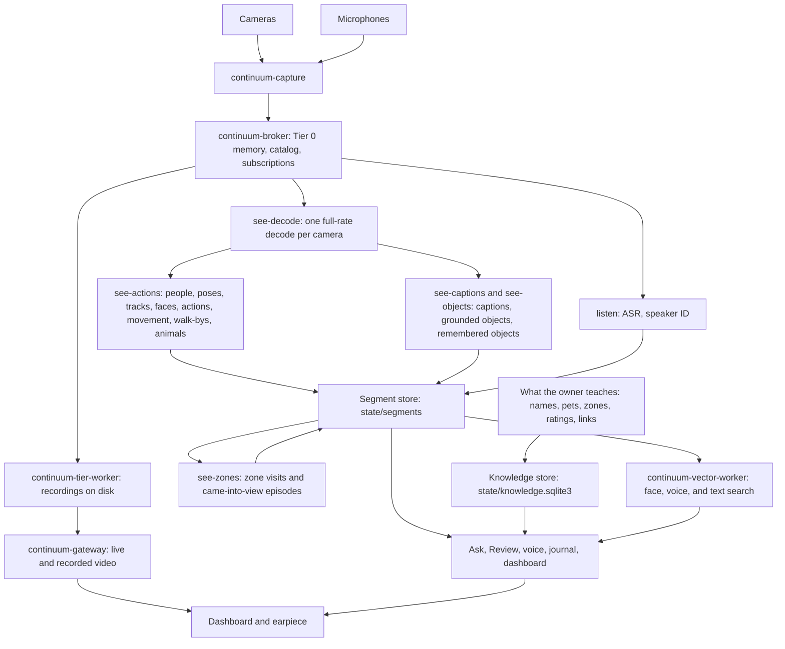
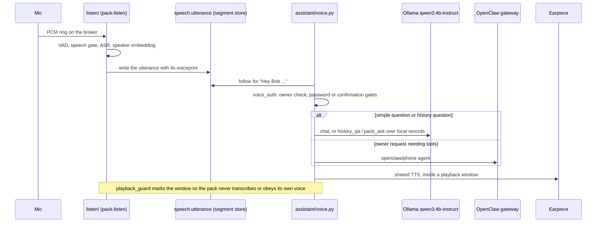

# Architecture

The Liberational Pack is a wearable ambient assistant. It listens all the time through one or more microphones, watches through a ring of cameras, keeps a local record of what was said and seen, learns who people are, and answers questions out loud through an earpiece or bone-conduction speaker. Everything that can run locally does: speech recognition, speech synthesis, captioning, speaker and face recognition, and the fast language model all run on the machine you carry. Cloud or hosted pieces are optional add-ons for bigger tasks. See [MANIFESTO.md](../MANIFESTO.md) for why.

This document covers the software. For the hardware (collar, bone conduction, mic array, cameras, and satellites), see the Hardware section of [ROADMAP.md](ROADMAP.md) and the parts list in [hardware/BOM.md](hardware/BOM.md).

This document describes the system as it exists on `main` today. Planned changes are marked as such and tracked in [ROADMAP.md](ROADMAP.md).

## System overview

Capture owns the devices and writes frames and audio into the broker's shared memory. The tier worker keeps the
recordings. Everything the system derives from them goes into the segment store, and everything the owner teaches
goes into the knowledge store. Readers (Ask, Review, the voice loop, the journal, and the dashboard) combine the
two, and the gateway streams video to the browser.

**One vision pipeline.** `see-decode` decodes each camera once, at full frame rate (on NVDEC for H.264 cameras), and
shares the pictures with every vision reader. `see-actions` is the person pipeline: on each configured camera it finds people, their
skeletons, and their tracks at the configured analysis rate, and from those tracks it derives faces (from each track's head),
actions (an ST-GCN++ model over the skeletons), movement, walk-bys, and animals. `see-captions` describes each view
in words and grounds its objects, and `see-objects` finds the objects the owner asked it to remember. `see-zones`
turns see-actions' tracks into zone visits and came-into-view episodes with plain geometry. Models handle perception; geometry handles counting lines, zones, and track boundaries.

**Honest answers.** Every derived stream that answers "how many" or "when" has a coverage stream saying what was
actually analyzed (`action.coverage`, `walkby.coverage`, `zone.coverage`, ...). A reader treats time no coverage
covers as unknown, never as nothing happening, and a model kind the owner hasn't checked by rating it is reported
as unverified.

[CONTINUUM.md](CONTINUUM.md) is the broker's design. [VISION-STREAMS.md](VISION-STREAMS.md) is the field reference
for the vision streams. Phone calls keep their own transcripts and media under `calls/`.

## Where data lives

| Store | Path | What's in it | Kept |
|---|---|---|---|
| Recordings | `state/continuum/tier/`, `tier2/` | Camera video and microphone audio, as chunk files the broker catalogs | Video for 30 days (the video window, below), audio indefinitely less silent audio past 30 days, both until a reset |
| Broker catalog | `state/continuum/catalog.redb` | Recording chunk metadata, the memory log (`journal.entry`, `journal.page`, `person.fact`, and Ask's history, `memory_log.py`), worker state rows, and subscriptions | Until a reset |
| Segment store | `state/segments/<stream>/<camera>/` | Everything derived from the recordings: see-actions' streams, captions, objects, zones, presence, speech, voice embeddings, network and Bluetooth sightings, and the Wi-Fi access points heard. Zstd-compressed Arrow IPC parts, one per stream, camera, and UTC hour (`continuum-segments`); the filesystem is the index, so any number of processes read and write with no shared database. Each stream's typed columns are declared once in `segment_log.py` | Until a reset; forgetting writes tombstones |
| Places | `state/places/<place>/` | Spatial memory's machine view of each indoor place (#2799, `memory/places.py`): a chain of revisions, each a `<revision>.json` written once (producer, source visits, the place's identifying signals, which map and plan it uses, the map's floor plane, the map-to-plan transform, and the fixed cameras registered in that frame), plus the `<revision>.map` point cloud (binary PLY; a fixed-camera snapshot is about 2 MB, and the fused map kept with it is about 0.4 MB) and `<revision>.plan` floorplan DSL (a few hundred bytes) it adds. A revision of fixed cameras can also have a 3D Gaussian splat beside it (#2877): `<revision>.gs.ply` (the 3DGS master, about 24 MB) and `<revision>.spz` (the 3D view's copy, about 4.4 MB), written once. Visits are the `place.visit` segment stream. The owner's names and plan corrections are in the knowledge store and supersede this view without changing it. The journal's day page reads a span's places and rooms through `places_for_span` (#2812): rooms are drawn area zones a person was in, until floorplan rooms can be placed; a zone on a fixed camera registered to a place (#2825) is filed under that place, which counts as observed (`PlaceRef.visited` False) unless the rig was there too, and the pages' Places line leaves observed-only places out | Plans and revision records until a reset; the newest 2 maps and the newest 2 revisions' splats per place. A reset deletes it all (machine-made, and the keyframes that could rebuild a map age out with the video window) |
| Knowledge store | `state/knowledge.sqlite3` | What the owner taught: the people registry, names and aliases, identity records, pet profiles and sighting labels, drawn zones, activity names and ratings, device links and where each device lives, remembered-object crops, taught voice vectors, the owner's place names and floorplan corrections (`place.named`, `place.plan`), and each fixed camera's held focal and lens (`camera.intrinsics`, #3289) | Preserved by `--keep-taught`; removed by `--fresh`; export/import supports transfer between installs |
| Applied privacy pauses | `state/continuum/capture_paused.json` | Which devices capture has stopped for privacy, and which are still stopping (`{"paused": [...], "stopping": [...]}`). The pause itself is `paused = true` in `config/devices.toml`, so it outlasts a reset | Rewritten by capture on a change |
| Vector index | `state/continuum/vector/` | LanceDB tables for face, voice, and journal search, rebuilt from their streams | Until a reset |
| Face gallery | `faces/db.npz`, `faces/learned.npz`, `faces/nots.npz`, `faces/<name>/` | Enrolled face embeddings, views learned from tracks (`learned.npz`, #3013), the owner's "not this person" faces (`nots.npz`, #3246), and photos | Preserved by `--keep-taught`; removed by `--fresh` |

Segment rows have no broker parents. A forget or a compaction rewrites a closed part (`-v<n>`) rather than editing
it. see-zones keeps a checkpoint holding each of its writers' next `row_seq` (`state/see-zones.json`, replaced by an
atomic rename), so a restart reopens its writers there and never repeats an output; see-actions keeps none, and a
restart starts new tracks.

**The video window.** `pack-video-window` (the `video-window` service, nightly) ages out camera video committed more
than `video_window.days` (30) days ago, as broker `AgeOut` purges. Everything derived from the video stays, and
Review says the footage expired. If free disk falls under 15%, it ages out the oldest kept hours early (never the
newest day). Its per-stream progress is `state/video_window.json`. One run condenses first (#2809, `retention.py`):
for each ended day past the window whose day page is written, it condenses dense coverage and device sightings into
`<stream>.condensed` companions (read together with their streams) and drops the per-frame rows. It then promotes the
moments the journal's day pages cite (a short clip, a still, and the caption, `state/journal_evidence/`,
memory/journal_evidence.py, #2808), so a cited moment outlives its video, and a citation degrades from the recording
to the clip to "footage expired" instead of vanishing. After that it ages out the camera video, then the audio chunks
no speech touches. Each finished day goes in `state/retention.json`. [STORAGE.md](STORAGE.md#retention) has what is
kept.

**The reset.** Machine-made data is expendable (AGENTS.md). `pack-reset-catalog --keep-taught` deletes the broker catalog, the
recordings, the segment store, the place maps and plans (`state/places/`), the vector index, and see-decode's frame cache, and keeps the knowledge store and the
face gallery. `--fresh` also removes owner-taught state, including face and voice references; it is a different,
explicitly destructive mode. After a keep-taught reset, listen writes the knowledge store's taught voice vectors back
into the segment store first, so named voices match again. [MIGRATING.md](../MIGRATING.md) has the steps.

## Service startup

The broker validates and opens the catalog, restores a valid clean-stop availability projection or rebuilds the
complete index, clears locations from the previous Tier 0 arena, and creates its new arena before serving clients.
A projection is accepted only at the same catalog incarnation and mutation revision, with a supported bounded
codec and intact checksum. Missing, stale, invalid, or ineligible checkpoints use the full catalog reconstruction.
Clean shutdown first closes the core sessions left after socket-task cancellation through the normal session cleanup path, then drains writes and stops maintenance. A transient Busy checkpoint fence is retried within the existing close deadline; permanent errors and ineligibility remain a full-rebuild fallback. The fence preserves exact durable copy counts,
stream metadata/names, cuts, and coverage. Old Tier 0 counts are excluded; its exact payload-ID index supplies
obsolete locator cleanup. A rate/kind change or unfinished purge/read/copy work prevents checkpoint publication; a running `FRAMES` sweep is dropped at the fence instead (#1789), and every refusal and every start-time rebuild logs its reason. Startup logs separate catalog
open/recovery and recording repair, payload reconstruction and index application, stale-location clearing,
purge/keeper reads, arena creation, and total startup. A partial index is never exposed. The synthetic-only
phase benchmark is documented in [CONTINUUM.md](CONTINUUM.md#nothing-stalls-the-broker); it accepts no existing catalog.

`services/services.toml` marks mandatory broker clients with `wait_for_broker = true`, and both launchd and systemd run `continuum_ready.py` before execing them. `wait_for_gpu` (the `ollama` and `see-actions` services) runs `python -m liberational.gpu_ready` before exec: it waits up to 15 minutes for `nvidia-smi -L` to list a GPU, then starts the service anyway, and a machine without `nvidia-smi` starts at once (#2964). Readiness requires an SDK handshake and a successful catalog request, with a 60-second total deadline and bounded backoff for transient socket, transport, arena initialization, and unavailable responses. Permission, schema, and other permanent errors fail immediately. A timeout logs an error and exits without starting the daemon; the service manager retains its normal failure and restart reporting. The wrapper replaces itself with the daemon, preserving its PID, arguments, signals, and exit status.

The broker itself, dashboard, and gateway are ungated, so diagnostics and recorded playback remain usable while the broker is offline. Device stream/ring readiness belongs to each consumer: listen already waits for capture's real ring, camera readers wait for their streams, and Tier discovers missing streams independently. This broker readiness boundary does not claim that every physical device is ready, and it must not make one absent device block unrelated services. Activity additionally waits up to 60 seconds for its producer streams to register, retrying only initial subscription NotFound responses. Once subscribed, runtime failures still propagate normally; shutdown cancels the startup wait. No new state file, port, or daemon is introduced.

`service_cascade.py` coordinates installed services when `pack-services install` or `restart` targets the broker or capture. It stops readers before capture and the broker, proves the old process identities have exited, then starts the broker, capture, and readers in that order. `continuum_ready.py` gates a new broker arena and fresh manifest camera frames and microphone PCM; `cascade_health.py` checks stable service and capture-worker identities and runs the applicable vision status checks. Each stage has a deadline within the bounded operation. Broker readiness can use the remaining cascade budget (600 seconds overall, with diagnostic recovery time reserved), including cold catalog/purge startup; individual SDK attempts remain bounded, and the standalone service pre-exec wrapper still waits at most 60 seconds. A missing configured device fails the operation with its name; an empty device manifest skips only the hardware gate.

Automatic cascades preserve intentionally stopped services. `pack-services restart --cascade`, a full install, and dashboard Repair explicitly start the selected set, reporting previously stopped services. A stopped required core service outside an automatic request must be started explicitly before the request can proceed. Dashboard and gateway remain available through the core restart and refresh last only when explicitly included. Dashboard Repair excludes its own process; Settings handles its dashboard reexec after the CLI returns. A failed readiness gate remains a failure even if diagnostic services recover. After any failure past the first stop, the cascade starts every service it stopped (broker and capture first, then readers, then diagnostics), one at a time where a batch fails, and reports each that won't start (#1387): launchd never reloads an unloaded job, while a loaded one that fails keeps retrying. After a failed stop it leaves the broker and capture as they are, since their old processes may still hold the devices. Service manager starts try every service before raising their failures together. Unit PATHs end with the system directories whatever the installing shell had (#1386).

## Optional service CPU profiles

The package startup hook checks `PACK_PROFILE` only; the default-off path loads no profiler or configuration.
Selected Python console services can run a finite Linux CPU-weighted all-thread stack sampler in
`service_profile.py`, bootstrapped by `profile_bootstrap.py`, without changing commands, PIDs, or signal handling.
Configured `paths.logs/profiles/` holds bounded, private, atomic JSON/collapsed snapshots, with no observed data,
arguments, locals, or source text. Native-only CPU and process/thread accounting gaps remain explicit.
`tools/profile_services.py` passively measures all services and descendants, including Rust services.
[PROFILING.md](PROFILING.md) defines controls, artifact contract, deployment, and statistical attribution limits.
No new daemon, port, config key, or durable application state is introduced.

## Shared camera decoding

`pack-see-decode` (`see/decoded_worker.py`, #1738) decodes each manifest camera once, at full frame rate, and shares
the pictures with every reader through `see/shared_frames.py:decoded_frames(camera, format="nv12" | "bgr", every_ns=)`.
Each reader asks for its rate, and the decoder runs that reader's `shared_frames.Schedule` before it downloads a
picture (#3218): every access unit still goes to NVDEC (the cameras' P pictures are all references), but a picture
no reader takes is never downloaded, copied, converted, or published, and each reader is sent only the pictures its
own schedule took (a reply's `skipped` counts the ones it passed over for other readers, so they aren't gaps). BGR
readers get at most one picture each half second of capture time. Each
yielded `DecodedFrame` carries the original source header (native frame id and capture time), the decoder epoch,
`gap_before` for any loss (cache lap, decoder reset, source epoch or size change, restart), and the color range and
matrix. H.264 cameras decode on NVDEC on `vision.shared_decode_gpu`, through FFmpeg's native H.264 parser and a CUDA
hardware context. This keeps ordinary B-frame reordering without the CUVID parser's extra display buffering
(which held 19 pictures on streams with incomplete VUI). Every output some reader takes is downloaded once as host
NV12, with its original timestamp and color signaling. Missing color signals stay unspecified, including incomplete VUI;
readers keep their existing explicit color fallback. CUDA format selection refuses a silent software fallback. An unavailable
CUDA device or failed decode is reported before selecting one shared software decoder per camera. MJPEG and UYVY cameras decode once
on the CPU and are converted to limited-range BT.601 NV12. A camera decodes only while a reader is attached, and only
the representations someone reads are produced: NV12 stays in sensor orientation, and BGR is upright and converted
once for all numpy readers. The handoff is host memory (four mmap slots per camera and format), not CUDA IPC; a GPU
reader uploads the NV12 itself. Slow readers skip overwritten slots and see a gap rather than stalling decode.
A picture discarded while the decoder discovers an unspecified reorder depth releases its pending source header
and marks a gap; it never accumulates until a reset. Hardware crop offsets are applied before publication.
B-frame reordering keeps native header identity through a bounded presentation-time map (CUDA's 100 ns packet clock is
checked for collisions). see-actions reads every configured camera this way. The existing vision workers read the cameras named by
`vision.shared_decode_cameras` (default `["*"]`: the H.264 cameras) through the hub instead of decoding them
themselves, and ask it for their own rate (`see/frames.py:newest`). Recording and the gateway read the original
encoded stream, independently of this service. A purge stops the service, which removes its cache files before
acknowledging; the supervisor restarts it with a new epoch.

Every local MJPEG camera is stored as H.264 unless `encoding = { enabled = false }` is in its `[device.video]` (or
`[video.encoding]` for every camera; other keys `gpu`, `cq` 0 to 51, default 36, and
`keyframe_interval_ms`, default 2000). Capture (`continuum-capture/src/encoding.rs`, built with the `ffmpeg` feature)
decodes each JPEG and publishes one immediate H.264 access unit (shape `H264AnnexB`) on the camera's usual
`<camera>.video` stream. It opens the hardware encoder, `h264_nvenc` on the configured CUDA GPU or `h264_videotoolbox`
on macOS (low-delay realtime, #1915), and falls back to low-delay `libx264` with a warning when that can't open or
fails at runtime, including returning other than one access unit per frame; it never stores MJPEG once encoding is
on. Frame ids are assigned at
publication; capture time, device sequence, epoch, size, flip, and duration stay the camera's. A keyframe starts
every `keyframe_interval_ms` of capture time and after any break (a dropped frame, a new epoch, arena pressure), so
the tier worker closes chunks on independently decodable boundaries. A stream already registered as MJPEG keeps its
identity, so an existing camera switches at a catalog reset (see [MIGRATING.md](../MIGRATING.md)).

## Shared archive maintenance

Old video leaves through the video window (`pack-video-window`, `video_window.days`): it ages out `*.video` chunks
committed more than that many days ago, and Review says the footage expired there. The Tier worker doesn't shrink
or re-encode old media for retention; a microphone's chunk becomes Opus once, as it closes. With the opt-in AV1
archive on (`video_archive.av1`, off by default; docs/STORAGE.md, "AV1 archive"), it re-encodes each camera chunk to
AV1 once, a day after recording, in place. The installed Tier command uses the
opt-in `fresh_config` service launcher: after broker readiness, `python -m liberational.services exec
continuum-tier-worker` reads the current central config, expands the worker's declared arguments, and replaces
itself with the Rust worker, so an ordinary restart applies settings edits without rendering new units. The
service's templated environment (the AV1 archive's settings) is filled in again at the same moment.

## Owner knowledge

`knowledge.py` stores what the owner taught in `paths.state/knowledge.sqlite3`, outside the broker's `continuum/`
directory, so it survives a `--keep-taught` catalog reset and stays readable while the broker is down. Person ids, names, aliases,
merges, role and contact attributes, identity assertions, remembered-object events, and spoken measurements go
through `knowledge_eventlog.py` and the domain event-log port. Owner records are collections beside them: the
identity worker's proposals (`identity.record`), pet profiles and sighting labels, drawn zones, activity names and
ratings, device links and locations, remembered-object crops, taught voice vectors, and forgotten-name hashes.

Each cached knowledge Store reuses a connection per calling thread. Nested operations share a transaction;
transactions never span an `await`. Bulk owner writes use a worker-local registry projection, so the shared
registry lock does not cover file syncs or SQLite commits. A failed transaction discards that worker projection.
Identity generations include physical file identity, database incarnation, and identity erasures; a revision
rewind resets the projection. Unrelated reference writes do not replay identity streams. Voiceprint membership is cached until its owner assertions, names, or forget state change.

Owner transcript corrections also live in this store (`transcript.correction`, `listen/revisions.py`).
`POST /transcript/reject` records one atomic batch of exact line keys for the visible turn, with a durable
`POST /transcript/undo` token. Raw speech rows and audio remain intact. Ordinary transcript and history readers
hide rejected lines, voice references exclude their confirmations, and correction revisions invalidate cached
encounters, generated clone references, and derived journal/summary evidence until rebuilt from current inputs.
Undo restores the batch without overwriting a separate later rejection. Live resends its transcript snapshot
when a correction changes; no new state file, service, port, or setting is introduced.

Immutable record IDs have exact-content retry semantics. A conflicting ID fails; an erased ID cannot be reused.
Occurrence and recording times are distinct integer nanosecond columns. Indexes cover ID, collection/time,
collection/logical key, subject membership, and commit position. Content, subject memberships, deletions, audit
counts, and the monotonic change feed commit together. Selector purges select and erase under one write lock.
Registry projections replay new positions and observe cross-process change revisions. Consumer acknowledgments
never move back, and deletion does not reuse positions.

The store uses thread-local connections, short transactions, and FULL synchronization. It journals in WAL (readers
never block the writer) when Python's SQLite is 3.51.3 or newer, and keeps rollback journaling on older SQLite,
which has the WAL-reset defect; each store logs the mode and SQLite version it opened with. A lock another process
holds is waited out: a 30 s busy timeout, then retries with backoff for up to 5 minutes on an open or a BEGIN, so a
slow peer delays a service instead of stopping it (#2898). A COMMIT waits at most 60 s, because in rollback journaling
a writer waiting to commit keeps new readers out, and a dashboard request waits at most 10 s in all
(`knowledge.lock_wait`), answering with an error rather than queueing. Each committed write checkpoints the WAL into
the file and truncates it (waiting at most 1 s for readers, else the next write does it), so erased content does not
linger in the WAL and a WAL left beside a replaced file has nothing to replay onto it. A WAL store keeps
`knowledge.sqlite3-wal` and `-shm` beside it, so copies and resets take `knowledge.sqlite3*`; a process whose SQLite predates 3.51.3 refuses a
WAL store rather than open it, which matters for a machine whose Python bundles an older SQLite. A missing fresh-install
file initializes an empty store; a corrupt or incompatible file fails explicitly. No broker headers, stream
registration, native subscription, model, daemon, or port are introduced. Forgotten-name hashes occupy a separate
collection without person subjects, so a person's event purge cannot erase their suppression record.

Voice tagging runs on one serialized background thread. A request loads its transcript rows and filed vectors
once, prepares and syncs segment copies once, then commits its owner claims and confirmed references together.
Prepared rows for a new person carry voiceprint and utterance provenance; committed claims supply their person.
Failed batches remain queued with bounded retry, and replay reuses deterministic prepared rows. The gallery
caches calibration per reference/identity generation, rebuilds off the audio loop, and cannot name a person from
a dirty or revoked generation. The UI coalesces burst refreshes and delayed tag followups per query client.

Voice identification treats ordinary `voice.embedding` rows as observations. Only an individual OWNER_TAG/CORRECTION about an utterance, or nonoverlapping windows from an explicitly enrolled recording, can enter `voice.reference` in the knowledge store. Naming a voice cluster (Who's this?, People's assign, or That voice is mine) does not confirm all its lines: it confirms at most three, the clip Who's this? offered for it and then its most typical lines of a second or more and two words or more (`voices.teaching_lines`, #3247), and its undo releases them. Labeling one line as a person (Lines to check, a card's voice line, Live's line label) confirms that line. Listen, ingest, and synchronous phone lookups share one gate set on this home's room audio (#3248, `listen/voices.py` "Matching" has the measurements): three distinct confirmations, a core of confirmed lines of 2 s or more that agree with another confirmation at 0.5 (short or stray answers are left out of it rather than disabling the person), a line named by its nearest core reference at a cosine floor of 0.5, a 0.15 margin over other people and over the person's own negatives, and 0.05 over the nearest unnamed voice. The owner taking a line from someone (a card's "Not <name>", or labeling it as somebody else) keeps its embedding as that person's negative (`voice.not` in the knowledge store, #3258), released by the undo; it raises their threshold and a line must clear it. Overlapping reference sets disable automatic person assignment. Reference writes happen only at explicit confirmation/enrollment actions, with deterministic IDs for line-confirmation retries. One recording counts as one confirmed source, regardless of its windows. New utterance confirmations invalidate the gallery cache; corrections, forgetting, and replaced enrollments invalidate their references. Old imported vectors without individual confirmation provenance cannot teach; the model cutover discards CAM++ vectors and re-teaches voices in the new 192-dimensional space. Live and Review offer manual turn naming, and Settings records an explicit voice reference. Turn naming confirms only lines agreeing with its voice majority; queued requests remain pending. Turn-header Trash rejects the turn's transcription with durable Undo; the separate per-line unlabel action only removes a speaker assignment. Transcript-built clone audio uses only individually confirmed lines, with no neighboring padding, and caches carry `reference_policy=confirmed-lines-v1`; older transcript caches are not offered. Explicit recorded/picked references and the owner's original recording remain usable unless their selected transcript inputs are rejected. No new service, port, setting, or state file is introduced.

`knowledge_cli.py` (`pack-knowledge`) moves what the owner taught between installs. `export --source sqlite` reads
`knowledge.sqlite3` plus an allowlist of taught files (`knowledge_attachments.py`) and writes a versioned ZIP of
records and SHA256 blobs (`knowledge_backup.py`), printing how many records of each collection and files of each
folder it wrote. `verify` checks a bundle, and `import` validates all of it, then restores it in one transaction.
Exact duplicates are idempotent, conflicting IDs fail, and erased IDs stay erased. Import then puts each taught file
back at its home under `paths.state`, `paths.faces`, and `owner.voice_ref` where nothing is there yet, and names any
it found a different file at instead of overwriting it; `pack.toml` and `devices.toml` stay in the bundle.

What crosses: every knowledge-store collection (an export refuses a store holding a collection it doesn't list,
naming each, #3262): people and identity events, names, voice and face references and the owner's voice and face
negatives (`voice.not`, `face.not`), pets (profiles, labels, references, and `pet.not`), transcript corrections (the
owner's, not the audio tagger's TV marks), activities (names, feedback, and the owner's kinds, `activity.kind`),
zones, place names and plans (the joined place's plan and rooms are a `place.plan`), device links and locations, Object crops,
forgotten-name suppressions, and the journal and Ask records kept there. And the taught files: voiceprints and
enrollments, card preferences, People undo, contacts, added people, voice clones, confirmed person references (whose
photos also teach a face, #3255), the face gallery's owner rows and negatives (`faces/db.npz`, `faces/nots.npz`), the
owner's voice sample, and the settings. What doesn't: rows the face matcher learned from tracks (`faces/learned.npz`),
unknown face groups, place revisions, maps, and splats under `state/places/`, and everything else machine-made. Hand-made
measurements (`paths.measurement`) and model weights are kept by hand, not by the bundle.
The export from the old broker streams that the #1755 reset used is gone (#1926): every install has reset since. A
`--keep-taught` reset must not remove the knowledge database, and explicit forgetting remains different from ordinary
recording retention.

## see-actions: the vision pipeline

`pack-see-actions` (`see/actions_worker.py`) follows each camera's decoded frames from see-decode and runs
`see/actions.py`'s `ActionPipeline` on this machine's vision backend (`see/vision_backend.py`; `--backend` picks one,
`auto` by default: CUDA when available, with the models as CUDA graphs; on an Apple Silicon Mac, the models on ONNX
Runtime's Core ML provider and the rest in torch on MPS; the CPU only when asked for by name, #1879). Each
frame goes through one RF-DETR Small pass (`see/gpu_pose.py`) for people and COCO animals, a ByteTrack-style tracker
(`vision/crossings.py`'s `Tracker`), and RTMPose for each tracked person's 26 halpe26 joints. On a camera whose
`config/devices.toml` entry has a `fisheye` calibration (`tools/calibrate_fisheye.py`), each person is first
resampled into a virtual pinhole view aimed at them (`see/fisheye.py`, #1891), and their joints map back to fisheye
pixels; `People.view_joints` keeps them in the view, for the action model. From there:

RF-DETR Small uses a fixed 512x512 RGB input with ImageNet normalization, raw normalized boxes, and 91 sparse
COCO logits. Both the ONNX reference (`vision/crossings.py`) and GPU path rank sigmoid query/class scores
globally (top 300), then map person slot 1 to internal ID 0 and animal slots 16..25 to internal IDs 14..23.
There is no YOLOX letterbox/grid/objectness decode and no NMS; overlap alone must not discard adjacent people.
The deployed person floor is 0.60; animal candidates retain 0.35 before their separate verifier. The tracker and
six confident COCO joints above 0.5 still decide person births; the detector floor also bounds continuation input.

The pinned Apache-2.0 ONNX conversion is [Deeds67/rfdetr-small](https://huggingface.co/Deeds67/rfdetr-small/tree/eb76679daa78e76b4b9ef358ef18bed7b65e383a),
SHA256 `31fe724f8d5dbff5d09eb4c2c44d2d4083c086c167aec54e11e694e652307f9b`. It is an unofficial conversion of
[Roboflow's Small checkpoint](https://huggingface.co/Roboflow/rf-detr-small), whose code and weights are Apache-2.0.
A real-frame CPU comparison against official revision `3bdc465063270f99769da5a1b4c00c68bd2d439d` loaded without
missing/unexpected weights and differed by at most 0.000164 in boxes and 0.000865 in logits. ONNX Runtime's named
`dets` and `labels` outputs are validated rather than interpreted by position.

On the retained 50-still diagnostic cohort (#2189, separate from the deleted 278-frame #2025 cohort), primary
matching uses 44 frames/37 visible people at IoU 0.5. YOLOX-m at score 0.5 found 33 with two unmatched predictions;
RF-DETR at 0.60 found 33 with seven. The full pose/birth gate rejected all false births on 18 definite-empty frames:
YOLOX produced 32 static births over all 50 and RF-DETR 31. These are purposeful stills with uncertain/truncated
labels excluded from primary matching, not general recall, animal accuracy, or temporal tracking measurements.
A bounded GPU0 saved-cam0 replay of 90 frames per model stayed within 33.3 ms: RF-DETR plus RTMPose median 11.65 ms,
p95 21.01 ms, with a 1496 MiB process peak; YOLOX plus RTMPose median 11.34 ms, p95 19.70 ms, 1492 MiB peak.
These bounded replay timings do not establish live throughput under the full shared workload.

- **Skeletons and coverage.** Every tracked person's joints are a `pose.track` row. `action.coverage` spans the frames
  analyzed, so a stretch without it is unknown.
- **Actions.** Each track's recent skeleton window is scored by ST-GCN++ with stock NTU RGB+D 120 weights
  (`see/stgcn.py`, `see/action_classes.py`) about twice a second. The top five classes of each window are an
  `action.window` row. A kind (sit_down, stand_up, pick_up, put_down, fall, drink, eat, phone_call, or phone_use) held
  at the threshold over consecutive windows becomes one `action.span`. MoViNet-A2 (`see/action_clips.py`),
  when available on the backend, also scores person crops for `read`, `watch_tv`, `phone_use`, and `sleep`.
  Its windows use Kinetics-600 class indices, distinguished by the `model` field.
- **Faces.** `see/head_faces.py` looks at each confirmed track's head about once a second, finds and embeds the face,
  and names the mean of the track's looks so far against the gallery (`faces/db.npz`, and `faces/learned.npz` when it
  has rows; a name only the learned rows give also needs similarity 0.55, #3028), so the pose track is the identity
  over time. When the track ends, and `faces.learn` is on (off by default, #3013), a track the owner's rows alone
  name confidently can add up to two of its views to `learned.npz`, at most 16 learned views a person. A view within
  0.05 of someone else's rows, or of an unnamed group's representative, is passed over (#3044). A look needs
  nose confidence of at least 0.4 and, when available, raw AdaFace norm of at
  least 10 (`see/faces.py:readable`). Rejected looks write `face.signal` only, without changing the track
  identity, learning a group, or saving a photo. A kept look that shows the side or back of a head (landmark
  frontalness under 0.1 and AdaFace norm under 18, `see/head_faces.py:shows_face`, #3155) still feeds the track's
  name, but never starts or joins an unnamed group and is never learned. An unnamed group is made from the mean of
  the face looks that matched no one, and only after 3 of them (#3001). Naming requires cosine 0.45 and a 0.10 lead over the second
  person. A name is also held back when the look doesn't beat that person's nearest negative by the same 0.10
  (`faces/nots.npz`, #3246): the faces the owner said aren't them, from Who's this? "Not <guess>" on a face group (its
  representative) and a card's "Not <name>" on a shot, video, or track (each face), at most 32 a person, undone with
  the answer. Nobody is named while the saved held-out check (`faces/check.json`, below) is off. It writes `face.match`, `face.visit`, and `face.embedding`, plus the Live tab's `face.boxes` ring.
  SCRFD supplies the box and five alignment landmarks; the pinned CVLFace AdaFace IR50 WebFace4M RGB model supplies
  the 512-dimensional recognition vector. Both ONNX files live under `paths.models` and use CUDA, CoreML, or CPU.
  `tools/export_adaface.py` exports the SHA-checked official checkpoint to RGB 112px ONNX on CPU; runtime loading
  never downloads or exports models. Its code is MIT, while the pretrained model card separately requires following
  the training-dataset license. Personal use was approved for this cutover; other operators must review those terms.
  AdaFace and the previous ArcFace vectors are incompatible, including enrolled references of the same dimension.
  The vector worker follows `face.embedding` into `embedding/adaface/ir50_webface4m_rgb`, separate from the retired
  ArcFace namespace. Resetting face-group numbering also requires retiring old `face-group:N` identity assertions;
  otherwise those assertions would name new unknown groups that reuse a number.
- **Movement and walk-bys.** `see/action_movement.py` samples the tracks about every 0.2 s into `see/tracks.py`'s
  `MovementPipeline` (`movement.track`, `movement.coverage`) and, through the counting-line check
  (`vision/crossings.py`'s `crossings_of`) and `see/walk_bys.py`'s chain rules, into `walkby.span` and
  `walkby.coverage`. Camera motion comes from the backend's GPU shift estimate: a walk-by while the camera moved
  says so (`camera_moved`) and isn't counted.
- **Animals.** `see/action_animals.py` drops animal boxes inside a person's head, tracks each species, confirms a
  track with the backend's SigLIP 2 image check, and embeds confirmed boxes on a cadence (`animal.detection`,
  `animal.embedding`, `animal.coverage`). People's Pets section groups the embeddings by appearance for the owner to
  label, and `people/pet_recognition.py` names a new sighting only for a species whose labels pass a held-out check.
  Listing, labeling, photos, and recognition read only `animal.embedding` rows of the current model and crop; a row
  from another space, including the square crop from before #3024, is not a sighting (#3042).
  Verification uses independent sigmoid scores: the candidate species must clear a minimum score and beat the
  strongest alternative species, person, or household-background prompt. The model's processor defines the crop
  preprocessing; the verifier does not reuse CLIP's softmax or image normalization.
  Pet appearance uses the configured DINO model's CLS output, normalized to a unit 384-vector; register and patch
  tokens are not pooled into that vector. The checkpoint's processor owns RGB resize and normalization. DINOv3
  ViT-S/16 is the default, pinned to the declared HF revision. DINOv3's custom
  license and gated download require operator acceptance and HF authentication. DINOv2 vectors,
  including taught `pet.reference` vectors, cannot be compared with the new space despite their equal dimension.

Track ids are see-actions' own, unique across restarts, and every reader joins on them as strings: zone visits,
face matches, and action windows name the same tracks. A restart or a decode gap starts new tracks, ends open ones
censored, and breaks coverage, so nothing bridges frames that were never seen. Field references are in
[VISION-STREAMS.md](VISION-STREAMS.md).

## People shown on screens

`see/screens.py` filters person tracks using RF-DETR's TV/laptop boxes and owner-drawn zones of kind `screen`.
A new track is classified as screen content when at least 80% of its box is inside a screen and its box is at most
half the detected screen's area. Drawn screen polygons use the containment test without the area-ratio limit.
A screen track is excluded from faces, photos, groups, actions, pose rows, Live overlays, movement, and crossings.
Once its box leaves the screen test, it is released permanently for that track; a real track that later overlaps
a screen stays real. Recordings retain the original pixels. This is a visual geometry filter, not audio tagging.

Settings' zone editor exposes **A screen**. Screen zones persist with the owner's zone definitions and are excluded
from ordinary zone-visit counts. Existing stored observations are not reclassified by this live filter. `see/screens.py` also tracks moving pictures inside drawn `screen` zones (`ScreenActivity`) and writes `state/screens_on.json`. In `pack-identity`, `listen/media_tag.py` combines that file, `[models.audio_tagger]` (EfficientAT `mn10_as`), and household voiceprints to mark broadcast lines as media (`source: "classifier"`) on `transcript.correction`, which the owner can override with `POST /transcript/media`, `POST /voices/unknown/media`, and `POST /transcript/not-media`.

## Captions and objects

`pack-see-captions` (`see/caption_worker.py`, `see/captions.py`) describes each camera's view with the vision
language model when the change gate says the view changed (`camera.caption`), and grounds notable objects
(`camera.objects`) on a view's first look, right after a caption the view's movement asked for (at most every 30 s),
and otherwise every 5 minutes: grounding is the VLM's costliest call, so a still view isn't re-grounded (#1935). A network camera waits `vision.network_caption_every_s` between captions; a repeat of an
unchanged view is marked as one. `observation.status` tells a fresh grounding from a cached publication, a failed
attempt, and unevaluated grounding, and an empty array is evidence only when it is a fresh grounding.
Both streams are segment rows, and the gateway draws
`camera.objects` over Live and Review.

`pack-see-objects` (`see/object_worker.py`, `memory/objects.py`) finds the objects the owner outlined on Live or the
Objects page (EdgeTAM masks, kept with their templates in the knowledge store) in each camera's newest frame every 5 s,
by SIFT and RANSAC confirmed in two frames, and writes `object.match` rows with a small inline JPEG.

## Zones and came-into-view

`pack-see-zones` (`see/zones_worker.py`) follows see-actions' analyzed frames (`see/tracked_frames.py`: `pose.track`
rows over `action.coverage`, with an empty frame where coverage says nobody was tracked). For each owner-drawn zone
(`zone.defined` in the knowledge store, drawn in Settings, Cameras) it writes unconfirmed `zone.visit` rows (a track's
foot anchor inside the polygon: entry, last inside frame, dwell, how it ended) and `zone.coverage`. It also writes
`presence.span` episodes (`memory/presence_episodes.py`): an episode starts at the first analyzed frame with anyone
tracked and ends once nobody was seen for `presence.absence_s` (10 s); a gap longer than `presence.gap_s` (30 s)
censors it. An episode means at least one person was tracked: its start estimates when someone came into view, never
a physical entry, a headcount, or who. Its checkpoint is `state/see-zones.json`. No model is involved.

`memory/zone_counts.py` answers count questions naming a zone ("how many times did someone use the bathroom
tonight"): visits of at least 10 s that entered in the window, split tracks within 30 s joined, over the zone's
coverage. `memory/presence_counts.py` answers came-into-view counts and Review's per-camera chips
from `presence.span` over `action.coverage`.

## Activities in Ask and Review

`memory/events.py` reads activity spans (`walkby.span` and `action.span`) and the owner's names and Right/Wrong
ratings on them (`activity.named` and `activity.feedback` in the knowledge store, keyed by span, with the span's
kind, camera, and stream). Review lists every span for naming and rating. A kind counts once its ratings pass
`activity.promotion_min_ratings` and `activity.promotion_min_precision`, per camera once a camera has enough of its
own; a Wrong span never counts. Walk-bys count until ratings say otherwise.

The activities themselves are the owner's list (`memory/activity_kinds.py`, #3244), not a fixed one: `activity.kind`
records in the knowledge store, the latest per kind winning, with the starting kinds (walk-bys and the model kinds
from before) until the owner first changes it. Each activity is read from model classes, NTU-120 for ST-GCN++ and
Kinetics-600 for MoViNet: those its name and description matched when it was added, plus those it learned from the
answers (a class that tops enough of its Yes clips, or of clips called by its name, and few of its No clips; each
answer keeps the clip's top classes for this). see-actions rereads the list each minute (`activity_kinds.Live`). A
deleted activity is a tombstone: it stops being scored, its spans and answers leave every read here, and a restore
brings them back.

- **Counts** (`memory/event_counts.py`): "how many times did I sit down" names a model kind in plain words and counts
  its spans against `action.coverage` (walk-bys against `walkby.coverage`). A kind not yet checked by ratings isn't
  counted: the answer says how many Right ratings it still needs and lists what the model flagged, as unverified.
- **When and what** (`memory/activity_questions.py`): "when did I sit down" lists a kind's span times, unverified
  until checked; "what was I doing at 3" or "what did Sam do in the kitchen" gives the model's most frequent top
  classes from `action.window`, as guesses, kept to the zone's visiting tracks and the person's face-matched tracks.
  What the model can't detect (stillness, repeated movement) says so plainly.

Time no coverage covers is unknown, never zero, and naming a span never proves the detector right.

## Pets

People's Pets section keeps owner-named pets (`people/pets.py`: `pet.profile` in the knowledge store, each with a
stable id separate from person ids) and the owner's labels of animal sightings (`pet.sighting`, keyed by track).
Listing, labeling, photos, and recognition read only embeddings of the current model and crop (#3042).
Unlabeled sightings are offered for labeling for `pets.label_days` (14). Ask answers "how many times did the cat use
the litter box" from zone visits (`memory/zone_counts.py`), attributing a track to a pet when the owner labeled it,
when recognition by appearance is on for its species, or, for the only named pet of a species, as "probably".
Questions about what an animal has been doing, with no zone, answer that animal tracking was removed.

## Person lookup and reference media

A face crop (`/faces/shot/<id>.jpg`, `people/face_shots.py`) is written by see-actions with its `face.match` row,
from the frame it already has, under `state/shots/`, so People's grids read files (#2018). Each file's name carries the
segment store's deletion revision it was checked under: one of the current revision is served without a lookup, with a
day's cache. After a forget moves the revision, a crop is served again only once its row is found. A row without a crop
(older ones) has it cut from its recorded frame, at most two at once at low priority; a request that waits more than a
second for its turn gets a 503 with Retry-After, so a grid can't hold every connection the page has (People's grids
try such a crop twice more). `python -m liberational.people.face_shots backfill` cuts the missing crops of the
retained sightings once, a camera at a time at a set rate. Pets' sighting photos work the same way (`people/pet_shots.py`, `state/pet_shots/`):
see-actions and see-captions save a track's crop when they embed its largest box yet, `/pets/sightings/photo` serves it
with no lookup and cuts one from video only for a track without one (the same turns and 503), and
`python -m liberational.people.pet_shots backfill` fills in the rest. A crop whose row is gone
returns 404 and loses its file. The folder keeps 30 days (the video's retention) and stays under 1.5 GB.

People and Voice clones share a process-local cache of retained speech rows, invalidated by the speech commit and purge mark. A cache fill drains one explicit time window through the request time, including histories larger than a single broker page. Each request builds a fresh identity view and reuses it for its roster, playable audio, clip counts, and clone references, so identity corrections remain visible without waiting for new speech. The cache holds raw rows only and adds no persistent state. Startup warm-up begins once the dashboard serving loop is ready, on a daemon thread at low priority. It passes the existing bounded voice admission gate before each stage: microphone status, scene, cameras, roster, clone candidates, voice groups, bounded raw inbox history, then face groups last so their short refresh interval starts near completion. Group readiness requires a successfully published snapshot for the current owner, with one retry for an owner change during warming; a returned 200 alone is insufficient. `/health.people_warmup` reports the current stage and done or incomplete result without starting a read. Success is logged at INFO; failures are summarized in one warning and do not stop startup or the remaining stages. Normal face counts and centroid updates are data changes, rather than owner invalidations; membership, identity corrections, and skips still invalidate immediately. Warm-up prepares imports and reader state, never builds a model or freezes live device/scene data. Later requests continue reading current state, and later broker failures or owner changes can require new work. Concurrent People requests share matching in-flight work only, while identity/configuration changes take a fresh read. Face/voice group caches coalesce matching cold reads, keep owner corrections immediate, and retry failed reads. The two HTTP group routes admit a cold read before sampling any owner/data keys and return `202` with `pending: true` and `count: null` while a single background reader warms the view. Clients poll and show loading, never zero or actionable live-only rows before skips are known. The internal warm-up still blocks and verifies publication; errors remain actionable. Published views retain their normal immediate owner/purge validation. No resolved names or group response are persisted. The dashboard delegates full face-group computation to one
spawned process (`_unknown_groups_worked_out`), with a 300-second timeout. Immediate owner corrections stay in
the dashboard cache. A failed or timed-out process is replaced on a later refresh; it is not a separate service.

Full face-group and voice-group recomputations, and the People list's full read (`_people_view_worked_out`), each
run in a separate, long-lived spawned process at low CPU priority. The dashboard enables them before warm-up; importers and tests read in-process by default. The workers
reread settings for each job, while response publication, owner-edit patches, and purge validation remain in the
dashboard. A worker that dies or exceeds the five-minute read deadline is terminated and replaced on the next
refresh, with the normal unavailable response for the failed read. These are dashboard child processes, with no
new daemon, port, or state file. The dashboard and each of its worker processes (these, Reports' days, and Review's
day history in `dashboard/presence.py`) return freed memory to the system every minute (`memtrim.py`, glibc's
`malloc_trim`): glibc otherwise keeps a process at its peak, and decoding frames for face photos grew the People list
worker past 1.6 GB. Review's day history worker also keeps today's ended hours of records on purpose
(`segment_log.keep_hours`, at most `MAX_HOURS`, dropped when the day turns): about 1.1 GB by late afternoon on devbox.

People's unnamed-face picker and its face groups read `face.match` from the segment store over a rolling month,
with a fresh identity view on every request, so corrections show at once.

People → New person offers integrated general-web search through `people/name_lookup.py`: Google Custom Search when `GOOGLE_CSE_API_KEY` and `GOOGLE_CSE_CX` are configured in the dashboard service environment or dedicated gitignored `.env.search` at the pack root (KEY=value, mode 0600), otherwise Brave Web Search with `BRAVE_API_KEY`. Provider names are displayed honestly. Google Gemini grounding credentials are not Custom Search credentials; they are not repurposed. Only explicitly entered name/context is sent, never media, stored notes, or agent configuration. One bounded API request returns up to ten pages with original title, snippet, and URL; canonical page URLs deduplicate results and matching context tokens rank snippets, without requiring every word to appear. Provider query includes role/company/location context. Pages are evidence, not verified person identities: preview retains the user-entered name rather than inventing a name from a page title, and saving remains explicit. Wikidata is a supplementary external link (its grounded record helper remains available), never a membership requirement. Missing credentials, quota, malformed responses, and network errors leave manual addition available; no generated fallback or CAPTCHA bypass. HTTP redirects are refused, response bytes/time bounded, and exception strings cannot leak credential-bearing URLs. No new config schema keys or dependencies are required; deployment needs a frontend build and dashboard-only restart. Environment overrides `.env.search`; this file allowlists only the three search settings and survives service regeneration. No service plist edits are needed.

`people/references.py` owns reference attachments; `dashboard/server.py` exposes upload, direct-URL import, preview, attach, list, and removal routes. The People card has file/drop and URL inputs with explicit target confirmation. **A single-face photo teaches**: attaching a photo with exactly one face adds that face as one of the person's owner face rows (`faces.enroll_reference` in a `pack-faces reference` child process, at most 64 a person, the same photo again adds nothing), recorded as `face` in its `meta.json`, and Remove reference takes the row back (#3245, which reverses #622's reference-only rule for these photos). Group photos, audio, and video are not enrollment: no face/voice model, recognition gallery, or cloning reference is modified. Existing “Pick what's theirs” remains the reviewed face/voice evidence workflow. Multi-person uploads are never auto-enrolled.

State contract: `paths.state/person_references/<random-id>/meta.json` plus normalized `media.jpg`, `media.wav`, or `media.mp4`. Metadata keeps the target name, source, original SHA-256, decoded type/duration, creation time, and `enrollment` (`face` for a photo that added a face row, else `reference only`, with `face` saying what attaching it did). Names follow dashboard rename/merge; deleting a person parks their reference folders under `data/premove/person_references/`. Individual Remove reference deletes that attachment. Unattached previews expire after one hour and are cleaned on the next upload. No arbitrary server pathname is accepted.

Uploads are bounded to 20 MB, images to 20 megapixels, audio/video to 120 seconds, and two concurrent decoders. Pillow and ffprobe/ffmpeg inspect actual bytes locally, using binary-container demuxers (never playlists). URL imports accept only direct HTTP(S) media on standard ports: all DNS answers must be globally routable, connections pin the checked address, TLS verifies the original host, and every redirect is refused. DNS, connect/read, total download, probe, and decode have deadlines. Web pages, redirect links, and unsupported media return actionable errors rather than pretending to import. Cancelling disconnects the browser; an already-started bounded decode may finish as an unattached expiring preview.

Deployment needs only a frontend build and dashboard restart; no new setting, service, model, or dependency. Roll back the scoped code change and rebuild/restart only the dashboard; retain reference folders as user data.

## The voice turn

The always-on voice loop splits the work across `pack-listen` and `assistant/voice.py` (`pack-voice`) as above. The voice service uses `speech/tts.py` for both silent startup warmup and replies: missing or unreadable owner references use Kokoro, and a newly recorded reference resumes cloning without restarting. A clean state never synthesizes or restores an enrollment reference.

On Linux, `Speaker.speak` hands synthesized chunks to `speech/voice_clone.py`'s bounded playback queue rather than
waiting for synthesis of the entire reply. Generation stays on the caller's thread; one writer owns a fresh output
stream for the reply, with at most four chunks queued. Playback exclusion covers writes and the final device drain.
Writer failures stop the producer instead of leaving it blocked on a full queue. macOS retains the fresh `afplay`
path, which resolves the current output device per reply and still buffers the complete synthesized audio. Both
paths keep generation on the caller's model thread. History speech may start from a completed and validated
`short_answer` field while the explanation is still being generated; no incomplete history JSON is spoken.

Ask's optional spoken-history callback preserves its bounded worker subprocess. The worker atomically publishes
one short-result event in a private temporary directory; the caller watches it on the TTS thread, while a separate
watchdog enforces the worker deadline even during playback. Private output/error files prevent pipe backpressure
while speech runs, and the child is killed and waited for before those files are removed. The early event carries
known coverage/truncation flags, and the caller adds any pronoun-resolution note before applying the normal spoken
caveats. The first top-level field must be a complete valid short answer, and its rendered sentence is committed:
final validation or a format retry cannot silently change it. A final-only answer remains the fallback when no
eligible field arrives. Once speech starts, the completed answer contributes only the remaining explanation;
failures report that the explanation could not finish, rather than repeating or contradicting the spoken short.

Background model calls yield to the broker's Listening, Thinking, and Speaking interval through
`voice_turn.wait_quiet()`. Welcome supplies the initial turn and the SDK reader tracks updates without consuming
worker events. The `voice.background_max_wait_s` cap (30 seconds) and fail-open behavior without a broker keep a
failed voice service from starving background work. Shared model helpers gate by default; foreground Ask/history,
recall, voice, Live, and bridge paths explicitly bypass that wait. Journal embeddings yield before generation;
the Rust vector worker indexes supplied vectors and performs no model inference. No new state file, port, or daemon
is introduced. See [CONTINUUM.md](CONTINUUM.md) for the admission and already-submitted-request boundaries.

## Deterministic history measurements

Came-into-view counts and walk-bys are covered under "Zones and came-into-view" and "Activities in Ask and Review".
The rest of history answers are deterministic too:

`intervals.py` supplies pure temporal grouping for Review chips, recorded face
visits, timeline encounters, and caption episodes. Callers retain their ordering,
identity/camera partitions, evidence, and aggregation. Chip spans and encounters
keep the maximum end; caption episodes keep the last supplied timestamp and stop
at negative or unknown rows. Visit rebuilds aggregate equal-timestamp SQL peers
before grouping, preserving their sample counts and nullable similarity scores.
Each caller has its own configured gap: `dashboard.person_gap_s`,
`dashboard.object_gap_s`, and `timeline.gap_s` (a face visit's gap is `see.faces.VISIT_GAP_S`).

Review answers lead with a specific short answer before evidence and coverage explanation. Local model synthesis returns `short_answer` and `explanation`; the renderer checks the lead is one sentence of at most 25 words, without extracting or inventing quantities from prose. This uses a prompt-level JSON contract rather than Ollama schema mode, which not every local backend supports. Deterministic presence answers lead with per-camera observed episode counts, never physical entries or unique people; unknown lamp duration remains unknown rather than a brightness-derived total.

Topic-frequency questions retrieve the full requested transcript window before citation limits.
Identity comes from the transcript view, never a guessed name for an unknown speaker. When a requested
participant or nearby exchange is missing, report attribution coverage rather than ranking unrelated
monologues. With attributed exchanges, the deterministic fallback ranks recurring words, not semantic
topics or speaking duration; speaker labels alone cannot exclude unmarked media playback.
Lights questions are answered only from the recordings' colour cast over one to three whole days
(`memory/lights_color.py`); any other lights question (another window, or when the lights went on or off) is
answered unknown, never from caption brightness, which follows auto exposure rather than the lamps. These
deterministic answers bypass generic model synthesis.

## Bluetooth advertisement sensors

`pack-bluetooth` is optional and off by default (`bluetooth.enabled`). USB-attached ESP32-C3/S3 receivers run
strictly passive BLE scanning, with duplicates and a continuous scan window. The firmware has no connection,
pairing, GATT, Wi-Fi, or advertising path. Each board is a sensor with a chip ID, boot ID, and NVS name. The host
reads checksummed BLE1 frames, tracks a separate receipt/uptime clock offset per sensor, and publishes bounded
per-sensor/native-identifier aggregates on `bluetooth.sighting` (a segment stream), including unknown/unnamed devices. Explicit serial
naming writes only the local board's NVS. Missing sensors, counter gaps, and capacity loss never establish absence.

Raw identifiers are never merged, and neither RSSI nor a sensor name proves distance, location, or person identity.
`bluetooth.coverage` reports bounded queue/cache loss and backlog. Both streams are segment rows. No alerts or
People/Things links are created by acquisition. Optional BlueZ/CoreBluetooth sources use the same bounded sensor
contract when explicitly selected and authorized by `bluetooth.allow_active_scan`; ESP32 remains preferred and
there is no automatic radio fallback. OS-managed discovery may send scan requests, recorded as
`os_managed_active`, and never connects, pairs, reads GATT, or changes adapter power. BlueZ retains address/type
semantics and bounds its cached metadata; CoreBluetooth retains app-scoped UUIDs with no fabricated MAC or
peripheral cache. A bounded thread-safe queue feeds the shared worker without per-report asyncio tasks.
Coverage carries actual backend/adapter/mode metadata and loss counters. No persistent host state or port is added.
Wireless sensor transport remains follow-up work.
See [BLUETOOTH.md](BLUETOOTH.md) for the stream, clocks, bounds, and rollout, and the
[firmware README](../firmware/esp32-ble-scanner/README.md) for the wire protocol and four flash images.

## Local network inventory

`proximity/devices.py` reads explicit device links and joins network/Bluetooth positives into linked-person stays.
Archived records keep their own timestamps, and unavailable bytes remain errors. `devices.home_status` is shared
by Ask and Live's read-only `GET /device-presence`; coverage retains source provenance, and negative device evidence
requires fresh complete applicable coverage for every linked source. Passive or unrelated sensing remains unknown.
Live presents these unconfirmed device reports separately from visual/speech presence. Settings can search/filter
all observed devices and creates links only on a local owner action. Stays are computed when asked, never stored.
The network inventory's polls (`network.device_observation`, `network.inventory`) are in the segment store (#1755).

Network inventory (#1328) is optional (`network_devices.enabled=false`). Local controller address and read-only
credentials belong in the ignored `pack.toml` under `[unifi]`. The shared session permits only fixed read-only
Network/Protect routes, local literal-IP HTTPS, bounded bodies and deadlines, and no redirects or proxy environment.
TLS verifies by default; a private controller CA can be supplied with `unifi.ca_file`. No cloud, DNS resolution,
client probing, alerts, or automatic person links are performed. `pack-network-devices --check` reads one inventory
and prints only counts and coverage warnings without publishing.

Raw `network.device_observation` retains native MAC/UUID identifiers, hostname separately from an owner's alias,
IP, vendor, access point, and controller timestamps only when supplied. Locally administered MAC bits do not prove
randomization. Passive ARP/DHCP rows, including expired leases, have `connected=null`; they never establish current
presence. Unknown devices are retained. A complete authoritative poll is a `network.inventory` row; a failed or partial poll
cannot claim complete coverage or confirm an absence. Both streams are segment rows, and there is no file under
`state/`. Polling defaults to once a minute and publication is
rate-limited. Installing these config keys requires restarting every config-reading process before configuring them.

The same worker records the Wi-Fi access points this machine hears as a place signal (#2798, part of the spatial-memory
goal #2794): `wifi.access_point` rows (BSSID, SSID or null when hidden, signal, frequency) under the slot `wifi`, one
per access point, a scan's rows sharing a `scan_id`. It reads only what the OS already scanned, never connecting,
probing, or asking for a scan: NetworkManager's cached list on Linux (`nmcli ... dev wifi list --rescan no`, signal in
percent) and CoreWLAN's cached results on macOS (RSSI in dBm, and nothing when the process lacks Location Services
permission, which CoreWLAN needs to show BSSIDs). A scan is written when the set of BSSIDs changes and restated every
10 minutes while it doesn't, so a still machine doesn't fill the stream; no rows for longer than that means nothing was
heard or the machine has no Wi-Fi.

Settings' Network cameras uses explicit local read-only Protect or TTL-1 ONVIF discovery. It never enables a
Protect stream, starts a probe in the background, or opens media during discovery. Existing RTSP(S) URLs stay in
private server memory behind opaque Add IDs valid for five minutes; public replies show scheme and host only.
Add requires local same-origin control and deployed broker, Tier, capture, and SDK H.264 capability, atomically writes a kind=rtsp
device to ignored `config/devices.toml` with owner-only permissions, and restarts capture through the ordinary
service cascade. Configured RTSP rows also expose a Use switch, guarded by the deployed capture binary's
`device_enabled` and FFmpeg capabilities before any write. It changes only `[[device]].enabled` (default true),
preserving the native stream ID, private URL, credentials, and recorded history. Disabled rows start no capture
worker and remain available to Review and Ask. Live and status subscribe to the active roster immediately after
a successful save. Display names edit the existing `vision.places` Settings draft and use the ordinary Save action.
Changing Use restarts capture, briefly pausing cameras and microphones; a failed restart is reported separately
from a saved manifest. The broker reserves capture rings only for enabled rows (#1657), and it sizes them when it starts, so a disabled camera's memory comes back and a re-enabled camera gets its ring again only after a broker restart.
Credentials belong in local `[unifi]`, `[unifi_protect]`, or `[network_cameras]` settings. Protect
is read from `[unifi_protect]` when its url is set (an NVR separate from the Network console), else from `[unifi]`.
With `verify_tls = false`, urllib3's unverified-TLS warning is silenced for that console's host only and one WARN
line says verification is off. ONVIF sends its WS-Discovery probe by multicast and, in the same burst, by unicast to
`network_cameras.onvif_hosts` and to the `[unifi]` console's current client IPs (at most 256 hosts, one UDP datagram
each, no port scanning); replies are keyed by sender, so a camera found both ways is listed once. ONVIF is partial
discovery, not proof that every camera on the network was found. No extra disk state is introduced.

## Components

Core means the pack is not useful without it. Optional means the rest keeps working when it is off.

| Component | What it does | Port | Writes | Reads | Role |
|---|---|---|---|---|---|
| `profile_bootstrap.py`, `service_profile.py`, `tools/profile_services.py` | Finite opt-in CPU-weighted thread stacks and passive service/process CPU survey; statistical function attribution with explicit native/gap accounting | | Private rotated JSON/collapsed files under `paths.logs/profiles/`; explicitly requested survey/report artifacts | Linux procfs CPU counters and current Python code locations only | Optional, off by default |
| `proximity/` (`pack-bluetooth`), `firmware/esp32-ble-scanner/` | Preferred named ESP32 USB receivers; optional explicitly authorized BlueZ/CoreBluetooth discovery; shared bounded decoding and aggregation | USB serial, or local BlueZ system bus / CoreBluetooth | `bluetooth.sighting`, `bluetooth.coverage` segment rows; explicit naming changes only board NVS | ESP32 BLE1, local replay, or bounded native OS reports | Optional, off by default; host scan requests need separate authorization |
| `spatial/cameras.py` (`pack-spatial-cameras`), `spatial/mast3r_runner.py` | Nightly (01:00, niced; or by hand, at any hour) fixed-camera places (#2825): each fixed camera's best recorded frame of the last day's midday (manifest cameras without a fisheye calibration; tried every 20 minutes from 10:30 to 14:30 local through the broker, dark and night-mode frames passed over, frames see-actions' person detector (RF-DETR on the CPU) finds nobody in first, else the one people cover least, then the sharpest, #3008; a camera whose later lit frames show another view than its midday one (moved, or its lens uncovered) takes its best frame since the change, and a lone camera MASt3R finds no floor for is tried again that run with a later frame, #2997, its people masked beside it out of the cloud and the camera's background, #3085; a camera with a `lens` calibration or `masks` in its manifest entry has its wide lens undone (the undistorted frame stays the same size and keeps every edge and corner; a calibration whose frame makes 1 + lambda r^2 fall under 0.35 is refused) and its burned-in overlays painted over first, `spatial/lens.py` and `tools/calibrate_lens.py`, #2998, and keeps the lens on its pose so its foot points are undone too), MASt3R in its own runtime on the GPU with the most free memory to match every pair, group the cameras joined by 1,000 or more matches, and align each group (a lit indoor camera in no group is a place of its own when its view shows a floor, from its frame paired with itself, its up and floor found from its surfaces, #3000, unless that floor puts the camera less than 0.3 above it, or a measured height over the found height falls outside 0.5 to 2, in which case no revision is written and an existing place keeps its last one; cameras listed in `spatial.outdoor_cameras` are left out); a group of two or more cameras is then registered again by reprojection of MASt3R's matches, each camera's pose, focal, and a one-parameter division lens fitted to the best-fitting reference camera, its cloud re-cast along those rays and its floor the reference's lowest flat layer tilted to the measured heights' ratios, and each camera's background (what it sees with nobody in the way, as a height over the floor per 8 px cell, kept on its pose for `footprints.at_edge`, #3070) (`spatial/registration.py`, #3069; MASt3R's own alignment takes every camera as a pinhole and stands when the fit fails); GeoCalib (cvg/GeoCalib, in its own CPU runtime) then gives each camera's gravity and focal, which replace MASt3R's pitch, roll, and focal for a camera registered alone where its pitch is within 3 degrees (cameras registered together keep MASt3R's poses, #2960); each group becomes a revision of a place (one group per place per run, except that a group of some of a place's registered cameras, as each room of a joined place comes back, is fused straight into that place's map from where its cameras are registered in it, `fuse.seat`, #3115, and makes no new place when it doesn't seat, until it has been refused three runs in a row, when it has moved and becomes a place of its own, the old place rewritten without it; a group that was one MASt3R group with the place's other cameras before splits off the night it doesn't seat, #3146) with its point cloud, a floorplan when the cloud closes a room, the floor plane, and each camera's pose. MASt3R is naver/mast3r at f5209afc with the ViT-L 512 metric checkpoint; code and weights are CC BY-NC-SA 4.0 and the weights also carry their training datasets' non-commercial terms, accepted by Joe for now (2026-11-07). A plan goes through `spatial/tiling.py` (#2803) before it's written: rooms on shared centrelines that tile, gaps the rooms enclose absorbed or left as "Not seen yet" voids, and openings clamped to their walls, so the floorplan library takes it as it is | | `state/places/` | the broker's recorded video, the position layer, `config/devices.toml`, `data/mast3r` (`mise run mast3r`), `data/models/mast3r`, `data/geocalib` (`mise run geocalib`), `data/models/geocalib`, the person detector (`[models.files.person_detector]`, optional) | Optional (needs CUDA) |
| `spatial/walkthrough.py` (`pack-walkthrough VIDEO\|STRAY_FOLDER [--place ID] [--poses FILE]`), `spatial/cut3r_runner.py`, `spatial/posegraph.py`, `spatial/retrieval.py`, `spatial/stray.py` | By hand, once per video (#2787, #2931): a phone walkthrough becomes a revision of a place. A Stray Scanner export (an iPhone with LiDAR: ARKit's metric, gravity-aligned poses and its depth, read by `spatial/stray.py`, turned upright when it was held in portrait) takes the place of CUT3R below, its confident LiDAR points the cloud, and needs CUDA only for MASt3R's revisits. The sharpest frame of each second in which the view moved (tracked corners on a small grey copy) goes through CUT3R in its own runtime (`mise run cut3r`; CUT3R/CUT3R at 8bc15dc9, code and weights CC BY-NC-SA 4.0, accepted by Joe on 2026-11-08), one frame at a time with each frame's output moved off the GPU, for every camera's pose and its camera-frame points. Every consecutive pair and the possible revisits (the 25 pairs at least 30 frames apart that MegaLoc, a place-recognition model in `spatial/retrieval.py`, finds most alike: gberton/MegaLoc's MIT ONNX export, run on the CPU) go through MASt3R's pairs mode (`spatial/mast3r_runner.py`: each pair's relative pose both ways, each view's depth, and its PnP inliers). A step where a sure MASt3R measurement turns far from CUT3R's is a CUT3R break and takes MASt3R's; revisits whose two directions agree go into CUT3R's scale by the two models' depths, and `spatial/posegraph.py` solves the walk's poses with an upright and one-height prior, so walls the walk passes twice move toward each other; a revisit whose two frames' near points fit onto each other (point-to-plane ICP, at least 30% of one frame's points within 5 cm of the other's) is closed on that fit, tightly, so its near walls land on each other. Points within 5 m of their camera move with their corrected poses, thinned to 3 cm; the floor is level with the corrected cameras (at the lowest well-held horizontal slab, since a plane fitted to the cloud tilts with CUT3R's smear), and the plan comes from `layout` in `spatial/cameras.py` (`spatial/floorplan.py`, then `spatial/tiling.py`). The revision keeps the cloud, the plan with its transform, the floor, and the video's name as its `walkthrough` signal; `--poses` also saves the corrected camera poses (npz). A walk that made a new place is then joined with the fixed cameras' places it passes through (#2997): MASt3R pairs each registered camera's frame with the walk's frames, and a place that at least two walk frames seat the same way (within 15 degrees and 1.5 m, the camera at its own height) is placed in the walk; with two or more placed, they and the walk become one place (`fuse.join`), kept in the frame of the one the owner taught most about (a corrected plan, then a name, then the most cameras), the others retired; a retired place's owner plan correction is moved into the joined plan's frame and saved as the joined place's correction (source "merge"), the joined place's own owner rooms holding where both drew one | | `state/places/` | the video file, `data/cut3r`, `data/models/cut3r`, `data/mast3r`, `data/models/mast3r`, `data/models/megaloc` | Optional (needs CUDA; `--keyframes-only` runs anywhere) |
| `spatial/plan_import.py` (`tools/import_owner_plan.py`) | By hand (#3276): an owner-supplied floorplan (a floorplan DSL file, from a phone scan app or drawn by hand, read by path and never copied into the repo) registered into a place's newest map frame (its walls on the map's wall band, rigidly, with the page's mirror; owner-measured camera spots as `x-camera` anchors, a camera that lands over 1 m from its spot left out of the fit and named) and saved as the place's owner plan (`places.correct_plan`, append-only: `--history` lists the earlier ones and `--restore` puts one back). A dry run (the default) prints the fit, the scale a free fit would take, each camera's residual, facing (by its registration and by its own view against the plan), and whether its video reads as mirrored, and the day's position rows by room before and after. `--move-camera` moves a camera whose view fits clearly better at its measured spot (`fuse.move_room`) | | `knowledge.sqlite3` (`place.plan`) | the place's newest map and cameras, the position layer | Optional |
| `tools/fit_intrinsics.py` (`lens.hold`) | By hand (#3289): each fixed camera's own focal and lens fitted once and held, so every registration after keeps them and fits only poses: against a Stray Scanner walk (MASt3R pairs of the camera's frame with the walk's frames, the walk frame as the pinhole reference of `registration.fit`, the median over the pairs), else the median of the camera's nightly fits. A dry run (the default) prints each camera's fit and tilt by the walk, then seats tonight's camera pass into a throwaway copy of the state (`spatial/dryrun.py`) with tonight's intrinsics and with the held ones, and prints today's rows with no floor point and how far apart two cameras put one person, each way; `--load <saved> --write` holds exactly those. A nightly registration logs a WARN when a free fit clearly beats a held lens | | `knowledge.sqlite3` (`camera.intrinsics`) | the place's revisions, the fixed cameras' recordings, the walk export, MASt3R's runtime | Optional |
| `tools/rebuild_place.py` (`fuse.rebuild`) | By hand (#3286): a place's map made again from its Stray Scanner walks (each walk revision's own map, placed by the looks it shares with the fused map and fitted to the owner plan) and a fresh read-only snapshot of each fixed-camera group (`cameras.capture` and `snapshot`), each camera on the owner's measured spot and each snapshot where it fits the walks, in the owner plan's frame; older machine-made material is dropped. A dry run (the default) writes it into a throwaway copy of the state and prints the wall error against the owner plan before and after, each group's seat and tonight's predicted seat, rooms covered by a walk or by cameras only, the day's position rows by room before and after, and that the owner plan, its page, camera spots, zones, and device locations still resolve; `--load <saved> --write` writes exactly that rebuild and saves the owner plan again on it | | `state/places/`, `knowledge.sqlite3` (`place.plan`, the same plan re-based) | the place's revisions, the owner plan, the fixed cameras' recordings, MASt3R's runtime | Optional |
| `spatial/fuse.py` (no command of its own) | Tier 1 refinement (#2801), run by `pack-walkthrough` after its revision and by `pack-spatial-cameras` for every place each day (niced with them): a place's newest revision is levelled by its floor, put at metric scale by the owner's measured camera heights (`spatial.camera_heights_m`; MASt3R's maps aren't metric, #2960; a scale outside 0.5 to 2 is not fused), registered against the place's fused map (a coarse yaw and shift search over top-down wall images, then ICP with scale, turning only about z (#2897)), merged at 3 cm voxels (a covered voxel with no new point in its cell or any of its 26 neighbours is missed once, and a neighbour's point only spares the miss; a voxel missed at least twice and more often than seen is dropped, #2933), its fixed cameras kept as their own MASt3R run registered them (people seen by two cameras at once don't move them: such seconds are most often two different people, #2960), the fused map turned level again with its cameras when its own floor has drifted more than 0.3 degrees, unless the candidate plane has more than 5% of the map more than 5 cm below it (a table, a dresser, or a wall slice, not a floor, #3000), and its floorplan derived again on that levelled floor (z = 0), not a floor fitted to the cloud again (#3045); the result is a new revision in the fused map's levelled frame (floor at z = 0), which keeps the fixed cameras' registrations valid. A first revision becomes the map; one that doesn't register (under 35% of it within 5 cm of the map) isn't fused. A Stray Scanner (LiDAR) walk is fused as walked (#3286): a fixed camera's snapshot never fades a walked voxel and goes in only where no walk saw or next to the walk's voxels, a camera the owner measured stays on its spot in each nightly seat, a walk into a place whose owner plan is drawn on its map is placed by that plan first, and no machine plan is derived while such an owner plan holds | | `state/places/` | the places' revisions and maps, see-actions' `pose.track` (walking people's height, a check on the scale) | Optional |
| `spatial/splats.py` (`pack-spatial-splat [--place ID]`), `spatial/splat_runner.py` | After `pack-spatial-cameras`'s daily pass (when `spatial.splats_enabled`), or by hand (#2877): the revision the Places 3D view shows, when it registers fixed cameras, gets a 3D Gaussian splat, once. Each camera's recorded lit frames of the last day's midday (one every 20 minutes from 10:30 to 14:30, at least 6 and at most 12, fitted to the size it was registered at; one fixed appearance, so the window stays near midday, #2877), the map points the cameras see as the start, and the revision's poses as they are; gsplat's MCMC trainer (7,000 steps, at most 300k Gaussians) in its own runtime, niced, on the GPU with the most free memory (about 2 to 2.5 minutes and 0.2 GiB of GPU memory a place). The 3DGS PLY and an SPZ copy go beside the revision. gsplat 1.5.3 is Apache-2.0, prebuilt for torch 2.4 and CUDA 12.4 | | `state/places/` | the broker's recorded video, `data/gsplat` (`mise run gsplat`) | Optional (needs CUDA) |
| `proximity/devices.py` (`pack-devices`), `proximity/vendors.py`, `memory/device_answers.py`, `dashboard/device_links.py` | Bluetooth and Wi-Fi device sightings and tallies (`state/cache/device_tallies.json`), owner `device.link` claims in `knowledge.sqlite3` (linking a device, or a person's phone, watch, or tag, in Known's Devices tab, `/devices`), each device's maker and kind from the IEEE and Bluetooth SIG registries (files `mise run models` fetches into `data/models/ieee-oui/` and `data/models/bluetooth-sig/`, read offline), and device presence and arrival answers in Ask | | `state/cache/device_tallies.json`, `device.link` and `device.location` (knowledge store) | `bluetooth.sighting`, `bluetooth.coverage`, `network.device_observation`, `network.inventory`, `knowledge.sqlite3`, the registry files | Optional |
| `proximity/network_worker.py` (`pack-network-devices`), `unifi.py` | Slow read-only local UniFi client inventories, with passive host ARP/DHCP cache fallback; the Wi-Fi access points this machine hears (`proximity/wifi.py`) | Outbound local HTTPS only; the OS's cached Wi-Fi scan (`nmcli --rescan no`, CoreWLAN) | `network.device_observation`, `network.inventory`, `wifi.access_point` segment rows | Local controller or existing host cache files | Optional, off by default |
| `see/tracks.py`, `see/walk_bys.py`, `memory/movement_counts.py`, `memory/crossing_counts.py` | Movement and walk-by rules see-actions runs in-process over its tracks, and their readers (visible dwell, image-edge boundaries, walk-by chains) | | `movement.*`, `walkby.*` (written by see-actions) | see-actions' tracks | Optional |
| `audio/ambient.py`, `audio/sensitivity.py` | What remains of v1's microphone service after #548's switch: the microphone selection rules the dashboard's device page uses. `audio/sensitivity.py` maps the per-mic sensitivity (`audio.sensitivity`, `[audio.mic_sensitivity]`, 0 to 100, #315, #384) to the VAD and speech gate settings the listen worker uses (`listen/gate.py`) | | | | Core |
| `listen/` (`pack-listen`) | The audio worker on Continuum (#548): reads each microphone's PCM ring live from the broker (capture's `<device>.audio` streams), checks each record follows on (a gap or a torn record restarts the VAD rather than splicing), resamples to 16 kHz, runs v1's energy VAD and Silero speech gate with the per-mic sensitivity, ASR, and a ReDimNet2 B3 embedding, keeps v1's echo, caption, two-mic, and password rules, and writes each utterance on `speech.utterance` in the segment store (`speech_log.py`, #1788) under the mic's device name, with its UTC span and its audio span, and the energy gate's state on `speech.activity`. It also runs each mic's auto gain (`audio/gain.py`, #410, #798): between utterances it moves the mic's own capture volume (on Linux the ALSA control of the card behind its PipeWire node, through amixer) toward `audio.auto_gain_target_dbfs`, or scales the samples for a mic without one, per `[audio.mic_auto_gain]`. `listen/voices.py` matches each line to a voiceprint (v1's integer voice ids, "Speaker n"; names come from the registry) through the vector worker's search, files its embedding on `voice.embedding` in the segment store (#1817: its voiceprint, the person that names, and the line), on a fresh segment store first writes the knowledge store's taught voice vectors (`voice.reference`) to slot `taught` so named voices match after the reset (#1862), and handles the dashboard's voice tags from `voice_tags.jsonl`. On by default (`[listen]`) | | `speech.utterance`, `speech.activity`, and `voice.embedding` segment rows, `voiceprints.json` (the next voiceprint number), voice tag claims in `knowledge.sqlite3`, `voice_tags.offset`, `listen.gain.json`, each mic's capture volume | the broker (PCM rings, batch notices, vector search), `playback_windows.json`, `voice_auth.json`, `voice_password_window.json`, `voice_tags.jsonl`, `knowledge.sqlite3` | Core |
| `listen/deep.py`, `listen/revisions.py` (`pack-deep-transcribe`) | Overnight second pass (#1191). A timer at 03:30, on by default, not a daemon. Parakeet and Qwen3-ASR 0.6B re-hear each line. Qwen uses native Transformers in the scheduled process on CUDA, MPS, or CPU (asr.deep_device); it exits after the batch. Stored utterance bounds supply timestamps; no aligner is loaded. Empty Qwen text is no speech, while a failed backend leaves the line pending. A small local model may combine them only from words those passes heard. Review and the other transcript readers show a changed line and keep the live text as `text_live`. Uncertain lines, and lines the pass kept, stay as the live text. Broker speech records are not rewritten. | | `state/transcript_revisions_qwen.sqlite3` | stored utterance audio, the live transcript, local `[models.hf.asr_deep]` weights, Ollama | Optional |
| `video_window.py` (`pack-video-window`), `retention.py`, `memory/journal_evidence.py` | Nightly at 04:15 (the `video-window` service, on by default): condenses ended days past the window (`retention.py`), promotes moments the journal cites (`memory/journal_evidence.py`) before any video is aged out, ages out camera video past `video_window.days` (and earlier while free space is under `video_window.free_floor_percent`), then ages out silent audio. The files are under Where data lives | Continuum broker socket | `state/journal_evidence/`, `state/video_window.json`, `state/retention.json` | broker `*.video` and audio chunks, journal day pages, the segment store | Optional |
| `people/pets.py`, `people/pet_recognition.py`, `dashboard/pets.py` | Owner-named pets and the owner's sighting labels; recognition by appearance once a species' labels pass a held-out check. Readers take only `animal.embedding` rows of the current model and crop (#3042) | | `pet.profile`, `pet.sighting` (knowledge store) | `animal.embedding` (segment store) | Optional |
| `memory/events.py`, `memory/event_counts.py`, `memory/activity_questions.py`, `memory/activity_kinds.py` | Activity spans for Ask and Review: the owner's activity list, names, and ratings, the rating-calibrated kind policy, counts, and when/what questions (see "Activities in Ask and Review") | | `activity.kind`, `activity.named`, `activity.feedback` (knowledge store) | `walkby.span`, `action.span`, `action.window`, their coverage (segment store) | Optional |
| `see/zones.py`, `see/zones_worker.py` (`pack-see-zones`), `memory/zone_counts.py`, `memory/presence_counts.py`, `dashboard/zones.py`, `frontend/src/dashboard/zones/` | Owner-drawn zones (#1316) and the visits and came-into-view episodes see-actions' tracks make (see "Zones and came-into-view"); zones are drawn in Settings, Cameras (`GET /zones`, `GET /zones/history?cam=`, `POST /zones`, this machine only) | | `zone.defined` (knowledge store); `zone.visit`, `zone.coverage`, `presence.span` segment rows; `state/see-zones.json` | `pose.track`, `action.coverage` | Optional |
| `vision/objects.py` | Notable objects with boxes from the caption model's grounding, for see-captions' `camera.objects` | | | | Optional |
| `vision/vlm_server.py` (`pack-vlm`), `vision/review_inference.py` | Keeps Qwen3-VL (MLX) resident; serves live `/caption` and question-aware recorded-frame `/inspect` on the model-owning thread | `8081` (`ports.vlm`) | | | Optional (vision falls back to Ollama) |
| `people/identity.py` (`pack-identity`), `listen/media_tag.py` | Links voices to faces, learns names from conversation and explicit labels, and the role and organization said with a name ("this is Alice, CEO of Acme"). Follows `speech.utterance` (its place in `identity.speech.cursor`) and `face.match` in the segment store, and keeps its proposals in the knowledge store's `identity.record`. `listen/media_tag.py` tags broadcast lines on `transcript.correction` (`source: "classifier"`) using `state/screens_on.json` and `[models.audio_tagger]`. The name-badge check and the online face lookup are gone (#1738): in 1342 checks the badge VLM read only one piece of printed text in view, never a badge. Older badge records stay pending proposals until the owner confirms them; clothing and signage never name a face by themselves | | `identity.record`, `transcript.correction`, and `measurements` (knowledge store), `state/identity.speech.cursor` | the segment store, `state/screens_on.json`, `[models.audio_tagger]` | Core for people ID |
| `people/tags.py` | Parses a tag into a name, a role, and an organization by fixed rules, with no model call (step 6 of [DOMAIN-MODEL.md](DOMAIN-MODEL.md)). A library used by the identity daemon, the assistant's "that's Alice" command (with a role only when `identity.command_attributes` is on, off by default), and the dashboard's People routes | | | | Core for people ID |
| `people/registry.py` (`pack-registry`), `knowledge.py`, `knowledge_eventlog.py` | Stable person IDs, registry history, identity assertions, remembered Object events, and spoken measurements, replayed through the domain event-log port. Exact-content idempotency and transactional deletion; indexed by ID, subject, time, logical key, and position | | `state/knowledge.sqlite3` | Central state path; no broker required for registry reads/writes | Core for people ID |
| `people/contacts.py` | A person's phone number and whether the owner added them by hand, from their `Person` in the registry, so a rename or a merge carries them (issue #28). A library used by the dashboard, `phone/outbound.py`, and `pack-registry phone`. Writes the registry and then the two read models; reads a read model only for a name the registry has no number or added mark for | | `knowledge.sqlite3`, `contacts.json`, `people_added.json` | `knowledge.sqlite3`, then `contacts.json` and `people_added.json` as a fallback | Core for people ID |
| `people/forgotten.py` | Suppresses answers about forgotten names using a keyed one-way hash under a fixed key (a per-install salt is a follow-up); checks living identities before replying. No evidence or model call | | `state/knowledge.sqlite3` (`forgotten.names`) | SQLite registry, central config | Optional |
| `people/transcript_view.py` | Resolves speech rows through `person_of`, applies line corrections, and supplies current person identities to every transcript reader | | | `speech.utterance`, transcript corrections, and identity assertions | Core |
| `people/voice_list.py`, `people/voice_edits.py` | Voices as voiceprints (#772). `voice_list` is the dashboard's voice list: each voiceprint a line on the speech log carries or the event log names, with its line count and first and last time heard, counted from the log and kept current with what's new (recounted after a purge). `voice_edits` is the dashboard's voice commands, run as a child process: `label` (a claim in the event log; naming replaces merging, so a person may have several voices), `forget` (withdraws the name and forgets the voiceprint's embeddings in the segment store), and `enroll` and `enroll-clone` (a recording's 192-dimensional ReDimNet2 B3 embedding filed on `voice.embedding` under the person's voiceprint or a new one; a clone's is marked in `clones/<n>.json` first) | | `voiceprints.json` (a new voiceprint), `voice_enrollments.json`, `voice.embedding` segment rows (slot `enroll`), claims in `knowledge.sqlite3` | the segment store (speech log, `voice.embedding`), `knowledge.sqlite3`, `clones/` | Core |
| `assistant/voice.py` (`pack-voice`) | "Hey Bob" listener on the broker's speech log (#548): utterances as the listen worker writes them, replies on `assistant.reply` (both in the segment store), and the voice turn as broker system state; authorizes, routes, answers out loud. Its password gate (`assistant/voice_auth.py`) counts wrong passwords per voice and keeps them across restarts. Also makes the dashboard's clone speech from its warm clone model (`speech/clone_server.py`, streamed to the browser by `dashboard/clone_stream.py`, #333), on its own loop thread | 8776 (clone speech, `ports.voice`, 127.0.0.1) | `assistant.reply` segment rows (slot `voice`), `voice_lockout.json` (and its `.lock`) | `speech.utterance`, scene, memory, speakers, `voice_auth.json` | Core |
| `people/whisper_names.py` (`pack-whisper-names`) | Whispers one short line in the ear ("Alice. Last here Tuesday.") when a known voice speaks that was not announced recently | | `whisper_names.json` | transcript, `people/` | Optional |
| `memory/journal_pages.py`, `memory/journal_counts.py` | The journal's day, week, and month pages (#2806): fixed-section Markdown in the third person, written inside the journal's pass once each period settles (a day at `journal.page_batch_at` (03:00) the next morning, a week early Monday, a month on the 1st) and again when its inputs change; the model writes the prose, code the People present, Counts, and Evidence sections. Written once a day in one batch at `journal.page_batch_at` by a larger local model (`journal.page_model`, loaded for the batch and unloaded after; when it won't fit beside Ollama's other models, the batch opens a sleep window: it stops `journal.page_window_services` (voice, captions, naming) and unloads every Ollama model, then starts and reloads them as soon as the pages are written, within an hour; it falls back to the journal's model when it won't fit even then, #2930). With `journal.cloud_pages` on, week and month pages go to the agent gateway (`agent.url`, model `journal.cloud_agent`) and fall back to the local model when it can't be reached (#2810) | | `journal.page` on the memory log | Hour journal entries, day pages, encounters, and counts; optionally the agent gateway | Optional (with the journal) |
| `memory/history_qa.py`, `memory/ask.py`, `memory/video_evidence.py` | Evidence-grounded answers; Review Ask includes actual decoded recording frames, raw utterances and their conversational context, not daily-summary search. With the timeline on, "who was here" and "when was X last seen" answer from encounters, seen and heard | | `review_video_cache/` | transcript, camera history, calls, indexed MP4s, encounters (`memory/timeline.py`) | Core for history questions |
| `memory/research.py` (`pack-research`), `dashboard/research.py`, `frontend/src/dashboard/inbox/` | Research (#1336): an Ask question taken slowly in the background, from the Research button beside Review's Ask, with more search rounds (`research.max_rounds`), a 600 s answer, and no deadline, one job at a time at idle CPU and IO priority. Each finished job is a report in the Inbox tab: the answer with citations into Review, the question, the time it took, the model, and what it looked at; unread until opened. By default it uses Ask's model and context on Ask's own Ollama. A separate `research.model` can select a thinking answer model; retrieval planning uses `recall.model` or the shared conversational model at its resident 4096-token context, with old snippets compacted to that budget. Successful planner calls calibrate the shared prompt estimator. Thinking Research answers use the model's recommended sampling profile and reserve at most 8192 reply tokens, bounded by half the answer context, including thinking; ordinary Ask budgets stay unchanged. Research waits before each model call while an instant Ask question runs, and shared-model planning also waits for voice to be quiet. After a job that displaced Ask on its dedicated server, Research reloads Ask's normal model and context; a failed reload warns without discarding the report. It isn't offered without a server other than the voice loop's. `GET /research/jobs`, `GET /research/jobs/<id>`, `POST /research/jobs`, `POST /research/jobs/<id>/read`, `POST /research/jobs/<id>/delete` | | `research/` | Ask's evidence (as Ask), `ask/busy/` | Optional |
| `ollama` service (`ollama serve`, `services/services.toml`), `gpu_ready.py` | The shared Ollama server at `ollama.url`: the voice loop, captions, the journal, and embeddings. On by default, replacing the system `ollama.service` (2026-11-08). Its unit starts through `gpu_ready` (`python -m liberational.gpu_ready`), which waits up to 15 minutes for `nvidia-smi -L` to list a GPU and then starts the service anyway, because an Ollama started before the NVIDIA driver runs on the CPU until restarted; a machine without `nvidia-smi` starts at once. see-actions uses the same wait. Pinned to `ollama.gpu` (a UUID; empty means any GPU), reading the model store `ollama.models` | `11434` (`ollama.url`) | Ollama's own state | the Ollama model store | Optional |
| `ask-ollama` service (`ollama serve`, `services/services.toml`) | Optional, off by default (#1306): an Ollama server of Ask's own, so Ask's model stays loaded at Ask's context (`ask.num_ctx`) without making the shared Ollama reload the voice loop's model, which it would even for the same model at another context (#917). Pinned to one GPU (`ask.gpu`, a UUID), `ask.max_loaded_models` models at a time (1 by default; 2 keeps research's own model, `research.model`, loaded beside Ask's so a research job never unloads it, when both fit on the GPU), kept loaded; reads the model store `ask.ollama_models` names. Ask's answers, and its search loop's calls when they use Ask's model, go there when `ask.ollama_url` points at it; embeddings and the resident conversational planner stay on `ollama.url`. For MoE models on a constrained GPU, `ask.cpu_expert_layers` keeps that many expert layers on CPU while attention and KV stay on GPU; this requires a runner supporting `LLAMA_ARG_N_CPU_MOE`, a dedicated endpoint, and RAM for the expert weights. The profile disables the generic whole-model fitter and expert cache, and answer requests use all remaining GPU layers with a 128-token prefill batch. `ask.kv_cache_type` controls the dedicated server's KV precision; Flash Attention and one parallel request bound its cache. With CPU expert offload, keep `ask.max_loaded_models=1` unless both models' RAM and VRAM have been budgeted | `ports.ask_ollama` (11435) | Ollama's own state | the Ollama model store | Optional |
| `memory/timeline.py` | Projects encounters from face visits and resolved speech rows, joined by person ID and `timeline.gap_s`; refreshes on source, identity, and purge changes | | Process-local cache | Segment face visits and speech, the registry, and playback exclusions | Optional |
| `memory/journal.py` (`pack-journal`) | Builds bounded journal windows and rollups, preserving selected evidence and speaker attribution; yields to voice turns and embeds completed entries | | `journal.entry` and `journal.embedding.<digest>` on the memory log | Speech, assistant replies, captions, and the registry | Optional |
| `memory/embedding.py` | Embeddings from a local model (on by default; `semantic.enabled`): the call to Ollama's /api/embed with `models.ollama.embedding` (Qwen3-Embedding 0.6B, 1024 dimensions) that the journal makes for each entry (committed as `journal.embedding.<digest>` payloads the vector worker files) and recall makes for a question at search time, each vector cut to `semantic.dimensions` and scaled to unit length; the model's digest is read from `/api/tags` after every call (`journal._tags`), so a vector made by other weights than the index's is dropped and the search goes on by words alone. | | | Ollama (`/api/embed`, `/api/tags`), `models.ollama.embedding` | Optional |
| `memory/facts.py` | Derives person facts from completed journal hours, without changing owner identity records; source invalidation removes derived facts | | `person.fact` on the memory log | Journal entries and the registry | Optional |
| `memory/recall.py` | Search across the journal's levels on the memory log (`journal.entry`): the vector worker's full-text index of the entries, fused by reciprocal rank with their nearest by meaning while the semantic index is on, both filtered by time and person (an entry's subjects) first, each hit read back from the memory log so nothing superseded or purged is evidence; and Ask's search-or-answer loop (on by default; `recall.enabled`, up to `recall.max_rounds` rounds): each round the local model searches the journal, facts about a person, transcript, camera captions, visits, or recorded frames, then Ask answers from what it found. history_qa adds a few journal entries to transcript and camera evidence when a journal exists, but not to a question that names a camera, since entries mix every camera and speech | | | interpretations, transcript, camera history, sightings, video | Optional |
| `vision/crossings.py`, `vision/onnx_runtime.py`, `memory/crossing_counts.py` | The person detector, tracker, and counting-line geometry, used by see-actions. `memory/crossing_counts.py` reads see-actions' walk-bys over a window, with their coverage: the only walk-by source, and unknown where nothing watched | | | | Optional |
| `vision/camera_history.py` (`pack-camera-history`) | Questions about what the cameras saw ("cam 0 in the last hour", "at 3pm"), answered from `camera.caption` in the segment store, plus a CLI | | | the segment store | Core |
| `see/object_worker.py` (`pack-see-objects`), `memory/objects.py`, `dashboard/objects.py` | Object memory (#778): objects the owner outlined with EdgeTAM on Live or the Objects page (`/objects`) are registry events with their templates and masks, and the owner's crops are `object.sighting` records, both in the knowledge store. The worker matches template features inside the mask in each camera's newest frame every 5 s (SIFT and RANSAC, confirmed in two frames) and writes `object.match` with a small inline JPEG. Voice asks the page's API (`memory/objects_voice.py`) | | `object.match` segment rows | decoded camera frames, the knowledge store | Optional |
| `people/face_identity.py` | Last seen per person and camera, from `face.visit` and the recent `face.match` tail in the segment store, read through one fresh registry snapshot | | | the segment store, the registry | Optional; on by default |
| `people/profiles.py` (`pack-people`) | Builds a profile per person from transcripts and calls, under the person's current name. Also moves a profile with its person on a rename or a merge, for the dashboard | | `people/` | transcript, calls | Optional |
| `model_runtime.py`, `speech/whisper_service.py` (`pack-whisper`) | Successful model loads reported by their holding process, and process-level RAM/VRAM for Settings' This machine. The Whisper supervisor keeps the existing native binary/arguments, verifies its child owns the configured port and answers ready before reporting, retains that verified load through transient health failures until the child exits, and forwards shutdown to that child. Other service entrypoints activate reporting; on-demand segmentation children report separately | `8082` (`ports.whisper`) | `state/model_loads/<pid>.json` | process identity/RSS, optional bounded `nvidia-smi` query, configured model catalog, Ollama's existing `/api/ps` | Diagnostics |
| `dashboard/server.py` (`pack-dashboard`) | Dashboard: live transcript, scene, speakers, summaries, review page, ask box, call placement, and Settings' Services, which switches services on and off, and This machine | `8765` (`ports.dashboard`) | line labels and people's role, organization, phone, and added mark in `knowledge.sqlite3`, speakers, `contacts.json`, `people_added.json`, `people/` (a profile moves with its person) | most of `state/` | Core for humans |
| `ingest/` (`pack-ingest`, `pack-ingest-analyze`), `dashboard/ingest.py` | Ingest ([INGEST.md](INGEST.md)): photos, video, and audio from uploads, links, and sources (link, wyze, google_photos, and stubs for icloud_photos, allsound, and thinking_hat behind one adapter interface in `ingest/sources/`), each deduped by SHA-256, converted with ffmpeg (FLAC for sound, H.264 MP4 for picture, a 2 s clip for a still), and registered in place on `<stream>.audio_v1` and `<stream>.video_v1` with `register_v1_index` and `register_v1_video_index`, at the item's original time (EXIF, ffprobe's `creation_time`, the source's, else when it was added). The dashboard's Ingest tab runs one job at a time on a background thread; confirmed item deletion fences active work, purges chunk descendants, and polls keeper completion before removing files; `pack-ingest poll` (the `ingest` service, off by default) polls the ongoing sources in `ingest.sources` and records each Wyze camera from docker-wyze-bridge's RTSP with one copying ffmpeg each. `pack-ingest-analyze` (the `ingest-analyze` service, on by default) runs captions and speech once an item is waiting, timed at the original time; imported face analysis is unavailable while it depends on tracked heads. Analysis writes segment rows, and item deletion explicitly forgets its speech/voice slot and source-camera caption/object/animal rows by video chunk identity, in addition to broker chunk descendants. Animal embeddings are deleted before their grounding ownership links, so interrupted cleanup is retryable; overlapping imports remain intact. Video is sampled at the keyframe nearest each second, upright when the file's display matrix turns it. A failed output is tried again after a delay and then a longer one, counted from when the pass returns; the third failure marks the item failed with the reason. The pass is recorded in `state/ingest-analyzed.json` (a row with no state is a finished pass from before retries). | | `state/ingest.sqlite3`, `paths.ingest` (`data/ingest/`), `<stream>.audio_v1` and `.video_v1` chunks | uploads, links, Google Photos (a Playwright profile), docker-wyze-bridge RTSP | Optional |
| `phone/bridge.py` (`pack-phone-bridge`) | Twilio media stream bridge: ASR, LLM, cloned voice, owner escalation to OpenClaw. Owner treatment needs the owner's number with grade A caller-ID attestation (StirVerstat), or the voice password said on the call (#122) | `8790` (`ports.phone_bridge`) | `calls/`, `voice_lockout.json`, `phone_seen_calls.json`, `phone_lockout_notice.json` | memory, scene, speakers, `voice_auth.json` | Optional |
| `audio/route.py` (`pack-audio-route`) | Picks the output device on macOS (Bluetooth headset first) | | | | Optional, macOS only |
| `continuum/` (#528) | The running data layer: a Rust broker, capture, tier, vector, and gateway workers, with Python consumers. The design is [CONTINUUM.md](CONTINUUM.md) | | | | Core |
| `continuum/crates/continuum-broker/` (`continuum-broker`) | The Continuum Broker daemon ([CONTINUUM.md](CONTINUUM.md)): a Unix socket taking length-prefixed FlatBuffers `ControlEnvelope`s, one session per connection. It owns the Tier 0 shared memory arena (slots, and rings carved per stream, passed to clients with `Welcome`), the redb catalog, the availability index, and the scheduler: registration, ingest, queries with quotes and promises, dispatched jobs and leases, the 5 ms voice turn preemption, durable subscriptions, and purges with notices to the workers that keep copies. On by default (`[continuum-broker]`; build it with `mise run continuum-release`) | Unix socket `state/continuum/broker.sock`; shared memory `/cnt.<h>.<generation>` | `state/continuum/` (socket, lock, catalog, `broker.sock.arena`) | | Core |
| `continuum/crates/continuum-capture/` (`continuum-capture`, `continuum-capture-worker`) | Continuum's capture supervisor: reads the device manifest (`config/devices.toml`, see `config/devices.example.toml`), watches hotplug (uevents and sysfs for cameras and PipeWire for microphones on Linux; AVFoundation and CoreAudio on macOS), and runs one worker process per device, opened one at a time. Each worker writes its camera's frames into Tier 0 slots or its microphone's PCM into a carved ring, stamped and anchored, and ingests them. Native `kind=rtsp` workers demux local H.264 into byte-bounded variable-size slots without recompression; Tier preserves decode order and original presentation times, and optional SDK decoding feeds vision. `--list` prints the devices it sees, and `--from-v1` prints a manifest from v1's `[vision]`. Its private `state/continuum/capture.sock` control endpoint accepts an explicit camera name through `--restart-camera`, reopening only that worker with fresh manifest settings. A device marked `paused = true` (the header's privacy pause, #2260) gets no worker: the supervisor rereads the manifest about once a second, stops a newly paused device's worker without touching the others, and writes what it has applied to `capture_paused.json` beside `capture.sock`. On by default (`[continuum-capture]`) | Continuum broker socket; private `state/continuum/capture.sock` | Continuum broker (`<device>.video`, `<device>.audio`), `state/continuum/capture_paused.json` | `config/devices.toml` | Core |
| `continuum/crates/continuum-tier/` (`continuum-tier-worker`, `continuum-export`) | Continuum's tier worker: follows each capture stream by durable subscription, discovers derived streams for durable opaque sidecar copies, appends sensor payloads to per-stream Tier 1 chunk files (MJPEG as it is, microphone batches as FLAC at native depth), commits each closed chunk through the broker, carries out purges on its files, and serves hydrates. Each microphone chunk becomes Opus as it closes, before it is committed; one without a known rate or with a layout Opus can't keep stays PCM. Video and other chunks stay in Tier 1; with `video_archive.av1` on, a camera chunk is re-encoded to AV1 in place a day after recording, at the lowest CPU priority (`archive`, `av1`). `continuum-export` writes a range of chunks as an MP4 (needs the `ffmpeg` feature). Camera layout or capture-epoch changes close the old chunk and encoder; ambiguous recovered raw chunks are preserved outside the catalog without stopping new recording. On by default (`[continuum-tier-worker]`) | Continuum broker socket | `state/continuum/tier/`, `state/continuum/tier2/`, hydrated outputs through the broker | `config/devices.toml` (which streams to follow), broker streams | Core |
| `continuum/crates/continuum-vector/` (`continuum-vector-worker`), `continuum/crates/continuum-search/` | Continuum's vector worker: files embeddings from `face.embedding` and `voice.embedding` (followed in the segment store, their cursors in `segments.face.embedding.json` and `segments.voice.embedding.json` in the vector store's directory (`state/continuum/vector/`), and each forget there applied to its rows, #1817), and the journal's `journal.embedding.<digest>` streams (found by prefix), and each `journal.entry`'s rendered `search` text (speaker names rather than tokens, falling back to `text`) for native full-text search (durable subscriptions; inline payloads only), into LanceDB tables per embedding space, answers `vector.query` and `text.query` with `vector.search` and `text.search` results (dispatched jobs, and live for now), and deletes its rows completely on a purge before acknowledging it. `continuum-search` holds the payload codecs it shares with `continuum_py.search`. On by default (`[continuum-vector-worker]`) | Continuum broker socket | `state/continuum/vector/` | the segment store, broker streams | Core |
| `continuum/crates/continuum-gateway/` (`continuum-gateway`) | Continuum's browser gateway: serves live and recorded frames, with overlays, to the dashboard over WebSockets (and WebTransport where configured), reading recorded frames straight from the tier worker's chunk files. Browser requests are checked against `--allow-host` (`dashboard.gateway_allow_host` on the installed service) plus the machine's own names. WebTransport stays off unless `--webtransport` is passed, and the installed service does not pass it. On by default (`[continuum-gateway]`) | `0.0.0.0:8766` (WebSocket, set in `services.toml`; the binary defaults to `127.0.0.1:8766`). No `ports` key. WebTransport's example address, `0.0.0.0:8767`, is not started | | `state/continuum/tier/`, the broker, the segment store (`camera.objects`) | Core |
| `src/liberational/see/decoded_worker.py` (`pack-see-decode`) | Shared full-rate camera decoder (#1738): one NVDEC (or shared CPU) decode per camera, fanned out as host NV12 and one shared BGR conversion with the original frame headers and explicit gaps. See "Shared camera decoding". On by default (`[see-decode]`) | Continuum broker socket; private `paths.decoded/decoded.sock` | `paths.decoded/` (transient socket, lock, and pixel mmaps only) | `<camera>.video`, `vision.shared_decode_cameras`, `vision.shared_decode_gpu` | Core for see-actions |
| `src/liberational/see/` (`pack-see-actions`, `pack-see-captions`) | The vision workers: see-actions (people, skeletons, tracks, faces from heads, actions, movement, walk-bys, and animals on every configured camera at its analysis rate; see "see-actions: the vision pipeline") and see-captions (captions and grounded objects; see "Captions and objects"). Field references in [VISION-STREAMS.md](VISION-STREAMS.md). On by default. see-actions waits for the NVIDIA driver at start (`wait_for_gpu`, #2964). | see-decode's socket | `pose.track`, `action.*`, `face.*`, `movement.*`, `walkby.*`, `animal.*`, `camera.caption`, `camera.objects` segment rows; the Live tab's `face.boxes` ring; `state/screens_on.json`, `state/shots/`, `state/pet_shots/` | decoded frames, `faces/db.npz`, `faces/learned.npz` | Core |

## Recording a walkthrough

[WALKTHROUGH.md](WALKTHROUGH.md) has the steps to record a walk and import it, and how Known › Places marks the places and rooms that need one (#3).

Paths in this document are relative to `src/liberational/` unless they start with `tools/` or `tests/`. Other modules are CLIs (`camera_rename.py` (`pack-rename-camera OLD=NEW ... [--dry-run]`: renames cameras across owner-taught and segment-store state with the services stopped, and prints the config edits; its docstring lists what moves and what ages out, #3277), `vision/faces.py` (`pack-faces`), `speech/voice_clone.py` (`pack-voice-clone`), `speech/clone_say.py` (`pack-clone-say`), `speech/clone_tts_cli.py` (`pack-clone-tts`), `phone/outbound.py`, `phone/call.py` (`pack-call`, `pack-phone-call`), `phone/eval.py` (`pack-call-eval`), `phone/review.py` (`pack-call-review`), `memory/ask.py` (`pack-ask`), `assistant/ask_friends.py` (`pack-ask-friends`), `config.py` (`pack-config`), `services.py` (`pack-services`), `continuum_status.py` (`pack-continuum-status`), `catalog_stats.py` (`pack-catalog-stats`), `system_packages.py` (`pack-system`), `knowledge_cli.py` (`pack-knowledge`), and `reset_catalog.py` (`pack-reset-catalog`)), benchmarks (`tools/phase0_check.py`, `tools/phase1_harness.py`, `tools/measure.py`, and `tools/measure_movement_entries.py`, which score identification, history answers, and entry and exit counters, against the hand-made labels in [MEASUREMENT.md](MEASUREMENT.md)), drivers (`audio/xvf3800.py` (`pack-xvf3800`) for the ReSpeaker mic array), demos (`tools/oakd_demo.py`). `domain/` holds the plain types of the domain model ([DOMAIN-MODEL.md](DOMAIN-MODEL.md)) and the event log port (`domain/eventlog.py`). `knowledge_eventlog.py` adapts the independent SQLite store to the event-log protocol, and `people/registry.py` writes identity events through it. `memory_log.py` stores interpretations on broker streams. Tests live in `tests/`.

## State

Runtime data lives under `data/` (gitignored, since it holds private recordings), one folder per `[paths]` setting (plus `paths.decoded`, in `/dev/shm` on Linux or the temp directory on macOS, when the setting is empty). In this table `state/` means `paths.state` (`data/state/` by default), `faces/` means `paths.faces` (`data/faces/`), `voices/` means `paths.voices` (`data/voices/`, the owner's voice clone reference `owner_ref.wav` and `owner_ref.txt`), `calls/` means `paths.calls` (`data/calls/`), and `ingest/` means `paths.ingest` (`data/ingest/`). Logs go to `paths.logs` (`data/logs/`, one `<service>.log` each, holding the service's stdout and stderr), one line per record as `<stamp> [tag] LEVEL message`, the stamp ISO local date and time with its offset (`2026-11-03T02:20:15-08:00`, #1696; lines written before it carry `HH:MM:SS`) (`liberational/logs.py`, at `logging.level` or the service's `logging.per_service` entry), which the dashboard's Debug tab tails, colors, and filters by a minimum level. Fetched models go to `paths.models` (`data/models/`). Hand-made measurement labels go in `paths.measurement` (`data/measurement/`): `dashboard/marks.py` writes People's identification labels (`identification.jsonl`), Review Ask's retrieval questions (`retrieval.jsonl`), plain answer feedback with nothing to score (`answer_feedback.jsonl`), and Review's timeline labels (`events.jsonl`, `entries.jsonl`). `tools/measure.py` reads the identification, retrieval, events, and entries files. Entries are scored only with an explicit counter, such as `tools/measure_movement_entries.py`. Nothing in the pack reads `answer_feedback.jsonl`.

| Path | Writer | Readers | Contents |
|---|---|---|---|
| Bluetooth acquisition (process-local, no host state file) | `pack-bluetooth`, optional host OS scanners, ESP32 firmware | Shared advertisement worker and Continuum readers | Bounded callback queues, BlueZ device-property cache, native identifier windows, and candidates live only in process memory. CoreBluetooth retains no peripheral cache; its UUID is OS/app-scoped. ESP32 friendly names persist only in board NVS. Reconnects, queue/cache loss, and restarts never establish continuity or absence. |
| `paths.decoded` (default `/dev/shm/liberational-<uid>-<install>/`, or the temp directory on macOS): `decoded.sock`, `decoded.lock`, `decoded/decoded-<owner>-*/slot-*.pixels` | `pack-see-decode` only | `see/shared_frames.py` readers | Private Unix socket, single-owner lock, and transient NV12/BGR mmaps (four slots per camera and format) holding the exact source header with each picture. Removed on shutdown, reset, last reader leaving, and purge; never recordings or restart state |
| `state/screens_on.json` | `pack-see-actions` (`see/screens.py`) | `pack-identity` (`listen/media_tag.py`) | When each camera's drawn screen was showing a moving picture, the last day, as `{"cams": {camera: [[start, end], ...]}, "at": when written}` (seconds). `listen/media_tag.py` reads it with `[models.audio_tagger]` to tag broadcast lines |
| `state/see-zones.json`, `state/see-zones.lock` | `pack-see-zones` (#1825) | `pack-see-zones` | Its checkpoint: the input cursor over see-actions' segment streams, each output writer's next `row_seq`, and every camera's open visits, replaced by an atomic rename every 5 s after the outputs are synced. Losing it starts the worker from now. The lock keeps a second instance off the same streams |
| `state/research/` | `pack-research`, dashboard (`/research/jobs`) | dashboard (the Inbox), `pack-research` | Research jobs: `<id>.json` per job (question, day, status, times, attempts, worker heartbeat, and the finished report), `<id>.read` once the owner opened it, and `.lock` (an advisory lock every change holds). Up to 10 waiting and 200 finished; deleting one in the Inbox removes its files |
| `state/ask/busy/` | `memory/ask.py` (an instant Ask question while it runs) | `pack-research` | One empty marker per instant question in progress, removed when it finishes; research waits before each model call while one is fresher than 10 minutes |
| `state/ask/partial/` | the Ask worker subprocess (`memory/ask.py --worker`) | the dashboard (`GET /pack-ask/jobs/<id>` while a job runs) | `<job id>.txt`: a local answer as the model writes it (the short answer, then the explanation, as far as they've come), rewritten whole a few times a second and removed when the job ends, so Ask shows the answer as it grows |
| `state/continuum/broker.sock` (directory 0700, socket 0600), `broker.sock.lock` (0600), `broker.sock.arena` | `continuum-broker` | Continuum clients (the socket); the broker (the lock and `.arena`) | The broker's control socket, and the lock the broker holds for its whole life so two brokers can never share the socket. `broker.sock.arena` keeps the last Tier 0 arena's generation and name (two lines, written before the arena is made): the next start removes that arena if a killed broker left it, and gives its own a newer generation, so a locator from an earlier run is refused. Losing the file only means the next generation comes from the clock. A stale socket (one that refuses connections) is replaced; the socket is removed on exit, and the lock file is kept |
| `state/continuum/catalog.redb` (restart tables and metadata) | `continuum-broker` | The broker's startup and shutdown paths | Existing catalog owns `restart_projection`, exact Tier 0 `hot_ids`, incarnation/revision metadata, and the normal catalog rows. Tracking initialization atomically activates format 6, which older writers reject. Normal writes invalidate older projections; checkpoint publication binds opaque bytes by revision CAS. Scrub carries these tables. No sidecar cache or independent state file. Invalid cache bytes rebuild; catalog corruption remains actionable |
| `state/continuum/service-cascade.lock` (0600) | `pack-services` | Concurrent install/restart requests | Advisory lifetime lock serializing cascades. The file remains after release; selection and manifest are validated again after acquiring it |
| `state/continuum/capture.sock` (0600), `capture.sock.lock`, `capture_paused.json` | `continuum-capture` | `continuum-capture --restart-camera`, dashboard `capture_control.py` through that CLI, and `privacy.py` (`GET /devices/privacy`, `POST /devices/privacy`) | Local bounded camera restart requests, and the applied privacy pause (`{"paused": [...], "stopping": [...]}`) beside `capture.sock` (#2260). The lifetime lock protects a running endpoint; stale sockets are replaced only after verifying they are not active. Shutdown removes the owned socket and keeps the lock file. Requests identify a manifest camera, never an arbitrary process; accepted scheduling is distinct from device readiness |
| `state/segments/<stream>/<camera>/<YYYYMMDDHH>-...arrows`, `.writer.lock`, `.seq`, `state/segments/.deletions`, `.deletions.lock` | `continuum-segments` writers: see-actions (`pose.track`, `action.*`, `face.*`, `movement.*`, `walkby.*`, `animal.*`), see-zones (`zone.*`, `presence.span`), see-captions and ingest (`camera.caption`, `camera.objects`), see-objects (`object.match`), listen, the voice service, and ingest (`speech.*`, `assistant.reply`, `voice.embedding`), and the network and Bluetooth workers, one slot per camera, microphone, or writer; `.deletions` is appended by forget paths | `segment_log.at(state)` and `speech_log` readers, the vector worker, and the gateway (`camera.objects`) | Everything derived from the recordings: zstd-compressed Arrow IPC parts per stream, camera, and UTC hour; the filesystem is the index. `.writer.lock` keeps one writer per stream and camera, and `.seq` the next `row_seq`. `.deletions` (locked by `.deletions.lock`) is an append-only log of forgets, each with the next deletion revision. A writer reopened at a checkpoint's `row_seq` drops rows past it, so a restart never repeats an output. A catalog reset deletes it |
| `state/places/<place>/<revision>.json`, `.map`, `.plan`, `.gs.ply`, `.spz` | spatial memory's place jobs, through `memory/places.py` (#2799): `pack-spatial-cameras` (#2825) and, by hand, `pack-walkthrough` (a phone video, #2787), each followed by tier 1's fusion (`spatial/fuse.py`, #2801) | `memory/places.py` readers (`places_for_span`, `camera_places`, `camera_to_plan`) | A place's machine revisions, each written once by an atomic rename after the map and plan files it names: producer, source visit ids, identifying signals (such as heard Wi-Fi BSSIDs, or the fixed cameras that see it), its map (format named by its producer; a fused map's PLY also carries each voxel's seen and missed counts, and how many LiDAR walks saw it, `walked`, #3286) and plan files, the map's floor plane, the map-to-plan transform (the frame the plan's DSL is drawn in), and each registered fixed camera's pose in the map's frame. `camera_to_plan` maps a registered camera's pixel to plan metres on the floor, for foot points. A revision that changes neither points at the earlier files. Older maps past the newest 2 are deleted; plans and revision records stay. A revision's splat (`.gs.ply` and `.spz`, `pack-spatial-splat`, #2877) is written once after it, and only the newest 2 revisions' splats are kept. Each revision names its map's `frame` (the revision whose map first stood in it; tier 1 keeps it while it fuses without rescaling or re-levelling), so the 3D view shows the newest splat of the same frame when the newest revision has none, and only names one from another frame as out of date. A place merged into another (#2997) ends with a revision that names that place (`merged_into`) and nothing else, and isn't listed again. Placeholder names (Place 1, Place 2, ...) follow creation order until the owner names a place (`place.named` in `knowledge.sqlite3`). `state/places/footprints.json` (`pack-spatial-cameras`, spatial/footprints.py, #2800) is how far each fixed camera's footprints are recorded into the position layer. `state/places/seats.json` (`pack-spatial-cameras`, #2997) counts each camera's refused seats in a row, so a camera moved to a room no other camera sees is registered on its own after three; a run that tries a camera and doesn't refuse it drops its count, and a missing or unreadable file (or entry) starts the counts again. Written whole by an atomic rename. `state/places.lock` (locking.py, #3173) is held by `pack-spatial-cameras` from its first place write through its fusion and by `pack-walkthrough` from its revision through its join, so the two never write places at once |
| `state/journal_pages_window.json` | `pack-journal`, while a page batch's sleep window is open (memory/journal_pages.py, #2930) | `pack-journal` | The services the window stopped and the Ollama models it unloaded to make room for the page model, written before it stops anything and removed when it has started them again; one a crash left behind is closed (models reloaded, services started) by the next pass. Machine-made |
| `state/journal_pages_batch.json` | `pack-journal`, after each finished page batch (memory/journal_pages.py, #2930) | `pack-journal` | The local day of the last finished batch of day, week, and month pages, so the page model (`journal.page_model`) is loaded at most once a day, and each page model's loaded size as Ollama reported it, which the next batch's memory guard uses. Missing or unreadable: the next pass after `journal.page_batch_at` runs a batch, sizing the model from its file. Machine-made, safe to delete |
| `state/journal_evidence/<YYYY-MM-DD>/<camera>-<ms>.mp4`, `.jpg`, `index.json` | `pack-video-window`, before it ages anything out (memory/journal_evidence.py, #2808) | dashboard `GET /journal/evidence` and its files | The moments a day page cites, kept after their video goes: a 6 s 480 px H.264 clip, a still, and `index.json`, each moment's outcome (clip, still, or nothing left) and caption, written by an atomic rename after each moment, so an interrupted run keeps what it made and nothing is worked on twice. At most 3 per cited hour, about 2 to 6 MB a day (docs/STORAGE.md). Durable, like the journal |
| `state/video_window.json` | `pack-video-window` (nightly, #1748) | `pack-video-window` | Per `*.video` stream, the broker commit sequence up to which video has been aged out past the 30-day window; each run resumes after it. Losing it only makes the next run read the streams from the start again (already aged-out ids are no-ops). The age-outs themselves are `AgeOut` purges: the chunks and their frames go, derived records stay, and the spans are recorded as aged out so readers say the footage expired |
| `state/retention.json` | `pack-video-window`'s retention pass (#2809, `retention.py`) | the same | Each finished day past the window: what was condensed (rows in and kept) and dropped (bytes) per stream, and the silent audio chunks aged out. A day not in it is done again on the next run; condensed rows already written for a camera aren't written twice |
| `state/continuum/tier/` | `continuum-tier-worker` | `continuum-gateway`, `continuum-tier-worker` (hydrates) | Tier 1 chunk files, `<stream>-<n>-<m>.cnk`, indexed in the broker's catalog. Chunks live only in `streams/<stream>/<YYYYMMDDHH>/` (the UTC hour they were created in, #2908, #2939), and every reader lists only those hour directories (`continuum-tier`'s `layout`), so a listing reads only the hours still being written. Derived copies are single-record `<stream>-copy-<payload-id>.cnk` sidecars retaining the original payload header and provenance; Tier syncs them before attaching a warm location and removes them before purge acknowledgment. `.rejected` holds chunks the broker refused for good. `.UUID.layout-unknown` preserves recovered raw camera bytes whose pixel layout cannot be proven; these are synced before acknowledgement, excluded from the catalog, and retained for manual recovery. Purges rewrite or delete cataloged and quarantined chunks, and the opt-in AV1 archive rewrites camera chunks as AV1 (`Av1Au`); nothing else should touch them |
| `state/continuum/tier2/` | nothing now (an earlier background sweep) | `continuum-gateway`, `continuum-tier-worker` (hydrates), `continuum-export` | Older Tier 2 chunk files (Opus audio), indexed in the broker's catalog by their locators. Purges rewrite or delete them like Tier 1's; nothing else should touch them |
| `state/continuum/vector/`, `segments.voice.embedding.json`, `segments.face.embedding.json` | `continuum-vector-worker` | `continuum-vector-worker` | LanceDB tables: `emb__<model>__<version>` per embedding space and `texts`, every row keyed by the payload id it came from, plus `segments.<stream>.json` (the segment-store intake's applied deletion revision and per-slot `row_seq` cursor, #1755, #1817). Rebuildable from segment embeddings and broker payloads; purges delete rows and prune old versions. Nothing else should touch them |
| `position.sample` (segment stream, #2831) | Position sources through `spatial/positions.py`'s `write_positions`: fixed-camera footprints of people and animals (#2800, from `pose.track` and `animal.detection`), later the rig's pose (#2802) | `spatial/positions.py`: `positions` (placed and named, for the Places paths and the journal's "where") and `samples` (raw, for #2800's walkable floor) | Where people, pets, and the rig wearer were: one raw observation a row, slot the camera or `rig`. A fixed camera's row is its foot point as the camera saw it (`u`, `v`), put on the plan only when read, through the camera's current registration (`places.project`), so a new map or plan never strands stored coordinates; a rig row carries `place`, `x`, `y` in the plan frame of the place revision it names. A view drawing on a plan reads with `frame_revision=` that plan's frame (`Place.plan_revision`): camera rows are projected through that revision's poses, and rows that can't be come back flagged (`in_frame` False). `entity` is a person, pet, unnamed face group (`face:<N>`), or `rig` id (or none until identified), named when read; `track` ("<camera>:<track id>", an animal's id holding its species) groups a path, and a camera track's entity is worked out when read too (`identify`: the faces matched on it, or, with no named face, the unnamed group three quarters of its faces were put in, so the same unnamed person shares `face:<N>` on every camera, #2981, or the owner's pet label or pet recognition), each track staying its own path. Zone visits are the room-only fallback, derived when read, never stored. Past the 30-day window, retention thins each track to one sample per 10 s (`position.sample.condensed`) |
| `speech.activity` (segment stream, #1788) | `pack-listen`, on energy-gate transitions and every second while reading PCM | dashboard Live microphone indicators | Per microphone (its slot): `device`, `stream`, `in_speech`, and the capture-block UTC time; `level_dbfs` and `threshold_dbfs` when finite. Operational energy-gate activity, not verified speech. A stale or missing heartbeat means processing is unavailable, not quiet. No transcript or audio copied |
| `state/listen.gain.json` | `pack-listen`, every 5 s (replaced whole) | dashboard (Settings' microphones: the auto gain toggle and the gain under it) | Each microphone's gain by device name (on Linux its PipeWire node name, else its `config/devices.toml` name): that name, whether auto gain is on, the stage (`hardware` or `software`), and its dB. Older than 30 s means the listen worker isn't running |
| `state/transcript_revisions_qwen.sqlite3` | `pack-deep-transcribe` | transcript view (`people/transcript_view.py`) | One row per utterance the overnight pass has considered: live text, Parakeet, Qwen, the chosen text, how it was chosen, and whether it was uncertain. Readers reload the file when it changes. Deleting it returns those lines to the live text. It does not rewrite `speech.utterance`. |
| `state/model_loads/<pid>.json` | Explicitly activated model-loading processes and the Whisper supervisor for its native child | dashboard `/stats` | Versioned, atomically replaced successful-load evidence: PID plus creation time, service, model config key/name/purpose/device and loaded-since. Empty live reports mean no model loaded yet. Explicit unload or owner collection removes a load. Clean process exit removes only the exact files that reporter still owns. Bounded discovery verifies PID lifetimes and prunes abandoned or reused-PID reports at most 64 files per five seconds, rechecking file identity and lifetime before deletion so replacement reporters survive. Corrupt or unverifiable files remain actionable. Memory is measured once per process (RSS and, when available, VRAM), not attributed repeatedly to each model. Missing or unreadable reports for active services remain unknown |
| `state/memory.jsonl` | phone bridge | assistant voice, phone bridge, and dashboard, all through `memory/remembered.py` | "Remember that ..." facts, with forgets |
| `state/cache/device_tallies.json` | `proximity/devices.py` (Known › Devices' device list, `GET /device-links`, and its warm-up at dashboard start) | the same, after a restart | Each settled hour's per-device tally of Bluetooth and Wi-Fi sightings (count, newest row, newest name, and what a link can match), about 4 MB, with each hour's segment store stamp: an hour the store has changed since (a late row, a purge) is tallied again. A rebuildable cache: deleting it costs the first device list after a start about 25 s, and a catalog reset deletes `state/cache/` |
| `state/review_video_cache/*.json` | memory/video_evidence | Review Ask | Disposable bounded recorded-frame observation cache; no images. Recording size/mtime and model identity invalidate observations |
| `state/people/<name>.md` | `people/profiles.py` (`pack-people`); the dashboard moves one on a rename or a merge | `pack-whisper-names`, `pack-phone-bridge` (owner calls), dashboard | People profiles, keyed by the person's current name in lower case, with the name in the heading |
| `state/person_references/<id>/`, `state/knowledge_blobs/<sha256>` | dashboard (`people/references.py`), `knowledge_attachments.py` (`pack-knowledge`) | dashboard (`/people/references`, `/people/reference-media/`), `knowledge_attachments.py` | Reference attachments (`meta.json` and `media.jpg`, `.wav`, or `.mp4`) under `person_references/`. `knowledge_blobs/<sha256>` holds the bytes of `knowledge.attachment` records, the taught files `pack-knowledge` collects. A `voice.reference` record is a vector in `knowledge.sqlite3`, not a blob here |
| `state/contacts.json`, `state/people_added.json` | dashboard and `pack-registry phone`, through `people/contacts.py` | `phone/outbound.py`, dashboard, through `people/contacts.py`; agent tools | Read models of each person's phone number and added mark, which live in `knowledge.sqlite3`. Written beside it so older readers still work, and read only for a name the registry has nothing for (before `pack-registry backfill`, or a name written in by hand) |
| `state/reports.sqlite3` | dashboard (Reports tab, `memory/reports.py`: a background builder delegates missing days to one spawned process; `dashboard/report_health.py`: a sample every 5 minutes, storage every 30) | the same | System health's samples (kept 400 days) and last storage measurement, each report's per-day aggregates (person ids and counts, never names or raw rows) with the report's version and whether the day is settled, the last broker purge seen (a purge drops the days it touches, or every day for a purge of ids or a person), and the Reports tab's chosen reports and order. Disposable: deleting it rebuilds every report from the broker |
| `state/ingest.sqlite3` | dashboard (Ingest tab), `pack-ingest` (`ingest/store.py`) | the same | Every ingested item, keyed by its content's SHA-256: source and the source's own key, file name, kind, original time and where it came from, status and why, and the chunk ids it was registered as; each source's keys already handed over (`seen`), and a JSON state per source. `deleted_items` fences conversion/analysis and keeps pending purge receipts until storage acknowledgments; completed receipts keep only opaque ids/times, so late retries cannot target reused ids |
| `state/ingest-locks/<id>.lock` | dashboard, `pack-ingest`, `pack-ingest-analyze` | the same | Per-item advisory locks shared by conversion, analysis, and deletion. A deletion writes its durable removal fence before waiting for active work; lock files remain to avoid inode replacement races |
| `state/ingest-analyzed.json`, `state/ingest-analyzed.json.lock` | `pack-ingest-analyze` | the same, and a delete of an ingested item (`Ledger.remove`, #1173) | One row per item analyzed for captions and speech; imported face analysis is unavailable. A row with no state is a finished pass from before retries, and a restart skips it. A failed output waits, then runs again; the third failure marks the item failed and keeps the reason. Each rewrite holds the lock, rereads the file, and replaces it, so a row another process removed is not put back |
| `ingest/` (`paths.ingest`, `data/ingest/`) | dashboard (Ingest tab), `pack-ingest` | the broker (the files under `media/` are registered in place), the same | `originals/<sha[:2]>/<sha>.<ext>` (each original once), `media/<stream>/<day>/` (the converted FLAC and MP4 the broker reads), `incoming/` (downloads in flight), `wyze/<camera>/` (RTSP segments until they're ingested), and `google_photos/profile/` (the Playwright browser profile Google Photos is signed in to) |
| `premove/` (beside `state/`) | dashboard (People: Delete, Rename) | nobody | Where a deleted person's photos, profile notes (under every name they had), reference media (`premove/person_references/`), and clone clip are moved instead of deleted, and a profile left under a name that a rename gives someone else. Deleting a person (`POST /people/delete`) forgets their face rows, voice, phone, added name, and the names on their recorded sightings (under every name they had that nobody else has now), and the microphone service puts their transcript lines back to unnamed through `voice_tags.jsonl`. It also appends `PersonForgotten` to `knowledge.sqlite3` and purges their events; recordings, transcripts, and camera captions that mention the name stay. Journal entries built from their lines or from camera rows showing their face, under any name they had, are purged, with the rollups above them and their facts, and later rewritten without them: the store remembers those lines and rows as forgotten, so no new entry can use them. Mentions of the name in other lines stay, as transcripts do. A People row under a living person's old name (a call heard before a rename) is refused, since forgetting it would forget them |
| `state/knowledge.sqlite3` | The registry, identity worker, dashboard (pets, zones, activity names and ratings, device links and locations, remembered objects), listen (taught voice vectors), and `pack-knowledge import` | Identity, Ask, Review, the dashboard, Objects, see-zones, pets, and measurement readers | What the owner taught (see "Owner knowledge"): versioned low-rate SQLite with immutable record ids, subject/time/key indexes, a monotonic change feed, consumer cursors, and erasure tombstones. Lives outside `continuum/`; `--keep-taught` preserves it and `--fresh` removes it. Do not copy an open database as a backup |
| `state/inbox_skips.json` | dashboard (People: Skip in the inbox, `POST /inbox/skip`) | dashboard (`/people`, `/speakers/refine`) | Faces, voices, and uncertain lines put aside for good in People's "Who's this?" inbox; "Bring them back" under Recent decisions clears it |
| `state/identity.speech.cursor` | `pack-identity` (`people/identity.py`) | `pack-identity` | The identity worker's place in `speech.utterance` (the segment store, #1788): each slot's next `row_seq`, saved once a line is handled, so a restart takes up after the last line handled; with none it starts from now |
| `state/playback_windows.json` | `speech/playback_guard.py` (via `speech/voice_clone.py`, `dashboard/clone_stream.py`, and dashboard `/playback/start` and `/playback/stop`) | `pack-listen` (`listen/worker.py`), `assistant/voice_auth.py`, `memory/history_qa.py`, `memory/journal.py`, `memory/timeline.py` | When the pack itself was speaking |
| `state/voiceprints.json`, `state/voice_enrollments.json`, `state/clones/` | `pack-listen` (`listen/voices.py`), `people/voice_edits.py`, `speech/clone_say.py`, dashboard | `pack-listen` (`listen/voices.py`), `people/voice_edits.py`, `speech/clone_say.py`, dashboard | `voiceprints.json` keeps the next voiceprint number (`next`). `voice_enrollments.json` maps each enrolled voiceprint to its recording's payload id. `clones/` holds per-voice clone references (`<id>.wav`, `<id>.txt`, `<id>.json`, `<id>.checks.json`) and rendered `say-*.wav` clips. `people/voice_list.py` does no file I/O |
| `state/voice_tags.jsonl`, `state/voice_tags.offset` | dashboard queues owner requests; `pack-listen` advances the cursor | `pack-listen` | One request contains its exact line keys, name, request time, and group. The listener also accepts pending single-line and repeated-group requests from older versions. Owner requests survive transient write failure; the byte cursor advances only after completion or a permanent invalid/forgotten outcome. Existing human labels are preserved when a turn fails the majority guard. No audio or transcript rows are deleted |
| `state/voice_auth.json` | made by hand | `assistant/voice_auth.py` (it only verifies the file; `pack-voice`, `pack-phone-bridge`, and `pack-listen` pass the path in) | Owner password verifier |
| `state/voice_password_window.json` | `assistant/voice_auth.py` (`Conversation.share_pending`, from `pack-voice`) | `pack-listen` (`voice_auth.may_be_password`) | When the voice password may be said (`asked` to `expires`, wall clock) for the latest request that waited for it, so the microphone service checks and blanks a line captured then, even one another microphone transcribes late (#194). Written atomically at 0600; when the ask ends it is kept, closed at that moment. Missing, unreadable, garbled, a link, another user's, or writable by others means nothing waits |
| `state/phone_seen_calls.json`, `state/greeting_once.json`, `state/outbound_missions.json`, `state/approvals.jsonl`, `state/call_reviews.jsonl` | `pack-phone-bridge` (`phone/bridge.py`), `phone/call.py` (`pack-call`), `phone/outbound.py`, `phone/review.py` (`pack-call-review`) | `pack-phone-bridge`, `phone/review.py` | `phone_seen_calls.json`: Every call the phone bridge set up (CallSid and when), so a replayed signed `/bridge/voice` request can't start a second session for the same call (#205). Kept 30 days and at most 5,000 calls; written atomically at 0600. Unreadable starts over (logged) rather than refusing calls. `greeting_once.json` is a one-shot opener for the next owner call, `outbound_missions.json` holds outbound call missions, `approvals.jsonl` logs call tool approvals, and `call_reviews.jsonl` records call reviews |
| `state/phone_lockout_notice.json` | `pack-phone-bridge` (`phone/bridge.py`) | `pack-phone-bridge` | How many times, and when last, the phone locked out a password guesser (#204), numbers only; the line made from them is said on the owner's next owner call (with the one-shot greeting) or the call they unlock with the password, then the file is removed. A link, another user's file, or one open to others says nothing. Also a warning in the bridge log, and a message through the agent (at most every 30 minutes) when one is configured. Kept up to 7 days, 0600 |
| `state/voice_lockout.json` | `assistant/voice_auth.py` (`Lockouts`, from `pack-voice` and `pack-phone-bridge`) | `assistant/voice_auth.py` | Wrong spoken passwords: a count and cooldown per voice (and per phone number), and the last minute's wrong tries, as wall-clock deadlines. The phone and the room keep separate everyone-limits; the phone also has an hourly one (20 wrong from any numbers). Phone cooldowns escalate 1, 5, then 30 minutes, per number and phone-wide, starting over after that number's right password or a day with no lockout, and a phone number's entries are dropped after a quiet day (#204, version 2; a version 1 file is still read, but a process older than #204 would rewrite it as version 1, so restart the voice service and the phone bridge together). Shared by every process that checks the password: each check or change holds an exclusive lock on `voice_lockout.json.lock` (0600) and rereads the file first, so the read, change, and save are one step (#191). Written atomically at 0600, so a restart keeps a lockout; unreadable means everyone waits a minute, then it is rewritten. Missing is a fresh start |
| `faces/db.npz`, `faces/learned.npz`, `faces/nots.npz`, `faces/unknown_clusters.npz`, `faces/unknown_rejected.json` | `vision/faces.py` writes `db.npz` (`pack-faces`, and the dashboard's `save_db`), and `nots.npz` (`add_not`, from the dashboard's `face_nots.mark` and `sightings.correct`). `learned.npz` is written by `learn_from_track` from see-actions (`see/head_faces.py`) when `faces.learn` is on. `unknown_clusters.npz` is written by `group_unknown` from see-actions (`see/faces.py` `V1Matcher.unknown`) and by the dashboard (`server.py` `autoname` and `recenter`). `vision/face_rejects.py` writes `unknown_rejected.json` | `see/faces.py` `V1Matcher` (see-actions) and `vision/face_guess.py` read `db.npz`, and `faces.match` also reads `learned.npz` and `nots.npz`. `vision/sightings.py` and `people/identity.py` read `unknown_rejected.json`. `people/face_identity.py` reads none of these | `faces/learned.npz` holds views learned from tracks (#3013), apart from the owner's rows in `db.npz`, at most 16 a person. `faces.learn` is off by default, so nothing new is written until it is on; matching still reads a file that is already there. `pack-faces learned` lists the rows and `pack-faces unlearn` removes them. `--keep-taught` leaves `faces/` in place and `--fresh` deletes it. `unknown_clusters.npz` caches unnamed face clusters. It also keeps the numbers of groups folded into another (`alias_from`, `alias_to`, #3181: near-duplicates of one stranger, folded by `pack-faces fold` and whenever a face starts or joins a group), saved with the groups; `segment_log` reads every `face.match` and `face.embedding` sighting through them, so a folded group's looks read as the group it went into. Each group stores `last_seen` (seconds): when a face last started or joined it (#3004); a group no face has started or joined since the store began keeping that time has none. People's "to name" lists and counts a group only for `faces.unnamed_days` after the newer of that time and its newest sighting (7 days by default). A group with neither date is left off, and an older group stays in the store and comes back when it is seen again. `unknown_rejected.json` records `face.match` ids the owner took out of an unnamed group (`{"ids": [...]}`). Known face embeddings; at most 64 diverse human-enrolled views per name (32 before #3245). Redundant views are evicted instead of the oldest enrollment. Retained undo evidence can recover capacity-evicted views only while their owner-tag claim is active and their person remains enrolled; recovery validates model and unit-vector shape, locks the gallery, backs it up, and atomically saves it. Legacy evidence requires an explicitly verified model. |
| `faces/check.json` | `pack-faces check` (`vision/faces.py` `refresh_check`), a child process at idle priority the dashboard's `faces-autoname` thread runs shortly after a start and then every 10 minutes, so its decoding never holds up a request (#2325) | see-actions' live naming (`faces.match`) and the dashboard's automatic naming (`faces.autoname`), reread when the file changes | The held-out check over the owner's face tags (#2274): each tagged group named from the others' centroids by the live gate, with its counts, the groups it named as someone else (likely mis-tags), and a status. `on`: naming is trusted. `off` (fewer than half decided, or more than 1 in 10 decided wrong): nobody is named by appearance until it passes. `unchecked` (fewer than 6 tagged groups, or one person): the calibrated gate alone. A missing or unreadable file counts as trusted; safe to delete (rewritten on the next run) |
| `state/card_prefs.json` | dashboard (People: a card's Use as main photo and Hide from the card, `people/card_prefs.py`) | dashboard (the card and the People list's photo) | Per person: the shot chosen as their main photo, and the shots, clips, and lines hidden from their card. Follows a rename or merge; deleting the person drops it |
| `state/whisper_names.json`, `state/dash_password`, `state/friends_performance.json` | `pack-whisper-names` (`people/whisper_names.py`), `assistant/ask_friends.py` (`pack-ask-friends`); `dash_password` is made by hand | those writers, and the dashboard only reads `dash_password` (`server.py`) | `whisper_names.json` records when each known voice was announced (`announced`, `seen`). `dash_password` is the dashboard password when `dashboard.password` is empty; nothing writes it. `friends_performance.json` keeps each ask-friends model's score, count, and elapsed time. Runs share a lock in the temp directory, `pack-ask-friends.lock`, not under `state/` |
| `state/people_undo.json`, `state/refine_log.jsonl` | dashboard (People's corrections and picks, `people/card_prefs.py`, `dashboard/server.py`) | dashboard (`POST /people/undo`, `/speakers/refine`, `/speakers/refine/undo`) | The newest 200 undo records: what each claim, correction, or assignment changed and how to put it back. Each is used once. `refine_log.jsonl` appends each speaker label from Lines to check, and what it replaced, so the label can be undone |
| Clip labels, in the dashboard process (`memory/clip_labels.py`, at most `MAX_CACHED` clips) | dashboard (one background thread, one short local-model call per clip) | dashboard People tab (the contact card's Recent video) | A short label per recorded clip, rewritten from its camera caption with no subject and no name (never from the first-person journal): one per clip (camera and start), with a hash of the caption it came from, so a changed caption is rewritten. A restart starts the cache empty. v1's `state/clip_labels.json` is no longer read |
| `state/shots/<id>-<version>-r<revision>.jpg`, `state/shot_norms.json`, `state/pet_shots/`, `state/video_thumbs/` | see-actions (`face.match` crops and animal crops), see-captions (animal crops), dashboard (`people/face_shots.py`, `people/pet_shots.py`, `people/video_thumbs.py`), `tools/score_shot_crops.py` (`shot_norms.json`) | dashboard People tab (the shot strip, the main photo, and the contact card) and Pets | Square face crops (`shots/`, 30 days, 1.5 GB cap, with optional `shot_norms.json` norms) and pet sighting crops (`pet_shots/`, the same cap), plus full-scene video thumbnails (`video_thumbs/`, 30 days, 256 MB cap). Keyed by the segment store's deletion revision, and safe to delete |
| `faces/<name>/<ms>.jpg`, `faces/_unknown/<id>.jpg` | dashboard (People: tagging, claiming, renaming, faces in view) | dashboard People tab | Face photos (the database holds embeddings only): the newest 8 per person, and the latest crop of each unnamed face group |
| `calls/<day>/<call>/` | `pack-phone-bridge` (`phone/bridge.py`) | the dashboard's Calls tab, `pack-call-eval`, `pack-call-review`, `people/profiles.py` (`pack-people`), `memory/history_qa.py` | Per-call audio, transcript, metadata |

## Quantities heard in speech

The identity daemon parses newly consumed human transcript lines with fixed rules in `memory/quantities.py`, without a model call. Each match appends `MeasurementRecorded` to the `measurements` collection in `state/knowledge.sqlite3` before the transcript cursor advances. The payload carries `name` (`mass`, `distance`, `count`, or unqualified `quantity`), `value`, canonical `unit` or null, `source: "speech"`, `utterance_id`, source `device`, optional `voice_id`, original character `span`, and `rule`. The envelope carries the utterance start time, canonical person as `subject` when known, the utterance evidence reference, and the rule producer/version. It stores neither the sentence nor a display name. An unreadable identity log stops consumption rather than silently dropping attribution.

Only explicit supported units are normalized; no conversion or activity inference occurs. Bare phrases such as "putting on 135" and "that's ten" retain a null unit. Anonymous speech retains utterance/voice references and a null subject; later naming does not rewrite these events. Known-person measurements follow the existing person purge. Durable opaque per-source-timestamp/device/match receipts survive purging, preventing retries after a failed cursor write from recreating deleted measurements. A stale known-person write after `PersonForgotten` is suppressed in the same SQLite transaction. Receipts contain only an opaque key, consumer name, and event UUID, and are retained indefinitely. This does not attach measurements to activities or expose new answers; that is separate work (#228). Existing transcript history is not replayed on first startup.

## Object segmentation

Freeze View first stops this dashboard's active segmentation child and waits for its slot to be released, even when a
page reload or navigation lost the old browser job ID. It affects only segmentation, not other model processes.
A detected object in Live's large view is clickable, including by keyboard. It opens Objects with a crop of the
exact displayed clean camera canvas and the detector label as an editable name. The crop includes 5% context around
the box, is capped at 1280 pixels per side, and stays in this browser tab's memory for at most a minute until consumed.
`POST /objects/api/import` validates its camera, timestamp, JPEG size, and dimensions before adding it to the existing
bounded snapshot cache and marks its server-side source as `live_crop`. It does not replace a spoken draft or save
an object. An explicit Remember action can save this full crop while segmentation is pending, empty, or failed; the request
must opt into `full_crop`, and only a validated Live import permits that path. Without a selected mask, the saved
template has no segmentation metadata. A chosen selection retains strict snapshot binding and its mask. Ordinary
Freeze View requires a selected mask or an explicitly chosen manual rectangle. Remember invalidates a pending outline and requests cancellation
without waiting for model completion. Face boxes retain their People links; mirrored views crop unmirrored source pixels.

Review's player has **Find objects** for its selected large camera. It pauses playback and asks the gateway's
exact-frame path for the playhead. JPEGs decode directly; compressed video uses the returned keyframe to start a
bounded range and flushes delayed decoder output before choosing the newest frame at or before the playhead.
A separate ordered WebSocket connection/worker hands Objects native pixels with the actual frame timestamp and
no preset name. No displayed-video scaling or Review overlays enter the draft. A missing frame disables the control with an explanation. The separate capture
is bounded to ten seconds, 600 access units, 64 MiB, and a 15-second keyframe lookback. Incomplete ranges are
refused, and success, failure, or navigation closes its decoder/connection.

The tab-local full-frame draft expires one minute after handoff, independently of its historical capture time.
`POST /objects/api/import` accepts its `kind: full_frame`, validates a finite nonnegative non-future timestamp,
and preserves validated JPEG bytes up to 16 megapixels, 8192 pixels per side, and 16 million data-URL characters.
Its snapshot source is `full_frame`; the existing snapshot count/creation-time TTL bounds remain. Objects runs no
segmentation until the owner clicks an object, draws a box, or asks Find objects. A full-frame import requires a selected EdgeTAM mask or an explicitly
chosen manual rectangle to save; Live's existing whole-crop fallback is unchanged when no manual crop is drawn. The full-frame import adds no separate state file, service, config setting, or model.
Deployment needs the frontend build and dashboard update together.

The frozen-frame editor supports pointer-centered wheel and two-finger pinch zoom, drag panning, fit reset, and
keyboard zoom/pan/reset. Crop mode separates rectangle drawing and eight adjustable handles from panning and
mask selection. Crops are integer full-resolution frame pixels, including letterboxing and zoom/pan offsets;
Escape or Cancel clears the rectangle and its staged choice. Drawing or editing never saves anything. **Use this
crop** selects a direct rectangle for the normal name-and-Remember step, preserving the existing 24-pixel save
minimum and recognition/template path without running segmentation. A manual crop suppresses Live's whole-image
fallback until explicitly selected or cleared. **Find object in box** sends the rectangle to EdgeTAM once as a box
prompt, preserving the view. Cropped inference uses a lossless image scaled to a 1024-pixel
long edge, and masks and boxes map back to the original frame. Point and box segmentation accept `crop: [x,y,w,h]` in frame pixels; prompts and returned boxes retain their normalized frame
coordinates. Direct enrollment requires `direct_crop: true` plus a validated rectangle on the cached snapshot.
Editing the rectangle invalidates the old outline and its mask preview, and enrollment holds frame/crop replacement
until its result is known. Errors retain the frame, crop, and name for retry. Deployment needs a frontend build
and dashboard restart; no new configuration, model, or persistent state is introduced.

The Objects page gives its Remember sidebar most of the desktop width and shows the shared Live camera canvas
before freezing. Freeze copies that canvas immediately, retaining the displayed frame's gateway capture timestamp,
and imports it through `POST /objects/api/import` as a full frame. It waits for the camera's first picture instead
of capturing an unseen frame. The preview reuses Live's gateway session and decoder; no separate camera stream is
opened. Its API prefix remains `/objects` after navigation, so unmount cleanup reaches the same cancellation
endpoint. Processing feedback spans cancellation, capture, image loading, and segmentation; a previous frozen view
stays faded while its replacement is prepared.

Segmentation is on demand only (#1481): EdgeTAM never runs over a whole frame by itself. Clicking an object box on Live
hands Objects the displayed crop around it together with the box's position inside that crop, and Objects sends that
box once to `POST /objects/api/segment`. On a frozen frame, a click sends that point, and **Find object in box**
sends the drawn rectangle; each runs EdgeTAM once and shows the returned mask for the name-and-Remember step. There is
no background proposal loop; automatic masks run only through an explicit Find objects request.
`vision/segmentation.py` runs EdgeTAM through Transformers' `EdgeTamModel` and `Sam2Processor`.
The Apache-2.0 checkpoint is `yonigozlan/EdgeTAM-hf`, pinned to revision
`c266ce53b3fc00f0f495b583f6a116c4e57f53bb` under `data/models/edgetam`; `mise run models` fetches only
checkpoint/processor files at that revision. Its timm RepViT backbone is declared in the `segmentation` extra.
One isolated child serializes requests and keeps the model warm for 120 seconds after use; cancellation,
timeout, or idle expiry stops that child and releases its GPU memory. `objects.segmentation_timeout_s`
bounds each request, including cold loading. Requests may carry a random
`job` identifier. `POST /objects/api/cancel` with that identifier terminates only its matching child and waits for
cleanup and busy-slot release before the browser captures a replacement view. Bounded cancellation tombstones also
reject a delayed request whose cancellation arrived first. A cancelled request returns HTTP 409; another browser's
job is left alone. Device `auto` selects the CUDA
device with most free memory, Apple Silicon MPS, or CPU; `objects.segmentation_device` can choose explicitly.
Inference uses local weights only, fetched through `mise run models`, and dependencies from the `segmentation`
extra (`mise run setup` includes it). A missing model or failed inference is an explicit error, never a box-only
selection presented as a model mask. Processor size metadata stays outside the model call; only image and
prompt tensors reach EdgeTAM's timm-backed encoder. Find objects reuses one image embedding for its 256-point
grid in batches of eight, retaining the same IoU/stability/area and duplicate-mask filters. On one saved
720-by-1280 frame, the Linux CUDA check returned 30 proposals in 3.50 seconds with 1426 MiB peak process
memory (also retained while warm); warm point/box calls took 76 to 112 ms at 744 MiB. The previous 64-prompt
batch exceeded a 3072 MiB process budget for both SAM2.1 (5132 MiB) and EdgeTAM (4844 MiB), so batch size
is a memory bound, not a smaller point grid. These are single-scene measurements, not a latency guarantee
or a mask-accuracy benchmark; proposals can include parts and background regions. Apple Silicon was not
hardware-validated in this change.

The returned transparent PNG previews the actual mask. A random selection token binds that mask to its frozen
snapshot for ten minutes; `POST /objects/api/enroll` requires the token and uses the server-held box and mask.
Selections are process-local, at most thirty, and disappear on dashboard restart. Saved templates and aligned
lossless masks live in `ObjectRemembered` broker events, together under the inline size cap. SIFT keypoints are
computed only inside each saved mask; subsequent object re-identification remains the CPU SIFT/RANSAC worker,
not a claim of EdgeTAM tracking. Existing unsegmented templates keep their original matching behavior.

The model and inference API are documented by [the checkpoint card](https://huggingface.co/yonigozlan/EdgeTAM-hf)
and [Transformers](https://huggingface.co/docs/transformers/model_doc/edgetam). The official upstream code and
raw weights are [Meta's EdgeTAM](https://github.com/facebookresearch/EdgeTAM), Apache-2.0. Install the updated
segmentation dependencies and fetch the pinned checkpoint before restarting the dashboard consumer.

## Review summary evidence

New `journal.entry` records retain bounded atomic source evidence selected explicitly by the model: speech and
assistant lines, camera captions, separate `face.match` records, actions, walk-bys, and zone visits. Rollups carry
only selected source records from their children. Each reference includes its stable record ID and stream, source
times, actual people, camera when present, and event category/raw activity kind when present. API person names
resolve current registry IDs without changing the stored source context. Audio-only sources
have no camera. Nearby faces never supply a caption's person attribution. Aggregate journal subjects remain for
privacy and reconciliation; they are not per-block facet evidence.

`memory/review_summary.py` selects sources again for the shorter neutral line and stores them on `review.summary`.
The rewrite cache identity includes the journal record and its evidence, so identical words in different windows
cannot share attribution. `GET /review/summary` returns each block's `evidence: {status, sources}` alongside its
existing text and tags. `verified` means the source IDs were explicitly selected from the supplied records, not
that a model detection is independently validated. Missing, invalid, or unavailable attribution is `unverified`.
Verified facet tags use only the selected records: `person:<name>`, `camera:<id>`, and
`event:activity:<raw kind>` (for example, `crossing` for a walk-by). Zone provenance is retained without inventing
an unsupported facet kind. Existing summaries are not regenerated and remain unverified; their conservative
whole-name matching is retained. New fields live in the existing memory-log records; there is no new state file.

## Dashboard frontend

This section describes the dashboard on main.

The dashboard frontend, including the Objects tab, uses TypeScript, React, and [Mantine](https://mantine.dev/), in `frontend/` (ported from hand-rolled Preact pages in issue #66). Vite builds it into `dashboard/static/app/`, which is gitignored: `mise run setup` builds it, `mise run frontend` rebuilds it (skipped while it's current), and the git hooks rebuild it after a pull or checkout that changed `frontend/`.

The shell's camera list comes from camera and RTSP names in `config/devices.toml`, preserving exact case and digits.
A present empty manifest means no cameras; only an absent manifest falls back to legacy `vision.cams` indices.
`vision/places.py` shares that selection and the native ASCII camera-name syntax with Review and memory readers.
Read APIs accept retained camera IDs even after a camera leaves the manifest. Place aliases keep legacy numbered
shorthand, with exact configured names taking precedence; direct camera arguments preserve exact IDs.
Natural camera requests also resolve configured room/place phrases, spoken separators, and unambiguous case variants
to those exact IDs. Ambiguous place aliases require an explicit native ID; unconfigured rooms, speech topics,
numeric times, and temporal dayparts are not inferred as camera selectors.
Camera-keyed frontend dictionaries use Maps, prototype-free objects, or own-property lookups, so valid IDs such
as `constructor` and `__proto__` retain their literal meaning in labels, playback, presence, and camera controls.

- **Serving.** The dashboard serves `static/app/index.html` at `/` and the app paths in `APP_PATHS` (`/review`, `/people`, `/pets`, `/activities`, `/devices`, `/places`, `/journal`, `/calls`, `/inbox`, `/ingest`, `/reports`, `/settings`, `/debug`, and `/skeletons`; `/objects` has its own handler), filled in with the owner and assistant names (`fill`), and the router picks the tab from the path. Known (#1970, `frontend/src/dashboard/known/Known.tsx`) is one page whose own tabs are paths too: People (`/people`), Pets (`/pets`), Objects (`/objects`), Activities (`/activities`, #2283; like `/people`, a request that doesn't accept HTML gets the JSON API), Devices (`/devices`, the phones, watches, and tags the house has seen), and Places (`/places`, #2796: floorplans drawn by the vendored floorplan library in `frontend/src/vendor/floorplan/`, example plans until spatial memory makes real ones; spatial memory's additions to the plan format, the `x-` keys for anchor, revisions, provenance, unexplored areas, cameras, and objects, with their DSL, overlay, and lint, are a layer beside it in `frontend/src/dashboard/places/plan/`, #2797; the tab lists the real places from `GET /places` (each with when the owner was last there, a `place.visit`, and when anyone was last seen there by its fixed cameras, from the position samples, #2905) and draws where people and pets went on a plan from `GET /places/positions`, both in `dashboard/places.py` over memory/places.py and spatial/positions.py, with the example plans only while no place has a plan, #2848 and #2831; the owner corrects a plan there by hand (`places/edit/`: drag a wall or corner, rename a room, add or remove a door), and `POST /places/plan` saves it as taught state over the machine's, never editing it, #2859; Revert plan puts back the previous owner plan from `GET /places/plan/history` with `POST /places/plan/restore`, as a new record so the one it replaces stays in the history, or the machine's plan when there's no earlier owner plan, #3285; a Plan | 3D toggle shows a place's map in 3D, the revision's point cloud with its floor, fixed cameras, and plan outline, drawn by three.js in `places/cloud/`, a chunk loaded only when the view opens, from `GET /places/scene` and the map file itself at `GET /places/map`, which serves byte ranges and is cached for good since a revision's map never changes, #2876; a revision's splat, when it has one, is served the same way at `GET /places/splat` and drawn by Spark (MIT, its own chunk, loaded on the first splat) in the same scene, with a Splat | Points toggle and a button per fixed camera that puts the view where it stands, #2877); `/settings` opens the shared Settings Drawer rather than replacing that tab. Journal (`/journal`, #2811) is a top-level tab: a column view from months down to the journal's events (`frontend/src/dashboard/journal/`), read through `GET /journal` (`dashboard/journal.py`, which also answers its JSON when the request doesn't accept HTML), with each entry's evidence resolved by `memory/journal_evidence.py`. The dashboard also serves the same configured `index.html` at `/objects` and `/objects/` (`dashboard/objects.py`), and the router selects Known's Objects tab. Navigation between Objects and the other tabs stays in the app, with its shared status, Settings, and theme controls. The object API remains under `/objects/api/`. `dashboard/assets.py` reads the built pages (`built_page`). With no build, a page says how to make one (503) instead of a 404, so nothing on the Python side needs Node, and a build older than `frontend/` gets a banner (and a warning in the dashboard's log at start). The content-hashed files under `static/app/assets/` are cached for a year; every page is fetched fresh.
- **Dev mode.** `mise run dev` starts Vite's dev server (port 5173 by default, `ports.vite`) next to the dashboard. In `--dev` the page is Vite's instead, and the dashboard passes `/static/app/*` through to Vite, so the page loads everything from its own origin and Vite's hot reload runs it; with Vite down it falls back to the build. The dashboard still restarts itself when Python or config changes (`devreload.py`).
- **Frontend log (#2007).** `frontend/src/shared/telemetry.ts` reports what goes wrong in the page, and which page loads are slow: uncaught errors and rejections, chunks that failed to load, error boundaries, failed or slow (over 3 s) requests from `shared/http.ts`, and navigations over 2 s (or with a failed request) with the requests and chunks they waited on. It batches them to `POST /frontend/log` (`dashboard/frontend_log.py`), which keeps only known fields and appends JSON lines to `logs/frontend.log`. Paths only, with no query, hash, or body; 30 events a minute from a page and 120 a minute in all; the file rotates once at 5 MB. Local only.
- **Disclosures.** `frontend/src/dashboard/lib/Disclosure.tsx` shares a keyboard button and Mantine Collapse across Ask, Review, object memory, naming history, Live status lines, reference media, and Services. Lazy Ask content is built on first open and retained after closing; panels that previously unmounted still do so.
- **Images.** Face-group previews and pages, person cards, and unnamed pickers list only saved crops under the current deletion revision. Pet sightings retain video and identity metadata and mark photo and video-thumbnail readiness separately. Person cards and unnamed video pickers list only prepared video tiles; pet cards use only ready scene thumbnails among their newest four sightings. Directory-indexed file sets refresh on changes, own writes, and at most a second later for external writes; each listed file is checked for existence. This availability filter runs after cached face-group identity results, so new crops appear on the next poll. The dashboard starts one deduplicated `face_shots.Pending` worker with bounded admission after serving begins, at low CPU priority, sharing the existing two-decode semaphore with foreground crops. Face crops, pet photos, and full-scene video thumbnails use this worker. It paces real decodes at four per second and drains cheap checks without delay. Decode-slot contention stays pending; transient frame/RPC timeouts use per-job exponential backoff from one to sixty seconds without blocking other jobs or logging error tracebacks. Missing media and other failed cuts stay unavailable until a deletion revision change or dashboard restart; they are counted separately from processing, so the queue drains. Pet jobs share a two-second, revision-keyed sighting snapshot read before decode admission. Old-revision crops are revalidated and renamed without taking a decode turn. The queue and failure memo are memory only; no new state file, daemon, or port is introduced. The 40px naming tiles and 36px pet avatars use 80px JPEG variants (`?size=80`), prepared from the saved larger crop by that same background worker. Variant filenames add `-grid80` to the geometry version, stay under the same deletion revision, and share the existing `state/shots/` and `state/pet_shots/` retention and size caps. Source rewrites invalidate their variant; detail photos and larger grids keep their original URLs. Variant GETs only read prepared files or queue work, returning uncached 202 while pending. Scene thumbnails stay in `state/video_thumbs/`, keyed by camera, frame millisecond, size version, and deletion revision, with a 30-day frame-time window and 256 MB cap. A thumbnail GET reads a prepared file or queues work and returns 202 with Retry-After; it never decodes inline. Known missing media returns 404, and pending responses are not cached. Pending counts drive a quiet processing line and two-second frontend polling until ready. `frontend/src/shared/SafeImage.tsx` holds a Mantine skeleton while a saved image loads, and replaces missing media with an accessible neutral placeholder. Existing face-rail and identification image handlers retain their own recovery paths.
- **Face-group reads.** The unknown-face view shares one request-owned `vision/sightings.py:FaceBatch` between guesses and co-occurrence. Its face/match snapshot covers the thirty-day shot window plus an hour of context on either side, with 40,000 catalog items and raw records per stream as guards. The SDK enumerates the bounded time window before the item guard can be checked; raw-record counts are checked before JSON decoding. Oversized or out-of-snapshot reads use the original daily or merged co-occurrence windows, never a truncated answer. Exact-nanosecond interval indexes preserve half-open boundaries, original daily joins, identity corrections, and the existing 20,000-sighting selection order. No process-global cache or new state file is added.
- **Deferred pages.** Live and the shell load first. Other tabs (including Review's player, Reports' D3 charts,
  Objects, and Inbox), first-run setup, and the general Ask window load on first use. Visited tabs retain their
  Activity state; Settings loads only when opened and retains its draft while hidden. Its device, imported-media,
  service, and machine panels are separate chunks, and Pets loads within People. Header unread/health badges
  import only their query/model code. Each deferred boundary has a named loading state and a local reload action
  on failure. Settings deep-link focus waits for the section's actual DOM commit, including a slow chunk download. The
  Recent decisions undo calendar loads with its control, keeping calendar code out of Live's initial bundle.
- **Cold service status.** The first Services poll starts one process scan in the background and reports explicit
  checking/unknown until it finishes, rather than blocking the request or treating unscanned processes as absent.
  Failed scans report a retryable error. Service actions still wait for fresh process evidence. Linux manager
  states are read in one batched request, preserving unknown states when a unit's reply is missing.
- **Requests.** JSON GETs share two slots to preserve the four long-lived HTTP/1.1 stream connections. At most one background status poll runs at once, and queued page reads start first. Ambient/vision status and the Services menu badge use background priority; the open Services section uses page priority. Writes bypass the read queue.
- **Phone layout.** The brand and icon actions share one row, with 44 px action targets. Section links scroll separately with edge fades, and navigation/resize reveals the current section. On a phone (700 px or narrower) those links are hidden, the bar shows the page name, and `BottomNav` pins Live, Review, Known, and Inbox, with the rest under More. Narrow transcript turns put speech above timestamps and correction actions so those controls cannot squeeze the text column.
- **State.** Server data goes through TanStack Query. The live feed (`frontend/src/dashboard/live/feed.ts`) writes each `/events` stream event into the query cache and polls the same URLs while the stream is down. The little UI state left over is in Zustand stores. Mantine is themed with the old pages' palette (`frontend/src/shared/theme.ts`), and the light or dark choice is kept in `liberational.prefs` in the browser.
- **Layout.** `frontend/src/dashboard/` is the app: the shell (`App.tsx`: the top bar with its section links, the command palette (`palette/PaletteButton.tsx`), Ask LLMs, one microphone and camera status pill (`StatusIcons.tsx` `StatusPill`, which opens the privacy pause menu), and a gear menu (`ShellMenu.tsx`) for Settings, the Resource monitor, the theme, Live display, and Debug), the tabs (Live, Review, Journal, Known, Calls, Inbox, Reports, and Ingest; Debug is in that menu, not the bar; Known's tabs are People, Pets, Objects, Activities, Devices, and Places; Journal is `journal/`, Reports is `reports/`, over `dashboard/reports.py`, and Ingest is `ingest/`, over `dashboard/ingest.py`; `/skeletons` is `skeletons/SkeletonsPage.tsx`, not in the nav), and the shared Settings Drawer (`settings/`), with the camera mux, live boxes, and waveform in `camera/` and Ask in `ask/`. Review is ported (`frontend/src/dashboard/review/`): `engine.ts` keeps time and media outside React (which video segment covers a moment, the two `<video>`s per camera, the seek queue while scrubbing, the room audio played in step under the video, and where there's no video, the room's kept audio, or the lines one after another where none was kept, and one animation-frame loop that moves the playhead and clock), React renders from the engine's small Zustand store, and Review keeps its place in the URL's hash, so other tabs link to a moment with `reviewURL()`. Code that several tabs share goes in `frontend/src/dashboard/lib/`: the one clip player (`player.ts`, a Zustand store, with the playback guard that keeps the room microphone from transcribing what it plays), formatting, speaker colours, appearance prefs, the mic recorder and WAV encoder, and summary Markdown with moment links (`markdown.tsx`). Code the object memory page shares too goes in `frontend/src/shared/`. The Continuum player (`frontend/src/dashboard/player/`, issue #554) is the WebCodecs path: a Web Worker (`worker.ts`) decodes the gateway's frames and draws them with the overlay of the same capture time on a worker-owned `OffscreenCanvas`. Review keeps its DOM canvas on the main thread and presents transferable `ImageBitmap` frames, closing each bitmap after presentation; disposal or React ref remount never transfers the same DOM canvas twice. Live keeps one subscription for faces, objects, and poses, and skeleton toggles change local drawing rather than restarting that feed. `transport.ts` speaks WebSockets or WebTransport, `header.ts` and `decode.ts` read the default 16 byte frame header (20 bytes for opted-in recorded media contexts) and the overlay FlatBuffer (`generated/`, from `mise run continuum-codegen`); the Live tab (`camera/gateway.ts`) and Review (`review/gatewayVideo.ts`) play through them (#549).

Review's retention path uses bounded gateway day summaries (`review/gatewaySegments.ts`) and per-decoded-frame
contexts (`player/media.ts`, `review/gatewayVideo.ts`). Policy candidates, original observation instants, and
explicit recording durations remain separate. Failed or
incomplete discovery preserves the last good listing. `camera/geometry.ts` maps source boxes through the persisted
encoded content rectangle, including asymmetric padding on flipped frames. Exact People crops use the bounded
native single-target decoder through `see/frames.py` and `vision_log.py`; missing native support or a missing
retained frame fails closed. Object imports carry the actual frame metadata, keep decoded pixels for image and
mask crops, and convert only persisted source observations. Legacy imported boxes explicitly retain decoded
coordinate provenance and do not become source overlays.

Live's shared camera mux accepts native H.264/HEVC access units as well as JPEG. Encoded live feeds use the same
WebCodecs worker as Review, with one decoder per displayed camera and one retained decoded picture in live mode.
Worker output keeps the displayed capture timestamp, native portrait/landscape geometry, and upright orientation
for face crops and object handoffs. Leaving the page, hiding it, or losing the gateway closes that decode generation;
late output cannot paint a replacement camera. Unsupported codecs produce an explicit camera message.

The Live camera stage opens multiple sources as a filled thumbnail grid (three columns on wide screens, two
on phones). Camera names overlay the pictures. Displayed canvas dimensions place portrait previews across two
rows, with dense packing and the existing gutters; orientation follows later stream-size changes too. Each card
opens a single full Live camera at `#camera=<exact ID>`, with the existing face picker and object selections;
returning to All cameras releases that full subscription. The focused picture retains its native proportions,
and focused captions sit below it. Settings and Objects camera previews also fill their picture cards with name
overlays. Object crops retain the displayed capture time.

`camera/preview.ts` shares one ordered WebSocket and one decoder worker across overview tiles: one independent
frame request at a time, at least 250 ms apart, roughly every three seconds per camera. The five-second flight
budget includes handshake and decoding; hiding or unmounting closes pending work. Replies and decoded pixels must
agree on stream, request, context, and capture time. Archive geometry remains attached to previews, unavailable
reads retain visibly stale pixels, and a failed pixel commit invalidates its identity. Overview pictures are not
face/object selection evidence; opening a camera waits for fresh full Live pixels before those actions.

The gateway's native H.264 `frame` path reads one actual IDR with in-band parameter sets from a bounded fifteen-second
query, independently of an unfinished predictive tail. It preserves native geometry/orientation and leaves recorded
`range` completeness and archive revision/tombstone handling intact. Deploy the gateway binary and frontend together;
no new port, state file, SDK schema, or capture restart is introduced by this preview change.

- **Calls.** Calls is a top-level tab at `/calls` (after Known), with its call form, recordings, and transcripts in `frontend/src/dashboard/calls/`. It shares People's contact query for the phonebook; People no longer renders the call section. HTML navigation to `/calls` serves the app, while JSON and default fetch requests retain the existing calls API.
- **People queries.** The roster and naming suggestions share the full `GET /people` query under `PEOPLE_KEY`. `livetab/people.ts` selects names from that response for Live, Review, and face pickers, so mounting a naming control alongside the roster does not run the expensive People handler twice. Naming mutations invalidate the shared People query prefix; selectors also update when a mutation supplies a new full view.
- **Event labels.** Review's engine owns temporary I/O event boundaries at the playhead. Both boundaries open the event-label form in time order, and the timeline draws a shaded camera-lane range with ruler handles. Saving clears the marks while keeping the form's confirmation; Cancel, Escape, changing the day, or leaving Review clears the selection. Text fields and open modal dialogs keep their keys. Shift-drag scrubs; the explicit Mark an event pointer tool still selects a range.
- **Fonts.** Figtree sets UI text and headings, Aleo sets speech and transcripts, and Cousine sets code and key hints. WOFF2 files and their licenses live in `frontend/src/shared/fonts/`, with upstream revisions and conversion details in its README. `shared/fonts.css` declares the faces with `font-display: swap`; every face ships with the app and loads from its own origin, so typography needs no external font service.
- **Checks.** `mise run lint` checks the frontend with Biome and `tsc`, and `mise run test` runs its Vitest tests (Testing Library on jsdom, with MSW standing in for the servers). They test behavior, not visual layout; a real browser check is a separate gate.

Settings' Cameras and microphones section (`frontend/src/dashboard/settings/devices/`) reads `GET /devices`
(`dashboard/devices.py`): this machine's cameras and microphones, manifest preferences, live status, and native mode
choices. Hardware discovery uses V4L2 on Linux and AVFoundation through ffmpeg on macOS; microphone enumeration runs
in a child process so the dashboard never loads PortAudio. Camera display names remain in the Settings draft.
Use and Listen with this save manifest membership immediately and restart capture, with that pause disclosed.
A camera or microphone that's off (Use or Listen with this unchecked) shows only its name and that checkbox; its
settings (preview, Mirror, Upside down, Zones, name, resolution, exposure, sensitivity, and auto gain) come back as
they were when it's checked again. Every source row in Settings is a `SourceItem` (`settings/layout.tsx`), so network
cameras and photo libraries follow the same rule.

The Ingest tab's sources moved into Settings in #1331, placed by what each is (`settings/sources/model.ts`). A
camera source (Wyze) sits on this section's Network cameras card, between this machine's cameras and the
microphones, where UniFi Protect and Reolink (#1317) will join it. Photo libraries and recorders (Google Photos,
iCloud Photos, AllSound, and Thinking Hat, and any new adapter until it's listed as a camera) are their own
section, Imported media. Both read `GET /ingest/api/items` and call the same `/ingest/api/...` routes and `POST
/config` the tab did. Links to the cards are `/settings#network-cameras` and `/settings#imported-media` (a
section's `anchors` in `catalog.ts`), which the Ingest tab's line about sources uses.

Per-camera Resolution, Automatic exposure, target brightness, and Upside down save through `cameras.update_video`
in the capture manifest, preserving other entries and the fallback ladder. `camera_modes.py` offers only advertised
discrete sizes and exactly integral rates, refreshing discovery before a resolution save. A single mode or missing
inventory shows the configured size as text. macOS keeps native exposure and displays unsupported-control notes.
The exposure switch controls application steering; OFF restores advertised native auto/default controls after
opening the camera and starts no steering thread. Target brightness ranges from 60 to 180, default 110.

On macOS, manifest resolution/rate are preferences subject to `continuum-capture`'s unknown-bus bandwidth policy
(`mac_bandwidth.rs`). Each enabled configured camera, including an absent one, keeps an equal share of the manifest's
`supervisor.mac_raw_budget_bytes_per_second` (default 40,000,000). The worker selects an actually supported size/rate
from its fallback ladder before opening, preferring native compressed transport but charging at least raw UYVY (four bytes per pixel for RGB/unknown native formats). Shares are
fixed by the supervisor and passed to restarted workers; changing the budget or roster needs a whole capture
restart. Requested/selected/verified-delivered modes are logged. AVFoundation input-priority setup, native format
and duration readback, and per-frame dimensions/pixel-format/stride checks prevent silent larger captures.
Input priority is requested when supported; active format and duration readback are authoritative. The first
verified UYVY sample can establish a smaller height at the selected width within its admitted stride/rate budget.
`Opened` is refined before worker registration, so capture headers use the delivered dimensions. That layout and
stride remain fixed for every later frame; different widths, taller first frames, and later changes are refused.
Duration configuration first widens the supported maximum, then sets the minimum and optionally pins the maximum.
Session teardown stops delivery and removes inputs/outputs; supervisor shutdown waits for post-kill reap events.
No new state file, daemon, or port is introduced, and Linux capture does not use this policy.

Each video save calls `capture_control.restart_camera` to reopen only the named camera. Saved preferences remain
visible if the request fails; the reply distinguishes saved settings from restart status. The explicit Restart all
capture button posts `/devices/capture/restart` under the same local-control and same-origin rules, and is never an
automatic fallback after a failure or timeout. Sensitivity, per mic or the default, saves at once through
`POST /devices/sensitivity` and restarts nothing: the listen worker follows pack.toml live.

Settings' Services and This machine sections (`frontend/src/dashboard/settings/services/`, #386, drawn as cards in #787) replace the top bar's Services and This machine drop-downs. It reads `GET /services` (`services.snapshot()`): each service, whether it's enabled for this machine, its systemd or launchd state, its running processes (a `pack-*` command found by name, a program in the repo such as Continuum's daemons by its path in this checkout, and the processes either started), and how it has run (`services.runs()`, #297): how often the service manager restarted it (systemd's `NRestarts` and `ActiveEnterTimestampMonotonic` in one `systemctl show` call; launchd's runs after the first and its pid's age), and what last went wrong (`last_error`: the newest `ERROR` line in the last 64 KiB of its log, or the exception line of a bare traceback, which an uncaught exception writes with no `ERROR` line). For a running service only an error logged since its current start counts (its start is `now - up_s`), so one a restart fixed doesn't linger; a service that's down, or that the manager restarted in the last 10 minutes, shows its newest error whatever its age. Log lines carry only a clock time, so `last_error` dates them backward from the log's mtime, a step back of more than 2 minutes being the day before. A summary card counts what runs, what needs attention (linking to the first such row), and what is stopped, with Start n stopped, Repair, and Turn all off. The list is a card per `group` in `services.toml` (Continuum core, Workers, Dashboard, Extras, then Other), each with how many of its services run; each row shows its state, a switch, and a menu with the log and Disable, and a failed or looping row opens a box with what happened, its last error, and Start again. Services stopped and not enabled for this machine sit apart under Turned off, open on a desktop and folded on a phone. A crash loop is 3 or more restarts with the current run under 10 minutes, since the count only resets when the service is started by hand; scheduled jobs and services with `restart = false` have no count. Failed and crash-looping services badge the section and put a dot on the top bar's gear. Each service's controls post an action to `POST /services` (#423): its switch stops (`stop`: it's still installed, so it starts again when the computer restarts or on Repair, and a Settings save leaves it stopped) and starts it (`start`, or `install` when it isn't installed), and Disable (`disable`) takes it out of this machine's services in pack.toml (`pack-services disable`, or `reset` for one off by default) and uninstalls it, so it stays off after a restart; Enable on a turned-off one does the reverse (`pack-services enable` or `reset`, then `install`). The API's `on` and `off` (install and uninstall alone) remain. Remote viewers get no controls. Each action, done or not, logs one INFO line (`services: <action> <name> (<what it does>): done`). Start n stopped turns on every enabled service that isn't up or coming up, failed ones included. Repair (`{"all": "repair"}`) reinstalls every enabled service, using one explicit cascade when broker or capture is included, and Turn all off (`{"all": "off"}`) removes every installed one; both leave out the dashboard and any service running by hand. Switching works only for direct requests from the machine itself addressed to a loopback name; remote viewers (Tailscale) see status read only. The dashboard can't switch itself off. Which services run here are also settings (`services.enable` and `services.disable`, in Advanced and search, not on the Services page) with a picker of their own in `settings/controls.tsx`, saved with the save bar; a save installs a service newly allowed to run here and uninstalls one no longer allowed (`settings.apply_run_here`), logging a line for each. This machine reads `GET /stats`: a verdict (amber from 80% of the processor or more than 1 GB in swap, red from 90% of memory), the models and system packages it lacks with the command that installs each (`system.missing[].command`), tiles for the processor, memory, and models, and the models Ollama has loaded (size, parameters, and context). The Resource monitor (`frontend/src/dashboard/usage/`, #2245, #2258, #2263) is opened from the top bar's gear menu (`ShellMenu.tsx`), not in Settings: a panel the app shell mounts, so it stays open on every page until closed, floating (dragged by its title bar, resized from its corner) on a wide screen and a bottom sheet on a phone, with open or closed, place, and size kept per viewer. It holds a D3 stacked area of the last half hour, one band per busy service and one for everything else, for the processor, memory, or each NVIDIA GPU's memory (a toggle; no GPU choice without nvidia-smi). It reads `GET /stats/history?since=` (`dashboard/machine_usage.py`): a sampler thread started with the dashboard keeps one sample every 5 s for 30 minutes whether or not anyone is looking (#2277), with per-device GPU memory by GPU uuid and each Ollama runner counted toward the server that started it. The chart polls only while the panel is open. A sample costs about 0.4% of a core on devbox: the process scan (`proc_table.py`, shared with `services.processes()`) lists the pids each time but reads each process's name, parent, and command line only once, and the GPUs come from NVML in-process (`nvml.py`, libnvidia-ml through ctypes, falling back to `nvidia-smi`). A full scan of every process's command line plus three `nvidia-smi` calls cost 4.3%. `/stats` names each process for its service (`services.processes()`) and each Ollama runner for the model it runs (its `--model` blob, matched to `/api/show`'s FROM line once per model), and gives the same measurement to requests less than a second apart, since CPU is measured since the last call.

Services replaces current-run uptime text with a D3 lifecycle strip for each service over the last 24 hours or
seven days, sorted by current trouble, failures, restarts, and observed downtime. Running spans are solid,
starts/restarts are ticks, failures are red, stopped time is blank, and unknown history is hatched. Hover,
keyboard focus with arrow keys, or a tap shows the interval/event time, duration, and recorded failure or exit
reason. Details distinguish a unit crash from a failed start job. Job-only failures never change availability or
replace a stateful anchor; a matching unit crash supersedes its duplicate failed-start marker. Existing service
controls and issue dismissal keep their current behavior.

`GET /services/history?hours=24|168` reads only systemd manager lifecycle metadata for declared daemon units
through `services.history()`, with a 30-second cache and at most two reads, each bounded to five seconds, 4,001
records, and 4 MiB. A bounded prior-window lookup can establish a long-lived service's initial state; truncated
in-window results never bridge omitted transitions with an older anchor. Exit reasons pair only within a known
invocation. An explicit invocation change on any stateful transition invalidates unobserved running time before
it. Separate start records prove continuous running time only when their nonempty invocation IDs match;
otherwise an unobserved prior end leaves the gap unknown. No application `MESSAGE` or command fields are read or
returned. Before the first proven observation, across unobserved boot gaps, and where data was truncated,
history remains unknown. Current status and restart counters never manufacture history. Without exact lifecycle
history, the API reads existing Reports samples in read-only mode and labels the five-minute precision; sample
gaps remain unknown and no restarts or exit reasons are invented. Missing/corrupt sample history is explicit. No
new service, port, setting, or state file is introduced.

Services shows recent error notices for healthy processes only from the current run and the last ten minutes.
Failed services and active crash loops keep their latest error regardless of age. Running services also offer
Dismiss issue on a restart-history card, including one without error text. This acknowledges the displayed run and
error occurrence in this browser, including after a reload, and clears its card and badges. A new log error or
service-manager run brings it back, even when the text and second are identical. Failed, stopped, and starting
states remain visible. Acknowledgement leaves service state and log files intact; the Debug tab retains the log.
If browser storage is unavailable, acknowledgement lasts for the current page.

People's **This is me** action merges a selected person into the existing owner without changing the owner's
PersonId or established fields. `POST /people/me` requires local control and same-origin JSON. A person with voices
first returns the current voice IDs for an explicit confirmation that those voices become the owner's; IDs stay
in the request, while the dialog shows their count. The server rechecks the complete voice set under the People
and registry locks. The merge and explicit owner voice assertions share one `PersonsMerged` knowledge-store event. After a reset, when
`owner.name` is configured but no owner record exists, the selected PersonId becomes the owner through one
`PersonAttributesChanged` item that renames it and records the confirmed assertions together. Neither case can
grant only part of the requested authority on a failed commit. Ordinary merges still cannot grant owner voice
authority, and the owner cannot be renamed away from People. Without voices, the explicit action merges directly.

The Mantine Settings Drawer (the top bar's Settings link, or the `/settings` path, which opens it over Live when loaded directly) reads `GET /config` (`config.schema()`: every setting in `config/defaults.toml` except the `[models]` manifest, with its effective value, its comment from that file as the description, and any environment variable overriding it; secrets are never sent) and saves with `POST /config` (`config.save()`, in `dashboard/settings.py`). Saving writes only the values that differ from the defaults into `pack.toml`, keeps the file's comments and other keys (tomlkit), and makes it readable by the owner only. A new `owner.name` (with `owner.speaker_label` empty) also renames the owner in People, as a rename there would (`server.rename_owner`): their record, voices, face rows, photos, and profile. So the owner check keeps matching their voice. A name someone else in People has is refused, and so is a save whose rename fails; either way `pack.toml` is put back. Then it restarts the installed services and re-executes the dashboard so everything runs on the new settings. The existing section menu, search, deep links, controls, and save bar live inside the drawer. Mantine handles its right-side overlay, focus trap, Escape, outside click, and focus return; phones use the full viewport width. The current dashboard tab stays underneath, and closing a drawer opened in the app returns to that tab and its URL. The draft stays mounted while closed, so closing and reopening retains unsaved values; Save and Discard remain explicit. With no `pack.toml` (`needs_setup`), the dashboard starts on the same form as a full-page first-run setup. Saving has the same rule as switching services: this machine only. A "New features" panel at the top collects the on/off switches of new answer paths: the keys whose comment in `defaults.toml` has a `# New feature: <name>` line (`config.NEW_FEATURE`, sent as each row's `feature`). Each switch shows there only, and its own section links to it. Ask answers from those paths carry a "New" tag that links to `/settings#set-<key>`, which focuses that switch: the search loop by its `rounds`, journal and facts evidence by `source`, timeline answers by `paths: ["timeline"]`, detector last-seen answers by `paths: ["detections"]`, and the forgotten-person reply by `paths: ["forgotten"]`.

Common Settings card headings and full-width rows live in `frontend/src/dashboard/settings/layout.tsx` and `layout.module.css`. Config settings, Advanced, Services, This machine, Cameras and microphones, voice capture, and first-run setup share their spacing, typography, borders, and surfaces. Device names, resolution, exposure, and sensitivity use the shared control grid; previews and live meters keep their specialized displays. Field identifiers, labels, drafts, save/restart actions, and specialized meters and tables remain owned by their existing controls and panels.

Settings' Models in memory combines successful local process reports with Ollama's own loaded-model API. Rows show the model's purpose, execution device, and loaded-since; each process shows its RSS and available VRAM once. RSS includes non-model allocations, and RSS and VRAM are not added together. Configured models without a live load are dimmed; an active service without verifiable reporting remains unavailable rather than being claimed unloaded. Catalog variants follow the configured platform, and supporting assets such as Kokoro's voice table are not separate models. Registry I/O and GPU queries are bounded, use no model imports or inference, and reporting failures never stop a successful model load.

The Reports tab (`frontend/src/dashboard/reports/`, #1340, #2074) draws charts over the whole corpus with D3 (scales,
arcs, chords, and stacked areas; React owns the SVG), in a chunk loaded the first time the tab opens. Who's around
has a 24-hour clock with one ring per day, oldest inside, paging through 14 days at a time, and a day-by-hour calendar
view. Conversation ribbons show exchanges between people, linking to the latest exchange day. Event bands show
daily totals, joined between checked days and broken at gaps; hover or focus supplies exact counts. Each has
theme-aware colors and scales to phone width. `GET /reports/api/report?kind=` returns
one report's figures, assembled from per-day aggregates `memory/reports.py` caches in `state/reports.sqlite3`: a
request never reads a day itself: it gets cached days and those still `pending`. A dashboard builder queues
days newest first and delegates the computation to one spawned process (`memory/reports.py`) while the page polls.
The worker shares `reports.sqlite3`, reuses activity coverage briefly between reports, and is replaced after a
crash or a 900-second day timeout. It is a dashboard child, not a new service. A day is settled six hours after it ends; until then it's reread when its
copy is five minutes old. Hours nothing was recorded in (no video and no audio on the broker, probed one item per
stream and hour) are null, and the charts hatch them, so a gap never reads as a zero. Who's around and Conversations
come from the timeline (`memory/timeline.py`); names are looked up when the figures are assembled, so a forgotten
person drops out. Activity and events counts promoted activity spans over their coverage (`action.coverage`, `walkby.coverage`), and
zone visits (joined as `memory/zone_counts.py` joins them, at least its minimum dwell) over zone coverage; each series
states its typical day (the median of the days it was looked for). Optional hourly reports add walk-bys per camera,
unioned model activity spans per person (with unverified kinds explicit), and observed device identifiers by source.
They reuse `reports.sqlite3`'s day cache and purge/identity invalidation. Activity-dependent reports also invalidate
settled days when owner names/ratings or promotion settings change; person merges resolve before unioning spans.
Device totals are sums of hourly distinct
identifiers, rather than unique devices over the whole period; unknown/cached network entries are excluded and
negative coverage follows the device reader's evidence gate. Links use actual observation times. System health has no day aggregates: the dashboard samples memory, GPU (nvidia-smi), and which services are up
every five minutes into the same file
(`dashboard/report_health.py`), and every half hour adds up the Tier 1 and Tier 2 chunk files by the day their
recording started, drawn against the plan in [STORAGE.md](STORAGE.md). Every mark that stands for moments links to
Review there, and a chart's links are one tab stop with arrow keys between them. `GET`/`POST /reports/api/layout`
keep the chosen reports and their order on the server, and `GET /reports/api/suggestions` offers more reports from
what the stored days hold (a person, an event kind, a zone, an animal, walk-bys, model spans, or devices), five at a time
on the page. Layout responses identify built-ins separately from optional report kinds, so a new kind never appears
as a removed built-in without evidence for a suggestion.

Review's chips (`frontend/src/dashboard/review/chipStyle.ts`, `ShowOnly.tsx`, `spans.ts`) come from `GET /review/presence?day=` (`dashboard/presence.py`): the day's people (`face.visit` in the segment store and named transcript lines), objects (the caption model's grounding, `camera.objects` in the segment store, labels folded to one name per kind of thing, only things seen in at least two groundings), and notable events (the day's journal page's linked bullets, one chip per section, and what the assistant said out loud), each as time spans. It is computed on request and cached until a source changes. Picking chips marks their spans on the timeline in a lane of fixed height, zooms to them, and steps between them; "Skip the rest" (remembered per viewer in the browser) makes playback jump over the time when none of them is present.

The unnamed face and voice inbox (`whosthis/WhosThis.tsx`) shows a searchable name selector on every row from
first render. Its guesses lead the options with their confidence or co-occurrence evidence; choosing one, choosing
another known person, or adding a typed name immediately claims the group. Typing or leaving the field alone does
not claim it. The name box sits at each card's top right with the card's answers in one row of buttons under it, each
an icon over a caption and its key, with a popover on hover and keyboard focus saying what it does (`naming/NamingRow.tsx`,
#3263): Not and Ignore, plus a voice's per-clip Multi (Multiple speakers, with label Undo) and Noise (drop just that
clip) and its TV (the whole voice as a TV or radio, with Undo). The list sorts by certainty, highest or lowest first,
from one Certainty toggle. Pet sighting groups use the same inline Who's this? prompt with a species-and-pet Cascader,
including the new-pet flow and sighting-label Undo. New face and voice claims return a token for the existing
`POST /people/undo` path; the decisions Toast offers Undo and restores that group to the unnamed list. A repeated
claim that adds no naming decision has no token. Undo removes only the new claim and crop, preserving earlier
owner photos and gallery rows; undoable claims do not prune older photos.

Keyboard shortcuts come in three kinds, and none of them share a key where they could both act. Global keys: Ctrl+K
(Cmd+K on a Mac) opens the command palette from anywhere, in a text field too, but not over another dialog
(`palette/Palette.tsx`); with `dashboard.hotkeys` on (off by default), `/` (or Shift+/) opens or focuses Ask on Live
and Review (`AskBar.tsx`), except over a modal, and `,` opens Settings (`ShellMenu.tsx`); neither acts while typing in
a field. Review's own keys are one table, `review/reviewKeys.ts`, which its `?` help lists. Row keys act only on the
focused row, never while typing in its name box or with a menu open, so they need no setting: a Who's this? or Pets
sighting row (`naming/NamingRow.tsx`) takes Y (yes, the guess), N (not the guess), and I (ignore), plus each kind's
extras, shown on their buttons as well: M (multiple speakers), N (noise, since a voice has no Not), and T (TV or radio)
on a voice, and P (not this picture) and G (ignore this picture) on a pet sighting. A shows all of a face's or pet
sighting's photos, as its Show all link does. The arrow keys move the selection to the card beside, above, or below on screen, following the grid's
columns (`naming/focus.ts`), and Space plays or stops a voice's clip or shows all of a face's or pet sighting's
photos. A selected People or Pets roster row opens its card with Enter or I (`people/RosterColumn.tsx`). While a
place's plan editor is open (Places, Edit plan), Ctrl+Z (Cmd+Z on a Mac) undoes its last edit, and Ctrl+Shift+Z or
Ctrl+Y (Cmd+Shift+Z) redoes it, over the last 100 edits; neither acts while typing in a field, where the field's own
undo applies (`places/edit/PlanEditor.tsx`), and the Undo and Redo buttons name them in their tooltips. Each of these
sets `aria-keyshortcuts`.

Review's Show only groups people (including unknown faces), things, and event kinds beside a searchable camera selector. Camera choices use display names and repeat `cameras=` in the URL hash independently of `cam=` (the large view). They persist across day changes and reloads, restrict camera lanes, camera-backed marks and navigation, activity lists, and visible player tiles. Presence and tracked-movement event chips carry their source `camera`; speech and evidence with no camera remain available. Show all clears the camera and moment filters. Long chip groups scroll within the filter panel and stay searchable, with selected counts shown in both themes and at phone widths.

Live and Review use `people/FacePicker.tsx` for the same explicit existing-person or in-place Add flow and naming
API. Review crops the active displayed canvas, using the presentation timestamp delivered with its pixels rather
than the moving playhead or a newly fetched frame. Its box response retains the real face track separately from
spatial display IDs. A missing frame timestamp or unmatched/missing track prevents naming; an open picker keeps
its frozen crop and source through playback, seeks, or camera switches. Successful claims refresh Review boxes.

Review's player has per-viewer People, Pets, and Objects marker choices (#2174), with people on and the others off
by default. The existing bounded `/review/boxes` camera/time endpoint combines faces, native `animal.detection`
tracks, and see-objects' `object.match` sightings. Pet labels use species and the current name of an exact owner-labeled
track; automatic appearance recognition is deferred to #2175 rather than scanning retained history on an overlay
request. Pet tracks keep their own IDs and cannot invoke face naming or object picking. Overlay geometry and time
follow the displayed frame; pet/face samples hold for one second and object samples for six. Green/amber people,
pink pets, and blue objects remain distinct in both themes. Marker choices share browser preferences and perform
no detection or state writes. The large camera loads its current minute and prefetches the next near the boundary.

Live unknown-face picking preserves the selected track, camera, group, overlay time, and a clean JPEG crop. Live's Here now and face-setup Who's this actions open that same local picker when a fresh unknown face is displayed, preferring the large view without changing the selected camera; with no current face they fall back to People. Successful claims immediately update the matching camera/track/group label without extending its freshness hold, and retained People state cannot follow or rewrite another tab's hash. Live and Review share an explicit face-name choice: selecting an existing person keeps the confirmation step, while a typed name with no matching suggestions offers Add to create and claim in place. Typing alone never creates anyone, successful Live claims stay on Live, and failed claims retain the selected evidence and typed name for retry. Live's secondary More details in People link carries the same preview and a blank name into the full New person form. Opening either view does not create a person or enroll recognition. The confirmed claim validates the original `face.live` context, or the same track's latest preceding persisted `face.match` within two seconds after the transient overlay expires. Missing, named, or changed source evidence is rejected. The confirmed crop is validated, stored through the existing person-photo evidence path, and survives navigation; no Blob URL or transient overlay id is stored as a photo URL.

`GET /activities?day=YYYY-MM-DD` returns at most the latest 200 detected spans of that local day, including unpromoted candidates, with explicit owner names separate from detector kinds and a truncation flag. Replaced candidates are omitted. Review puts these in the Events timeline lane and kind-grouped Show only chips, and as chips in its Summary feed. Known's Activities tab (#2283) reads the last 7 days of them a day at a time to teach them: the kinds with how far each is from being counted in Ask (and a tab badge of clips still unanswered), and the unanswered clips newest first, 20 at a time, each with its own embedded player bounded to the clip (its segments trimmed at the clip's end), Yes / No / Not sure (`POST /activity/feedback` right or wrong; Not sure only sets the clip aside), and a "Call it" owner name (`POST /activity/name`). Dashed markers and Candidate badges distinguish unconfirmed records; the marker limit is visible beside the timeline. Selecting a span seeks its exact original time, including point crossings, and selects its configured source camera. If the span began on another local day, Review opens that source day before seeking; late responses from the old day cannot replace the pending start. Details include current person names (resolving merged identities), track, count, duration, and per-attribute heuristic confidence; missing confidence stays unknown. Source record arrays are omitted from this bounded display response.

`dashboard/activities.py` accepts local same-origin JSON owner annotations through `POST /activity/name` and `POST /activity/feedback`. Each resolves the actual source span (a walk-by or model action in the segment store) in a bounded time window and writes an `activity.named` or `activity.feedback` record to the knowledge store (#1832), keyed by the span over its time, so it survives a `--keep-taught` catalog reset. The latest write supersedes earlier names or Right/Wrong feedback. The list and timeline share one pending feedback write per activity ID, including controls reopened while a write is in flight. Names remain separate from measurement gold labels and do not change promotion. Right/Wrong feedback supplies the derived kind policy below. Feedback records contain the activity ID, verdict (`right` or `wrong`), `source: owner`, and the source's kind, camera, and stream, and both kinds of record keep the span's top model classes (`classes`) when its windows are still there, which the activity list learns from. `GET /activity/kinds` lists the owner's activities (each with its defined and learned classes, answer count, and Ask status) and the deleted ones; `POST /activity/kinds` adds one from a name and an optional description, and `POST /activity/kinds/delete` and `/activity/kinds/restore` delete one (keeping its answers) and bring it back, under the same local-control rule (#3244).

`memory/events.py` derives Ask eligibility from the latest retained owner verdict per distinct activity. A kind needs `activity.promotion_min_ratings` ratings (10 by default) and a Right fraction of at least `activity.promotion_min_precision` (0.8). A camera angle with enough ratings overrides the kind-wide policy for that angle, including demotion; cameras are angles on the same rig, not rooms. Existing eligible crossings count by default until a sufficiently rated policy fails precision. Other kinds start unverified, including legacy records formerly admitted by joint confidence alone. Known Wrong events are excluded from both counted and pending evidence; other unverified spans preserve unknown answers rather than false absence. Camera-moved spans remain withheld.

Each request reads the owner's latest ratings from the knowledge store and applies the current thresholds. `count_evidence()`, `events()`, and Review share one policy snapshot per request. Review receives aggregate `promotion` rows independently of its latest-200 activity cap, and Events filter tooltips show whether a kind is counted or needs more ratings. When `events.answer_counts` is off, those rows report disabled rather than claiming Ask counts the kind; measured policy eligibility and the underlying votes remain available. A saved rating invalidates activity-list queries across all cached days because calibration is global, while unrelated presence queries remain cached. `promotion_measurements(state)` exposes these same per-kind and camera-angle Right/rated/precision aggregates for #19; owner feedback precision is not held-out precision or recall.

Happening treats a named and an anonymous sample as one arrival only within the same camera, physical track, and continuous ten-second sighting run. Reset track namespaces and gaps remain separate, and uncertain frames stay unnamed. When later evidence identifies a run, an explicit removal revision retracts its obsolete anonymous arrival from incremental clients; raw observations remain intact.

Live is focused on current camera feeds and the recent conversation (the shared store keeps at most 300 lines), not the full-day transcript. It has local text/speaker search, an explicit follow/hold control, a collapsed daily summary, and links into Review. The live camera label distinguishes streaming frames from a snapshot fallback. The sticky header measures its real height when it wraps; shared dialogs keep keyboard focus inside and restore it on close.

Camera settings use the capture manifest rather than a global flip: Settings saves each `device.video.flip` through
`dashboard/cameras.py` under its manifest edit lock, then requests only that camera's worker to restart. Each frame carries its own flip flag,
which vision readers honor. The gateway carries this orientation through live, range, probe, and archived
video packets. Live and Review rotate the decoded pixels once before drawing upright overlays, and full-frame
captures use the same orientation. Legacy v1 recordings already contain upright pixels and are not rotated again.
Live's camera-name popover discovers Linux UVC controls through V4L2, including each control's current value,
range, step, default, and advertised menu choices. Same-origin, locally authorized writes save numeric control
IDs in `device.video.controls` in the same manifest. The capture worker's control coordinator polls those
preferences once per second and applies them through a separate control handle without reopening the stream;
it reapplies them on device open and replug. That coordinator also owns automatic exposure, so manual brightness
and exposure controls stay disabled while custom steering owns them. Removing saved overrides restores their
advertised defaults. Reset defaults saves the defaults of currently adjustable controls and leaves the separate
automatic-exposure choice intact. RTSP cameras direct
the owner to their NVR, and platforms without local control support say so explicitly. No additional service,
port, or state file is introduced.
The player repaints retained pixels when a nearby inference overlay arrives after display, including later
people in a frame whose poses arrive separately. When adjacent snapshots contain different numbers of skeletons,
interpolation uses the nearer complete set rather than truncating newly visible people to the earlier count.
Face-only snapshots from a different sampled frame do not clear nearby poses: the player uses the closest
pose-bearing snapshot within the same 100 ms freshness limit, and drops it when that limit expires.
Live's face boxes come from see-actions' `face.boxes` ring, its body boxes and skeletons from see-actions' `pose.track`
(the gateway reads it from the segment store, `segment_overlays.rs`), and its object boxes from `camera.objects`. Overlay track
ids are camera-local: they never identify a known person or link cameras. Tracked interpolation matches ids, not
detector order; unmatched tracks use the nearer complete snapshot, and untracked object boxes keep positional
interpolation.

## Model backends and platforms

Model names, download revisions, and files are declared in `config/defaults.toml`; local overrides belong in
`pack.toml`. The defaults below describe the current model set, not a promise of measured accuracy.

| Capability | Configured model and execution |
|---|---|
| Live ASR | Parakeet TDT 0.6B v3: `parakeet-mlx` on Apple Silicon, sherpa-onnx elsewhere; optional whisper.cpp through `asr.engine` |
| Overnight ASR | Qwen3-ASR 0.6B through Transformers, alongside a Parakeet second pass |
| TTS | Kokoro; Qwen3-TTS 0.6B cloning through MLX on Apple Silicon or faster-qwen3-tts on CUDA, with Kokoro fallback |
| Shared LLM | Ollama `qwen3:4b-instruct-t2` (`models.ollama.llm`) |
| Captions | Ollama `qwen3-vl:8b-instruct-q4_K_M-t2`; Apple Silicon's MLX backend retains Qwen3-VL 4B |
| Text embeddings | Ollama `qwen3-embedding:0.6b`, 1024 dimensions, indexed with native full-text search in LanceDB |
| Speech gate | Silero VAD v6.2.3 after the energy gate |
| Audio tagging | EfficientAT `mn10_as` (AudioSet, ONNX Runtime) in `listen/media_tag.py` (`[models.audio_tagger]`) |
| Object masks | EdgeTAM, loaded on demand for prompted object selection |
| Speaker identity | ReDimNet2 B3 VoxCeleb2 LM, 192 dimensions, ONNX Runtime |
| Face detection and identity | SCRFD plus AdaFace IR50 WebFace4M RGB, 512 dimensions, ONNX Runtime with CUDA, CoreML, or CPU providers |
| People and animals | RF-DETR Small boxes, RTMPose halpe26 poses, ST-GCN++ skeleton actions, and optional MoViNet-A2 crop actions |
| Animal verification and appearance | SigLIP 2 verification and DINOv3 ViT-S/16 appearance vectors; checkpoint terms and access gates remain applicable |

Ask uses `ask.model` when set, otherwise the configured local OpenClaw default, otherwise `models.ollama.llm`
(`memory/ask.py:local_settings`). Research's empty model/server settings inherit Ask's settings. The
Qwen3-30B-A3B Thinking-2507 tag in the config comments is an optional Research recommendation, not its default.
A separate model needs enough capacity beside Ask or may cause reloads on a single-model server.

Capture uses native device APIs and FFmpeg codecs, with NVENC on CUDA and VideoToolbox on macOS when available.
Service definitions are shared and rendered to systemd or launchd.

MLX code is thread-affine: a model must be loaded and called on the same thread. That is why `vision/vlm_server.py` exists as a separate single-threaded process, why `speech/tts.py` serializes TTS behind `mlx_lock`, and why `phone/bridge.py` runs all model work on one executor thread.

## External dependencies

### Ollama

Serves every LLM call, the embeddings, and the fallback VLM on `localhost:11434`. Without it, voice answers, summaries, identity naming, and history answers fail. It is the one external service the core needs.

### OpenClaw gateway

Optional, and off unless `[agent] url` is set (the defaults are empty; `config/pack.example.toml` has the OpenClaw values). OpenClaw is the agent runtime that hosts "Bob" as a full agent: a larger model with tools (shell `exec`, web search, file access), persistent workspace memory, scheduled automations, and messaging channels. It exposes an OpenAI-compatible endpoint at `http://127.0.0.1:18789/v1/chat/completions` with named agents, and its config lives in `~/.openclaw/openclaw.json`, where the pack also reads the gateway token.

The pack uses it for work that the small local model cannot do safely or at all:

- `assistant/voice.py` sends authorized owner requests (check a service, look something up, take an action) to the `openclaw/phone` agent. Ordinary questions and history questions stay on local Ollama.
- `phone/bridge.py` sends the owner's turns on a phone call to `openclaw/phone`; other callers get the local model.
- `assistant/ask_friends.py` asks an advisory panel (`openclaw/friends-advisor` plus local models) for second opinions.
- The dashboard's "public lookup" button asks `openclaw/phone` to web-search public facts about a named person.
- `memory/ask.py` reads the configured primary model from `openclaw.json`, unless `ask.model` names one.

Without an agent configured (`config.agent_configured()` is false), the local loop, transcripts, vision, and history answers still work, and nothing tries to reach a gateway. Owner tool requests get a spoken "I can't do that without an agent", the phone bridge answers the owner with the local model, "ask your friends" from the dashboard falls back to the local model with a warning (by voice it says it needs an agent), and public lookup reports that no agent is configured. An agent's workspace (persona, memory, and skills) lives outside this repository; no code in `src/liberational/` reads it.

### Twilio

Phone calls in and out. `phone/bridge.py` receives Twilio voice webhooks and a media WebSocket; `phone/outbound.py` and `phone/call.py` place calls through the REST API. Credentials come from `.env.phone`. Optional: without it there are no phone calls.

Verified-owner calls use the short identity greeting ("It's <assistant>"), with the owner's prior recording consent; other outbound recipients keep the identity and recording notice. Fixed greetings/notices and the short farewell are rendered at model startup. A mission opening is generated while the fixed greeting plays, outside the media receive loop, so generation cannot delay the first greeting audio or prevent incoming media/marks from being read. A caller who continues during the opening gets the next turn rather than being talked over. Recording, voice identity and Twilio admission rules are unchanged.

An explicit "hang up" or goodbye uses the direct termination path for owner and guest calls, without an LLM turn. A failed farewell cannot prevent the hang-up attempt. `pack-phone-call --hangup CALL_SID` ends that exact provider call; the owner agent receives the current call's command. The Calls tab's live row posts `{day, dir, confirmed: true}` to authenticated, same-origin JSON `POST /calls/hangup`. The server checks the selected live record before resolving its CallSid; a stale selection cannot end a newer call. Both controls use `phone/outbound.hangup`, validate the SID, and report success only after Twilio confirms `completed`. No new port, service, setting or persistent state file is added.

### Tailscale Funnel

Gives the machine a public HTTPS name so Twilio webhooks can reach `phone/bridge.py`, and optionally exposes the dashboard remotely (the dashboard requires a password for any request that is not direct loopback). Optional: without it, everything works on the local network only, and phone calls cannot connect.

People/Known JSON writes use the shared same-Host check for HTTP and HTTPS, including the port. Authentication and each action's teaching permissions are unchanged; an HTTPS reverse proxy does not require a separate origin exception.

HTML and static source assets negotiate gzip with a bounded cache keyed by source bytes; API data and media ranges are unchanged, and authentication remains required. The page shell shows a loading/reload state before its JavaScript modules arrive, reports slow or failed startup instead of remaining blank, and preloads the common same-origin vendor modules. Silent event-stream stalls activate bounded fallback polling after 40 seconds; each polling endpoint has at most one outstanding request, and JSON GETs abort after 20 seconds including body reads. The camera mux reconnects after 15 seconds without bytes and ignores obsolete-stream retries. This reduces avoidable work on a slow public relay; it does not guarantee relay availability or replace an actual remote-browser check.

### whisper-server

A whisper.cpp HTTP server on `127.0.0.1:8082` (`ports.whisper`), used when `asr.engine = whisper` (`PACK_ASR=whisper`) and for higher-accuracy reprocessing. Optional: the default ASR is Parakeet in process. `mise run whisper` (part of `mise run setup`) builds a pinned whisper.cpp release into `data/whisper.cpp/` with CUDA, Metal, or CPU, and the `[whisper]` service runs it with the model from `[models.files.asr_whisper]` (large-v3-turbo, 5-bit, 574 MB). `speech/whisper.py` uses the same build for its `whisper-cli` fallback.

## General Ask and Review

Review's timeline is a continuous Unix-time viewport with local midnight date markers (#2094). `review/window.ts`
fills independently cached day chunks for the visible range plus neighboring days and the playhead's neighbors.
The engine keeps only this active window's rows and preserves its media, filters, and cursor as chunks arrive;
inactive query snapshots expire after 20 minutes. Current recording sources refresh as they grow. A chunk's
loading or failure remains explicit, and retry targets its transcript, video listing, and audio spans. Video spans
from the same gateway stream rejoin at midnight, and overlapping audio spans join per device. Playback waits for
an unfinished next-day chunk before deciding it has reached the end. An authoritative refresh replaces only its
own day's data, and late responses outside the current window are discarded. Day bounds advance to the next local
midnight across clock changes.

The timeline opens as a compact combined strip of speech, people, pets and things, and activity (#2111).
Compact and Expanded switch only its drawing and hit layout; the same canvas, cursor, filters, and time range stay
mounted. Expanded restores the labeled camera and audio lanes. This viewer's choice is kept in browser preferences;
unavailable browser storage still permits switching for the current opening. Compact marks retain their original
timestamps and details, and camera-less evidence never acquires a camera from the combined strip.

The day picker and external hashes move the same playhead. The details panel follows that day's transcript,
activities, and summary, with transcript highlighting indexed against the exact day snapshot. A summary row's
selection uses its stable start time and survives its own seek, including one across midnight. The summary list's
query belongs to the requested viewport, so moving its cursor does not remount or refetch the selected list;
deliberate viewport pans and zooms refine it. Full-day detail queries show the new day's loading state while its
summary loads. Ask remains scoped to the playhead's day. Embedded recording players retain their clip bounds.

The person panel can play a snapshot of that person's speech or camera moments (#2057). `personMomentsModel.ts` (`PersonMoments.tsx`)
builds exact speech bounds and camera-specific video windows; `personPlayback.ts` owns their bounded queue, while
the engine owns media clocks and downloads. Speech skips the clip endpoint's 0.4-second lead and stops at each
line's recorded end. Video uses the source camera with a short lead and a nonzero tail for point actions. Missing
recordings are reported and skipped; unloaded day chunks wait at their exact target. Each video source is added
to a restrictive camera filter before playback. Manual navigation, pause, scrubbing, person/day/camera-filter
changes, and leaving Review cancel the sequence. The queue bypasses global Skip filters.

Journal generation budgets the full prompt and reply against its explicit 4,096-token Ollama context. Its token
estimate starts at three UTF-8 bytes per token, retains each model's largest observed token/byte ratio from
Ollama's prompt counts, and leaves framing and safety margins. It removes optional source evidence and its
references before splitting oversized transcript input into contiguous pieces and summarizing the results.
A context-limit HTTP 400 tightens the estimate and retries the window once. Journal entry and rollup replies
use Ollama's JSON schema constraint for nonempty text and source IDs, with thinking disabled. Empty content,
malformed JSON, and incorrect response shapes have distinct diagnostics; reply-token exhaustion is logged
without retaining model content. No tokenizer, model, or larger context is loaded for budgeting. Normal daemon
passes retain their retry policy. An explicit `pack-journal --day YYYY-MM-DD` rebuild supersedes failed markers
and records a new failed marker/count for a bad window before continuing to later windows and rollups. A shared
model/server outage or a purged input still stops the rebuild for recovery rather than failing every window.

Summary is one story feed (#2275): the blocks for the visible timeline range, in time order under part-of-day headings (day headings when the range spans days), each a row of its time and sentence with the detected activities that start inside it as chips. An activity outside every block shown is a row of its own at its time. The header says the range and the journal level it reads in ("by the hour"), which follows the timeline's zoom. Every click plays: a row from its block's start, a chip from the activity's own start and camera (#2259). Rating and naming activities are Known's Activities tab (#2283). It adds no model calls or state files.

Live's **Ask LLMs** offers Local / Friends / Everyone and submits `/pack-ask/jobs`. Local submits `scope: "history"` with no day, the same call voice and Research make: history_qa parses the time window and names from the question ("What was Alice doing today?"), the recall loop gathers evidence, and the local model answers from it, still free to answer general questions from its own knowledge (#2307). Friends and Everyone submit `scope: "general"`: that path never collects transcripts, camera history, summaries, calls, or recorded frames, so remote agents receive only the submitted question, with no retrieved evidence attached, and general answers have no history-coverage panel. A selected `day` is rejected for the general scope rather than silently switching to history.

The same async API supports `scope: "history"`, the default for existing API, voice and CLI callers. The CLI can opt into general Q&A with `pack-ask --scope general`. Scope survives job submission, polling and the subprocess worker. A saved Live job resumes only when its scope matches its mode's scope (a Live local job saved as general before #2307 is not resumed; its question is kept). General-job recovery is separate from Review and older history jobs; legacy draft questions can be restored without automatically resuming or resubmitting their jobs.

Review's `/review/presence` endpoint starts or polls a deduplicated background day job, returning `pending` immediately
while its first detector history load runs. One background worker serves a bounded set of day jobs; completed
successful answers refresh at most once a minute after completion. Failed or pending jobs retry on the next poll,
without overlapping an unfinished job. Broker startup and transport failures stay pending; persistent data/config
failures remain explicit errors while Review keeps polling, including ended days. Detector history has a separate 60-second per-stream budget while interactive
vision reads retain their normal ten-second deadline. Bulk reads split history into five-minute windows, capped at
the read time, to bound catalog item batches; crossing records are deduplicated by ID. With a current SDK, inline
history arrives as compact identity/span/bytes tuples from already validated Rust headers. Older SDKs keep the
one-header-projection inline path. Shared-memory and chunk records retain the generic reader's lease, chunk-identity,
and stale-location handling. Python keeps JSON validation and full boxes/error/bbox evidence. A cold presence-cache
read of 451,591 synthetic records took 22.661s originally, 15.955s with the first inline path, and 13.003s with compact
SDK results, with identical count and evidence digest. These single measurements use a warm temporary catalog and
exclude fixture creation. Deploy compact reads by rebuilding
the Python SDK and restarting the dashboard; the broker protocol and catalog format are unchanged.
The existing cached reader keeps the completed day and rereads
only its late-arrival tail and new records. Read failures preserve unavailable evidence and log the source deadline.
The compressed presence projection indexes detector-gap barriers by start and prefix maximum end, so each adjacent
sample checks closed-interval overlap in logarithmic time rather than rescanning every barrier. Original barriers
still supply coverage diagnostics and evidence, including zero-width gaps and inclusive boundaries.

Review shows one summary in its Summary tab: time blocks from `/review/summary`, which follow the visible timeline range. Clicking a row plays from its start and keeps its selection; zooming is the timeline's own. At the hour level (a day's view) the response also carries `days`: each local day's own sentence and one sentence per part of the day (Night, Morning, Afternoon, and Evening, by the journal's zone), written ahead by the journal's model from the hour lines once none is pending and stored as `review.summary` records with level `part:<name>` or `day` (#2276). The feed opens with the day's sentence and shows each part as its sentence and activities, its stretches folded under it; a part with no sentence shows its stretches, and "Only these" lists single stretches. The header contains the day picker and status, with no day headline or full-day summary dialog. The day's journal page (`journal.page`, memory/journal_pages.py) is the journal's, written by its pass; Review reads it only for its event chips. Speaker labels and captions remain uncertain.

Review's transcript/summary pane also has one search box for both sources. The selected day's transcript and a full-day summary-block preload are indexed once per data revision in the browser; typing does not request fuzzy results from the server. The preload uses `GET /review/summary?day=YYYY-MM-DD`, whose bounds come from the server's recording timezone, including daylight-saving changes, rather than the browser's timezone. Existing visible-range requests retain their explicit start/end bounds. Unicode case/accent folding and bounded optimal-string-alignment distance allow adjacent swaps as one edit, with budgets 0 for one to three letters, 1 for four to seven, and 2 for longer words. The final query word can match a prefix. Results rank by match quality and time, highlight original word spans, and seek through the existing Review engine. Arrow keys select, Enter seeks, and Escape clears without invoking player shortcuts. Summary loading, partial coverage, and errors remain visible.

When local matches are absent after data settles, meaning search waits 300 ms after typing; the explicit Search by meaning action can request it at once. Query/day changes abort the browser request and discard stale results. `GET /review/search?day=YYYY-MM-DD&q=...` reuses `memory/recall.search` inside that local day's DST-aware bounds, caps results at 24, and skips chat reranking. Its opt-in strict availability mode reports a missing local embedding model/index as 503 rather than silently presenting lexical fallback or unavailable evidence as no hits; legacy recall callers retain their existing fallback. An embedding/index call already submitted on the server can finish within its existing bounded timeout after browser cancellation. The model and local Ollama endpoint remain configured through the existing semantic settings. No external search service, new daemon, or persistent browser index is added.

Review Ask submits `/pack-ask/jobs` with `scope: "history"` and the selected `day`. Ask and voice share the same history time parser: “last night” means 18:00 on the previous local day through 05:00 on the question’s local day, anchored to question time even when Review has an older selected day. Explicit today/yesterday/date/this-week/last-week phrases override that default; weeks begin Monday in the configured timezone. Questions about plans retrieve raw utterances from the named participants plus neighboring conversational context. General visual and recap questions also reserve one early journal overview wholly inside windows of up to two days, then ranked journal hits within the existing three-item budget. Journal retrieval combines LanceDB native full-text matches with Qwen3-Embedding 0.6B semantic matches using reciprocal rank fusion before the per-level limit; lexical matches retain exact terms and names present when the journal entry was written. Exact-camera questions retain camera isolation through search rounds, and recorded answers keep their citation order. Camera captions link to their actual Review angle, while model context preserves native IDs alongside configured display names. Explicit journal-source questions search journal entries only, within the existing evidence budget, using content text separated from parsed time/source wording. Keyword-free journal browsing preserves the requested window up to two days; broader browsing asks for a shorter window or a search topic instead of scanning all retained history. Missing search results remain partial evidence rather than proof of absence. Semantic hits hydrate the current journal parent of an embedding, while lexical hits retain their own entry identity; superseded, quiet, and person/time-ineligible entries stay excluded. Directional walk-by questions use native image-direction witnesses with citations and explicit coverage gaps, rather than substituting passage totals. Direction-qualified count questions retain their observed passage quantities, and configured segment directions refer to line sides A and B. Video questions default to stored caption evidence. Recorded-frame analysis requires explicit `review.recorded_frame_analysis = true`; it decodes saved MP4s locally, never live cameras. Evidence links seek Review to the source timestamp. Sampling, decode/model failures, missing footage and budget limits are reported. Two-second short windows provide per-camera absent→present→absent passage candidates (not verified walking trajectories) and estimates of visible fixture-on time only between matching states no more than 2.5 seconds apart in one recording. Static presence is not repeatedly counted. Transitions, gaps and the rest of the requested day remain unknown; cameras are not deduplicated and no full-day/electrical-power total is inferred. `review.video_max_frames` and `video_timeout_s` bound question-time work.

**Walk-by counts.** A walk-by question is answered from see-actions' walk-bys only (`memory/crossing_counts.py`): it counts `walkby.span` rows over the window, per camera and direction, never summed across cameras or into unique people, and says what share of the window `walkby.coverage` covers. Where nothing watched, the count is unknown, never zero. Captions are not walk-by evidence.

Live and Review share the same filled **Ask** button in the top bar. The button and `/` open a nonblocking panel with no backdrop or focus trap; video controls and Space playback remain available outside its input. Desktop panels fit the actual right column, with Live reserving its rail beside the camera stage; narrow windows put Ask directly below video. Answers scroll internally while the input stays visible. Review keeps the panel's selected day, draft, and cited timeline marks with its engine context, including a Settings drawer roundtrip. Only **Live** offers Local, Friends, and Everyone modes in its panel; their history/general scope rules are described above. Single-key shortcuts like `/` work only with `dashboard.hotkeys` on (off by default); the page shell passes it to the page as `NAMES.hotkeys`. Review and Live keep separate job recovery; a legacy Review multi-model job is not resumed automatically, but its question is preserved for an explicit new local submission.

The active queue is process-local; completed jobs reopen from local Continuum history after a dashboard restart, while interrupted jobs stop polling with a failure. `memory/ask_history.py` stores questions in `ask.question`, lifecycle metadata in `ask.state`, and answer chunks in `ask.answer`, using the existing broker state directory. Live Ask lists exchanges from all surfaces; Review filters its selected day. Voice and normal authenticated call replies use the same local history. Saved exchanges never become new inference context. Question persistence and answer persistence are tracked separately: a failed completion write keeps the live answer with a storage warning while the question exists; answers using recorded evidence additionally require an unchanged pre-retrieval deletion checkpoint. If that checkpoint cannot be verified, the unsaved evidence answer is unavailable. Deleting one exchange or a filtered history purges its root and derived payloads, including pending answers. Answer chunks depend on all known retrieved source IDs; source purges remove the saved answer and mark affected citations unavailable. Legacy evidence without canonical IDs is explicitly unverified, with stream-revision invalidation when available. No new state file, daemon, or network service is introduced. No new daemon or external scheduler is required.

## Known rough edges

- Analysis rates differ by camera and available hardware; readers must use each stream's actual coverage.
- Model actions remain unverified until the owner-rating gate passes; a passing rating gate is not held-out accuracy measurement.
- Plumbing is still duplicated across modules: JSON read and write helpers, Ollama chat wrappers, and log functions.

[ROADMAP.md](ROADMAP.md) covers the plan for each.

## Caption-first observations

Caption inference describes each frame independently (no earlier caption in the prompt), with a 144-token budget for visible people/count/position/activity, objects, readable text and observable fixture states. This is model evidence, not verified truth. The visual gate still saves GPU work; a local-block change check catches changes smaller than the global threshold and a 30-second idle refresh bounds steady-scene recaption intervals. Skipped ticks explicitly say not re-observed, never repeat an earlier person's presence as fresh evidence. Failed inference does not advance the gate.

`camera.caption` records' `observation` carries version, fresh/not_observed/error status, inference timestamp, camera, backend and prompt version. Legacy NULL provenance stays legacy_unknown; no historic timestamps are upgraded. History retrieval excludes known skipped/error rows, warns on legacy uncertainty, ranks question terms with neighboring context, and reports sampled coverage/gaps. Counts of people visible in one frame are not unique people or passage totals. Durations between observations remain unknown without sufficient evidence. No automatic full-day recaption runs.

A bounded nine-distinct-frame, three-camera saved-recording comparison (three adjacent frames per view) found fuller explicit no-person/object/fixture descriptions, at median 1587 ms versus 767 ms with the old 36-token prompt under concurrent load. The sample contained steady views, not validated person transitions. Visual inspection also found guessed brand text and overconfident fixture claims: the prompt was tightened; neither OCR nor whole-day accuracy is established by this sample.

A People profile media card shares retained speech rows and one fresh identity view between its roster and recent-voice readers. New speech and purges invalidate raw rows; a rename is visible on the next request without changing the speech cache. The card shows a slow-loading status after 1.2 seconds and exposes the first 20-second request timeout with an explicit Retry instead of automatically repeating the full wait. A failed refresh leaves cached media usable alongside its error and Retry.

People recent-video tiles use a full-scene `/people/video-thumb.jpg` rather than a quality-filtered square face
photo. Listing queues the thumbnail in the background and publishes a tile only once its current-revision cache file is
ready. The worker tries the visit start, then at most three retained span starts within five seconds. Pending and
unavailable counts stay distinct and drive the processing status and polling. Missing footage remains unavailable rather than substituting another camera or distant visit.
A Review link can carry one-shot `play=1` and a camera alongside its day/time: the engine loads that day, seeks the
target media, then starts playback after the seek lands. The play intent is consumed from the URL so a later
reload does not unexpectedly restart playback. Review labels the room microphone as its sound source and offers a mute control that keeps video running and follows replacement audio elements. Camera video is silent; room audio retains its browser-permission
notice and existing explicit controls.

Clicking a People recent-video tile opens `people/profile/VideoFloat.tsx`, a temporary full-scene player in a
portal. It reuses Review's engine, Player, gateway segment listing, decoder, and cleanup. Embedded engine mode
owns neither the page URL nor global keyboard shortcuts. The clicked clip is held as an immutable UI snapshot so
a card refresh does not restart playback. The window and image scale tween from the tile, and back on dismissal;
reduced-motion preference selects opacity fades. Escape or the backdrop closes it, aborts a pending listing,
releases media, and restores focus to the tile. Open in Review reads the engine's current absolute time and carries
the existing one-shot camera/play intent. No new media endpoint, format, or persistent state is involved.
