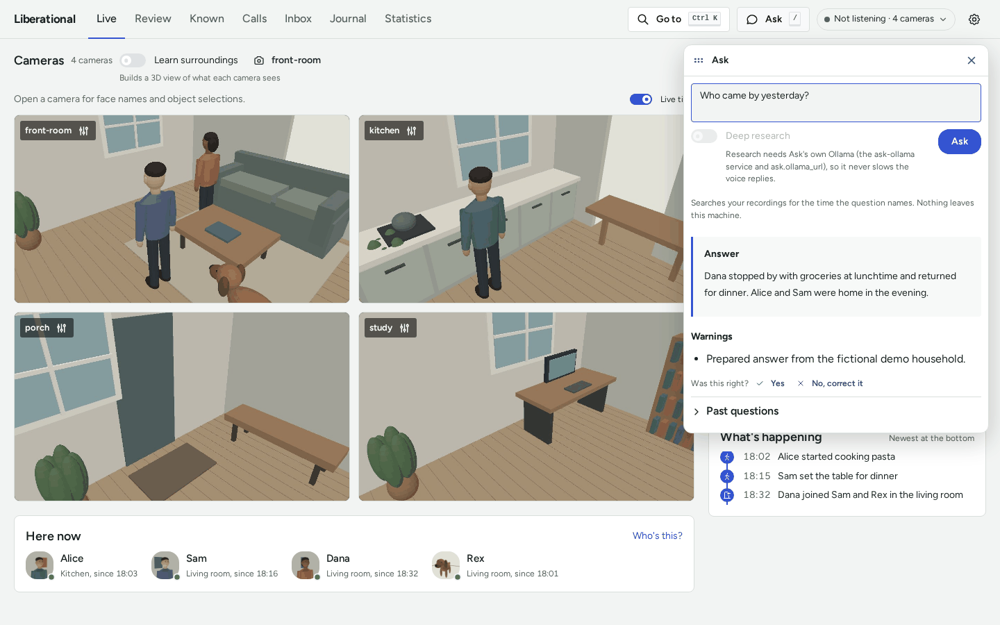

# How to ask the pack a question

This guide shows you how to ask a question about your recordings, read the answer, and send a harder question to
Deep research, whose report arrives in the Inbox. [Answers](ANSWERS.md) explains how a question is read and answered.

## Before you begin

- The pack has recorded something to ask about.
- Deep research needs Ask's own model server: the `ask-ollama` service, with `ask.ollama_url` pointing at it
  ([config/defaults.toml](../config/defaults.toml)). Without it the switch is disabled and says so.

## Open Ask

There is one Ask, and it opens the same way from anywhere:

- Press **Ask** in the dashboard's header, or the `/` key.
- Choose it in **Go to** (Ctrl K).
- In Review, open Ask as above. The day Review shows sits over the box as a chip, and the question is about that day
  unless it names another time. Remove the chip to ask about any time.
- In the Inbox, press **Research a question**. Ask opens with Deep research on.

## Ask a question

1. Type the question under "Your question", or pick one of the suggested questions.
2. Press Enter, or **Ask**.

Ask searches your recordings for the time the question names. Nothing leaves the machine. While it looks, it says
"Looking through your recordings", and the answer appears as it is written.

Under the answer:

- **Warnings** say what the answer could not see, such as a stretch nothing was recorded.
- **Was this right?** takes **Yes**, or **No, correct it**, which asks what a right answer says. Either saves the
  question for checking later answers against.
- **Past questions** lists what was asked before, with the answers.

Opened from Review, the answer's cited moments are listed as times. Click one to play from there.

## When there is no quick answer

When nothing in your recordings answers the question quickly, Ask says so in one line and offers **Try Deep
research**. It offers the same under an answer that rests on only part of the evidence. Press it to send the same
question to Deep research.

## Use Deep research

Deep research takes longer and looks deeper: more rounds of searching, at idle priority, one question at a time.

1. Turn on **Deep research** under the question box. The button reads **Research**.
2. Press **Research**.

Ask says "Research started", and about how long a report usually takes on this machine. You can close Ask and carry
on. The switch is off again for the next question: a question is quick unless you ask for more that time.

## Read the report

Open **Inbox**. Each finished question is a report, with the moments it cites, how sure it is, and what it looked at.

- **Ask a follow-up** opens Ask with the report as a chip over the box. A follow-up gets a quick answer.
- Deleting a report removes it for good. Asking the question again starts the research over.

## Related

- [Answers](ANSWERS.md): how a question is read, what counts as evidence, and which questions are counted, not
  written.
- [Activities](ACTIVITIES.md): make a kind of activity count in Ask.
- [Objects](OBJECTS.md): ask where a thing was last seen.
