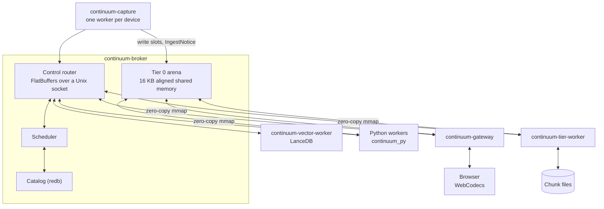

# Continuum

Continuum is the data layer: the processes every other process uses to record, find, and forget data. Its code is in
`continuum/`, a Rust workspace with a Python SDK. This document is the overview. The detail is in:

| Document | Covers |
|---|---|
| [CONTINUUM-BROKER.md](CONTINUUM-BROKER.md) | Shared memory, the socket protocol, the scheduler, the catalog, and forgetting |
| [CONTINUUM-STORAGE.md](CONTINUUM-STORAGE.md) | Tiers, chunk files, the video window, the segment store, and the vector worker |
| [CONTINUUM-CAPTURE.md](CONTINUUM-CAPTURE.md) | Devices, the capture supervisor, RTSP and RTSPS cameras, timestamps, and codecs |
| [CONTINUUM-GATEWAY.md](CONTINUUM-GATEWAY.md) | The browser gateway's wire format and requests |
| [CONTINUUM-SDK.md](CONTINUUM-SDK.md) | The Rust, Python, and C clients, building, and the wheels |

## What lives where

| Store | Holds | Owner |
|---|---|---|
| Tier 0 arena (shared memory) | The last seconds of raw frames and audio | `continuum-broker` |
| Catalog (`state/continuum/catalog.redb`) | Chunk metadata and frame indexes, the memory-log streams (journal, facts, summaries, and Ask history), worker state, and purge records | `continuum-broker` |
| Chunk files (`state/continuum/tier/`) | Recorded video and audio | `continuum-tier-worker` |
| Segment store (`state/segments/`) | Everything workers derive: per-hour Arrow parts per stream and slot | Each stream's writer |
| Vector index (`state/continuum/vector/`) | Embedding and full-text search tables | `continuum-vector-worker` |
| Knowledge store (`state/knowledge.sqlite3`) | What the owner taught; not part of Continuum | See [PEOPLE.md](PEOPLE.md) |

Most machine output goes to the segment store, not the broker. Segment rows have no broker parents, and the store
forgets its own rows.

## Processes



One broker runs per machine. Everything else is a client on its Unix socket.

- **The broker** owns the arena, the catalog, and the scheduler. It never runs a model, a codec, or a camera.
- **Capture workers** own the hardware and write raw samples into Tier 0.
- **The tier worker** drains Tier 0 into chunk files and carries out purges on them.
- **The vector worker** holds the search tables.
- **Workers** read frames and audio through an SDK and write what they derive to the segment store.
- **The gateway** serves the browser.

A consumer asks for a stream and a time range. The broker works out where the bytes are.

## Decisions

Each is a boundary of the design, with its reason.

1. **Capture and encoding run outside the broker.** A driver fault or a codec crash kills one worker, not the
   catalog.
2. **Tiers are numbered 0 (hot, shared memory), 1 (warm, chunk files), and 2 (cold).** The same numbers appear in
   code, schema, and logs.
3. **Two request flows.** A consumer queries and may commit to a quoted plan; a worker takes a job or a lease and
   commits its output. Committing a consumer's promise is what dispatches jobs.
4. **LanceDB lives in the vector worker.** Its dependencies, compaction, and memory stay out of the process
   everything depends on.
5. **Forgetting is a cascading purge.** A purge follows provenance forward, so everything derived from the removed
   data goes too.
6. **Current dependency versions.** Pin only on breakage, with the reason in `Cargo.toml`.
7. **Tasks run through mise** (`continuum-*`), like the rest of the repo.
8. **Payload ids are UUIDv7**, 16 bytes on the wire. They sort by creation time and match the domain model's ids.
9. **One timeline: UTC nanoseconds as `u64`.** Capture stamps on the monotonic clock and converts once through the
   stream's anchor, so wall-clock adjustments never reorder data. Ranges are half-open and never empty; an instant
   covers `[t, t + 1)`.
10. **Layers follow the domain model.** Layer 1 is what was sensed, layer 2 decisions and projections, and layer 3
    interpretations ([DOMAIN-MODEL.md](DOMAIN-MODEL.md)).
11. **The voice turn is broker system state.** One writer, a broadcast to every reader, and the scheduler acts on
    it.
12. **The gateway is its own process, and serves WebCodecs.** HTTP, TLS, and browsers that vanish stay out of the
    broker. Video goes as encoded access units instead of WebRTC, which drops and rescales frames and desyncs
    overlays.
13. **FFmpeg for codecs, native APIs for devices.** V4L2, AVFoundation, PipeWire, and CoreAudio expose the device
    timestamps and controls that a generic layer hides. GStreamer's pipeline would duplicate the broker.

## Stack

| Part | Choice |
|---|---|
| Language and runtime | Rust and tokio |
| Data plane | A custom 16 KB aligned POSIX shared memory slab and ring allocator |
| Control plane | FlatBuffers over a Unix socket, file descriptors passed with `SCM_RIGHTS` |
| Tables and tensors | Arrow IPC and DLPack |
| Catalog | redb |
| Vectors and text search | LanceDB |
| Python SDK | PyO3, built by maturin |
| C and C++ SDK | A C ABI from cbindgen |
| Browser | Axum with WebSockets; WebTransport as an option |
| Codecs | FFmpeg through `ffmpeg-next`, in capture, the tier worker, `continuum-export`, and `continuum_py`; never in the broker |

`continuum/Cargo.toml` is the source of truth for versions.

## Repository layout

```text
continuum/
  Cargo.toml              workspace, shared dependencies, and release profile overrides
  pyproject.toml          maturin build for continuum_py
  build_backend/          PEP 517 wrapper that probes FFmpeg headers and protoc
  python/                 Python helpers and type stubs around continuum_py._native
  schemas/                FlatBuffers: the control plane, stored metadata, and overlays
  packaging/              wheel builds and the private FFmpeg recipe
  crates/
    continuum-core/       PAGE_ALIGN, ids, time, and generated schema code
    continuum-wire/       the socket wire format
    continuum-shm/        the arena, slab classes, and rings
    continuum-catalog/    redb tables, provenance, purges, and coverage
    continuum-sched/      planner, promises, leases, bands, and the cost model
    continuum-broker/     the daemon
    continuum-client/     the Rust client
    continuum-ffi/        the C ABI and C++ wrapper
    continuum-py/         the Python bindings
    continuum-search/     search payload codecs shared by the vector worker and SDKs
    continuum-vector/     the vector worker
    continuum-tier/       the tier worker and continuum-export
    continuum-capture/    the capture supervisor and workers
    continuum-gateway/    the browser gateway
    continuum-segments/   the segment store
    continuum-log/        the daemons' log format
```

## Running and checking it

The five daemons are in the `core` group of [`services/services.toml`](../services/services.toml) and on by default.
[RUNNING.md](RUNNING.md) covers starting, stopping, and restarting them, and [SERVICES.md](SERVICES.md) explains how the
supervisor orders them. `config/devices.toml` names the cameras and microphones
([`config/devices.example.toml`](../config/devices.example.toml) documents every key), and
[CONTINUUM-CAPTURE.md](CONTINUUM-CAPTURE.md#list-restart-and-recover-devices) covers listing and restarting devices.

```sh
mise run continuum-status
```

`pack-continuum-status` is the same check. It only reads, and exits 0 when healthy and 1 when any check fails. Each
check and what its failure means:

| Check | A failure means |
|---|---|
| Services | A service is installed but not running. A Continuum service that is not installed is only noted |
| Broker | Its socket refuses a connection, or the client handshake fails: the broker is down or starting |
| Streams | A live capture stream has nothing in the window or an old newest payload, or a manifest device has no stream or no producer: capture is not reading it |
| Tier 0 pressure | A size class has too many slots held (being written, pinned, or not yet in Tier 1), or a network camera's ring dropped or overwrote pictures |
| Flush lag | The tier worker is behind: a capture stream's oldest payload still only in Tier 0 is older than the limit |
| Search streams | The vector worker has not registered `vector.search` and `text.search` (only a failure when the stage expects it) |
| Gateway | The gateway's port refuses a connection |

`--port audio` or `--port vision` checks a stage of the switch: every service the stage needs must be installed and
running, and every manifest device must stream. [`continuum_status.py`](../src/liberational/continuum_status.py)
documents the options and thresholds.

```sh
pack-reset-catalog --keep-taught
```

Prints what a reset would delete and changes nothing. With `--yes`, it deletes machine-made state (the catalog, the
recordings, the vector index, and the segment store) and keeps taught state
([`src/liberational/reset_catalog.py`](../src/liberational/reset_catalog.py)).

## Guardrails

- No new SQLite stores, JSONL logs, or JSON state files for data shared between processes. Recordings go through
  the broker, machine output through the segment store, and taught state through the knowledge store.
- Never hardcode 4096 for alignment. Use `PAGE_ALIGN` (16,384).
- No writes to shared memory outside a lease.
- No CUDA-only workers. Every worker picks `cuda`, `mps`, or `cpu` at start.
- Nothing in the broker that can crash with a device or a library: no capture, codecs, models, or HTTP.
- Every broker payload carries its provenance.
