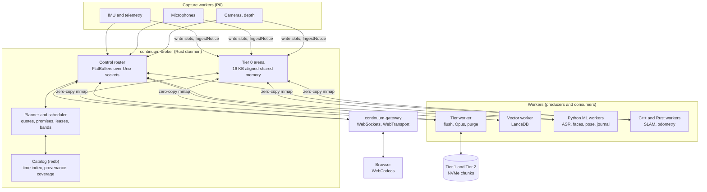
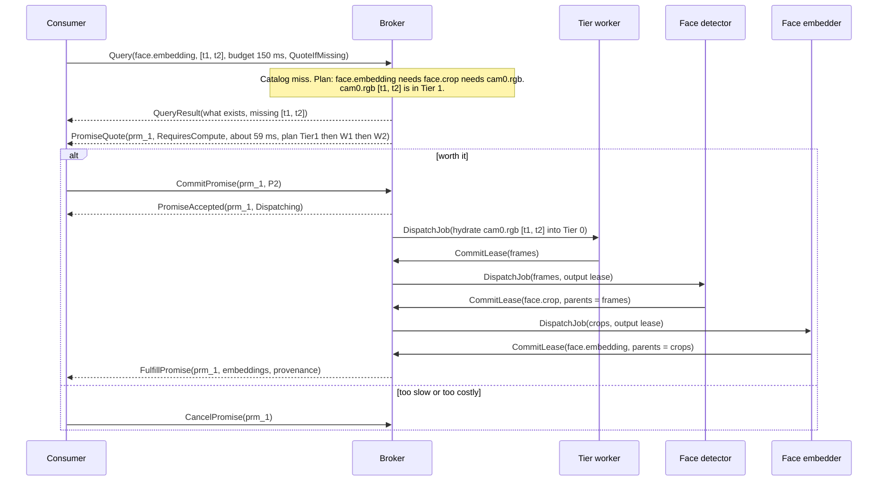

# Continuum Broker

Continuum Broker is the data layer: one Rust daemon that every process uses to record, find, and forget data,
whether it is a live camera frame, a compressed clip from last week, or a search over face embeddings. Code lives in
`continuum/` in this repo.

This document is the design reference for `continuum/`: the broker, shared memory, catalog, storage tiers, vector and
text search, browser gateway, capture workers, and SDKs.

## What lives where

The broker's catalog (redb) holds:

- the recordings: each camera's and microphone's chunks, their frame indexes, and where their bytes are in Tier 0,
  1, or 2;
- the memory-log streams (`src/liberational/memory_log.py`): journal entries and embeddings, person facts,
  summaries, and Ask history, plus the search request/result streams;
- worker state rows (`WORKER_STATE`, under "Catalog");
- the purge records and `FORGOTTEN`.

Most machine output lives outside the broker, in the **segment store** (`continuum-segments`,
`state/segments/<stream>/<camera>/`): per-hour Arrow IPC parts, one writer per stream and camera, with the
filesystem as the index. Python writes and reads it through `continuum_py`'s `SegmentWriter` and `read_segments`
and `src/liberational/segment_log.py`, which lists its streams (poses, tracks, movement, walk-bys, actions, faces
and their embeddings, animals, speech, captions, zones, and coverage). Segment rows have no broker parents.
Forgetting a segment row appends a deletion to the store's log, which every read honors at once, then rewrites the
parts that held it. Owner-taught state (names, pets, zones, activity names, and confirmed references) is in
`state/knowledge.sqlite3`, which survives a catalog reset (see "Turning it on").

Machine-made data is expendable: it can be rebuilt or dropped. The vision readers share one decode of each camera
(`see-decode`, NVDEC), and `see-actions` is the one person pipeline: at each configured camera's analysis rate it writes poses,
tracks, faces from heads, actions, movement, walk-bys, and animals to the segment store
([VISION-STREAMS.md](VISION-STREAMS.md)). Video is kept for 30 days (`pack-video-window`, under "Video window");
everything derived from it stays.

## Decisions

Each decision below states a core boundary of the data layer and its reason.

### 1. Capture runs outside the broker

Cameras, microphones, and the IMU are owned by dedicated capture worker processes that write into the broker's shared
memory and send it an ingest notice. The broker binary has no capture code.

Why: it keeps a hardware or driver fault from taking the broker down with it. A camera
that hangs, a USB reset, or a crash inside a capture library kills one capture worker, which restarts, while the
catalog, the scheduler, and every other stream keep going. Capture is a P0 producer like any other (see "Scheduler").

The same reasoning puts video encoding and the audio's Opus encoding (Tier 0 to Tier 1) in a separate tier
worker process rather than in the broker. The broker moves bytes and keeps the
catalog; anything that links FFmpeg (decision 13) or a device API runs in a worker, so the broker builds and runs
with no media libraries at all.

### 2. Tiers are numbered 0, 1, and 2

| Tier | Name | Medium | Holds |
|---|---|---|---|
| 0 | Hot | POSIX shared memory (RAM, which is unified memory on the Mac) | Raw frames, PCM audio, IMU batches, and recent derived outputs: capture rings hold 10 seconds by default, and slabs stay until their class needs them (see "Data plane") |
| 1 | Warm | NVMe | Short independently decodable recording chunks, including native H.264 and closed audio chunks encoded as Opus |
| 2 | Cold | NVMe (or a slower disk) | Older chunk files retained by existing catalog locators |

This numbering is used everywhere: code, schema, logs, and docs. The schema's `StorageTier` enum is `Tier0Hot`,
`Tier1Warm`, and `Tier2Cold`, and nothing else.

Why: hot memory is tier 0 ("tier zero is RAM"), matching the "T0" in the arena and slab names.

### 3. Both request flows, plus registration, dispatch, and ingest

In the consumer flow, a consumer asks for data, gets a quote if the data has to be computed or hasn't
been captured yet, and commits or cancels. In the worker lease flow, a worker asks for
an output buffer and a compute slot, and commits its result. Both are needed, and they meet in the middle: committing a
consumer's promise is what makes the broker dispatch jobs to workers. The full message set is in "Request flows".

Why: without the consumer side nothing can ask for derived data that doesn't exist yet, which is the point of the
broker; without the worker side the broker can't bound memory and compute on the 64 GB Mac.

### 4. LanceDB lives in its own crate, outside the broker's core loop

Vector storage and search are in `continuum-vector`, used by a vector worker process, not by the broker daemon. The
broker's own catalog holds only time and provenance (redb). A vector search is a request the broker routes to the
vector worker like any other derived stream, and the vector worker's rows point back to the broker payload or
segment row each came from.

Why: it keeps LanceDB's heavy dependency tree, its compaction work, and its memory use
out of the process every other process depends on, and lets the vector worker restart or rebuild its index
without touching the catalog.

### 5. Forgetting is a cascading purge now, cryptographic shredding later

The broker implements `purge_range(start, end, streams)` and `purge_entity(entity_id)`. Each walks the provenance graph
forward from what it removes, so every derived output (detections, transcripts, embeddings, summaries) built on the
purged data goes too, across the catalog, Tier 0 slabs, Tier 1 and Tier 2 files, and the vector worker's rows. The
details are in "Forgetting". The segment store forgets its own rows (see "What lives where").

Why: v1 already promises complete forgetting (the event log's purges, People: Delete), so Continuum can't ship without it,
and a cascade over the provenance graph is the straightforward way to make it complete. Encrypting each entity's or day's data with its own key and
destroying the key (crypto shredding) is a real improvement for backups and for files that are hard to rewrite, but it
is separate work.

### 6. Use current dependency versions

Use current stable crate releases and pin only when something breaks, the same rule as the rest
of the repo.

### 7. Tasks run through mise, not a justfile

Continuum's tasks (schema code generation, build, release, lint, test, the Python SDK build, and the status check) are mise tasks in
the repo's `mise.toml`, named `continuum-*`, and the Rust toolchain comes from mise as well. There is no `justfile`.

Why: the repo already runs everything through mise (`mise run lint`, `mise run test`, `mise run frontend`), and one
task runner means one place to look.

### 8. Payload ids are UUIDv7

Every payload has a 128-bit UUIDv7 id, stored as 16 bytes. The time-range key used for scans is separate (see "Catalog").

These are the same ids v1 makes. `domain/kernel.py` keeps them as strings (`str(uuid.uuid7())`); Continuum keeps them
in their 16 byte binary form on the wire and in the catalog. The ported kernel types convert at the boundary (the
Python SDK takes and returns the string form, and `uuid.UUID(s).bytes` is the binary form), so an id read from v1's
event log is the same id in Continuum.

Why: UUIDv7 sorts by creation time like a ULID, and it is what v1's `domain/kernel.py` already uses for every id, so
person, voiceprint, and event ids carry over without remapping. A composite id that embeds the timestamp makes the id
change if a timestamp is corrected, and a 16 bit source id is too small to name every derived stream.

### 9. One timeline: UTC nanoseconds

Every time a consumer sees, on the wire and in the catalog, is a `u64` count of nanoseconds since the Unix epoch,
UTC. Underneath, capture stamps each sample on the host's monotonic clock (`CLOCK_MONOTONIC` on Linux,
`mach_absolute_time` on macOS), which never steps when the wall clock is adjusted (see "Capture" for how each device
gets its stamp). A stream's UTC times are its monotonic stamps plus an offset: the capture worker takes one
monotonic and wall-clock reading together when it registers the stream (the anchor), so UTC times within a run keep
the monotonic clock's order and spacing. The broker also records a monotonic to wall-clock mapping every few seconds
(`CLOCK_MAP` in "Catalog"), so drift between the two clocks can be measured and old times corrected, and the raw
monotonic stamp stays in each sensor payload's capture fields.

Why: v1's rule is "UTC instants, convert other clocks at the edge" (`domain/kernel.py`, `instant()`), and keeping it
means v1 data ports by multiplying seconds by 1e9. Converting once, at capture, from a clock that never steps gives readers
one timeline and still keeps NTP adjustments from corrupting the catalog.

Ranges are half-open, `[start_ns, end_ns)`, and never empty. A payload header's `end_ns` equals its `start_ns` for an
instant (a single frame, a point reading), and an instant covers `[t, t + 1)`: read a payload's span with
`HeaderBuf::span()` (or `Interval::covering`) in `continuum-core`, never by taking `start_ns..end_ns` as is.

### 10. Data layers follow the domain model

Every payload names its layer, and the layers are the ones in [DOMAIN-MODEL.md](DOMAIN-MODEL.md) ("Data layers and
schema strategy"): layer 1 raw priors (what was sensed, immutable), layer 2 decisions and projections (typed and
rebuildable: people, identity assertions, the timeline, forgetting), and layer 3 interpretations (anything derived
for a question or a job, with its sources, producer, and shape).

Why: v1's rules depend on this order. Layer 2 never reads an unpromoted interpretation, and owner checks use only
layers 1 and 2. Porting the domain model with the layers swapped would break those rules silently. Note that under
the domain model, a detector's output (a face box, a transcript line) is a layer 1 record with its producer on it, and
a summary, a re-caption, or an embedding made for a question is layer 3.

### 11. Voice turn state is broker system state, not a field on every message

The broker keeps a small set of system states, the voice turn first (`Idle`, `Listening`, `Thinking`, `Speaking`).
The voice worker sets it, the broker broadcasts each change to subscribers, and the scheduler acts on it (see
"Scheduler").

Why: a state change has one writer and many readers, which is a broadcast, and copying it onto every message means a
message carries a stale value as soon as the turn changes. It also replaces v1's guess from file mtimes
(`memory/journal.py`, `voice_busy`) with one exact value.

### 12. The browser gateway is its own process

The WebSockets and WebTransport server is `continuum-gateway`, a broker client like any other, not part of the
daemon.

Why: the same isolation as capture and transcoding. An HTTP stack, TLS, and browsers that connect and vanish stay out
of the process every worker depends on, and the gateway can restart without dropping live capture.

### 13. FFmpeg for codecs, native APIs for devices

FFmpeg through `ffmpeg-next` does all codec and container
work (in the tier worker and wherever a capture worker must encode), and devices open through the platform's own APIs:
V4L2 on Linux (the `v4l` crate), AVFoundation on macOS (`objc2`), and `cpal` or `pipewire-rs` for audio. GStreamer is
not used. Local MJPEG capture normally encodes to H.264 before publication, using hardware encode when available;
native H.264 cameras retain their encoded
stream. The optional AV1 archive is described in [STORAGE.md](STORAGE.md).

Why: the broker already owns what GStreamer is for (buffers, scheduling, threads, and the clock), so its pipeline
graph would duplicate or fight the broker's. Tier work is batch work on chunks, a plain loop over libavcodec and
libavformat. Hardware coverage is the same either way, a missing FFmpeg codec shows up in one probe at worker start
instead of at runtime through a plugin registry, and v1 already depends on ffmpeg. Native device APIs are where the
device timestamps and controls are, which libavdevice would hide. The full reasoning is in "Capture".

## Architecture



One broker daemon runs per machine. Everything else is a client process that connects to it over a Unix socket:

- **The broker** owns the Tier 0 arena, the catalog, and the scheduler. It answers queries, issues quotes, grants
  leases, dispatches jobs, and records provenance. It never runs a model, a codec, or a camera.
- **Capture workers** own the hardware and write raw samples into Tier 0 (see "Capture").
- **The tier worker** drains Tier 0 into Tier 1 chunks, turns each microphone chunk into Opus as it closes, and
  carries out purges on its files.
- **The vector worker** holds the LanceDB tables (faces, voices, and text and image embeddings) and answers similarity
  searches.
- **ML workers** (Python through `continuum_py`, C++ through the C ABI, Rust through `continuum-client`) read
  frames and audio from the broker (the vision readers through `see-decode`'s shared decode) and write most of what
  they make to the segment store; the broker also lets them register capabilities, take dispatched jobs, and lease
  coverage gaps.
- **The gateway** serves the browser.

A consumer never asks for a file or a pointer. It asks for a stream, a time range, and optionally a latency budget,
and the broker works out where the bytes are, or what has to run to make them.

### Nothing stalls the broker

The broker serves many clients at once, and a P0 preemption has to go out within 5 ms whatever else is happening.
So no client, and no slow piece of work, may hold up anything else. The broker is built to that rule
(`continuum-broker`'s `core` and `server` modules):

- **The scheduler's task does memory-only work,** on a thread and runtime of its own, so nothing the sessions do
  (verifying a large frame, say) competes with it. It owns the open sessions, which streams are live, the
  availability index (what exists, in which tier, and what each stage has processed), and the scheduler. It never
  reads or writes the catalog, so it never waits on disk. The scheduler's `CatalogView` is answered from the index.
- **One writer thread writes the catalog,** in short transactions. It has an urgent queue (stream registration and
  ingest) and a background queue (purges, scrubs, and other long jobs). Each write transaction is atomic, but only
  one a second fsyncs (`DURABLE_EVERY`): the commits between skip it (redb `Durability::None`) and are made
  durable by the next fsynced commit, by the writer after a second with nothing to do, or by a clean close. A crash
  (a broker crash or a power loss) can therefore lose up to about the last second of commits, including ones already
  acknowledged: a tier worker's chunk commit lost that way leaves its chunk file on disk with no catalog row naming
  it, and the tier worker's own saved positions roll back with it, so frames still in Tier 0
  are absorbed again. An hour after it starts, the tier worker deletes such files: the raw chunks the previous run made in the 10 minutes before this start that no catalog locator names (`continuum-tier/src/sweep.rs`; `CONTINUUM_TIER_SWEEP_DRY_RUN` only counts them). Fsyncing every tick caused hundreds of fsyncs per second. Each
  writer tick takes everything urgent that is waiting, up to 4096 jobs, and commits all of its ingest notices in one
  insert: one transaction for the tick's ingests, never one per notice (a registration in the tick is its own transaction, and a sync commits the
  ingests ahead of it first). Under load a tick carries more rather than the fsyncs adding up. Each bounded urgent
  batch is followed by one background step, even while more urgent work arrives. Long jobs rotate round-robin;
  neither queue waits for the other to become empty. Ordinary background steps are
  sized to a time target (5 ms by default, `--step-target-ms`): the writer times each step, halves the job's budget
  after a step that overran (and logs it), and doubles it after a quick one.
  The finite writer regression keeps the next urgent write queued before releasing the current one, checking
  progress for both queues without sleeps or a load loop. The opt-in `purge_progress` example measures a trim on
  temporary synthetic redb state using the same cooperative purge work window. Purges check the caller's
  deadline between chunks of at most 64 phase operations within one transaction, with an overall operation cap.
  This avoids shrinking to one row per commit when commit/fsync alone exceeds the time target. At least one
  chunk runs per step; commit/fsync, final reports, and existing per-row descendant/frame fanout are outside the
  cooperative bound. Explicit `purge_step` row budgets remain available for offline callers.
  Broker health logs every 60 seconds include channel plus writer-local background backlog, the running-step
  flag, per-process step counts for up to 16 oldest unfinished purges, unknown-age and stalled-job counts, the
  oldest known age, and the three streams whose unfinished purge is oldest (name and age in seconds). Resumed ages
  come from stored purge metadata and then advance monotonically. At 120 seconds, an unfinished purge is warned
  about once per process; warning samples are bounded to 16 per health pass and deferred warnings remain eligible.
  A final catalog-phase log separates catalog work from writer wait. The purge start and completion lines name the
  kind (range, entity, or ids), the stream names, and the reason, cut to one short line. Keeper grace and
  acknowledgement waits stay separate, and failed persisted jobs remain visible as stalled work.
- **The index follows the catalog, never leads it.** The writer commits, then tells the scheduler's task, which
  applies the change to the index (it handles the writer's results before anything else). For an ingest that order
  means the index never shows what isn't committed. For a purge step it leaves a short window, the time the result
  takes to arrive, in which the index still shows rows the catalog has just hidden; a plan made in that window reads
  through the catalog, which no longer returns them, so it finds them missing rather than serving forgotten data.
- **Reads run in parallel** on a reader pool. With the redb catalog each read has its own snapshot, so a large scan
  never blocks another read or the writer (the in-memory catalog used in tests serializes everything on one lock).
  Time-range pages seek directly to their full time/sequence cursor, including ties at one timestamp. Startup
  rebuilds the complete availability index with these pages before listening; it never rescans the preceding
  window on each page. The catalog's counted-row regression checks linear visits at N and 2N rows. The opt-in
  `continuum-broker` example `index_rebuild` measures fresh synthetic 1M/2M catalogs and checks a 30-second,
  2.6x-doubling budget (`tools/build-slot.sh cargo run --manifest-path continuum/Cargo.toml --release -p continuum-broker --example index_rebuild -- --guard`).
  Fixture creation is measured separately and no live catalog is read.
  Startup also logs separate catalog-open phases (scrub recovery, redb open/recovery, schema checks, and recording
  repair), availability payload reads versus in-memory copy application, stale Tier 0 clearing, purge/keeper reads,
  arena creation, and total startup. Timing is process-local metadata, not new catalog state.
  Ordered disjoint copies append directly to the normalized copy set, merging only touching spans with identical
  counts across every tier. Overlapping updates and removals retain the general path.

  To profile those phases without opening any existing catalog, use the example's phase mode:
  `tools/build-slot.sh cargo run --manifest-path continuum/Cargo.toml --release -p continuum-broker --example index_rebuild -- --startup-phases --scratch scratch/startup-profile --payloads 6500000 --streams 100 --inline-bytes 512 --batch-size 65536`.
  Create the scratch parent first. The command generates a fresh synthetic catalog in a new temporary subtree,
  seeds and cleanly closes it outside startup timing, then measures reopen, index, stale clearing, and a small
  synthetic arena. It removes its catalog and arena afterward. It cannot accept an existing catalog path, and this
  mode is separate from the doubling guard. Use the build slot at standard priority; never profile the
  live catalog or copy it for this benchmark.

Planned broker restarts can restore the complete availability projection without reconstructing every payload.
The catalog owns the opaque `restart_projection` table and an exact `hot_ids` secondary index over Tier 0 locators.
A new catalog file starts with this tracking: a durable random incarnation, revision 1, and an empty hot index.
Every normal catalog write advances the revision and deletes the old stored projection atomically, including
location, coverage, cut, and purge changes
that do not advance the payload sequence. Read-only reopen and physical-only scrub statistics preserve it; a
semantic repair invalidates it. Scrub catch-up carries the deletion, so a privacy purge cannot preserve old IDs
or timestamps inside an unusable projection.

On clean shutdown, after clients and their queued writes drain, the broker stops maintenance and enters a terminal
checkpoint fence. The writer flushes preceding work, reports its stamp after earlier callbacks, and terminates.
Unfinished reads, purges, failed cursor writes, hidden-on-landing records, or changed rate/kind
metadata refuse checkpointing. The fence flushes cursor positions acknowledged since the drain ahead of itself and
accepts their saves. It drops a running `FRAMES` sweep instead of waiting for it: the sweep is restartable, never
changes availability, and on a large catalog runs for longer than its ten-minute cadence, so waiting for it refused
every stop. Each refusal is logged with its reason ("skipped the restart projection"), as is each start that
rebuilds because no stored projection was usable ("no usable restart projection"). The scheduler moves its settled index out for encoding off its own thread. Publication
checks the expected stamp and stores the checkpoint atomically; there is no separately copied sidecar. The codec
preserves names/rates, exact per-tier multiplicities, normalized coverage, and cuts, but strips all Tier 0 counts.
Its 2 GiB byte cap, 64M-row cap, and fixed count/name limits cause refusal rather than partial results; a stop gives
the fence, encode, and publish 45 s of their own, ahead of the catalog close's 10 s. Changes to frame
expansion, tier counts, or other persisted index semantics must bump the codec version so old projections rebuild.

Startup validates the stamp and opaque checksum in one catalog read snapshot, then validates codec version,
lengths, ordering, intervals, counts, names, and its checksum. It uses the exact hot-ID index to clear obsolete
locators before starting the core. Nonzero clearing counts obsolete copies, not lost payloads: a durable chunk
may already hold the same payload. Any mismatch uses the existing full scan; an unclean stop does not promise a
fast restart. Corrupt catalog metadata is still an error. The checkpoint deadline bounds admission to fencing and
encoding; synchronous durable redb publication cannot be cancelled, so an admitted publication is joined before
ordinary clean close. No catalog-writing task is detached on a timeout. Slow storage can extend that final commit.

Add `--restart-checkpoint` to the synthetic phase command above to measure one-time tracking initialization,
encoding/publication/clean-close cost, valid reopen/read/decode, and a coverage-only revision mismatch followed by
full reconstruction. The same fresh fixture is used throughout; canonical roundtrip and expected counts are
checked outside measured restore time. This flag requires the explicit synthetic phase mode and scratch parent.

A checkpoint becomes useful only after an eligible clean stop; the first start before any clean stop performs the full rebuild and one-time locator-index initialization.

- **The voice turn goes before everything.** `SetSystemState` has a channel of its own, polled ahead even of the
  writer's results (which arrive in chunks of 256), so a preemption never waits behind a large tick's commits.
- **Control goes first.** The scheduler's task drains its control channel (ingest, session open and close, system
  state, the writer's results) before normal requests, so a burst of queries can't delay an ingest or a preemption.
- **Sessions are isolated.** Each has a bounded outbound queue and its own writer, and every write is bounded by the
  heartbeat timeout. A session that stops reading, or whose queue fills, is closed; nobody else waits for it. No lock
  is held across I/O. Every queue is bounded: the writer's, the reader pool's, and the long-job backlog refuse work
  as busy when full, and when a session's own command channel to the core is full, that session alone waits.
- **A failure stays contained or stops the broker.** A read or a long job that panics loses only itself. If the
  writer or the scheduler's task panics, the broker aborts so its supervisor restarts it, rather than carrying on
  unable to write while looking healthy.

## Stack

| Part | Choice | Crates and tools |
|---|---|---|
| Language and runtime | Rust, tokio | Rust stable from mise; tokio 1.54 |
| Data plane | Custom 16 KB aligned POSIX shared memory slab and ring allocator over `shm_open` and `mmap` (no iceoryx2, no zenoh) | nix 0.31 or rustix 1.1; memmap2 0.9 |
| Control plane | FlatBuffers over Unix domain sockets, file descriptors passed with `SCM_RIGHTS` | flatbuffers 25.12 (crate and `flatc`) |
| Tables and tensors | Arrow IPC and DLPack | arrow 60; dlpark 0.10 |
| Catalog | redb | redb 4.4 |
| Vectors | LanceDB, in the vector worker | lancedb 0.41 |
| Python SDK | PyO3, built with maturin, managed by uv | pyo3 0.30; maturin 1.16 |
| C and C++ SDK | C ABI from cbindgen, with a header-only C++ wrapper | cbindgen 0.29 |
| Browser gateway | Axum with WebSockets, and WebTransport | axum 0.8; tokio-tungstenite 0.30; wtransport 0.7 |
| Codecs and containers (tier and capture workers only) | FFmpeg through ffmpeg-next, rsmpeg as the fallback (decision 13) | ffmpeg-next 9.0; rsmpeg 0.18; system FFmpeg 8 or 9 shared libs |
| Device capture (capture workers only) | V4L2, AVFoundation, and cpal or PipeWire | v4l 0.14; objc2 0.6 with objc2-av-foundation 0.3; cpal 0.18; pipewire 0.10 |
| GPU handoff | Plain shared memory: `cudaHostRegister` on Linux, no-copy Metal buffers on macOS | |
| Tasks | mise (`continuum-*` tasks) | |

Not used: iceoryx2 and zenoh (network transparency between machines isn't needed, and a custom allocator is easier to
back with CUDA pinned or Metal memory), Cap'n Proto (weak browser support), Protobuf (parses on every read), rkyv
(Rust only), WebRTC (drops and rescales frames, which desyncs overlays), GStreamer (decision 13), OpenCV for capture,
a justfile, Bazel, and Nix.

The rule: use the newest stable release, and pin only on breakage, with the reason in `Cargo.toml`. The
versions above are a snapshot for orientation; `Cargo.toml` is the source of truth.

## Data plane: the Tier 0 shared memory arena

`continuum-shm` is the allocator. Everything about it follows from two rules: every offset is a multiple of 16,384
bytes, and a slow reader can never stall a writer.

### Alignment

`PAGE_ALIGN = 16_384` is a constant in `continuum-core`, used for every slab, ring segment, and mmap offset. Apple
Silicon pages are 16 KB and Linux x86_64 pages are 4 KB, so 16 KB alignment satisfies both. With it, a Metal worker can
wrap any slab with `makeBuffer(bytesNoCopy:length:)`, and a CUDA worker can `cudaHostRegister` the whole mapping once
and DMA from any slab. `align_up_16k(size)` rounds up, `is_aligned_16k(offset)` checks, and both have unit tests
(`align_up_16k(1) == 16384`, `align_up_16k(4096) == 16384`, `is_aligned_16k(4096) == false`). Never write 4096.

Both GPU paths have specific alignment and residency rules. Metal needs the pointer page aligned and the length a multiple of
the page size, so a worker wraps the whole slab (its class size, always a 16 KB multiple), never the payload's `len`,
and asks for `storageModeShared`. `cudaHostRegister` has no alignment rule, but it pins at page granularity and faults
in every page it covers, so the first CUDA worker to register makes the whole arena resident (10 GB at the Linux
defaults; a few seconds, once at start). `cudaHostRegisterDefault` is the flag to use: on a 64 bit Linux host every
CUDA context has unified addressing, which makes the registration mapped and portable across all GPUs, so
`cudaHostRegisterMapped` adds nothing. Each process registers its own mapping; pinning is per process.

### Arena layout

The broker creates each arena at start with `shm_open` and `ftruncate`, and maps it. An arena is laid out as:

| Region | Size | Contents |
|---|---|---|
| Superblock | 16 KB (one page) | Magic, layout version, arena size, the arena's generation (bumped each time the broker recreates it), a global epoch counter (`AtomicU64`), and the offset and count of every region below |
| Slot directory | `slots * 64` bytes, rounded up to 16 KB (352 KB at the Linux defaults, plus the capture rings' slots) | One 64 byte, cache-line padded `SlotMeta` per slot, so two slots never share a cache line |
| Size class 0 | 64 KB slabs, 4096 of them (256 MB) | IMU batches, boxes, pose skeletons, short audio |
| Size class 1 | 2 MB slabs, 1024 of them (2 GB) | Embeddings, masks, crops |
| Size class 2 | 16 MB slabs, 512 of them (8 GB) | Decoded and hydrated frames (16 MB holds 4K NV12 or UYVY, or 1080p RGB; a 4K RGB frame is 24.9 MB and needs a larger class, a profile setting), depth, point clouds |
| Rings | per stream, set at registration | Fixed-stride continuous streams: PCM audio, IMU |

The counts are the defaults for the Linux profile and are settings, not constants; the Mac profile is smaller (see
"Hardware and platforms"). 5,632 slots at 64 bytes is 352 KB, so the directory is its own region and the superblock says where it is.
The size classes add up to 10.25 GB; the rest of an arena is the capture rings.

`SlotMeta` holds (64 bytes, one cache line):

| Field | Type | Meaning |
|---|---|---|
| `word` | `AtomicU64` | The state, generation, and pin count packed together (`generation << 32 \| pins << 8 \| state`), so one compare-and-swap moves them as a unit. The state is `Free` (0), `Writing` (1), `Ready` (2), or `Reclaiming` (3); the generation is bumped every time the slot is reused, so a stale reference is detected (no ABA); the pin count is how many readers hold the slot |
| `lease_expiry_ns` | `AtomicU64` | When the newest pin's lease runs out, in monotonic nanoseconds |
| `offset` | `u64` | Where the slab is, from the start of the arena (fixed when the arena is made) |
| `len` | `AtomicU64` | How much of the slab holds data |
| `owner` | `AtomicU64` | Who claimed the slot: a stream id for a capture stream's slots, or a lease or worker id |
| `seq` | `AtomicU64` | When it was published, from the superblock's publish counter, so slots can be ordered oldest first |
| `flushed` | `AtomicU32` | 1 once the tier worker has a Tier 1 copy |

Two platform gotchas. POSIX shared memory names are limited to 31 characters on macOS, so arena names are short
(`/cnt.<arena>.<generation>`), and the name is what `shm_open` takes on both platforms (Linux also shows it under
`/dev/shm`; macOS has no such path). And on macOS an object can be sized with `ftruncate` only once, so an arena is
never resized: a new size is a new arena with a new generation, announced in `Welcome` and to connected clients.
Linux's `/dev/shm` is a tmpfs sized to half of RAM by default, which the Linux profile fits with room to spare.

### Writing

A producer holds a lease that entitles it to a number of slots in a size class (a standing stream lease for capture,
or a job's output lease, see "Request flows"). To write, it claims a slot within that quota by moving `state` from
`Free` to `Writing` with a compare-and-swap, writes or decodes straight into the slab, sets `len`, moves `state` to
`Ready`, and sends a small `IngestNotice` naming the slot and carrying the payload header. Claiming needs no message;
only the notice does.

A capture stream's standing lease is a ring of its own slots rather than a share of a size class: each slot is the
stream's largest payload rounded up to 16 KB, and the ring's length in seconds is a per-stream setting (10 seconds by
default, in the profile), so capture never competes with derived data for slabs (see "Capture"). The size classes
serve everything else. The ring only has to outlast the tier worker's flush lag, since the tier worker drains it as
payloads land (see "Storage tiers"). Capture may overwrite the oldest slot nobody has pinned, flushed or not, to
keep live capture moving. If the stream is owed to the archive and losing that Tier 0 copy leaves any of its span
without another copy, the broker logs and counts an archive gap. A purge or a loss already covered by a durable copy is not an archive gap. These logs
and process-local counters are diagnostics, not a permanent loss audit; they do not write a gap to `COVERAGE`.

### Rings

A continuous fixed-stride stream (PCM audio, IMU samples) gets a ring instead of slots: one producer, any number of
readers, each reader keeping its own position. The producer overwrites the oldest data and never waits. Each record
carries a sequence number, so a reader that fell behind by more than the ring's length sees the gap and reports it
instead of reading torn data. One producer per ring is enough, since each stream has one capture worker, and it keeps
the ring simple.

On macOS a microphone is read through CoreAudio (cpal) at the device's default rate with every channel, as 32-bit
floats, each buffer placed at its `mHostTime`. On Linux a microphone is read through PipeWire at the graph's rate with
every channel, as 32-bit floats, which hold
a 24-bit source exactly; a buffer's capture time comes from the stream's time report (its cycle time, less the
device delay and the resampler's queue), and buffers are cut into the stream's fixed blocks. A PCM record starts
with a 16-byte stamp: the block's capture time on the host monotonic clock (from the audio fit)
and the index of its first sample, both u64 little-endian, then the block. A live reader gets each block's time from
the ring itself, without waiting up to a second for its batch's notice. The stream's registered stride includes the
stamp.

A ring's records are indexed in batches, not one by one: the producer sends one `IngestNotice` per batch (1 second
by default, a per-stream setting), and the batch is the payload the catalog knows, its header covering the batch's
time span. A reader that needs less latency than that, such as the voice activity gate, follows the ring's sequence
word directly and reads records as they land. Indexing every 20 ms audio block would be about 4 million headers a
day per microphone; batching keeps it near 90,000. The batch is only the catalog's granularity; the live path below
is what audio is built on.

The live path is event-driven, never polled. A ring's header has a 32 bit sequence word; the producer publishes each
block (the capture block, 10 to 20 ms for audio) with a release store of the sequence, then wakes waiters on that
word if the ring's waiter count is non-zero. Waiting is wait-on-address in both kernels: `futex` (the shared, not
process-private, form) on Linux and `os_sync_wait_on_address` with `OS_SYNC_WAIT_ON_ADDRESS_SHARED` on macOS (public
since macOS 14.4, which the field Mac exceeds), behind one `SeqWait` type in `continuum-shm`; no eventfd, pipe, or
message is on this path. A live reader (the voice activity gate, ASR, barge-in, the voice turn) therefore sees a
block within about one block period plus a wakeup of it landing: the target is capture to live reader in under 25 ms
for audio, two orders of magnitude inside the 700 ms voice turn gate on the Mac. The `IngestNotice` for the batch
arrives later and is for the catalog, subscribers that want headers, and the tier worker.

### Reading, pins, and leases

When a query is answered from Tier 0, the broker increments the slot's `pin_count` and sets `lease_expiry_ns` to now
plus 5 seconds (a setting), and returns the slot, its generation, offset, and length. The reader maps the arena once
(the file descriptor passed over the socket) and reads in place. The mapping is read-write, since releasing and
renewing pins write the slot directory, but the SDKs only ever hand out read-only views of payload bytes.

Releasing a pin is a decrement in shared memory, done by the SDK when the reader drops it (a Rust guard, the Python
DLPack capsule's destructor, a C++ RAII wrapper). No message is needed. The broker also tracks pins per connection,
so a client that disconnects or dies has its pins dropped for it.

### Slow consumers

A Python worker that holds a frame through a long inference or a GC pause must not stop the ring from wrapping or a
camera from writing. When a size class runs low on free slots, the broker reclaims the oldest `Ready` slots, flushed
ones first. An unflushed slot of a stream owed to the archive (one the tier worker follows) stays for the tier worker,
even when nobody has pinned it; a full class that cannot yield enough slots without one raises a pressure warning
instead of discarding unflushed data. A stream nothing archives owes the archive nothing, so its unpinned slots can
still be reclaimed and can't starve the class. A slot still pinned past its lease expiry is reclaimed
too, but only once `flushed` says the tier worker has written it to
Tier 1, so nothing is lost: the broker moves it to `Reclaiming`, bumps its generation, and logs
`SLOW_CONSUMER_EVICTION` against the reader's process id. A reader that checks the generation after reading (the SDK
does this) sees the change and gets an error rather than silently reading a reused slab; it can query again, and the
data comes back from Tier 1. This scheduler guard does not remove the producer's overwrite policy or stop a fixed
ring from wrapping: capture can still sacrifice unpinned, unflushed data for live continuity, and those actual
archive losses remain loud and counted. Separating Tier subscription delivery from commit/control traffic addresses
worker backpressure alongside this guard; it does not guarantee that archival work always beats the retention horizon.

### In the broker today

- The scheduler's learned cost models are saved to the catalog (`COST_MODELS`) every 5 minutes when they changed,
  and restored at start, so quotes after a restart don't go back to the manifests' guesses.
- `CLOCK_MAP`: the broker samples the host monotonic clock against UTC for this boot every 60 seconds, and at
  once when the machine has slept (the gap between the clock that stops in sleep and the one that doesn't jumps).
  Capture workers take their own anchors and register them again after a wake. Both jobs go through the writer;
  the scheduler thread only reads clocks.
- Slots: the broker notes which payload is in which Tier 0 slot as it indexes it. Once a second it scans the slot
  classes. A slot that moved on (reclaimed, or overwritten by capture) leaves the index. A class with no free slot
  and none on its way to free (so a plain claim would fail) gets up to an eighth of its slots reclaimed: slots the
  index counts, flushed ones first and oldest first within each, never an unflushed one a reader holds, and never an
  unflushed one owed to the archive. A stream is owed to the archive once a worker that registered `keeps_copies`
  (the tier worker) opens a durable subscription on it, and stays owed until the broker stops, so a tier worker
  restart doesn't lift the guard. The tier worker follows the manifest's capture streams and every derived stream;
  a stream it doesn't follow (a sensor stream outside `config/devices.toml`, say) is reclaimed as before. After a
  broker start the arena is new, and nothing is owed until the tier worker subscribes again. If owed unflushed slots
  prevent the reclamation, the broker warns about pressure and preserves them. The guard needs an arena made with
  `reclaim_requires_flush` (the broker's always is), since only then does `flushed` mean a Tier 1 copy. A class with a
  free or reclaiming slot is left alone. A pinned flushed slot whose pin expired can still be evicted
  (`SLOW_CONSUMER_EVICTION` is logged). Producer overwrites remain separate from scheduler reclamation.
- The 60-second broker health log includes `tier0_slot_archive_gaps` and `tier0_ring_archive_gaps`: lost slot
  payloads and lapped indexed ring batches of streams owed to the archive whose removal leaves an uncovered span. Purges and losses with another
  durable copy do not increment them. `tier0_reclaim_pressure_events` counts scheduler encounters with unflushed
  class pressure; `tier0_reclaim_pressure_classes` is the current number of affected classes. The first three
  counters accumulate for one broker process and reset on restart; the class count describes current pressure.
  Pressure is not proof of archive loss, and these diagnostics are not persisted in the catalog or `COVERAGE`.
  Deploying this reclaim policy and its counters requires a broker rebuild and restart through the normal
  coordinated lifecycle. It introduces no configuration, model, schema, state file, or SDK change.
- Purges: a purge takes its payloads' slots out of use at once (no new leases, and no reclaim or release frees them
  unzeroed), and zeroes and frees each one off the scheduler thread once no live lease holds it, retrying every
  second. A live lease's bytes never change under it. Not yet: the catalog keeps a reclaimed slot's locator, so a
  later purge of that payload logs a mismatch for the copy the index already let go.
- The broker keeps its redb catalog at `catalog.redb` beside its socket (`state/continuum/` by default;
  `--catalog` puts it elsewhere), opened once the socket's lock is held, so a second broker is refused before it
  touches the file. Tests that build a broker in process keep the catalog in memory.
- One arena per broker, made at start from the profile's slot classes (`--tier0-classes SIZExCOUNT,...` overrides
  them, which tests use to stay small). Its name is `/cnt.<h>.<generation>`, where `<h>` is 48 bits (12 hex digits)
  of a hash of the socket path, so two brokers on one machine practically never share an arena. The generation is
  the later of one more than the last run's and the clock's seconds, so it keeps rising even if `<socket>.arena`
  (which keeps it, and names the arena on its second line) is lost. A clean stop (SIGTERM, Ctrl-C) unlinks the arena;
  clients that mapped it keep their mappings.
- A broker that's killed (SIGKILL, a crash) leaves its arena behind. The next broker on the same socket unlinks it
  first; one on a socket that's never used again (a test's temporary directory) doesn't, so a test that kills a
  broker unlinks the arena named in `<socket>.arena` itself. To clear leftovers by hand with no broker running:
  `rm /dev/shm/cnt.*` on Linux; on macOS, `shm_unlink` each name from the `.arena` files, or reboot. A leftover costs
  only the pages that were touched, since the arena is sparse until slots are used.
- At start, an arena larger than `/dev/shm` is refused (touching its last pages would SIGBUS the broker), and one
  larger than what's free there is warned about.
- `Welcome` lists the arena (name, generation, size, classes) and passes its fd. The arena count is far under
  `MAX_FDS`.
- An `IngestNotice` or a `CommitLease` output with a Tier 0 locator is checked before it reaches the catalog: the
  arena and its generation are this broker's, the slot exists at that offset, and it's published at the locator's
  slot generation with the locator's length. A failed check is an `IngestRejected` (or an `Error` for a commit) with
  the reason.
- A query result's Tier 0 item is pinned for the reader (5 seconds) and held for its session; a session's pins are
  released when it ends, and expired ones are dropped on the scheduler's tick.
- The arena is made with `reclaim_requires_flush`, which covers one case: a slot still held by an expired pin from
  a direct lease is freed by `claim` only once the tier worker has marked it flushed. It doesn't stop capture: the
  broker drops its own expired pins on its tick, and capture's `claim_overwriting` overwrites the oldest unpinned
  slot whether or not it was flushed (an uncovered loss is logged and counted as an archive gap), since capture never
  waits.
- Readers can't renew a pin or release it early yet; a pin lasts its 5 seconds or until the session ends.
- Producers claim and publish slots themselves, in shared memory; no message is needed until the `IngestNotice`.
- **Rings** (PCM, IMU, sensor batches) are carved at `RegisterStream` from a ring region reserved at the end of the
  arena (64 MiB by default, `--tier0-ring-mib`), since an arena's size is fixed for its life:
  - A stream that sets `ring_stride_bytes` (and `nominal_rate_hz`) gets a ring of exactly that record size, holding
    `ring_seconds` (10 by default) at its rate. Exact matters: a device's native block (1,440 bytes per 10 ms for
    48 kHz mono 24-bit, 3,840 for a CoreAudio mic) must stay `count * stride` per batch, which a preset class would
    pad.
  - `StreamRegistered.lease` carries the ring's index, control block and data offsets, stride, record count, and
    generation. `Subscribed.rings` carries the same for every subscribed stream that has a ring, so a reader in
    another process (the flusher, a live view) can follow it.
  - Registering the stream again (a capture worker that reconnected) returns the same ring. Another stride is
    refused, and so is a ring the region has no room for, each with the reason.
  - Each ring is a 16 KB page for its control block and then its records, rounded up to whole pages. The control
    block keeps `head` and `started` alone on one cache line, and the reader-side words on the next. Carving checks
    the new ring doesn't overlap one carved before, takes the block with a compare-and-swap on its generation, and
    records it in the superblock's carved ring table: append-only, each entry written and then published by a Release
    store of its generation, never rewritten, and its position there is the ring's index. Readers and writers build
    from the announced numbers, which continuum-shm checks against the region (bounds, alignment), the control
    block's generation, and the superblock's own record of the ring, so a stale or wrong announcement can't point
    into another ring. Tools can list the rings with `Arena::carved_rings` (arena layout version 3).
  - A batch is a `RingLocation`: the arena and its generation, the ring's index, `first_seq`, and `count`. Its bytes
    are `count * stride`, at most two slices across the wrap. On ingest the broker checks that the arena is its own,
    the ring exists, and the batch is written (`first_seq + count <= head`) and not lapped
    (`first_seq >= head - capacity`). A lapped batch is rejected, and capture logs it as a Tier 1 gap.
  - On its tick, the broker drops from the index each batch the ring has lapped. If nothing else covers the batch's
    span by then, it was overwritten before it reached Tier 1, which is logged and counted in
    `tier0_ring_archive_gaps`. Purged batches and batches covered by another durable copy do not count as losses.
    The flusher has to beat the wrap, which is what `ring_seconds` is for.
  - The live edge: a time query on a ring stream that reaches past its newest indexed batch also gets
    `QueryResult.tail`, the ring's records written since (`first_seq` to `last_seq`, with the ring's index, control
    block offset, and arena generation), so "the last 300 ms" includes what the 1 second batches haven't sealed yet.
    The result isn't `complete` then, since the tail isn't indexed.
  - A ring batch can't be pinned: the writer never waits. A query or subscription hands it out while the ring hasn't
    lapped it, and the reader checks sequence numbers as it copies (`RingReader` reports what it lost).
  - A writer claims a ring with a token unique to the claim, carrying its process id. When a client's last session
    ends, the broker releases every ring claim its process holds (and only its: a late close can't clear a claim
    another process took since), so the stream's next writer can take the ring even if the last one died holding
    it. If the old writer is still running, its next push fails (`NotWriter`), and its `Drop` clears only its own
    token. What this doesn't close: an old writer descheduled in the middle of writing a record can land its stray
    bytes after the new writer has taken the ring, so a reader can validate a torn record in that slot, or a later
    one there if the old writer stalls past a lap. Readers of fixed-stride streams check each record's own continuity
    (its sequence or stamp) and treat a break as a gap.
  - Rings aren't reused yet: each stream keeps its ring for the arena's life.

### Platforms

The broker allocates arenas through an `ArenaBackend` trait. The first and default backend is plain POSIX shared
memory on both platforms, which is zero-copy for the CPU and GPU on the Mac (unified memory, no-copy Metal buffers)
and DMA-capable on Linux after one `cudaHostRegister` per process. Other backends (IOSurface for handing buffers to
VideoToolbox, a CUDA VRAM pool with `cudaIpcGetMemHandle` for GPU to GPU chaining) are later work, added only if a
measured need shows up.

## Envelope and provenance

Every payload, from a 4K frame to a one line summary, has a `PayloadHeader`. The heavy bytes sit in a slab or a chunk
file; the header is small, stored in the catalog, and sent in messages.

| Field | Type | Meaning |
|---|---|---|
| `id` | UUIDv7, 16 bytes | The payload's id (decision 8) |
| `stream_id` | `u32` | The stream it belongs to |
| `start_ns`, `end_ns` | `u64` | The time it covers, UTC nanoseconds (decision 9); equal for an instant |
| `seq` | `u32` | Order among payloads of one stream with the same start |
| `layer` | enum | Layer 1, 2, or 3 (decision 10) |
| `format` | enum | `RawBytes`, `DLPackTensor`, `ArrowRecordBatch`, `EncodedVideo`, `FlatBuffer`, `Text` |
| `shape` | string and version | What the payload looks like (a raw format like `NV12`, `PCM_F32`, or a named shape and its version for derived data), as `shape_name` and `shape_version` in v1 |
| `producer` | `Producer` | Who made it (below) |
| `parents` | list of ids | The exact payloads it was computed from |
| `evidence` | list of `EvidenceRef` | For layer 2 and 3 claims: the records that support it, with time spans (below) |
| `source_tier` | `StorageTier` | The coldest tier any input was read from when it was computed |
| `compute` | `ComputeCost` | Measured cost of making it (below) |
| `confidence` | optional `f32` | The model's own summary confidence, if it has one |
| `subjects` | list of entity ids | The people or things it is about, so a purge by entity finds it. Any RFC 9562 UUID, not only a v7: an entity id is an identifier, not a time-ordered key (a person's is their registry id, a voiceprint's or faceprint's a v5 named from its ref, `people.registry.subject_uuid`) |
| `capture` | optional `CaptureInfo` | For sensor payloads only: the raw stamps from capture (below) |

`CaptureInfo` keeps what capture knew, so times can be re-fitted later: `capture_mono_ns` (the best estimate of when
the sample was captured, on the host monotonic clock), `device_ts` (the device's own timestamp, raw), `arrival_ns`
(when the worker received it, monotonic), for video `stride`, `width`, `height`, and `flip` (a camera mounted
upside down is flipped once, by the reader, from this flag, not in every consumer), and `device_seq` (the device's or
driver's frame or block sequence number, so a dropped sample shows as a gap), and for video `capture_epoch` (minor 27:
an opaque nonzero id, the same for every frame of one capture session, which is one device open, one RTSP connection,
or the camera loop after a wake; `device_seq` only compares within one epoch, and zero means the producer didn't say).

Where the payload's bytes are right now is not in the header: a header is immutable, and its bytes move from Tier 0
to Tier 1 to Tier 2. Locations are a separate catalog table (see "Catalog"), and a query result pairs a header with a
`StorageLocator { tier, arena, generation, slot, offset, length }` (offset always 16 KB aligned in Tier 0), a chunk
reference, or for a small payload (at most 64 KiB, like an event's JSON) the bytes themselves, kept in the catalog,
reported as Tier 1, and never moved.

`Producer` is v1's `Producer` (`domain/kernel.py`) with one field added:

| Field | Meaning |
|---|---|
| `producer_id` | The worker and capability, like `sensor:cam0` or `worker:pose` |
| `model`, `version` | The model's name and version |
| `version_hash` | A git SHA or a hash of the weights, so drift between model builds can be traced |
| `prompt_id`, `prompt_hash` | The prompt, for model calls that have one |

`EvidenceRef` replaces v1's `kernel.EvidenceRef` (kind, id, and offsets in seconds into a media file): it is a payload
id plus an optional `start_ns` and `end_ns` inside it. The kind is no longer needed, since the payload's stream and
shape say what it is, and offsets become absolute UTC times because every stream is on one timeline.

`src/liberational/continuum.py` converts the Python domain types (ids, times, evidence, producers, and each record
type's layer) to and from these.

`ComputeCost` is `wall_time_us`, `queue_wait_us`, `ram_bytes`, `vram_bytes`, and `device` (like `CUDA:0`, `MPS`, `ANE`,
`CPU`). The broker fills it from what it measured, and it feeds the cost model (see "Scheduler").

Why `source_tier` matters: a face match on live, uncompressed video can score 0.94, and the same model on the same
moment read back from heavily compressed Tier 2 video can score 0.72 or miss a distant face. Recording which tier the
inputs came from lets downstream consumers (search, summaries, the identity rules) weigh a result by how good its
inputs were.

## Request flows

All control messages are FlatBuffers tables in a `ControlEnvelope { request_id: u64, payload: union }`, sent over the
broker's Unix socket, one length-prefixed envelope at a time. A reply carries the request's `request_id`.

`request_id` follows one rule on both sides. A client numbers its requests from 1, except `Hello`, `Goodbye`, and an
`IngestNotice` that wants no answer, which sit outside its table of requests waiting for answers: they carry 0
(`Welcome` echoes `Hello`'s, `Goodbye` gets no answer, and an accepted `IngestNotice` with id 0 gets none either). The broker answers a notice it
refuses with an `IngestRejected` that echoes the notice's id (0 reaches the push handler), and names the payload
(`payload_id`) and stream so the producer can tie it back. A producer that needs the payload's commit sequence (an
event log appending a record) numbers its notice: the broker answers it with `Ingested` (the sequence) once the
payload is committed, or `IngestRejected`, both with the notice's id. Every reply, error included,
carries the `request_id` of the request it answers. Everything the broker sends on its own (a `StreamEvent`, a
`CaughtUp`, a `DispatchJob`, a `LeasePreempted`, a `SystemStateChanged`, a `PurgeNotice`) carries 0, and so does an
error the broker can't tie to a request (a frame it couldn't parse). A client hands a message with 0 to its push handler, and
drops a nonzero one that no request is waiting for, as a late reply to a request it gave up on. One exception: a
`Query` is answered once, by its `QueryResult`, and when the broker also quoted, the `PromiseQuote` follows with the
same `request_id` on the push path, so a client hands a `PromiseQuote` whose id has no waiter to its push handler
rather than dropping it; the `missing` intervals and the id tie it to its query. The `QueryResult` says `quoted`
when a quote follows (a quoting mode can still get none: nothing missing can be made), so a client waits for one only
then. Both SDKs do this for the caller: `query_quoted` returns the result and its quote, `commit_promise` returns a
`Promise` that the promise's `FulfillPromise` parts and `PromiseFailed` are routed to by its id (`fulfilled()` gathers
them), and `cancel_promise` calls it off; a promise nobody holds still reaches the push handler.

The broker assigns fulfillment parts an ordinal in engine action order. Catalog reads still run in parallel, but
completed parts wait for earlier parts of the same promise before delivery; the final flag therefore cannot end an
SDK drain while an earlier read is unfinished. At most the reader queue's capacity of unresolved parts is retained
per promise; exceeding it fails that promise instead of growing its reorder buffer. An ordered read error or panic
fails the promise with the count already delivered and cancels any remaining engine work. Cancellation, failure, and consumer disconnect discard buffered
parts and suppress late read completions. Delivery ownership survives scheduler ticks after computation finishes,
and a computed promise with parts still awaiting delivery can still be cancelled. A rejected duplicate commit
leaves the original accepted delivery intact. Unrelated promises and reads
continue through the shared reader pool.

The handshake comes first and runs on the whole socket: the client's `Hello`, then the broker's `Welcome`, whose
length prefix carries the arena file descriptors as one `SCM_RIGHTS` message, in the order of `Welcome.arenas`. A
client that gets a different number of descriptors than arenas fails the connection. No other frame ever carries
descriptors.

### Connecting

| Message | From | Purpose |
|---|---|---|
| `Hello` | client | Client name, process id, SDK and schema versions |
| `Welcome` | broker | Session id, the arenas (name, size, size classes) with their file descriptors passed alongside, and the broker's schema version. A client with another major version is refused here. The major is 1 |
| `Heartbeat` | both | Liveness, and from a worker its telemetry: queue depth, models resident, RAM and VRAM in use |
| `Goodbye` | client | Clean disconnect; the broker drops the session's pins and leases |
| `Error` | broker | A request failed: code and message. A reply the broker built over the 16 MiB frame limit is replaced by an `Internal` error for its request (naming its size) and the session stays open |

### Registration

| Message | From | Purpose |
|---|---|---|
| `RegisterStream` | producer | Declare a stream by name: kind (sensor or derived), format, shape, nominal rate, size class or ring stride, and for a sensor the clock anchor (one monotonic reading and the UTC time it maps to). Registration grants belong to the connection: after reconnecting, register again before publishing even when the catalog stream ID is unchanged. Synchronous memory, identity, and vision adapters scope their registration caches to the actual client |
| `StreamRegistered` | broker | The stream's `u32` id and, for a capture stream, its standing `StreamLease` (a slot quota or its ring) |
| `RegisterWorker` | worker | The worker's id, version hash, and capability manifest |
| `WorkerRegistered` | broker | An id for every capability, in manifest order, each marked runnable or not (one whose compute domain the profile lacks is never dispatched) |

A capability in the manifest says what the worker can make and what it needs:

| Field | Meaning |
|---|---|
| `produces` | The output stream (like `camera.caption`, `vector.search`) |
| `requires` | Input streams, each with a window before and after the output's time (0 for the same frame) |
| `compute_domain` | `CPU`, `GPU` (CUDA or MPS), `ANE`, or `MediaEngine` |
| `ram_mb`, `vram_mb` | Static footprint when the model is loaded |
| `est_us_per_item` | The worker's own first guess at wall time per item, in microseconds, used until the broker has measured it |
| `output_bytes`, `outputs_per_job` | The largest payload one job writes, and how many payloads a job writes (1 for one batch per job, `max_batch` for one per item), so the broker can size the output lease |
| `role` | `Produce`, or `Hydrate` for the tier worker's one capability that brings any stream's Tier 1 or 2 bytes into Tier 0 |
| `cold_start_ms` | How long loading the model takes |
| `max_batch` | Most items per job |
| `preemptible` | Whether a lease can be taken back mid-job |

Two workers may produce the same stream (a fast and a heavy pose model); a quote can offer both.

### Ingest

| Message | From | Purpose |
|---|---|---|
| `IngestNotice` | producer | "I wrote this slot (or ring range), here is its header." The broker indexes it, marks it for flushing, and wakes subscribers and waiting promises. A client with no shared memory sends a small payload (up to 64 KiB) inline in the locator; the catalog keeps the bytes and serves them back inline (a query result carries at most 8 MiB of inline bytes and also counts headers and locator metadata against the 16 MiB wire frame limit: past either budget it stops early, as at `max_items`). A repeat (the same id with identical header bytes) is idempotent: nothing is written and the existing commit sequence stands; the same id with a different header is a `Conflict` |
| `IngestRejected` | broker | The notice was bad (outside the lease, wrong stream, a slot not in `Ready`, inline bytes over 64 KiB, a conflicting header), with a `code`: `BadRequest`, `NotAllowed`, `Conflict`, `NotFound`, `Unavailable` (busy: send it again), or `Internal`. Sent only on error, so the normal path is one message per write |
| `Ingested` | broker | The answer to a notice sent with a nonzero request id, once the payload is committed: its commit sequence, or 0 when it landed hidden under a running purge (as `output_seqs` says it). A notice with id 0 gets no answer |

### Consumer flow: query, quote, and commit

| Message | From | Purpose |
|---|---|---|
| `Query` | consumer | Stream, time range (past, present, or future), optional latency budget, priority band, and a mode: `HitOnly` (return what exists), `QuoteIfMissing` (return what exists and quote the rest), or `CommitWithinBudget` (quote, and commit at once if the quote fits the budget). With `by_seq`, a sequence query instead: the stream's payloads in commit order after `after_seq` (0 for all) that the filters keep (`subjects`: about any of them; `ids`: these; `start_before`: starting before this time; `range`, when set, overlapping it), at most `max_items` of them after scanning at most `max_scan` rows (default 4096, never below `max_items`), read on the reader pool with nothing quoted or made (the mode must be `HitOnly`). The filters, `after_seq`, and `max_scan` are refused on a time query (`BadRequest`) rather than ignored; a `max_scan` given without `max_items` also caps the page's items |
| `ListStreams` | client | Every registered stream, in id order. Answered with `StreamList` |
| `StreamList` | broker | One row per stream: id, name, kind, layer, format, shape name and version, nominal rate, whether a producer session is connected now, and optional `invalidation_revision` (schema 0.20) |
| `QueryResult` | broker | The headers and locators that exist (pinned for reading), each with its commit sequence (`Item.commit_seq`), whether the range is complete, and the missing intervals. For a sequence query, `next_after` is the paging contract: nonzero means more remains (continue from it), even after an empty or short page (every row scanned failed a filter, or `max_scan` cut the page); 0 means done (`complete` is set). A reader continues while `next_after` is nonzero, never by how full a page was. For a ring stream whose range reaches the live edge, also the unsealed tail: the ring position range to read directly, so "the last 300 ms of audio" is current, not up to a batch stale. `truncated` says the page was cut short (at `max_items`, the inline byte cap, or the serialized-frame byte budget) and more may follow the last item; `complete` is also false for a range with gaps |
| `PromiseQuote` | broker | For the missing part: a `promise_id`, a status (`RequiresCompute`, `AwaitingCapture`, or `AwaitingCaptureAndCompute`), estimated latency, cost units, `exceeds_budget`, the plan (which tier reads and which workers, in order), cheaper or faster alternatives, whether it shares in-flight work, and when the quote expires (2 seconds by default) |
| `PromiseAccepted` | broker | The answer to a `CommitPromise` or `CancelPromise`: the promise and where it stands (`Armed`, `Dispatching`, or `Cancelled`); results and failures follow as `FulfillPromise` and `PromiseFailed` |
| `CommitPromise` | consumer | Go ahead, with the chosen option (0 for the quote's own plan, n for its nth alternative) and priority band |
| `CancelPromise` | consumer | Don't: a quoted or armed plan is dropped; a dispatching one has its jobs revoked unless another promise shares them |
| `FulfillPromise` | broker | Results as they are produced: headers, locators, and the provenance of each. A long range can be fulfilled in several parts, the last one marked final |
| `PromiseFailed` | broker | A step failed or timed out: the reason, and whatever parts were delivered |



What the broker builds of this today (`continuum-broker`'s `core::query`): a `Query` names its stream and gets a
`QueryResult` of at most `max_items` payloads (the earliest ones; 1024 when it gives none; a cut result says
`truncated: true`, and a consumer wanting the rest narrows the range),
each with its header and the hottest copy a reader may use; Tier 0 copies go through one pin call that the slot
arena fills in, and a copy that can't be pinned gives way to the next one. The unsealed ring tail is left unset
until rings join the core. A `DispatchJob` names the capability by the stream it produces and by its id from
`WorkerRegistered`, and carries its inputs resolved from the catalog the same way; a job may be rejected only by
the worker it was sent to. Every catalog read behind these messages runs on the broker's reader pool, never on the
scheduler thread (the no-stall rule); under `CommitWithinBudget` a `FulfillPromise` part can therefore reach the
consumer before its `QueryResult` and `PromiseQuote`, which it ties back by the promise id.

The Python SDK exposes the same `truncated` boolean in query result dictionaries, including `query(all=False)`,
`query_by_seq`, and `query_quoted`. Check it rather than `complete`: a fully enumerated sparse time window can have
`complete=False` and `truncated=False` because of ordinary gaps. A page cut at `max_items`, the 8 MiB inline-byte
cap, or the total frame-byte budget has `truncated=True`, even if it contains fewer items than the requested limit. `query(all=True)` drains the
pages and returns `truncated=False`; its existing enumeration semantics are unchanged. For sequence queries, keep
following an advancing `next_after` until zero, including after empty filtered pages. Single time queries have no
such cursor, so retain the full-read fallback or narrow the time range when truncated. Rebuild the SDK with
`uv sync` to get the added key; no broker protocol change or application caller migration is required.

Query pages also include headers, locator strings, FlatBuffer overhead, missing intervals, and the ring tail
in their wire budget. The reader bounds full item cost independently of the existing 8 MiB inline limit, and the
broker checks result metadata before taking read pins, then verifies the exact serialized length before sending.
A byte cut in a sequence query returns a continuation before omitted rows; the Rust and Python full-read helpers
drain those pages and sort the complete result by time. A truncated sequence page without a continuation is a
protocol error rather than a successful partial read. A single unpageable item or oversized result metadata
returns an actionable bounded error and leaves the connection usable. No schema change is required. Deploy the
broker binary and rebuilt SDK together; restart SDK clients through the normal broker-dependent cascade.

A promise moves through these states:

| State | Meaning |
|---|---|
| `Quoted` | Plan built, nothing running; expires after the quote's time to live |
| `Armed` | Committed, and waiting for its time range to be captured (a future range) |
| `Dispatching` | Inputs being staged and jobs running |
| `Fulfilled` | Every part delivered |
| `Cancelled`, `Expired`, `Failed` | Ended without (all) results |

Future ranges: if the range is ahead of now and the sensor stream is live, the quote says `AwaitingCapture` (or
`AwaitingCaptureAndCompute`) with a latency of the time until the range ends plus the pipeline's time. On commit the
broker sets a trigger on the stream, and when the range's samples have landed in Tier 0 the plan runs and the results
are pushed. If the stream isn't live the query is refused, not quoted.

Live edge: a `Query` on a ring stream whose range reaches now returns the sealed batches from the catalog plus the
unsealed tail as a ring position range, read straight from shared memory, and a reader that wants to keep following
waits on the ring's sequence word (see "Rings"). Nothing that answers in real time waits for a batch to close. The
tail is the one uncovered part that touches the live edge (the newest time the producer has written); an uncovered
part that ends before the edge is a real gap, and the scheduler reports it missing rather than assuming the ring
still holds it.

Coalescing: the broker owns every promise and every job, so when a second query overlaps work already in flight (the
same output stream, an overlapping range, a compatible producer), its quote is discounted to near zero and its
commit attaches to the running job instead of starting another. Results already made for the overlap are returned
from the catalog, so the catalog and coalescing are the cache.

The diagram's first step, a hydrate of `cam0.rgb` by the tier worker, isn't built: the tier worker registers no
`<cam>.rgb` streams and decodes nothing on request. A reader of a past range decodes the chunk's frames itself.

### Worker flow: jobs and leases

A worker gets work two ways, and both end in a committed lease.

| Message | From | Purpose |
|---|---|---|
| `DispatchJob` | broker | Run a capability: the job id, the promises it serves, the input headers and locators (pinned for the job), the output range, the band, a deadline, and the output lease already granted |
| `JobRejected` | worker | Can't take it (model not loaded, out of memory); the broker replans |
| `QuoteRequest` | worker | For work the worker starts itself, such as a backfill over coverage gaps: the capability (which fixes the output stream and compute domain), band, output range, output bytes wanted, expected duration, and parent payloads to pin |
| `LeaseGrant` | broker | Granted or not. If granted: `lease_id`, the output slots (16 KB aligned locators), the expiry, and pins on the parents. If not: how long to wait before asking again |
| `RenewLease` | worker | Extend a lease for a long job |
| `CommitLease` | worker | Done: the output headers (a job can make several), the coverage interval finished, and the measured cost. The broker indexes the outputs, adds their provenance edges, merges the coverage, releases the parents' pins, and fulfills or advances promises. Answered with `LeaseReleased` (the request's id) once the outputs and coverage are durable, or an `Error` with the request's id. A refusal before anything is stored (`NotAllowed`, `BadRequest`, `Unavailable`) leaves the lease as it was; an error from storing (`Conflict`, `NotFound`, `Internal`) ends it, as an abort would, and the outputs stored before it stay indexed. A second commit or an abort sent while a commit is queued is refused |
| `AbortLease` | worker | Failed: the reason. The broker frees the slots and fails or replans the promises. Answered with `LeaseReleased` (the request's id), or an `Error` |
| `LeasePreempted` | broker | The lease is being taken back by a higher band: the lease id, the reason, and the band that took it. The worker stops, and its uncommitted output is discarded |
| `LeaseReleased` | worker, broker | From a worker: acknowledges a preemption (or gives a lease back early), unanswered. From the broker: the answer to a `CommitLease` (with `output_seqs`, each output's commit sequence in the outputs' order, 0 for one hidden by a running purge; a repeat carries its existing sequence) or `AbortLease` |

A dispatched job carries its output lease inside `DispatchJob`, so there is no extra round trip; only self-started
work uses `QuoteRequest`. Capture uses its standing `StreamLease` from registration and never asks per frame. If a
lease expires without a commit, the broker revokes it and recycles its slots.

How the messages fit together, as the broker implements them:

- A worker registers its output streams (`RegisterStream`) and waits for each `StreamRegistered` before
  `RegisterWorker`, since a capability names its output and input streams (sent together, the worker's capability
  may be checked before its stream exists); a capability naming a stream nobody has registered is refused, with the reason in
  `WorkerRegistered.refused_reasons`. Each accepted capability gets an id (`WorkerRegistered.capability_ids`), and
  `runnable` says whether this machine's profile can run it at all.
- A `QuoteRequest` names the capability by that id and the time range the work covers. The answer is a
  `LeaseGrant`; `RenewLease` is answered with a `LeaseGrant` for the same lease carrying its new expiry. The lease is
  extended to the requested time from now (`extend_ms`, at least the shortest lease), never earlier than its current
  expiry, and capped at the broker's maximum lease (5 minutes, a scheduler setting); 0 asks for the default 10
  seconds, and a longer job renews again.
- A voice turn preempts only GPU and Neural Engine (ANE) leases; CPU leases keep running through it.
- A lease the broker takes back without a higher band asking (it expired, say) reaches the worker as a
  `LeasePreempted` whose reason starts with "revoked:", so the worker stops either way.
- A stage's id is a 32-bit FNV-1a hash of its name, the same in every session and across restarts, since coverage
  is kept per (source stream, stage) and outlives the sessions that wrote it.
- A worker's session ending is the worker going away: its leases are revoked and the promises its jobs served are
  replanned or failed.
- `SetSystemState` preempts first and broadcasts `SystemStateChanged` to every session after, so the 5 ms bound is
  on the preemption itself.
- Not yet: any session may send `SetSystemState` (the voice service should be the only one; an owner check comes
  with the voice port), and heartbeat telemetry doesn't reach the scheduler until it names capabilities rather than
  models.

### Subscriptions

| Message | From | Purpose |
|---|---|---|
| `Subscribe` | client | Streams to follow (by name), where to start (`Live`, from a `Time`, or a durable name's `Saved` position), and a filter (`subjects`: payloads about any of them; `shape_name`: payloads of that shape). A durable subscription keeps its position in the catalog under `durable_name`; `pinned` asks for a locator with each event, not only the header |
| `Subscribed` | broker | The reply: the position the subscription starts after (0 for everything saved), and `live` when nothing is to catch up on (no `CaughtUp` follows) |
| `StreamEvent` | broker | A payload at a position: its header (and locator, if the subscriber asked for pinned data). Request id 0 |
| `CaughtUp` | broker | Catch-up is over: everything up to this position has been sent, and what follows is live. Request id 0 |
| `AckEvents` | client | A durable subscriber has handled everything up to here. No reply; the position is saved through the writer, which holds at most one queued write per durable name (a burst of acks keeps only the newest, and a full queue keeps it for the next tick) |
| `Unsubscribe` | client | Stop. Answered with `Unsubscribed`. A durable subscription keeps its saved position |
| `Unsubscribed` | broker | The reply |

A position is a commit sequence: the catalog's order of everything ever committed, the same for every stream, so a
subscription over several streams sends their payloads merged in commit order and its positions strictly increase.
`Subscribe.subscription_id` is the client's number for it, unique within its session; the same number twice is a
`Conflict`. A `Live` start sends the next commit on a followed stream and nothing earlier. `Time` sends every payload
whose span reaches `start_ns` or starts at or after it (a spanless payload by its start), scanning the stream from the
beginning of its history, then goes live. `Saved` starts after the position saved under `durable_name` (everything, when
none is saved yet). The catch-up reads the catalog in pages on the broker's reader pool and buffers commits that land
meanwhile, so nothing is missed or repeated between the history and the live stream; a subscriber that stops reading
fills its outbound queue and is closed like any other session, and a durable one resumes from its acknowledged
position. Two sessions may use one durable name (a handover); the last acknowledgement wins. `pinned` data is served as
`Query` items are: a Tier 0 copy is pinned for the subscriber where the arena allows, else another copy, and a payload
whose copy can't be pinned is left out of the events.

### Coverage

| Message | From | Purpose |
|---|---|---|
| `CoverageGapQuery` | worker | For a source stream and a stage, inside a window: which time ranges haven't been processed yet (at most `max_intervals`, 64 by default) |
| `CoverageGapResponse` | broker | The gaps |

### System state

| Message | From | Purpose |
|---|---|---|
| `SetSystemState` | the state's owner | Set a state, such as the voice turn (decision 11) |
| `SystemStateChanged` | broker | Broadcast of each change to every subscriber of system state |

### Purge

| Message | From | Purpose |
|---|---|---|
| `Purge` | an authorized client (the dashboard's People: Delete) | Purge a time range (optionally only some streams), an entity, or a list of payload ids (`ids`), with a reason and a JSON `detail` kept in the record (never naming the person) |
| `PurgeNotice` | broker | Sent to each worker that registered with `keeps_copies` (the vector worker, the tier worker for chunk files): the payload ids to delete, in pages (`more` set on all but the last), and on the first page the spans removed per stream. Sent again to a keeper that re-registers without having acknowledged, and at the acknowledgement timeout |
| `PurgeAck` | worker | Done, once per purge after its last page: every copy of what the notice named is gone. The purge is complete once every keeper it waits for has acknowledged |
| `PurgeResult` | broker | What was removed, per stream and tier, and the purge's record id |
| `ListPurges` | client | The purge records after a given one (all from the first), at most `limit` (default 100, at most 1000), oldest first, and never more reason and detail text than 8 MiB in one page (the caller continues after the last record it got). Answered with `PurgeList` |
| `PurgeList` | broker | One `PurgeSummary` per purge: its kind (range with its span and streams, entity, or ids with their count), reason, detail, payloads removed (0 until its steps have run), whether they have, and when every copy was gone (0 while notices are outstanding) |
| `GetPurge` | client | One purge's record. Answered with `PurgeRecord`, or `NotFound` |
| `RememberForgotten` | client | A forgotten person's name, hashed by the caller (32 bytes; the broker never sees the name), into the catalog's `FORGOTTEN`, which no purge removes. Answered with `ForgottenRemembered` |
| `IsForgotten` | client | Whether a hash is in `FORGOTTEN`. Answered with `ForgottenStatus` |
| `ListForgotten` | client | Read-only: a page of the hashes in `FORGOTTEN`, ascending, strictly after the `after` cursor (none starts at the first), at most `limit` (default 256, 1 to 1024; minor 34). Only opaque hashes, never names or observations. Answered with `ForgottenList` |
| `ForgottenList` | broker | The page's hashes and `next`, the last hash returned when more remain (absent at the end). Each page is one read snapshot, so a hash added below the cursor shows only in a new enumeration |
| `ForgetKeeper` | client (admin use) | Drops a keeper's name (a `keeps_copies` worker retired or renamed), so purges stop waiting for its acknowledgement; logged, and refused with `Conflict` while a keeper of that name is connected. Answered with `KeeperForgotten`, saying how many purges were waiting on it |
| `PurgeRecord` | broker | The summary plus the receipt: payloads removed per stream and tier, absorbed frames removed, and partial chunks rewritten |

### Recent native video

Any model can read the last few minutes (5 by default) of a camera's full-rate native H.264 with
`continuum_tier::recent::H264Window`. It opens at any time inside the window and yields every access unit
from the last IDR with in-band SPS and PPS at or before it, in decode order, then follows the live edge. Tier 0 is
not lengthened for this: the same bytes are in Tier 1 chunks (one access unit per `H264Au` record) within about two
seconds, when the part of the open chunk that holds them commits, and a slot is released only then, so the window
reads the catalog's chunks straight from their files (the camera's open one included) and the rest from Tier 0. The window subscribes live before it queries history, so nothing is missed or
repeated between them, and access units seen both ways are dropped by payload id. Continuity is never guessed: a
missing device sequence, a new capture epoch, a frame without them, or unreadable bytes is an explicit gap, and the
window resumes at the next random access point. Each access unit carries the payload id, times, sequence, device
sequence, epoch, size, and flip capture attested (from the chunk record and its provenance record, or the Tier 0
header, which a Tier 0 access unit also carries whole).

### Tier 1 chunks

The tier worker never holds the catalog: it hands each chunk it closes, or rewrote, to the broker, which commits it
on the writer (after any pending ingests, so every frame it names is indexed) and records the copy in the availability
index. Only a session that registered a worker may send these.

| Message | From | Purpose |
|---|---|---|
| `CommitPayloadCopy` | tier worker | Attach a synced single-record Tier 1 sidecar to an existing derived payload without absorption; keeps its header, parents, subjects, and commit position |
| `CommitChunk` | tier worker | A chunk: its header and Tier 1 or 2 location, its frame index (`ChunkFrame`s), and the Tier 0 payloads it absorbed, in frame order. The catalog compacts their headers into the chunk. With `first_frame` set (minor 35) it is a part of a chunk still being written: the chunk's frames from that index on, with the chunk's header and location as they are now ("Video chunks"); the broker answers NotFound for a chunk it doesn't know and Conflict for one a purge has hidden. Since minor 27 it may carry `frame_provenance` (one `FrameProvenance` per frame: `device_seq`, `epoch`, and a flag for a frame stamped at arrival) under `provenance_version` 1; a count that isn't the frames' or an undefined flag is a BadRequest |
| `ChunkCommitted` | broker | The chunk's id and commit sequence (a new one after each part), and whether it was a duplicate (committed already, so a retry after a lost reply is safe) or landed hidden under a running purge |
| `RewriteChunk` | tier worker | A chunk rewritten after a purge cut frames from it (or recompressed): its new frame index and location, the same frames in the same places |
| `ChunkRewritten` | broker | Done |
| `GetChunk` | any client | A chunk's frame index, every copy, and its commit sequence. Answered with `ChunkInfo`, which since minor 27 also carries the chunk's frame provenance from the same snapshot (empty and version 0 when unknown) |
| `ResolveFrames` | any client | At most 256 payload ids: where each is now (minor 26). Answered with `FramesResolved`, one `ResolvedFrame` per id in the asked order: `Absorbed` with its chunk, frame index, and start; `Payload` for one with its own header; or `Unknown`. An analysis receipt names the chunks its inputs resolved to |

## Scheduler

### Priority bands

| Band | Name | What runs there |
|---|---|---|
| P0 | Critical | Capture (hardware ingest), the live voice turn, safety alerts |
| P1 | Realtime | Live VAD and ASR, live SLAM, live overlays, the Tier 0 to Tier 1 flush |
| P2 | Nearline | Face and voice identification, pose, object tracking |
| P3 | Background | Journal rollups, historical backfill |

The flush is P1, not P3, because a slot can't be reclaimed safely until it is flushed.

Background model admission also uses this interval before callers move to compute leases. Welcome includes the
current voice turn (schema 0.18), serialized with session opening and subsequent state changes. The client's reader
tracks Welcome and SystemStateChanged independently of the event queue; Rust `Client.voice_turn()` and Python
`Client.voice_turn` return the latest state, or None after disconnection. A newly connected background caller thus
sees an already active turn without draining another worker's events.

`liberational.voice_turn.wait_quiet()` uses one shared gate connection per process/socket and waits for Idle, with
`voice.background_max_wait_s` (30 seconds) as a finite cap. An unavailable broker does not hold work. Journal model
calls, rollups, embedding generation, facts, daily summaries, conversation summaries, profiles, badge reads, name
polishing, and caption/grounding backends yield before model submission. Foreground Ask/history, recall, voice,
Live, and the bridge bypass the gate explicitly where they share an implementation. The vector worker only indexes
vectors computed elsewhere, so its disk work needs no model gate. Already submitted requests still run, and this
admission check does not cancel or claim to preempt a model server request.

The voice consumer sets Listening when it accepts a transcript request, then Thinking before routing it, Speaking
for playback, and Idle in cleanup. Recognition happens upstream in listen before the transcript arrives; this
consumer cannot protect pre-transcript recognition or detect a wake phrase earlier than that event.

### Leases and budgets

Every job runs under a lease that holds memory (shared memory slots, and the RAM and VRAM its capability declares) and
a share of a compute domain. The broker keeps a budget per compute domain and for memory, set by a profile
(`mac_mini_64gb` or `linux_dual_3090`, see "Hardware and platforms"). On the Mac, where the CPU, GPU, and Neural Engine
share 64 GB, a background job that needs a 12 GB model while 40 GB is pinned by an LLM context, SLAM, and Tier 0 is
either queued, run after evicting a cold model, or quoted with the model's load time included. That last option is
how a consumer learns that something is expensive right now.

### Preemption

When a higher band needs a compute domain or memory that lower bands hold, the broker preempts the lowest band's
preemptible leases on that domain first, newest first, by sending `LeasePreempted`. When the voice turn moves to
`Listening`, `Thinking`, or `Speaking`, P2 and P3 leases on the GPU and Neural Engine are preempted at once, without
waiting for contention, so the reply model and playback do not wait behind a backfill. Preemption has to be
deterministic and fast: the acceptance test is a P0 voice turn arriving while a P3 backfill holds leases, with the preemption sent within 5 ms.
What the broker controls is the lease: it cannot stop a kernel already running on a GPU in another process. The worker
stops at its next item or batch boundary and releases, which is why `max_batch` and `preemptible` are in the
manifest, and why a long job that can't be interrupted is quoted as one.

### Cost model

For each capability (a producer and its output stream), the broker keeps:

| Field | Meaning |
|---|---|
| `ema_us_per_item` | Exponential moving average of wall time per item, alpha 0.2 |
| `p95_us_per_item` | 95th percentile, for strict budget checks |
| `queue_depth` | Jobs dispatched and not committed |
| `vram_mb`, `ram_mb` | From the manifest, corrected by telemetry |
| `cold_start_ms` | Above 0 while the model isn't loaded |

Every commit updates them from the measured `ComputeCost`. They are saved in the catalog so a restart doesn't start
from guesses.

A quote's latency for a plan is:

```
est_latency = storage_fetch + sum over plan steps of (cold_start + (queue_depth + 1) * items * ema_per_item)
```

where `storage_fetch` is the measured cost of reading the inputs from their tier (decoding included for Tier 1 and 2)
and `items` is the step's number of frames or items. The `(queue_depth + 1)` term assumes queued jobs are about the
size of this one, which is good enough for a quote; it is an estimate, not a promise. Under a strict budget the p95
is used instead of the average. If the estimate is over budget, the quote is still returned, with `exceeds_budget`
set and any alternatives (another producer of the same stream, a lower resolution input) priced alongside, each with
its latency and its expected confidence.

Cost units are a single number for comparing plans: compute time weighted by domain, plus memory held over time. The
weights are settings.

## Catalog

`continuum-catalog` is redb, embedded in the broker. It holds the broker's metadata (see "What lives where"); bulk
bytes live in the tiers. Scanned keys are fixed-width tuples so range scans
need no parsing. Every table maps bytes to bytes, with keys written big-endian, so byte order is key order. A time scan
over the half-open window `[t1, t2)` is `TIME_INDEX.range((stream, t1 - longest, 0)..(stream, t2, 0))`, where
`longest` (from `STREAM_LONGEST`) reaches back to payloads that began before the window and run into it. redb is a
single-process store (one writer at a time, MVCC readers, no mmap), opened by the broker alone, which is
fine because every reader goes through the broker; an offline tool opens it read-only while the broker is stopped.

Each read transaction lazily retains successful read-only table handles for its own immutable snapshot, bounded
by the declared catalog table set. Repeated gets and nested scans reuse those handles without an initialization
lock held across callbacks. Failed opens are retried, and private tables outside that set keep their uncached open
behavior. The handles end with the transaction, including through scrub/database swaps; this caches no payload
rows, shares no roots across snapshots, and does not change write transactions.

Each stream also has a monotone invalidation revision, exposed through `Catalog::invalidation_revision` and the
optional `StreamList` field. Hiding or deleting an existing payload, and cutting an absorbed frame, advances the
affected stream's revision in the same catalog transaction, including transitive descendants and late purge effects.
Append-only commits remain tracked by their commit sequence. Redb keeps revisions in namespaced `META` entries,
preserved across restart and scrub. An unsupported implementation or an exhausted counter advertises no revision,
never a reusable saturated value.

An age-out isn't a forget, so each stream also has a forget revision (minor 33): the invalidation revision as its
last forget left it, where a forget is every change but an age-out's (`AgeOut` purges). It's
`Catalog::forget_revision` and the `StreamList` field `forget_revision`; redb keeps it in `META` beside the
revision, and a stream without one (none of its changes since this was built were age-outs) reads the current
revision. A dependency and a worker state are bound to the revision a producer read and stay good while no forget
has come since: any revision from the forget revision through the current one. A worker that only needs to know
whether something it read was forgotten compares the forget revision, so an age-out of old inputs doesn't
censor live state.
Readers' caches keep comparing the invalidation revision, since an age-out does change what a stream serves.

Retained readers check the target revision before and after incremental scans. An unchanged revision permits reuse
even during unrelated purges; a changed revision forces a rebuild, and a mid-scan change permits only an uncached
fresh answer. Root purge stream IDs do not prove independence because provenance crosses streams. Readers without
revision metadata retain conservative purge handling. This revision concerns catalog read visibility, not the later
keeper-copy acknowledgement phase (`completed_ns`).

Windowed commit-sequence queries retain up to four transient indexes, each at most 8 MiB of sequence numbers.
The initial time-index scan runs once while its entry remains cached; pages binary-seek their cursor, and later
commits extend the index even when their event times are old. Current snapshot rows are re-resolved on every page,
so cached candidates cannot revive purged or compacted payloads. Ordered read-snapshot admission prevents an older
transaction from using a newer cache entry, including a purge that changes visibility without advancing the commit
head. Entries are also keyed by database identity, so a scrub swap cannot reuse an index from the previous file.
Global cache locks only select entries; scans hold a per-window lock. An oversized window keeps its first
matching sequence and advances through the stream's sequence index, trading unrelated suffix reads for bounded
memory without rescanning the whole time window on every page. Cache eviction affects cost, not cursors or results.
A matching row's validated header is reused within that page's read snapshot when its current locations and
commit sequence are resolved. It is never retained as a substitute for a later snapshot's visibility checks.
`continuum-broker/examples/query_pipeline.rs` profiles a temporary 451,591-record catalog across 288 windows,
separating catalog work, locator selection, frame packing, verified client-equivalent decode, and canonical sort.
The read path embeds stored header bytes rather than rebuilding headers. Compare operation counts and ordered
identity/payload checksums as well as timing under the same conditions; this in-process fixture excludes IPC,
scheduler waiting, and Python projection, and makes no fixed-second live guarantee.

| Table | Key | Value | Answers |
|---|---|---|---|
| `STREAMS` | `stream_id: u32` | Stream info: name, kind, format, shape, rate, clock anchor | What a stream is |
| `STREAM_NAMES` | name | `stream_id` | Name lookup |
| `TIME_INDEX` | `(stream_id: u32, start_ns: u64, seq: u32)` | payload id | What a stream holds over a time range |
| `PAYLOADS` | payload id (16 bytes) | `PayloadHeader` (FlatBuffer bytes) | A payload's header |
| `LOCATIONS` | payload id | Where its bytes are, per tier: a shared memory slot, a chunk's byte range, or for a small payload (at most 64 KiB, like an event's JSON) the bytes themselves | Where to read it |
| `PAYLOAD_SEQ` | payload id | Its commit sequence | Where it falls in commit order |
| `STREAM_SEQ` | `(stream_id: u32, commit_seq: u64)` | payload id | A stream's payloads in commit order (the event log's positions) |
| `STREAM_LONGEST` | `stream_id: u32` | The longest span indexed on the stream | How far back a time scan starts |
| `CHUNKS` | chunk payload id | Its frame index: each frame's start, byte offset, length, and whether a purge cut it | The byte offset of each frame (the chunk's time is in `TIME_INDEX`, like any payload's) |
| `CHUNK_FRAMES` | `(chunk id, frame id)` | nothing | A chunk's absorbed frames that kept a `FRAMES` row |
| `PROV_PARENTS` | child id | parent ids (also in the header; kept for traversal) | Where did this come from |
| `PROV_CHILDREN` | `(parent id, child id)` | nothing | What was derived from this (a prefix scan) |
| `SUBJECTS` | `(entity id, payload or frame id)` | nothing | Everything about a person or thing (a prefix scan) |
| `COVERAGE` | `(source_stream_id, stage_id, start_ns)` | `end_ns` | Which ranges a stage has processed |
| `CURSORS` | durable subscription name | position | Where a durable subscriber is |
| `META` | a name: `format`, `commit_seq`, `cost_models`, `scrub_due`, `purge_seq`, `purge_gen`, `swap_count`, `live_bytes`, `last_scrub` | The scheduler's cost models (one blob it owns), and the catalog's own counters and flags | Quotes after a restart; whether a scrub is due; how many bytes are live and what the last scrub did (below) |
| `CLOCK_MAP` | `(boot_id: 16 bytes, mono_ns: u64)` | `utc_ns: u64` | The monotonic to wall-clock mapping, recorded every few seconds (decision 9); the monotonic clock restarts at every boot, so the host's boot id is part of the key |
| `FRAMES` | payload id of a raw frame absorbed into a chunk | `(chunk payload id, frame index, subject ids)` | Resolving a raw frame that something was derived from, after its own header is gone (below) |
| `PURGES` | purge id | When, what kind (a range as given, or "entity" with no id), the reason, what was removed and where its bytes were, and when every copy was gone | The record of each purge, kept so notices can be sent again after a restart |
| `FORGOTTEN` | name hash (32 bytes) | nothing | Names of people deleted, recognizable but unreadable (v1's `forgotten_names.json`) |
| `PURGE_ORDER` | sequence | purge id | Purges in the order they started |
| `DOOMED`, `PURGE_JOBS`, `PURGE_WORK`, `PURGE_FRONTIER`, `PURGE_CUTS`, `PURGE_LATE`, `PURGE_LATE_CUTS` | by purge | A running purge's state: what it hid or cut, and what it still has to follow and remove | Resuming a purge after a restart; every read checks `DOOMED` |
| `PURGE_REMOVED`, `PURGE_REMOVED_FRAMES`, `PURGE_CUT_ORDER` | by purge | What a purge removed and cut, kept as its report | The report, read back without holding the writer |
| `COMMIT_CLOCK` | `utc_ns` | the head commit sequence then | The commit clock: what was committed by when, about one row a minute ("Video window", below) |
| `AGED_OUT` | `(stream_id, start_ns)` | `end_ns` | Spans an age-out removed, merged, so a reader can say "footage expired" rather than "never recorded" |
| `WORKER_STATE`, `WORKER_STATE_INPUTS` | `(owner, contract)`; `(input stream, worker key)` | the checkpoint; nothing | A durable worker's state, and the workers a purge of an input stream invalidates (below) |
| `DEPS`, `DEPS_OF`, `DEPS_LONGEST` | `(stream_id, start_ns, dependent id)`; by dependent; by stream | `end_ns`; nothing; the longest span | A derived payload's dependencies on stretches of streams (below) |
| `CHUNK_PROVENANCE` | chunk payload id | version, then per frame `device_seq`, `epoch`, and flags | What capture attested about each frame, kept after the frames' headers are compacted |

`COVERAGE` is an interval set per (source stream, stage): a commit's interval is merged with its neighbors on insert,
so the table stays small, and a gap query is a scan over the window. A worker asks for the gaps and leases them; it
doesn't keep its own record of what it did. (Segment-store stages keep their own `<stage>.coverage` streams.)

`FORGOTTEN` sits outside the provenance graph on purpose. Forgetting a person purges
everything about them, and the purge must not remove the record that they were forgotten. The caller hashes
the name and sends the hash with `RememberForgotten`; `IsForgotten` answers whether a hash is there, so a name that
comes back is recognized without the catalog ever holding it. `ListForgotten` pages through the hashes (minor 34). The live check is `people/forgotten.py`: a keyed one-way hash, HMAC-SHA256 of the normalized name under a fixed
key. A per-install salt is a follow-up.

Raw frame headers don't stay in the catalog forever. Four cameras at 30 fps would add about 10 million frame headers
a day. A raw frame's header exists while the frame is in
Tier 0. When the tier worker commits the chunk that absorbed it, the chunk is the payload the catalog keeps (one
header per chunk, a minute of a camera, with the frame index in `CHUNKS`; "Video chunks" below says how a chunk
still being written takes its frames in parts), the frame's rows in `PAYLOADS`, `TIME_INDEX`, and
`LOCATIONS` go, and the frame keeps a small `FRAMES` row (its chunk, its index, its subjects), so every parent id
still resolves, for a child committed after the absorption too (ASR and a VLM take seconds, and the tier worker
absorbs within about two). A `FRAMES` row is a few dozen bytes
against a header's hundreds, but one per frame is about 10 million rows a day on four cameras, so the broker sweeps
them: every ten minutes, and at startup, a background job drops the row of each frame whose chunk ended over an
hour ago and that has no children, no subjects, and no running purge on it (`Catalog::prune_frames_until`). Like a
purge, each of its writer steps fills a cooperative work window (up to the writer's `max_budget` frames, stopping
once `step_target` has passed) rather than the writer's adaptive row budget, which includes the commit's fsync. Past that hour, a
child naming such a frame is refused as an unknown parent; the frame is still found by time through its chunk's frame
index (a range purge, a hydrate, whose copy names the chunk), and a frame with children or subjects keeps its row, so
lineage and purges by entity are unchanged. The chunk's own header
doesn't list the frames as parents; `FRAMES` is the link from a frame to its chunk, and a purge of a chunk takes its
absorbed frames with it.
Only raw frames are absorbed: a payload with parents, like a copy hydrated from a chunk, is never absorbed into
another catalog chunk. Derived sidecars below add an opaque file copy while retaining the original payload row. A purge that cuts a frame from a chunk that stays marks it cut in the chunk's frame index (indexes never
change; readers skip cut frames) and reports it for the tier worker, which rewrites the chunk and records the new
offsets. An absorbed frame's time is its slot, from its start to the next frame's start, and whatever was derived
from the chunk over that slot is purged with it, since a hydrated copy names the chunk as its parent. A hydrated frame is a new Tier 0 payload whose parent is the chunk, so provenance through a hydrate
stays a chain. Ring streams are indexed per batch from the start (see "Rings").

### Dependencies and worker state

A derived payload can name stretches of streams it was made from instead of one parent edge per frame (minor 31): `IngestNotice.dependencies` (`Client::ingest_dependent`, continuum_py `ingest_acked(...,
dependencies=[(stream_id, start_ns, end_ns, revision)])`), stored in the same commit as the payload (`DEPS`,
`DEPS_OF`), one row each. A purge (by id, range, or entity) that removes anything on such a stream overlapping a
stretch, a payload or frames cut from a chunk, takes the dependent and what derives from it, found by the stretch,
not the dependent's own time. That's conservative: same-time payloads it didn't use take it too. An age-out doesn't
cascade through them. Each dependency carries the stream's invalidation revision the producer read before checking
what it used, and the broker refuses the notice (Conflict) if something on that stream was forgotten since (an
age-out may have moved it: minor 33), so a purge in between is never missed. Only
an acknowledged notice may carry them, and the client refuses to send them to a broker below minor 31. A repeat must
name the same dependencies: different or missing ones are a Conflict, never an acknowledgment with weaker purge
coverage. Dependencies live in their own tables, not the header, so a query doesn't return them. A dependent is
removed whenever what it depends on is: a purge by an absorbed frame's original id reaches the frame (and so its
dependents, through the cut) only while its `FRAMES` row is kept, an hour after its chunk ends unless something names
it as a parent; after that the id no longer resolves and removes nothing, so purge by range over the frame's slot,
or the whole chunk, found through the (chunk, frame index) a producer recorded. A chunk never absorbs a payload with
dependencies, as it never absorbs one with parents.

A durable worker's checkpoint is one keyed catalog row (minor 32: `WORKER_STATE`, keyed by owner and
contract), overwritten in place: `SaveWorkerState`, `LoadWorkerState`, and `ForgetWorkerState`
(`Catalog::save_worker_state` and its two siblings, `Client::save_worker_state`, and `continuum_py`'s
`save_worker_state`). A save names each input stream's revision as the worker read it; the write that stores the
row refuses it (Conflict) when something on that stream has been forgotten since, or names a stream that isn't
registered. A load returns the row only while nothing has (an age-out isn't a forget: see the forget revision above, minor 33). A purge that advances an input's revision deletes the rows that name it in its own transaction (`WORKER_STATE_INPUTS` indexes them by stream), so derived state never outlives
what a purge took. A row holds at most 8 MiB.

### Page stats

`GetCatalogStats` (minor 30; `Catalog::storage_stats`, `Client::catalog_stats`, and
`pack-catalog-stats`) reports where the catalog file's bytes go, read-only, from one read snapshot on the readers:
each table's rows, B-tree pages, stored, metadata, and fragmented bytes, and the file's apparent and on-disk size.
What no table's pages account for is pages freed and not yet reused, plus redb's own trees. It walks every page, so
it takes a while on a large catalog, and the writer never waits for it. Measure the live catalog this way, never by
copying it: a copy of a file being written is torn, and redb can't repair one.

### Frame times, continuity, and catalog formats

A camera frame's header ends where its source says its presentation ended, and Tier carries that end
through Tier 1 and archive reads (each access unit keeps its own `end_ns`). Only AVFoundation
attests one: a sample buffer with a valid, finite, positive `CMSampleBufferGetDuration`. V4L2 buffers carry no
duration, and RTP doesn't either (libavformat fills an RTSP packet's duration from a frame-rate estimate, which isn't
source evidence), so USB on Linux and RTSP frames stay instants. A frame whose source gives no duration is never
stretched to the next frame or rebuilt from the nominal or encoder rate.

Continuity is a separate fact: each chunk keeps its frames' device sequence and capture epoch in
`CHUNK_PROVENANCE`, through Tier 1. Two frames are continuous only within one
nonzero epoch with consecutive `device_seq`; a reconnect, reopen, or wake starts a new epoch, and an unknown epoch
proves nothing. This supplements recorded durations and never replaces them.

`GetChunk` reads its frame index, copies, and frame provenance from one catalog snapshot, so a concurrent rewrite
can't pair an old file with new metadata.

The catalog file is format 8. The broker creates a new file at format 8 with every table it uses and its
starting values in `META`: the format, the recording era's first commit sequence (1), and the restart tracking
stamp with its empty, ready hot index. It refuses any other file: one stamped with another format, or one with no
stamp that already holds streams. The error says to create it again with `pack-reset-catalog`. A format 8 file
missing a table or one of those values is corrupt, never upgraded. There are no upgrades.

A chunk committed with frame provenance keeps it in `CHUNK_PROVENANCE`. A rewrite keeps every frame in its
place, so the row never changes after the commit; forgetting the chunk removes it. A chunk committed without
provenance reads as unknown, never as continuous.

The tier worker also writes each attested frame's provenance into the chunk file, as a provenance record (tag `P`)
just ahead of the frame's own record, so a chunk it recovers after a crash commits with the same provenance a clean
close would have. A provenance record is not a frame: the footer doesn't list it and frame indexes don't count it.
Its bytes start with their own layout byte (1). The tag is additive and the file version stays 2, so files without
these records read as before, and an older reader's recovery scan steps over one as an unreadable stretch. A purge
rewrite drops them, since a committed chunk's provenance is in the catalog.

`ResolveFrames` (minor 26) names the chunks a producer's observed frame or batch ids resolve to, never the chunks
that merely share its time span. It reads the catalog's frame rows, so it has to ask within the hour `prune_frames`
keeps a childless frame's row after its chunk ends; an id it can't resolve stays unresolved.

### Scrubbing the catalog file

redb reuses freed pages but never gives them back to the disk: after about 45 hours of recording on the Linux machine, the file was
8 GiB for about 4 GiB of rows, and the raw frame rows that come and go at 30 fps keep freeing and refilling
pages. A scrub (`Catalog::scrub_step`) copies the live rows into a fresh file
`catalog.redb.scrub` and swaps it in, which shrinks the file to its live rows and leaves no purged bytes on disk. The
broker's scrubber (`continuum-broker/src/scrub.rs`) schedules it.

**Steps.** The scrubber runs on a thread of its own, never on the writer thread. A copy step reads a snapshot of the
live file and writes up to a row budget to the fresh one, sized to a 50 ms target (halved after a slower step, doubled
after one under half); after a step of `t` it sleeps `3t`, so it steps at most a quarter of the time. Copy steps take
no lock a commit or read waits on. While the copy runs, every write notes its keys; after each step the keys the copy
has yet to reach are forgotten (a later step reads them as they are then) and those behind it are carried, so the set
stays about one step's writes long. Once the copy is done one durable commit flushes the fresh file outside every
lock, then the catch-up carries what is left. The swap is the one moment that excludes every other call: it carries
at most 64 keys, writes the exact live byte count, commits (a small flush, since the copy is already on disk), writes
and flushes the marker `catalog.redb.scrub-done`, and renames the fresh file over the catalog. After it, the directory
is flushed and the marker removed. Capture never waits on it: frames land in Tier 0 and ingest notices queue in the
writer's urgent queue (8192) for those few milliseconds.

**Crashes.** Opening the catalog settles what a scrub left: a fresh file with the marker finished its swap and is put
in place (the rename may not have reached the disk); a fresh file without the marker is deleted without being opened
(a half-copied file costs no redb repair); a marker alone is removed. A new scrub removes a stale marker before it
creates its fresh file. If the marker or rename fails, the swap deletes the fresh file before it lets go of the lock.
Unit tests in `redb_catalog.rs` kill a child process (no destructors, no clean close) at each point: the fresh file
made, mid-copy, flushed, swap committed, marked, renamed, and directory flushed, and check that every payload,
every acknowledged write, and every purge is as it was. A broker stopped mid-scrub deletes the fresh file.

**Stopping and opening.** A clean stop (SIGTERM) first closes the sessions and has the writer commit every notice
they handed over (a writer sync, bounded by the same 10 s), so the last frames a producer sent before the stop land in
the catalog. Then it closes the catalog file before the
process exits (`Catalog::close`): the scrubber's thread stops and is joined (a scrub in progress deletes its fresh file), the close
waits up to 10 s for the reads in flight (writes hold the catalog shared, so none is mid-commit once it has it alone),
and redb's close records its allocator state and clears the header's recovery flag. The next open then loads that
state instead of repairing the file, which is a checksum walk of the whole file (about 30 s for a 6.7 GB
catalog on the Linux machine, minutes under load). Calls after the close
fail, in the moments before exit. A close that gives up (a read holding on past the wait) is logged as a warning, and
the next start repairs the file as before.

**Crash repair at size.** A real crash still goes through redb's repair.
`continuum-catalog/tests/crash_repair.rs` checks it at a realistic size: it builds a synthetic catalog of a
few GB (once, then reused), runs a writer committing batches, kills it with SIGKILL mid-commit, reopens through the
repair, checks that every acknowledged batch is there and nothing after it is torn, and closes cleanly. It is ignored
by default, since it writes GBs and takes minutes. Run it by hand, one round per run so each is gated on its exit
code, in a directory on a real disk (not tmpfs, and never the live data directory):

    for i in 1 2 3 4 5; do
      CONTINUUM_CRASH_DIR=/path/to/scratch CONTINUUM_CRASH_ROUNDS=1 tools/build-slot.sh nice -n 19 ionice -c3 \
        cargo test --release --manifest-path continuum/Cargo.toml -p continuum-catalog --test crash_repair \
        -- --ignored --nocapture || break
    done

`CONTINUUM_CRASH_GB` (3) sizes the catalog. A failed reopen stops the test and leaves the file in place for debugging.

An open that redb refuses as corrupt writes the marker `catalog.redb.open-failed`, saying why, and while the marker is
there every open refuses at once without touching the file. Each repair attempt rewrites the file's header, and a
supervisor restarting a failed broker every few seconds would otherwise keep doing so. Keep a copy of the file, then
remove the marker to try again.

**When.** Checked 5 minutes after startup and then every 10 minutes:
- the file's live bytes are uncounted (no scrub has copied it yet) and the file is at least 256 MiB;
- the file is at least 256 MiB and holds at least 1 GiB and a quarter of itself more than a dense copy would need
  (its live bytes times the size per live byte the last scrub's fresh file had, clamped to 1 to 4);
- or `scrub_due` is set (a purge finished since the last scrub) and the last scrub swapped over 24 hours ago. Acting
  on every purge would copy the catalog without end; the day's gap bounds how long a forgotten person's headers can sit in freed pages, which redb also overwrites as it reuses them.

Nothing starts within an hour of the last attempt, whatever its result.

**Disk.** A scrub needs free space for the fresh file: a dense copy (the live bytes at the last scrub's density, or the
whole file before the first scrub), a quarter more for growth while it runs, and 8 GiB left for everything else on
the disk. Without it the scrub is skipped with the warning `catalog scrub skipped: not enough free disk`, and a scrub
that finds free space under the 8 GiB reserve between steps stops and deletes its fresh file. The old file's space
returns once the swap is done and the last reader of it closes.

**Live bytes.** Every write transaction adds its change in key and value bytes (outside `META`) to `META`
`live_bytes`, so the count is exact; it starts when a scrub first counts a file (the swap writes it). `last_scrub`
records the swap's time, the old and fresh file lengths, the live bytes, and the rows copied.

**Health line.** Every check logs `catalog storage` with `file_bytes`, `disk_bytes` (blocks on disk), `live_bytes`,
`reclaimable_bytes`, `free_disk_bytes`, `scrub_due`, `scrub_running`, `last_scrub_at`, and `last_scrub_result`
(swapped with the lengths, skipped for disk, stopped for disk, or failed). A scrub also logs `catalog scrub started`
(with its reason) and `catalog scrub finished` (elapsed and stepping time, rows, lengths before and after).
`--no-catalog-scrub` turns the scrubber off.

### Durable derived payloads

Derived payloads larger than the 64 KiB inline limit use a separate copy path. Tier periodically discovers registered
`Derived` streams and follows them with durable, pinned subscriptions alongside its manifest sensor streams. A
slot-backed derived payload is copied byte for byte to a single-record passthrough CNK sidecar under Tier 1, named
`<stream-id>-copy-<payload-id>.cnk`. Inline, header-only, and already-durable records are skipped. The sidecar stores
the original payload ID, span, and sequence; it does not absorb the payload or create an aggregate chunk header.

After closing and syncing the sidecar and its parent directory, Tier sends `CommitPayloadCopy` with the original ID
and Tier 1 Chunk locator. Only a registered worker that keeps copies may attach one. The broker's urgent writer
serializes the attachment with purge writes and preserves the original header, time and sequence indexes, parents,
evidence, subjects, and commit position. An identical locator retry succeeds without counting a second copy;
a different existing warm location, a sensor/inline/absorbed payload, or a missing or purged payload is refused.
Tier marks the source slot flushed and advances its subscription only after the durable-copy acknowledgment.
Producer ingest acknowledgment still commits metadata; it does not claim that asynchronous Tier flushing has
finished. Until Tier attaches the warm copy, normal Tier 0 retention and gap reporting still apply.

Normal SDK queries, including paged queries, return that same header and select the warm Chunk locator when Tier 0
is gone. `continuum_py.read.records` reads the single record through the existing CNK reader, with its original ID
and bytes. There is no blob-specific query API. Raw-frame absorption, its compact `FRAMES` rows, and sensor ring
archiving retain their existing rules. Derived sidecars are opaque copies and do not enter raw recompression.

On restart Tier scans sidecars separately from raw chunk recovery and retries attachment to existing payloads. It
never recreates a header from a file or reinserts a missing payload: a purge may have removed it deliberately.
A missing or purged payload authorizes removal of its orphan sidecar. A conflicting locator leaves the file
intact and raises an actionable error: two URI spellings can name the same live file, so conflict alone does not
authorize unlinking it. Parent purges and
entity forgetting traverse the original provenance and subject graph, and Tier removes sidecars named by the
complete purged-ID set before acknowledging the purge. Notice windows summarize removed spans; they must not
delete or suppress an unrelated derived payload at the same time. Raw sensor range purges retain their existing
window rules. A copy racing a purge is either attached while the payload can still be hidden
and removed, or refused; recovery cannot resurrect it. A failed disk write or transport request retains an
unacknowledged position for retry.

This path reuses Tier's file ownership and purge acknowledgment rather than adding filesystem work to the broker
scheduler or requiring every producer to operate a separate blob store. Broker and Tier must be upgraded together
for `CommitPayloadCopy`; older clients can continue using existing query and CNK read operations.

## Storage tiers

| | Tier 0 hot | Tier 1 warm | Tier 2 cold |
|---|---|---|---|
| Where | Shared memory arena | NVMe chunk files | NVMe or a slower disk |
| Retention | Capture rings 10 seconds by default; slabs until their class needs them (about 20 GB in all on the Mac) | Video 30 days ("Video window"); audio and everything else until purged | Until purged |
| Video | The camera's native payload: MJPEG frames as JPEG bytes, raw frames (UYVY, NV12) as captured, or H.264 access units from a camera with `encoding` on (cam0) or an RTSP camera | MJPEG frames as they are (MJPEG is already all-intra); raw frames as short-GOP H.264 (a keyframe a second, low delay, one access unit per record: `H264Au`) from the hardware encoder (NVENC, VideoToolbox) or libx264, about 1 GB an hour at 720p30 against LZ4's 120, or LZ4 where no encoder opens. With the opt-in AV1 archive on, an `H264Au` chunk becomes `Av1Au` in place a day after recording (docs/STORAGE.md, "AV1 archive") | None: video stays in Tier 1 |
| Audio | PCM at the device's native rate and format, all channels, in a ring | Ring batches as they're written, one chunk record each (`PcmBatch`: the records' stamps, then the samples): FLAC at the mic's native depth (24-bit or 16-bit) when every f32 sample round-trips exactly, which it does when PipeWire only converts the format (no stream volume, no resampling); LZ4 of the f32 batch otherwise, logged. At 48 kHz mono 24-bit, FLAC takes about 231 MB an hour (5.5 GB a day), against 352 MB an hour (8.5 GB a day) as LZ4 f32. That is only while the chunk is open: as it closes, it becomes Opus (libopus, `Opus` chunks), before it is committed | None: nothing writes Tier 2 now |
| Tables, tensors, IMU | Arrow and DLPack in slabs | Arrow IPC (Feather v2), LZ4 or zstd level 1 | None: they stay in Tier 1 |
| Read latency | Under 0.5 ms | 2 to 15 ms, plus a decode of the needed Opus record for audio | As Tier 1 |

Nothing is recompressed after it is committed, unless the opt-in AV1 archive (below) is on. A microphone's chunk
becomes Opus as it closes. Encoding PCM to Opus reduces size by about 91%, while a lossless remux of
the cameras' H.264 into long GOPs saves only about 4%. So camera video stays in Tier 1 as H.264
access units until the video window ages it out, and other chunk formats stay as they were written. Tier 2
(`state/continuum/tier2/`) holds only the Opus chunks an earlier background sweep wrote there. Their catalog
locators still name them, so they are read and purged like any other chunk.

The opt-in AV1 archive (`video_archive.av1`, off by default; `continuum-tier`'s `archive` and `av1` modules)
re-encodes a camera's `H264Au` chunk with SVT-AV1 once it is `after_hours` old (24 by default): one AV1 temporal unit
per record, in the same one-unit records, so every record keeps its index, payload id, times, and sequence number,
and the chunk opens on a keyframe and has another every 10 seconds, each carrying the sequence header. The tier worker swaps the new file in by
rename, never while a purge is running, and sends `RewriteChunk` with the new offsets; a crash between the two is
repaired by the next scan, which sends it again. A chunk with tombstones, B-frames, or frames that don't decode stays
H.264. Readers go by the chunk's format: `tier2::read_frames`, hydrate, and export decode AV1 with dav1d (export
re-encodes it to H.264; `--codec copy` stays H.264 only), the gateway serves its units with the codec name `av1`,
the Review player configures WebCodecs from the sequence header (`av01.P.LLT.08`), and the Python crop path
(`vision_log`) switches to an AV1 decoder where a stretch crosses into an archived chunk. The recent window and live
readers only see H.264, since a chunk waits at least an hour.

An archived microphone batch is self-contained: a header gives its true sample rate, channels, ring stride,
record count, and encoder lookahead; original block stamps follow losslessly, then the 20 ms Opus packets. `COP2`
stores the first stamp whole and each later one as two small varints against the expected
10 ms cadence and sample count, then one varint length per packet, about 2 bytes a record and 1 to 2 a packet.
`COP1` (still read, never rewritten) stored every 16-byte stamp and a 25-byte GOP table row per packet, which at
24 kbit/s was as large as the audio. Decode trims lookahead and final padding, returning the original number of f32 ring records with their
stamps unchanged. The safe `opus` crate bundles libopus, so archive reads work in the Python SDK without FFmpeg.
The first codec path accepts native Opus rates and mono/stereo; unsupported layouts stay lossless PCM chunks.
CaptureInfo.sample_rate_hz carries the source rate per audio batch (schema 0.17), with zero meaning unknown.
New lossless Tier 1 batches use CPB2: the CPB1 header plus the source rate (u32) before the existing body. CPB1 stays
readable, but its FLAC header rate is a placeholder, so a chunk with a CPB1 batch can't become Opus.
Hydrated SDK records carry exact rate, channels, and stride through to audio playback without timing guesses.

The lifecycle:

1. A capture worker writes into Tier 0.
2. The tier worker drains Tier 0 into Tier 1 continuously (P1): it follows each stream by subscription, appends each
   payload to the stream's open chunk file as it lands, syncs the open chunks every 100 to 250 ms and sets `flushed`
   on the slots that sync covered (one fsync per chunk per cadence, never one per frame; a slot is `flushed` only
   once its record is on disk), and closes a camera's chunk every minute and a microphone's every 15 seconds,
   recording it and its frame index in `CHUNKS` through the broker (`CommitChunk`; the worker never holds the
   catalog). A camera's open chunk is committed in parts, every 2 seconds ("Video chunks", below), so what
   follows about a chunk's commit holds for each part. The worker program
   (`continuum-tier-worker`) marks slots `flushed` once their chunk is committed, rather than at each sync, and each
   stream's durable subscription saves its position only up to the oldest payload whose chunk isn't committed, so
   a crash loses nothing: at the next start, recovery finalizes the chunks left open and commits each once its
   stream's first payload comes (every record carries its payload's id), and the payloads already in them aren't
   appended again. A commit the broker refuses for good sets that chunk aside (`.rejected`) rather than holding the
   stream back. It never waits for a chunk's worth of data to pile up in
   Tier 0, so a capture ring only has to cover the flush lag, not a chunk. MJPEG frames are concatenated into the
   chunk with their timestamps, with no transcode; raw frames are encoded all-intra. All-intra matters here: every
   frame is a keyframe, so reading one 50 ms slice never means decoding a whole GOP.
   The chunk file for anything already compressed or self-contained (MJPEG frames, LZ4 raw frames, FLAC, Arrow
   IPC) is the tier worker's own append-only container (`continuum-tier`'s `chunk` module): a header, then
   self-describing records (length, times, sequence, a CRC each), then the frame index as a footer. It is crash
   safe by construction: a crash loses at most the record being written, and the next start recovers the whole
   records and writes the footer. H.264 access units go in the same container, one per record (`H264Au` chunks, laid
   out by `continuum-tier`'s `gop` module: each unit's times and keyframe flag, then its Annex B bytes), and Opus
   audio goes in the same container (`Opus` chunks, one self-contained Opus batch per ring batch). Not fragmented MP4, for three reasons: one
   crash-safe container with one footer index for every kind of data; a purge cuts records as tombstones, like any
   other record; and the gateway hands Annex B access units to WebCodecs as they are, with no demuxing. The cost is
   that a chunk isn't a file a video player or ffprobe opens;
   for that, `continuum-export` (in `continuum-tier`, built with the `ffmpeg` feature) writes a range of one
   stream's chunks as an ordinary MP4: `continuum-export --out clip.mp4 [--from-ns N] [--to-ns N] CHUNK...` copies
   H.264 access units as they are (from the keyframe before the range) or, with `--codec h264` or from MJPEG, encodes
   H.264 for exactly the range. Across frame-size changes, the default `--codec auto` re-encodes one H.264 MP4 at the selected
   frame size with the largest pixel area (width, then height break ties). Smaller or differently shaped frames
   scale to fit, with their aspect ratio preserved to even-pixel precision and centered black letterboxing or
   pillarboxing. Frame order and timestamps are retained; source chunks and native readers keep their original
   dimensions. Explicit `--codec copy` rejects dimension changes and directs the caller to `--codec h264`.
   Camera layout changes are chunk and encoder boundaries. Before a new size, stride, raw format, or flip setting,
   the tier worker drains the old encoder and commits its chunk under the old shape, then opens the new layout.
   A non-increasing camera device sequence on a different payload also begins a new capture epoch. This covers
   Settings frame-rate changes, which restart that camera's capture worker; no frame rate is guessed from timing
   jitter. Per-frame capture metadata reaches Tier even when the logical stream id stays the same. Raw fallback
   chunks retain their existing CaptureInfo layout fields so compaction does not discard the dimensions needed to
   decode them. JPEG headers independently identify their dimensions for older callers without capture metadata.
   The gateway and Review retain each frame's native dimensions; recording does not scale them. Existing mixed-size
   historical chunks are not rewritten by this boundary change; MP4 exports normalize their selected frames as
   described above.
   A raw LZ4 chunk recovered before its catalog commit has no durable dimensions/stride in its file header. Tier
   preserves such ambiguous camera chunks for manual recovery and reports an error instead of committing them
   under the camera's current layout. The `.layout-unknown` file is synced before its payload ids are acknowledged;
   it is not listed in the catalog. New chunks from that camera and other streams continue normally. Committed raw
   fallback chunks retain their CaptureInfo layout in the catalog. `ChunkReader::flip()` exposes the chunk's native
   orientation, persisted in container flags and retained through purge rewrites.
3. As a microphone's chunk closes (on time, before a purge, or at shutdown), and before it is committed, the tier
   worker turns it into Opus (`continuum-tier`'s `opus` module): one Opus batch per PCM record, with the same
   payload ids, times, and sequence numbers, so the commit absorbs the same payloads. The Opus file is written
   beside the PCM one, synced, and renamed over it, and the directory is synced. A chunk that can't become Opus
   (a batch without a known rate, a rate or channel count Opus can't keep, or a codec error) is committed as PCM:
   the first for each stream is logged with why, and the rest are counted (`opus_fallbacks`). A crash before the
   rename leaves the finished PCM chunk and a `.partial` file, which the next start deletes. A crash between the
   rename and the commit leaves a finished Opus chunk the catalog doesn't know, as a crash leaves any closed but
   uncommitted chunk: the broker sends its payloads again, into a new chunk. Recovery only finalizes unfinished
   files, and the conversion only ever runs on a finished one, so it never commits both a PCM and an Opus chunk
   for the same payloads.
4. A query for old data reads it from its chunk file, in whatever tier holds it (below). The tier worker runs no
   decode or hydrate jobs.

### Video chunks: one file a minute, committed in parts

A camera's chunk is one file and one catalog row for a minute of video (#49). It used to be one of each every two
seconds: six cameras made about 185,000 files and 760 MB of catalog in 29 hours, and everything that walks chunks
(the gateway's listing, the nightly video window, a scrub, a restart) did work in proportion.

How long a file stays open and how often the catalog hears about it are separate settings:

- **The file** (`FlushSettings::chunk_ns`, 60 seconds for video) closes on the first keyframe after its time is up,
  or at the catalog's frame limit (`MAX_CHUNK_FRAMES`, 4,096: a minute at 60 fps fits), so a camera writes at most
  60 files an hour. A microphone's chunk is unchanged: 15 seconds, committed once, as Opus.
- **The parts** (`FlushSettings::part_ns`, 2 seconds). Tier 0 holds 10 seconds of a camera and capture overwrites
  it, flushed or not, so the catalog has to learn that frames are in Tier 1 within seconds, not at the end of the
  minute. The tier worker therefore commits an open chunk's new records every `part_ns`, at the same points the
  two-second chunks used to close: on a keyframe, or once an H.264 stream has been quiet for a second. It syncs the
  file first, so a part never names bytes a power cut could drop. The first part is a `CommitChunk` like any other.
  Each later part is a `CommitChunk` with `first_frame` set (minor 35): the chunk's frames from that index on, their
  absorbed payloads and provenance, and the chunk's header and location again with the new end and length.

So everything that relied on the two-second commit keeps its timing: a slot is marked `flushed` and a subscription's
position saved when its part commits, the frames' own rows are compacted into the chunk then, a reader that finds
its slot gone finds the frame in the chunk, and the recent window reads the same file.

**The catalog (`Catalog::extend_chunk`).** One transaction appends the part's frames to the chunk's frame index and
its provenance, absorbs the part's payloads exactly as a commit does (the same checks, the same cut rules under a
running purge, a `FRAMES` row each with its index in the whole chunk), replaces the chunk's header and Tier 1
location, and gives the chunk a new commit sequence, so a reader that follows a stream by commit sequence sees the
chunk again when it grows, as it used to see a new chunk. The chunk's id, start, and `TIME_INDEX` key never change.
It refuses a chunk it doesn't know (`NotFound`), one a purge has hidden (`Conflict`), a `first_frame` that isn't
the chunk's frame count, a first frame earlier than the chunk's last, a header that differs in anything but its end,
and a chunk that would pass `MAX_CHUNK_FRAMES`. A part sent again after a lost reply (the chunk already has those
frames under that header) is a duplicate, not an error. The broker's availability index gains the chunk's new span
only.

**Chunk ids.** A part names its chunk, and so does a recovery after a crash, so the id can't be made up at close any
more: it is a UUIDv7 built from the file's creation time, stream, and counter (the three parts of its name), the
same every time it is derived. At start, recovery finalizes an open file as before, then asks the catalog for that
id (`GetChunk`): a chunk it knows with `n` frames gets the file's remaining records as its last part, and one it
doesn't know is committed whole.

**When a part is refused for good.** A range forget that covers everything an open chunk has committed hides the
whole chunk, and the frames that arrived after it still need a home; so do frames the catalog won't take in order.
The tier worker closes the file there, copies the uncommitted records (and their provenance records) into a new
chunk file, and commits that as a chunk of its own. The old file keeps only what its chunk names, and the purge
deals with it. If the new chunk is refused too, it is set aside as `.rejected`, as before.

**Purges, the archive, and age-outs** see closed files only, as before: the worker closes every open chunk (its
last part) before it works on a purge, the AV1 archive waits an hour, and the video window ages out whole chunks 30
days after their last part committed. A forget that cuts into a minute rewrites that one file without the cut
records. Aging out an hour of one camera removes at most 60 files and 60 catalog rows.

**Readers.** A chunk's file can be longer than its catalog row says while it is open: the records past the
committed length are the next part. A closed file has its footer index; an open one is read by scanning its records
(`ChunkReader::open`, or `scan_tail` to follow it), which costs a read of up to a minute of one camera. A reader
that keeps a chunk's frame index by chunk id has to ask again when a frame index it was given is past what it holds.

**The frame index's size.** Longer files alone don't shrink the catalog: 72% of it was per-frame bytes, 25 for each
frame's entry in `CHUNKS` (start, offset, length, and cut as fixed-width integers) and 13.5 in `CHUNK_PROVENANCE`.
Both values are now delta-coded. A frame index (`codec::frames`) is stored in columns: each frame's start as the
change in its spacing from the previous frame's, each record's offset as the change in its distance past the previous
record's end (a fixed record head apart, so all zeros), each length as a varint, and the indexes of the cut frames;
the columns are zstd-compressed when that is smaller. Provenance (`ChunkProvenance::encode`) is stored as runs of
consecutive device sequences in one epoch, a few bytes for a camera that drops nothing. Measured on an hour of ten
video streams' real frame indexes (782,508 frames), a frame takes 4.0 bytes (6.1 before the compressor: capture
times jitter, by milliseconds on the 10 fps streams, and that jitter is most of what is left), against 38.5. The
per-chunk rows (header, location, time and sequence keys, the recording row), about 940 bytes a chunk, are written
once a minute instead of 30 times. Together the same cameras add about 3.8 MB of catalog an hour where they added
about 40.

The catalog file format is 8: format 7 files hold the fixed-width values and are refused, like any other format.
`pack-reset-catalog --keep-taught` makes the new one; it drops the recordings and the machine-made data with them.

The caller's API is the same for every tier; only the latency differs, and the quote says what it will be.

A query for a stream's own data needs no hydrate. Once the tier worker flushes a stream's payloads, the catalog
keeps the chunk as one payload whose Chunk locator names the whole file, and the payloads it absorbed are its
records, each with its own id and time. A consumer on the same machine reads the records itself. In Python,
`continuum_py.read.records` turns any query item into its payloads (inline bytes, a Tier 0 slot copied under a lease
that must still be valid after the copy, or a chunk's live records in a time range). When the locator went stale
between the query and the read (a flush freed the slot, a purge took the chunk), it looks again over the item's own
span, once, for the item or the chunk that absorbed it; an item purged by then reads as None. The chunk file is open
only during the read, so a purge's rewrite (a new file renamed over the old) or unlink is never held up. Hydrate
jobs are for compute inputs, which need the bytes in Tier 0 slots.

Decoded frames for the vision readers come from `see-decode` (`pack-see-decode`), which follows each camera's
stream live while some reader is attached, decodes every frame once (H.264 on NVDEC, MJPEG or UYVY on the CPU),
and shares the frames with every reader on the machine through a host-memory ring in `paths.decoded` (by default
a per-user directory under `/dev/shm`, in memory, or the temp directory on macOS)
(`src/liberational/see/decoded_worker.py`, `shared_frames.py`), so see-actions at full rate and the slower readers
never decode the same camera twice. Nothing it decodes is published to the catalog. For a past range, a reader
decodes the chunk's frames itself (`continuum-tier`'s `hydrate` and `tier2::read_frames`). The broker itself never
decodes (decision 1).

## Video window

`pack-video-window` (the `video-window` service, nightly; `src/liberational/video_window.py`) ages out `*.video`
chunks committed more than 30 days ago, with `AgeOut` purges, never range purges, and the gateway's `spans` reports
the time it removed as `expired`, so a reader says "footage expired" there. An age-out is not a forget: a purge takes
everything derived from what it removes, and an age-out takes only what it names. Everything derived from the video
(tracks, segment rows, captions, the journal) stays, and children's headers keep naming the aged-out chunks as
parents.

- **Commit clock.** Ages count from when a payload was committed, not from its own time: an import (Ingest) commits
  media from years ago. The writer marks `COMMIT_CLOCK` (UTC now, head sequence) with each host clock sample, about
  once a minute; `Catalog::commit_seq_at(t)` is the highest sequence known committed by `t`, 0 when no mark is that
  old. `CommitSeqAt` asks for it.
- **Whole payloads.** A `Purge` with `age_out` set and `ids` (`PurgeSelector::AgeOut`) removes those payloads and
  nothing derived from them, skipping any committed after `committed_before_ns` by the commit clock and any id that
  isn't a payload. A whole chunk takes its absorbed frames' rows with it, and what was derived from those frames
  stays. The catalog's parent index (`PROV_PARENTS`, what `Catalog::parents` reads) drops an aged-out id, as no
  purge can follow an id that no longer resolves. Coverage is unchanged (the data was processed), the
  removed spans go into `AGED_OUT`, keepers get the usual `PurgeNotice` (so tier files and vector rows go), and the
  purge record's kind is `AgeOut`. A payload derived later from one being aged out isn't hidden with it.
- **Spans.** `ListAgedOut` lists a stream's aged-out spans in a window (`Catalog::aged_out`).
  `Catalog::record_aged_out` records spans a policy dropped some other way.
- **Runs (minor 29).** An age-out's `aged_gap_ns` joins its removed spans on a stream into one aged-out span
  wherever they are at most that far apart, so aging an hour of frames leaves a run, not an entry a frame. 0 keeps
  each payload's span. Time inside a run that held nothing reads as aged; a gap wider than `aged_gap_ns` still reads
  as never recorded. `pack-video-window` uses 2 s.
- **The report.** An age-out keeps its per-item report (`PURGE_REMOVED`) only until every keeper has acknowledged
  it: `complete_purge` then drops those rows, and the record keeps its kind, count, and reason, with its spans in
  `AGED_OUT`. So "was this exact item aged" is answerable while keepers still need it; after that, the spans say
  which time was aged. A forget or delete keeps its exact report for good. Measured on one hour of 31,000 per-frame
  rows (`continuum-catalog/tests/redb.rs`): an aged hour left 4.53 MB (3.65 MB of report rows and 0.88 MB of
  single-instant spans); with 2 s runs and the report collapsed, it leaves 1.5 KB.

The messages need schema minor 23; a client that sees an older broker treats age-outs as unavailable.

The catalog also keeps original-input recording history (schema minor 28, the `RECORDING_*` tables): original chunk
identities and input runs, and a recording-era fence at a durable commit sequence set on the first successful
catalog write. Pages bound items, examined rows, and bytes, and pin the first page's commit watermark, invalidation
revision, and source generation. Nothing reads it now.

## Forgetting

`purge_range(start, end, streams)`, `purge_entity(entity_id)`, and `purge_ids(ids)` are the three entry points, sent as a
`Purge` with a reason and a JSON `detail`. A purge covers the broker's data. The segment store forgets its own rows
(`continuum_py`'s `forget_segments` and `forget_segments_where`, over `continuum_segments::forget`), since segment
rows have no broker parents for a cascade to follow.

Who may purge: for now, any client that completed the handshake. The socket's 0600 permissions (only the pack's own
user can connect) are the only gate. Purges are meant to come from the dashboard's People: Delete; a real
authorization check for `Purge` (a capability granted to the dashboard's session) is later work.

A purge never stalls the broker: it is a job of short steps (`start_purge`, then `purge_step(id, budget)` until it
reports `Removed`), and the broker's writer thread runs ingest commits between them. Its record in `PURGES` exists from
the start, so a purge cut short by a restart is listed by `pending_purges` and stepped on.

1. Find the roots: payloads in the range (from `TIME_INDEX`), about the entity (from `SUBJECTS`), or listed by id.
2. Walk `PROV_CHILDREN` forward from every root, collecting every derived payload, transitively, a budget at a time.
   Each step hides what it found from every read at once and returns it in the step's delta, so the broker's
   availability index drops it in the same step. A payload inserted while the purge runs, with a parent the purge has
   hidden (or copied from a chunk over a frame it cuts), is hidden at once and purged with the rest: nothing about a
   forgotten person is served or derived while the purge runs. A payload inserted under one the purge hasn't reached
   yet is hidden when the purge reaches it, a few steps later, and purged with it.

   A range purge forgets a frame by the same rule whether or not the tier worker has flushed it into a chunk: a raw
   frame goes when its span overlaps the range, and an absorbed frame is cut when its slot (`frame_slots`: its start
   to the next frame's start) does. A frame recorded as an instant has a one nanosecond span but a slot reaching to
   the next frame, so a range can forget it once absorbed where it wouldn't have before; that errs toward forgetting.
3. Remove all of them from `PAYLOADS`, `TIME_INDEX`, `LOCATIONS`, the provenance tables, and `SUBJECTS`, a budget at
   a time; remove the purged spans from `COVERAGE` (so they aren't treated as done); mark cut frames in their chunks;
   and write the report into the `PURGES` record. An entity purge's record keeps no entity id, a purge by ids keeps
   only how many, and the caller's JSON `detail` beside the reason must not name the person either (no subject id),
   since a scrub copies the record for good.
4. Free their Tier 0 slots and overwrite the slabs with zeros. Send `PurgeNotice` to the tier worker, which deletes or
   rewrites the Tier 1 and 2 chunks that held them (`continuum-tier`'s service: it first closes and commits its open
   chunks (a commit meeting the purge lands with the purged frames cut and the rest absorbed, the chunk taking a cut
   first frame's time key; one wholly inside a range purge's window lands hidden and goes with it), then works
   through its chunk files a few per step, so its subscriptions keep draining: in each it rewrites
   away the frames whose slot overlaps a purged span, by the catalog's own `frame_slots` rule, and the frames whose
   payload id the notice lists, sending `RewriteChunk` for the chunks the catalog knows; a file wholly inside a span
   is deleted only when the catalog doesn't know it, and files it set aside are purged the same way; a file already
   removed by retirement or an earlier purge is an idempotent `NotFound`, while permission failures, corrupt chunks,
   and other I/O errors stay errors). Audio and video files registered in place as chunks (`continuum_tier::inplace_audio`,
   `inplace_video`) are the exception: a purge cuts their frames from the catalog, so Continuum never serves them again,
   but the `.flac` and `.mp4` files are neither rewritten nor deleted. The notice also goes to the vector worker, which deletes their rows with a delete predicate on
   payload id (vector rows are keyed by payload id, because LanceDB's `_rowid` changes when a table is compacted, so
   the header holds no row ids). A LanceDB delete only marks rows, the bytes stay in the data
   files, older table versions, and the full-text index, and the delete's own version records its predicate (the
   purged ids). So the vector worker then compacts every table, rebuilds its text index, commits a fresh version that
   names nothing, and prunes every older version before it acks, even when a retry finds nothing left to delete
   (`continuum-vector`). Each answers
   `PurgeAck`; the broker retries until it does, and the purge record says when every copy was gone. The tier worker
   queues a notice sent again for a purge it's still working on only once, and a purge arriving before the last
   queued pass over its files has begun joins that pass, so a stream of purges costs at most two passes at a time
  .

   A worker that keeps copies says so with `RegisterWorker.keeps_copies`. When a purge's last step has run, the broker
   sends every such worker a `PurgeNotice` with the removed payload ids and the time spans the steps removed per stream
   (a copy held over any of them is deleted or rewritten without it, listed id or not), records the purge as awaiting
   acknowledgements, and completes it (`complete_purge`, through the writer) once every keeper has acknowledged
   and a grace period (30 s) has passed since the rows went. The keepers are every worker name that ever registered
   with `keeps_copies` (the catalog remembers them, `Catalog::keepers`) less the names the purge's record says have
   acknowledged (`Catalog::purge_acked`, written as each ack arrives, ahead of the completion), connected or not: a
   keeper that is offline when the purge finishes, or across a broker restart, is told when it registers, and the
   purge waits. A keeper retired or renamed would stall every purge, so `ForgetKeeper` drops its name (an admin
   request, logged) and the purges waiting on it alone complete. A large purge is told in pages of 4096 ids (a day of one
   camera is millions of frames, and a frame is 16 MiB at most): the spans ride on the first page, `more` is set on
   every page but the last, and the worker acknowledges once, after the last. A purge re-stepped after a restart has no
   step deltas, so a range purge's spans then come from its record (the range, on the streams it named or removed from)
   and an entity or ids purge's notice carries ids only then (a live one carries the spans its steps removed). The grace lets a keeper that is between runs when the purge finishes
   hear of it, which is the normal case for a purge a previous broker run left pending: a keeper registering during the
   grace is sent the notice and must acknowledge too. Acknowledgements are owed by worker name, so one connected keeper
   per name (a second `keeps_copies` registration under a connected keeper's name is a `Conflict`): a keeper that
   disconnects without acknowledging is sent the notice again when it re-registers, a keeper that acknowledged under
   that name is not told again, and a purge whose keeper never comes back stays pending (listed by `pending_purges` at
   the next start, and as finished but not complete in the purge listing), logged once past the grace while a keeper
   it waits for isn't connected (naming it) and once more past the acknowledgement timeout (60 s), and sent again to
   connected keepers at that cadence. A purge with no keepers known completes when the grace is over. Purges
   completed before this was built needed no notice: no worker held copies of what they
   removed. 5. Reply `PurgeResult`: removed payloads counted per stream and tier, a payload with copies in two tiers
   once in each, and one with no copy under Tier 0. Frames absorbed into chunks aren't counted (their bytes are the
   chunk's).

The broker's availability index follows a purge step by step (docs above, "Nothing stalls the broker"). Two cases
need care, and the index handles both. A chunk cut by one purge and doomed whole by a later one is reported with its
full span; the index remembers each chunk's cut slots and removes only what it still holds. A payload committed under
a parent the purge is forgetting is hidden by the catalog as it lands and named in a later step; while a purge is
running, the broker checks each committed payload against the catalog and leaves a hidden one out of the index, so it
is never quoted as available, then skips it when the step names it.

A purge has to be complete (rule 7 in DOMAIN-MODEL.md): no copy may remain. Here that means zeroing slabs, deleting chunk files rather than
leaving them for later compaction, and dealing with redb's freed pages: redb has no `secure_delete`, and
`Database::compact()` shrinks the file without promising that freed pages are overwritten. The catalog holds headers,
not media, but a header names people (`subjects`), so a scrub settles it: `scrub_step(budget)` copies
the live rows into a fresh file in small steps, carries over the writes made meanwhile, and then swaps the files. The
broker runs it as scheduled background work (see "Scrubbing the catalog file" under Catalog): when a purge has
left `scrub_due` set and the last swap was over a day ago, or when reclaimable space is large, on its own thread at a
bounded duty cycle, so the file both forgets purged pages and gives freed space back. The swap is the one brief moment
that excludes every other call: the catalog keeps its database behind a lock held only while the fresh file replaces
the old one (about as long as a rename), and every call opens its transaction against whichever file is current, so
readers never manage file handles. The copy and catch-up steps commit to the fresh file without flushing it; the swap
writes a `catalog.redb.scrub-done` marker before the rename, so on open a fresh file with the marker is put in place,
a fresh file without it is deleted unopened, and a marker alone is removed. Every other write is one durable commit,
so the broker batches ingest per tick. Cryptographic shredding (decision 5) is later work.

## Vector worker

The vector worker (`continuum-vector`: `lib.rs` for the tables, `jobs.rs` for payloads, `worker.rs` for the loop) is
an ordinary worker. It registers with `keeps_copies`, takes embeddings in by subscription, answers searches as a
derived stream, and drops rows when a purge says so. Its tables are derived from broker payloads and segment embeddings, so rebuilding requires those sources.

It runs as `continuum-vector-worker` (`[continuum-vector-worker]` in `services/services.toml`, on by default):
dedicated subscription and request connections, with its store in `state/continuum/vector/`. It follows `voice.embedding` (listen, ingest, and
enrollment) and `face.embedding` (see-actions' head faces) in the segment store (`--segments`), and on the broker
every stream named `journal.embedding.<digest>` (the journal's, one per embedding model; `--embedding-prefix`) as
it's registered; `--embeddings` adds broker embedding streams by name, and none are followed that way by default. It also files the `text` of each `journal.entry`
(`--texts`) for full-text search: one row per person the entry is about, so a search by person finds every entry
they're in, and nothing for a quiet window's marker. A stream not registered yet is waited for, without holding up
the others, and the store is compacted hourly. It exits when the broker connection ends, and the supervisor restarts it.

**Embeddings from the segment store.** Each `voice.embedding` or `face.embedding` row (`id`, `ts_ns`, `end_ns`, the
person when it names one, the voiceprint or face group, and the vector: 192 float32s for ReDimNet2 B3, 512 for AdaFace IR50 RGB) is
filed keyed on the person, else the voiceprint or group, with the voiceprint or group as its parent. The intake keeps
its place in `segments.<stream>.json` in the store's directory (the store's deletion revision it has applied, and
the next `row_seq` per camera), and applies each segment forget once, after the rows before it were filed: by an
entity or parent column, by `id`, or by a range. A store reset starts the place over and keeps what was filed
(`continuum-vector/src/segments.rs`).

**Embeddings from the broker.** A producer commits an embedding as its own payload, inline (a few KB at most: 192 floats for a
ReDimNet2 B3 voiceprint is 768 bytes), so its bytes live in the catalog as long as the payload does: format `RawBytes`, the
vector as little-endian f32, and shape `embedding/<model>/<version>`, which names the embedding space (one LanceDB table per
space, `emb__<model>__<version>`). The header's first subject is the entity (a person, for a face or a voiceprint),
and its first parent is what the embedding came from (for a voiceprint, the utterance). The worker follows the
embedding streams through a durable, pinned subscription (`vector-worker.embeddings`, from its saved position), files
each embedding as a row keyed by payload id, entity, parent, and span, and acknowledges it. A payload that isn't a
usable embedding (another shape, not inline, a length that isn't whole floats, a NaN) is skipped and acknowledged, as
is an event that can't be decoded, so it never blocks the rest; a LanceDB failure is not acknowledged, so a restart
files it again. A crash between filing and acknowledging files that payload twice on restart (two rows, one payload
id; a purge removes both).

**Searches out.** A consumer commits a query payload, `vector.query` (model, version, `k`, the vector, and an
optional time range, subjects, and whether rows must have an entity or must not: `labelled`, for matching only
enrolled people or clustering only unknowns) or `text.query` (the text, `k`, and the same filter), both Arrow IPC
with one row. The codecs are in `continuum-search` (Arrow only), which the worker and `continuum_py` share.
The answer is one `vector.search` or `text.search` payload: layer 2, Arrow IPC, the query as its parent, the query's
span, and as subjects the query's and every hit's entity, holding the hits (payload id, entity id, parent id, start,
end, and a score: cosine distance, lower is nearer, for vectors; relevance, higher is better, for text). A result
names the people it hit, so forgetting one of them (a purge by entity) takes the result too. `k` is 1 to 40, which keeps a result an inline
payload; the broker hands out no output slots yet. A query whose vector doesn't
match its space's size is refused, never answered with nonsense. The worker registers the query and result streams (registering a stream doesn't take
it over: any session that registers it may commit to it) and requires the query stream, so the broker dispatches the
search as a job whose one input is the query; a job the worker can't answer is turned down with `JobRejected` and the reason. The SDKs
don't have the consumer's promise calls yet, so there is an interim path: the worker also follows the query streams
live (`SearchWorker::serve`) and commits each answer itself, and a consumer waits for the result whose parent is its
query. In Python that's `continuum_py.search.Searcher`: `await search.nearest(model, version, vector, k, during=...,
subjects=..., labelled=..., timeout=0.5)`, which raises `TimeoutError` when no answer comes (no worker running, or a
query it refused), never hangs. It goes once a search can be requested like any derived stream.

**Purges.** A `PurgeNotice` names payload ids. The worker deletes their rows from every table, compacts, and prunes
old versions (see "Forgetting"), then acks. It also remembers the ids (in memory) and never files them afterwards: the
notice can arrive while an embedding it names still waits in the intake, and filing that late would bring back what
was forgotten. After a restart the catalog no longer has the payload, so nothing replays it. Rows are whole payloads, so the notice's spans (copies inside chunk
files) don't apply here. There is no delete by entity or relabel call: forgetting a person is a broker purge of that
subject, which names their embedding payloads, and a correction (a speaker split or merge) is a layer 3
interpretation that the matcher applies over the hits' payload and parent ids.

## Browser gateway

`continuum-gateway` serves the dashboard over WebSockets (and WebTransport where the browser has it). Video goes to
the browser as encoded access units, which the browser decodes with WebCodecs' `VideoDecoder`; there is no WebRTC.

WebSockets is the default transport. WebTransport needs TLS even on localhost, and a browser accepts a self-signed
certificate only through `serverCertificateHashes`, with an ECDSA P-256 key and a validity of 14 days or less, so it
is an opt-in the gateway turns on when a certificate is configured (Tailscale's, or a short-lived self-signed one it
regenerates). The message format below is the same on both.

Every binary message starts with a 16 byte header:

| Bytes | Field | Meaning |
|---|---|---|
| 0 to 3 | `stream_id: u32` | Which stream (a camera, a pose overlay, a transcript) |
| 4 | `payload_type: u8` | `0x01` H.264 or HEVC access unit (Annex B), `0x02` FlatBuffer overlay, `0x03` Arrow table, `0x04` JPEG frame |
| 5 | `flags: u8` | Bit 0: keyframe. Bit 1: from a live subscription, not a `range` (the two can interleave on a connection). Bit 2: rotate video pixels 180 degrees before drawing overlays. Bit 3: media-context ID follows. Bit 4: from the watch set. Bit 5: request ID follows |
| 6 to 7 | reserved | Zero |
| 8 to 15 | `capture_us: u64` | Capture time in microseconds, UTC (the payload's `start_ns` divided by 1000) |

The two reserved bytes at offsets 6 and 7 pad the header to 16 bytes and keep `capture_us`
8 byte aligned. Integers are little-endian. The browser reads `capture_us` with `DataView.getBigUint64`; as a UTC
microsecond count it fits a JavaScript number exactly until the year 2255. The `VideoDecoder` is configured with
`avc: { format: "annexb" }` (or `hevc: { format: "annexb" }`), since the gateway sends Annex B access units, and the
page checks `VideoDecoder.isConfigSupported()` before asking for a codec.

Recorded `range` and `frame` requests may opt in with `media_context: true`; `hello.media_context`
advertises support. The default binary header remains 16 bytes. Opted-in packets set flag bit 3 (`0x08`) and
append a little-endian `context_id: u32` at bytes 16 to 19, so their payload begins at byte 20 unless a request ID also follows. Flag bit 5 (`0x20`) adds another
little-endian `u32`, the request ID, after the media-context ID when present, otherwise directly after the base header. A `media` control
reply defines that immutable context: its stream, logical chunk, stream revision, `profile_status` (chunks carry no
playback profile, so a known chunk's pixels are its source's own), and the native geometry when the source header
proves it (`continuum-gateway/src/media.rs`). Context IDs are process-unique and never reused after cache
eviction. A packet keeps its own context through chunk sorting, GOP assembly, frame selection, and decoder
reordering; capture time alone cannot identify a chunk because chunks can overlap. The browser waits for
independently delivered control messages before decoding contextual packets, preserving GOP order, with a
600-packet/64 MiB backlog and a ten-second reconnect deadline. Context caches admit at most 128 entries and 1 MiB.

Review records the actual drawn frame's time and geometry on its canvas. People crops require the exact retained
frame, without substituting a nearby face. Object selection crops the decoded pixels but converts the persisted
observation box back to source coordinates. An unsupported native bridge or unknown geometry cannot certify a
source-coordinate crop, and exact evidence crops fail closed without the native extension's exact-target API
(rebuild it with ffmpeg support).

In the browser's worker:

- A `0x01` packet becomes an `EncodedVideoChunk` and goes to `VideoDecoder.decode()`. Normally its timestamp is
  `capture_us`; duplicate in-flight times receive distinct opaque decoder tags that map back to their actual
  capture time, orientation, and media context.
- A `0x04` packet (a frame from an MJPEG camera) is decoded with WebCodecs' `ImageDecoder` (or `createImageBitmap`)
  and drawn the same way, with its `capture_us` as its timestamp.
- A `0x02` packet (boxes, polygons, skeletons) goes into a map keyed by `capture_us`.
- When the decoder outputs a `VideoFrame`, the render loop takes `frame.timestamp`, finds the overlay with that
  timestamp (or interpolates between the nearest two for high-rate data like IMU or SLAM pose), draws both, and calls
  `frame.close()`.

The worker associates bit 2 and the immutable media context with each decoded picture through its decoder tag,
including reordered output and equal presentation timestamps.
It rotates the pixels on the native-size canvas before drawing overlays; overlay coordinates already describe the
upright image. Capture-only decoding uses the same transform. Reset, decoder failure, and eviction discard the
corresponding orientation metadata. The gateway takes orientation from `CaptureInfo.flip` for resident payloads
and the chunk header for archives. Overlay and Arrow packets never carry it; legacy v1 recordings and old headers
with the bit unset remain upright.

Because every frame carries its capture time, overlays line up with the exact frame whether the view is live or
scrubbing through Tier 1 or 2.

Review renders on a worker-owned offscreen surface and transfers each finished bitmap to the page-owned DOM
canvas. The page closes the bitmap after drawing it; closing or remounting a player does not transfer the DOM
canvas again. Live follows all three overlay groups on one media feed, and skeleton toggles only change drawing.

The overlay payload (`0x02`) is the `Overlay` table in `schemas/overlay.fbs`: boxes, skeletons (a joint layout name
and joints as x, y, confidence), polylines, and captions, all in frame fractions, with the same `capture_us` as the
header. `mise run continuum-codegen` generates it for Rust (`continuum-gateway/src/generated`) and TypeScript
(`frontend/src/dashboard/player/generated`), and `continuum-check` fails when either is stale.

The page steers a session with small JSON control messages (`continuum-gateway`'s `control` module documents each):
`streams` lists the streams with recorded frames; `range` asks for the frames of a time range, which the gateway sends
in time order as fast as the transport takes them (at most 600 per request; `done` says where to continue), and the
page paces playback itself from each frame's `capture_us`, asking for the next window as it plays and for the window
around a scrub position; `live` follows a stream. Over WebSockets a control message is a text frame and every frame or
overlay a binary frame. Over WebTransport the page opens one bidirectional stream for control (each message a `u32`
little-endian length then the JSON, both ways) and every binary message arrives as its own unidirectional stream, so
the browser reads each as one `ArrayBuffer`, and hands them to the decoder in the order the gateway opened them (QUIC
completes streams in any order; a long-GOP access unit must follow its keyframe). Clients can use `watch` for multiple cameras and request-tagged `range` windows for Review, as described below.

One connection can carry everything a page shows (`hello` lists `features`, `watch` and `req`, so a page can fall
back on an older gateway). `watch` follows many streams beside any `live`: a stream at a rate gets its newest frame that
decodes alone (a JPEG frame, or a video keyframe) at most that many times a second, newest only, and a stream at 0 gets
every frame, whole GOPs, with its overlays; each stream's newest frame from the last 15 s goes out at once, and its
frames carry the header's live and watch bits. `range`, `frame`, and `spans` take an optional `req`: a request with one
runs beside the connection's others, its replies carry the `req` and its frames the header's request bit with the id
after the header (and after any media context id), and `cancel` drops what one hasn't sent, so overlapping Review seeks
share the connection instead of each replacing it. A request without `req` is answered in order, untagged.

With the broker in the loop (`--broker-socket`, by default `<state>/continuum/broker.sock`; `hello` says `broker`
when it is connected; the gateway reconnects every 5 s while it is down and serves the chunk directory alone meanwhile),
`streams` lists the broker's registrations (`ListStreams`: name, kind, layer, format, shape, and whether a producer is
connected) merged with what the chunk directory holds for each, and a `range` is a `Query` over the stream: each item's
bytes come from where its locator says (a Tier 0 slot in the broker's arena, copied under a short lease of the
gateway's own; inline bytes; or the records of a chunk file in the range, read from its footer), sorted by time with an
H.264 chunk's access units kept in decode order, and cut as below. When no broker answers at startup the gateway runs
from the chunk directory alone (`--chunks-dir`, by default `<state>/continuum/tier`): it finds a stream's chunks by
name under `streams/<stream>/<hour>/` only (`continuum-tier`'s `layout`; each hour directory is read again only when its
modification time moves) and sniffs each record (a JPEG, an Annex B access unit, an Arrow table). A `range` is the records whose start lies in it, in
time order; a request is cut at 600 frames or about 64 MiB, never between records that share a start microsecond,
and `done` carries `next_us` to continue from. Sequential playback also sends optional `after_us`, the maximum
capture timestamp of the complete GOPs received in the previous successful reply. The next request starts after
that timestamp (or at the pagination cursor, when later). The gateway omits groups whose pictures are all at or
before `after_us`, preserving every newer GOP in full decode order, including its IDR and reordered pictures.
Seeks omit the field and receive the full reference prefix. A capped page can contain no new frames and still
carry `next_us`; the player follows that cursor. The filter reduces transmitted and decoded duplicates; bounded
source reads can still inspect the overlapping GOP. For an Annex B unit the codec comes from its parameter sets (an H.264
SPS or an HEVC SPS, which can't be confused), a unit without them takes the stream's codec so far, and a keyframe is
an IDR or IRAP picture or any unit carrying parameter sets; a raw camera's Tier 1 is H.264 with parameter sets on
every keyframe, a keyframe a second, and every chunk starting on one. `live` (with the
broker) opens one pinned `Subscribe` from now over the camera stream and the overlay streams named with it: each Tier 0
payload is copied under a short lease and sent as a frame with its capture time, each overlay payload of the `overlay`
shape (the `Overlay` FlatBuffer) passes through as `0x02` with the same time, and
the page gets `live` first and `stopped` at the end, with how many frames were sent, dropped, and skipped: the gateway
keeps a bounded live queue. Dependent video retains whole GOPs, and a slow page loses the oldest queued work
rather than stalling the subscription. Watch streams at a sampled rate retain only their newest independently
decodable frame; a rate of zero uses the full live feed. `stop`, a new `live`, or the connection closing ends it; the broker
connection ending does too, with a reason. One `live` per connection; `range` requests still work beside it (over
WebTransport their frames can interleave with live ones; the header's live flag tells them apart). Each pinned live event
holds the broker's 5 s read pin on its slot, so Tier 0 keeps about five seconds of frames per live viewer. Over WebTransport the unidirectional
streams can complete out of order, which is fine for JPEG and overlays (keyed by time) but not for long-GOP video, whose access units must
reach the decoder in order; the client must preserve gateway send order before decoding long-GOP video.

The vision workers' records ([VISION-STREAMS.md](VISION-STREAMS.md): one stream per kind and camera directory, each
record's time its frame's capture time) reach the page as overlay groups, which `hello` lists: `faces` (see-actions'
`face.boxes` ring, one record a frame with its faces named, followed live only), `bodies` and `poses` (see-actions' `pose.track` boxes and halpe26 skeletons;
a posed person is drawn as the skeleton, not a box too), and `objects` (`camera.objects`). Streams in the segment
store are read from it under `--state-dir` (`segment_overlays`), and the live follow, the range read, and
what stands in view at open are shared. A `live` or a `range` names groups in `overlays` beside or instead of
overlay-shape streams. The gateway (`continuum-gateway`'s `vision`) merges a camera's records per frame time into
one `Overlay`, since the page keeps one per capture time: live, each record that changes a frame's overlay sends it
again whole; a range reads the groups' streams over the window first (matches before detections, so every box in
the window has its name) and sends each frame's overlay right after the frame. Live interpolation pairs tracked
skeletons by track ID rather than detector position. An MP4 registered in place (`<cam>.video_v1`, an MP4
at its own path) plays the same way as Tier 2: every GOP overlapping the range, whole from its keyframe, its access
units in decode order with their presentation times (`continuum_tier::inplace_video::gop_units`).

`spans` tells a page which stretches of a window have frames (`[start_us, end_us)` pairs, joined across gaps of at
most `gap_us`, 2 s by default), for a timeline and for playing only what's there: from the broker's index of the
stream's payloads and chunks, or from the chunk files without a broker.

The reply's `expired` lists the stretches whose video the video window aged out (`[start_us, end_us)` pairs, from
`ListAgedOut`), so Review says the footage expired there instead of that nothing was recorded. With
`media_context: true`, a window that holds more items than one reply lists sets `partial`, and the page asks again
over smaller windows; without it, such a window is an explicit error.

A browser sends no CORS preflight for a WebSocket upgrade, so without a check any site a viewer visits could open a
session from their browser and read the cameras. The gateway accepts a browser origin whose host is the host the
request was addressed to (the dashboard and the gateway run on the same machine, so the dashboard's page always
has the gateway's host, by whatever name or address it was reached) or one listed with `--allow-origin`; the same
rule gates the CORS headers on its GET routes and a WebTransport session's origin. Because DNS rebinding would
make an attacker's page and the gateway agree on a name, the request's `Host` must itself be one of the gateway's
names (an IP address, `localhost`, the machine's host name, long and short, and its `.local` name, the
`--public-host` and `--self-signed` names, or one given with `--allow-host`, which the installed service
fills from `dashboard.gateway_allow_host`, for a Tailscale MagicDNS name) before the origin is compared at all;
a dashboard opened by a name the gateway doesn't know gets no player until that name is given. A client with
no `Origin` (a worker, a test) is
always accepted; no token is required yet, like the rest of the dashboard. Live video comes from each camera's encoded stream. Recorded video can also be an AV1 archive chunk;
playback requires browser codec support, and exports convert archived video to H.264. See
[STORAGE.md](STORAGE.md) for the archive policy. AVC
playback configures its decoder
from the stream's SPS profile, compatibility, and level, and reconfigures when parameter sets change.

## Capture

### Devices

| Device class | Interface | Formats and rates |
|---|---|---|
| USB UVC cameras (standard and wide-angle/fisheye) | USB 2 or USB 3 UVC (and composite UAC where present) | MJPEG or raw (UYVY 4:2:2, NV12), typically 1280x720 or 1920x1080 at up to 30 fps (lower when several USB 2 cameras share one hub) |
| Network cameras | RTSP / RTSPS (UniFi Protect, ONVIF, or manual URL) | Native H.264 access units demuxed into variable-size slots without recompression |
| USB and built-in microphones | PipeWire / ALSA on Linux, CoreAudio on macOS | 1 or 2 channels, 16-bit or 24-bit PCM, 16 to 96 kHz |
| ReSpeaker XVF3800 four-mic array | UAC2 audio and USB vendor control transfers (libusb) | 16 kHz or 48 kHz (2-channel beamformed or 6-channel with raw mics); DOA, beam azimuths, and speech energy polled at 10 Hz |
| OAK-D stereo depth camera | USB 3, DepthAI | RGB, stereo depth, and onboard IMU |
| Serial sensor boards | USB serial with I2C sensors | IMU at 100 Hz; environment and light sensors |

### Hardware codecs

Tier keeps the first NVENC session alive until every later session that overlaps it has closed.
Closing it first can crash the process, even when each camera owns its own encoder. A camera that finishes early
releases its caller state normally; at most one retired native context and NVENC session allocation remain until
the overlap ends. Replacement opens share this lifetime. Frame processing stays parallel, and software and
VideoToolbox encoders keep their usual lifetime.

On Linux with NVIDIA GPUs:

- NVENC encodes H.264 and HEVC (AV1 hardware encode depends on the GPU generation; `ffmpeg -encoders` may list `av1_nvenc` even when the GPU lacks it).
- NVDEC decodes H.264, HEVC, AV1, VP9, and MJPEG (`*_cuvid` and nvjpeg).
- Software: SVT-AV1, libaom, x264, x265, libopus, and FLAC.
- The Rust crates link the system shared FFmpeg libraries (`libavcodec`, `libavformat`, `libavutil`), not a static FFmpeg binary from `mise`.

On macOS (Apple Silicon):

- VideoToolbox encodes H.264, HEVC, and ProRes, and decodes those and AV1 (M3 and later).

Recordings are H.264 (or AV1 after the optional archive pass), for browser compatibility; nothing is stored as HEVC.

### Why FFmpeg, and its costs

The reasons are in decision 13. The costs, and how to handle them:

- ffmpeg-next is in maintenance mode and its bindings trail FFmpeg releases. Check at scaffold time that it builds
  against FFmpeg 8 (the system libraries here) and the Mac's Homebrew build; if it doesn't, use rsmpeg, or thin
  bindgen bindings over the same libraries.
- Hardware device setup (`hw_device_ctx`, hardware frames) isn't well wrapped, so expect a few `ffmpeg-sys` calls
  behind one small safe module.

Devices don't open through FFmpeg. libavdevice could open them on both OSes, but it hides device timestamps and
controls behind one generic API. Instead:

- Linux video: V4L2 directly (the `v4l` crate), for mmap or USERPTR buffers, `CLOCK_MONOTONIC` buffer timestamps, and
  the control ioctls v1 already needs.
- macOS video: AVFoundation through `objc2`, using each `CMSampleBuffer`'s presentation time on the host clock.
- Audio: `cpal` (CoreAudio on the Mac). On Linux, check that its backend gives capture timestamps for PipeWire
  sources; if it doesn't, use `pipewire-rs`.

### One process per physical device

Each physical device gets its own capture worker, not one per kind of device. v1 shows why: one wedged UVC device or
one PortAudio abort took down every camera or every microphone together. With one per device, each can be restarted
alone, and each worker is a single clock domain.

A composite device stays one worker that publishes several streams: an Arducam's video and audio, an OAK-D's RGB,
depth, and IMU, and the XVF3800's audio and DOA.

A capture supervisor (in `continuum-capture`, a broker client, not part of the broker) starts the workers from a
device manifest, watches hotplug (on Linux, the kernel's uevents and sysfs for cameras, without libudev, and
PipeWire's registry for microphones; on macOS, AVFoundation's camera list and CoreAudio's input list, read every
second, which is simpler than notifications that need a run loop and shorter than the settle delay), and
hands out one open token at a time with a settle delay, because concurrent UVC opens fail. It lives outside the
broker for the same reason capture does (decision 1): udev and IOKit are device code.

A worker that doesn't open in time is stopped and keeps the token until it exits, since it may still be mid-open. One
that ignores the stop is killed after a grace period, and one that outlives even that (an ioctl stuck in the kernel,
the wedged UVC case) is given up on, so one device can't hold the token, or the others, hostage. A device that comes
back while its old worker is still stopping (a USB re-enumeration) is started again once that worker is gone. A
manifest entry gets one worker at a time, whatever hotplug lists for it (a UVC camera's metadata node, a second
alias).

A stopping worker releases its device before anything else, and logs each step with its time: `teardown
begins`, then for example `teardown session stopRunning took 40 ms` (AVFoundation) or `teardown stop audio unit took
3 ms` (CoreAudio), and `teardown done in N ms`. A step still running after a second logs `teardown still in STEP
after N ms` every second, so if the supervisor's `ignored the stop: killing it` follows, the last of those lines names
the step the kill cut off. The grace before the kill is `stop_grace_ms` (10 s), and the service's `stop_timeout`
(25 s, rendered as systemd's `TimeoutStopSec` and launchd's `ExitTimeOut`) covers the grace and the wait after the
kill, so the service manager never kills capture mid-teardown.

If a kill does leave a device wedged on macOS (a camera that no longer opens, or a microphone that delivers nothing):
a UVC camera recovers when its USB port is power-cycled (`uhubctl -l HUB -p PORT -a cycle`, or unplug and replug it),
and a CoreAudio device recovers when `coreaudiod` restarts (`sudo killall coreaudiod`; it relaunches itself, and every
app's audio stops for a moment). Restart capture after either one.

`tools/capture_restart_check.py` runs one stop and start and reads these lines for you: per device, each teardown
step's time, the step a hung teardown was still in and whether it was killed, and whether the device opened again. A
device that tore down cleanly but didn't come back is the OS keeping it wedged; a hung step is the bug.

A device can be paused for privacy: `paused = true` on its manifest entry, which the dashboard's header icons
write. The supervisor rereads the manifest about once a second; a newly paused device's worker is stopped like any
other (an opening one keeps the token until it exits), and while paused the device waits without a worker, so it is
never opened and nothing from it reaches the broker. Resuming makes it due at once. A manifest that can't be read or
parsed keeps the current pauses, so a bad edit never resumes a device. What the supervisor has applied goes to
`capture_paused.json` beside the control socket (`{"paused": [...], "stopping": [...]}`, rewritten only on a change),
so the dashboard can tell a saved pause from one capture has carried out. `--capabilities` says `device_paused`;
the dashboard never writes `paused` for an older capture, which would refuse the field.

The supervisor also owns a private local control socket, `state/continuum/capture.sock` (0600), with a lifetime
`capture.sock.lock`. A second supervisor cannot replace a live endpoint. `continuum-capture --restart-camera NAME
--state-dir D` requests a restart by the manifest camera name, not by a process id; `--socket BROKER` derives the
control socket beside the broker socket, and `--control-socket PATH` overrides that location. The supervisor checks
the fresh manifest and the currently matched physical camera, updates only that camera's entry, and schedules its
existing stop/reopen lifecycle. Other cameras and microphones keep running; duplicate requests coalesce while the
same worker stops. The reply confirms scheduling, not that the device has reopened.

Control requests and replies are bounded, versioned JSON lines with deadlines. Camera identities are at most 256
UTF-8 bytes; overlong identities fail before a restart can be accepted. The CLI emits one JSON result with
the exact camera name and status `restarting`, `unavailable`, or `failed` (exit codes 0, 3, and 1). A timeout or
rejection is not permission to restart all capture. The dashboard's separate `capture_control.py` helper resolves
the executable from the service declaration, returns that distinction, and never performs a global restart itself.
An older or absent control endpoint remains an explicit unavailable result for callers that offer a fallback.

The manifest (`config/devices.toml`, see `config/devices.example.toml`) gives each device a name, a match rule, and
its settings; a top-level `[video]` holds every camera's settings, which a camera's own `video` overrides key by key.
### Native RTSP network cameras

A `kind="rtsp"` device uses its local RTSP(S) URL instead of a physical match. Settings can explicitly discover
already-enabled Protect streams or ONVIF media profiles and add one after capability checks. Keep the URL in
ignored `config/devices.toml`, mode 0600; credentials and bearer tokens never belong in tracked examples or logs.
Capture accepts H.264, demuxes complete Annex-B access units without decoding or recompressing the recording, and
publishes `<name>.video` as `H264AnnexB`. Unsupported codecs fail clearly. Each camera has an independent worker,
bounded connect/read deadlines, and reconnect backoff. Network delay is not known exposure time: original signed
PTS and packet receipt time remain available, while a bounded clock fit supplies presentation timestamps.

Access units remain in physical decode order; presentation times may regress for B-frames. Header sequence and
capture device sequence count decode order, including pressure drops, and reconnects establish a fresh epoch.
Tier writes original H.264 bytes into existing `H264Au` records with true PTS and actual IDR flags. Catalog indexes
are presentation-sorted while physical offsets and sequence preserve decoder references. Range reads retain a
complete reference prefix and reordered tail. The SDK's optional stateful decoder feeds every AU before the
existing newest-frame sampling, associates decoded pictures with their original capture headers, and resets on
sequence gaps. It creates no duplicate persisted decoded video stream. Recording avoids recompression; the video
window still applies.

`rtsp.ring_bytes` defaults to 64 MiB including metadata and is a hard per-camera payload budget. `video.ring_seconds`
is a target limited by encoded bytes, not guaranteed retention. Variable AU sizes choose the smallest fitting slot;
pressure drops never overwrite another producer. Broker planning retains its global camera budget and reports
byte-limited reservations. Existing USB reservations and overwrite behavior remain unchanged.

Deploy broker, capture, Tier, Gateway, and the SDK together. `mise run continuum-release` builds capture and Tier
with FFmpeg; `mise run continuum-py-ffmpeg` installs the optional decoder. Default SDK builds stay lightweight and
report the decoder unavailable. A later default `uv sync` rebuild can replace that optional wheel, so reapply the
FFmpeg SDK build on RTSP machines after a rebuild. The three native `--capabilities` queries and
`continuum_py.h264_decoder_available()` are side-effect-free; Settings refuses Add unless all report support.
System FFmpeg shared-library development headers are required where these features are built. Synthetic local
TCP RTSP fixtures cover B-frames, reconnects, and original-byte persistence; real camera/RTSPS validation remains
an operator check when hardware and credentials are available.

### Camera mode discovery

`continuum-capture --list` retains its human-readable device list. Add `--json` for the versioned device and camera
capability report, optionally with `--format MJPEG` (the default) or another configured capture format. The JSON
identifies each device by its key, node, stable paths, and USB ID, with camera modes and per-device diagnostics.
Discovery performs enumeration only; it does not change the capture format, start streaming, edit the manifest, or
restart workers.

On Linux, the report follows V4L2's format, frame-size, and per-size frame-interval enumeration. Discrete rates retain
both the exact rational frame interval in seconds and its inverse frame rate. Continuous and stepwise size/rate
ranges remain symbolic rather than expanding into an unbounded list or rounding rates to integer fps. A size range
does not imply that every size permits the same frame intervals. Capability errors remain diagnostics, distinct
from a camera that supports no modes in the requested format. Other platforms report unsupported discovery until
a native implementation is available.

The report's `schema_version` is 1. Consumers should use its enumerated values and status fields, and retain the
manifest's fallback ladder when choosing a preferred size. Mode discovery itself does not alter the existing
integer-fps manifest contract.

Settings' camera controls use the manifest's per-camera video preferences. The Resolution picker appears only
when discovery offers multiple discrete size/rate choices; a single mode or unavailable inventory shows the
configured size as text, with capability diagnostics. Only exactly integral frame rates are selectable. Saving
width, height, and fps preserves the manifest fallback ladder, and validates against a fresh capability report.

On Linux, Automatic exposure controls Liberational's steering; its target-brightness slider writes an integer
from 60 to 180 (default 110). Turning steering off runs native control restoration after opening the camera,
because the frame-rate setup may have selected manual exposure time. Only advertised AUTO or APERTURE_PRIORITY
modes are tried, with readback verification, followed by the driver's valid brightness default after re-querying
control flags. Missing, malformed, locked, or refused controls are reported rather than guessed. See the kernel's
[camera controls](https://docs.kernel.org/userspace-api/media/v4l/ext-ctrls-camera.html) and
[control metadata](https://docs.kernel.org/userspace-api/media/v4l/vidioc-queryctrl.html) contracts. macOS keeps its
native exposure behavior and shows an unsupported-control note.

The device API saves each video setting group through `cameras.update_video`, then requests a selective restart
through `capture_control.restart_camera`. A failed or unavailable restart leaves the saved preference visible and
offers an explicit Restart all capture action; it never silently broadens a failed request. Adding or removing a
camera with Use still requires the existing whole-supervisor restart, which the UI discloses. The API's saved
preferences are distinct from the live status's actual size/rate when a device uses a fallback.

The dashboard's `camera_modes.py` consumes this report with a short-lived hardware-only cache. Its selectable
choices contain only discrete sizes and discrete rates that are exactly whole-number fps; fractional rates and
symbolic ranges remain in the report for diagnostics. Saving validates the choice against a fresh report and
returns only the preferred width, height, and fps for `cameras.update_video`, preserving the fallback ladder.
Missing tools, unsupported platforms, malformed reports, and discovery failures remain explicit capability states.

### Timestamps

Each sample is stamped on the host monotonic clock, and the stream's anchor maps that to UTC (decision 9). The
monotonic stamp is the best estimate of when the sample was captured, which is not when it arrived:

- V4L2: the buffer timestamp is already `CLOCK_MONOTONIC`, recovered from USB start-of-frame by uvcvideo. Check
  `V4L2_BUF_FLAG_TIMESTAMP_MONOTONIC`, and whether the stamp marks the start or the end of exposure.
- AVFoundation: the sample buffer's presentation time, converted from host time, and its duration (when numeric)
  as the frame's end (see "Frame times, continuity, and catalog formats"). AVFoundation's video output
  converts what the camera sends (a raw format, or its MJPEG, listed as `dmb1`) and can't hand MJPEG over as is,
  so a Mac captures packed 4:2:2 (`2vuy`, UYVY). The session uses the input-priority preset, so it leaves the
  chosen format alone; frame durations come from the format's own rate ranges; and holding the frame rate pins
  both of the device's frame duration limits.
- Audio: a sample-count clock, anchored to the driver's capture timestamp (ALSA or PipeWire's
  htimestamp, CoreAudio's `mHostTime`). Re-fit the offset and the drift in parts per million continuously, and record
  overruns as explicit gaps instead of shifting time. A block later than the count says by more than half a block
  follows a gap, counted in samples from the driver's capture times (a loss is a whole PipeWire quantum or CoreAudio
  buffer, which needn't line up with the stream's blocks), or in whole blocks for a source whose blocks are its
  driver's periods and whose times are jittery; until the fit has enough blocks and a rate within 1,000
  ppm of nominal, blocks are placed at the nominal rate.
- XVF3800 DOA: the midpoint of the control transfer (v1 already measures its round trip), at about 10 Hz.
- OAK-D: DepthAI's host-synced timestamp (`getTimestamp`, not `getTimestampDevice`).
- Teensy: each packet stamped with `micros()` on the device; the host fits offset and drift from periodic ping and
  pong, keeping the samples with the smallest round trip.
- Fixed latency left over: measure each stream's once per rig with one clap-and-flash event, and store it as a
  per-stream offset.

The raw device timestamp, the arrival time, and the sequence number are kept in `CaptureInfo` so a better fit can be
applied later. Both host clocks stop while the machine sleeps (`CLOCK_MONOTONIC` and `mach_absolute_time` don't
count suspend), so after a wake each capture worker takes a new anchor and re-registers it, and `CLOCK_MAP` shows the
jump.

### How frames land in shared memory

1. When a stream registers, its standing lease is a ring of slots: each the stream's largest payload (`sizeimage` for
   MJPEG, the frame size for raw) rounded up to 16 KB, 10 seconds of them by default (a per-stream setting; a 1080p
   MJPEG camera at 30 fps is about 1.2 GB, a 720p Arducam at 10 fps about 180 MB).
2. The worker writes each payload straight into a slot. On V4L2 it can queue the slots themselves as USERPTR or
   DMABUF buffers, so the driver DMAs into shared memory with no copy; 16 KB alignment satisfies the page alignment
   that needs.
3. The worker fills the header (stream, seq, the capture fields, format, size, stride, and flip), marks the slot
   `Ready` with a release store of its sequence number, and sends the `IngestNotice`. A live reader that wants the
   lowest latency waits on the ring's sequence word (`SeqWait`, see "Rings") rather than on the notice.
4. The worker never blocks: it overwrites the oldest slot nobody has pinned, flushed or not (see "Writing" in the
   data plane for what an unflushed overwrite costs).

Tier 0 holds the device's native payload: an MJPEG camera's slots hold JPEG bytes, decoded only when a consumer asks
(see "Storage tiers"). The exception is a camera with `encoding = { enabled = true }` under its `video` in the
manifest (cam0): its capture worker decodes each JPEG and encodes it as H.264 (NVENC on GPU 0, else
libx264; `continuum-capture`'s `encoding` module), one access unit per frame with the frame's own capture stamp, and
publishes `<name>.video` as `H264AnnexB`. Raw UYVY (the Facecam on USB 3, if it is switched to raw)
goes to Tier 1 as short-GOP H.264 through NVENC, VideoToolbox, or libx264, or as LZ4. Audio stays PCM at the native rate and
format with every channel in Tier 0, and FLAC in Tier 1 until its chunk closes and becomes Opus.

## Hardware and platforms

| | Deployment (field rig) | Development (lab rig) |
|---|---|---|
| Machine | Apple Silicon Mac (64 GB unified memory) | Linux machine (128 GB RAM, two 24 GB NVIDIA GPUs) |
| Pages | 16 KB | 4 KB |
| Media | VideoToolbox encode and decode | NVENC and NVDEC |
| Compute | Metal (MPS), Neural Engine (Core ML) | CUDA |
| Profile | `mac_mini_64gb` | `linux_dual_3090` |

Everything attaches directly to the host over USB-C, Thunderbolt, I2C, or serial: USB and UVC cameras, an OAK-D stereo
and depth camera, microphones (the throat mic, an XVF3800 array), a 9 axis IMU, environmental sensors (temperature,
humidity, light), and later GPS, a barometer, and power and thermal telemetry, as listed in
[hardware/BOM.md](hardware/BOM.md). Ignore the BOM's Raspberry Pi nodes; there are no networked sensor nodes.

The trap is building on a dual-GPU Linux machine something that runs out of memory or overheats the Mac. Two things guard against
it: the arena and lease budgets come from the profile, so running with `mac_mini_64gb` on the Linux machine enforces the
Mac's limits there; and every worker selects its device (`cuda`, `mps`, or `cpu`) at start, so the same worker code
runs on both machines.

## SDKs

Python's `Client.query_inline_records` drains the same filtered query as `query(all=True)`, in the same order,
returning one list: inline payloads as `(id, start_ns, end_ns, bytes)`, and every other item unchanged for the normal
slot/chunk reader. It shares query argument checks, cursor advancement, and frame/inline-byte pagination limits,
and raises instead of returning a partial drain. It leaves JSON parsing to callers and adds no persistent detector
cache; callers keep their existing JSON and stale-locator rules. `VisionLog` falls back to ordinary query items with an
older SDK, so code and SDK updates can roll out in either order.

Mandatory broker-client services use the portable `continuum_ready` pre-exec wrapper declared in `services/services.toml`. A connected socket alone is insufficient: a successful SDK handshake and catalog request must complete within 60 seconds before the daemon starts. Transient startup/transport failures retry with bounded backoff; permanent failures and the overall deadline remain visible errors. Dashboard diagnostics and gateway offline playback remain ungated. Device stream/ring readiness is checked per consumer, separately from broker availability.

For a coordinated restart, use `pack-services restart --cascade`. It snapshots the selected installed services, stops readers before capture and the broker, proves those process identities have exited, and starts the broker, capture, then readers. Core-targeted `install` and `restart` requests use the same path automatically. Automatic requests keep intentionally stopped services stopped; explicit `--cascade`, full install, and dashboard Repair start the selected set and report services brought back from stopped. A required stopped core outside an automatic request produces an actionable error before any restart. Leaf-only requests remain selective. A failure after the first stop still starts every service the cascade stopped, except the broker and capture after a failed stop, and exits nonzero with each start failure named.

The broker gate requires a compatible handshake, catalog request, and a new arena generation after a broker restart. Capture requires fresh frames and PCM from every current manifest camera and microphone, including an actual readable PCM ring; registered stream names alone do not pass. Missing devices fail with their names, without a bypass. Zero devices skip only that gate. Final health checks preserve the process and restart-count baseline, include capture workers, and accept armed scheduled jobs without daemon PIDs. Full vision selection runs `python -m liberational.continuum_status --port vision --settle 60`; partial selection checks only the active expected vision services, and audio-only selections do not require vision.

The operation is bounded to 240 seconds with time reserved for restoring diagnostics. Dashboard and gateway stay available during core stages and refresh last only when explicitly requested. Dashboard-origin Repair leaves its dashboard running. Recovery never converts a failed gate into success. Concurrent cascades serialize through `paths.state/continuum/service-cascade.lock`; this is a retained advisory lock file, not a daemon or readiness marker.

Every worker talks to the broker through one of three thin clients over the same socket protocol, and none of them
copies payload bytes. Each maps the arena once (from the descriptors in `Welcome`) and hands out views into it.

| Client | Control plane | Data plane |
|---|---|---|
| Rust, `continuum-client` | Async socket client on tokio, FlatBuffers messages | A typed view over the mapped arena behind a pin guard that decrements `pin_count` on drop |
| Python, `continuum_py` (PyO3) | An asyncio client wrapping the Rust one | A slab as a zero-copy numpy array (the buffer protocol), a PyArrow buffer, or a DLPack capsule (`torch.from_dlpack`, through dlpark's versioned capsule); each releases its pin when collected. On Linux `tensor.to("cuda", non_blocking=True)` DMAs from the registered arena; on the Mac `mps` reads it in place |
| C and C++, `continuum-ffi` | The C ABI from cbindgen | A pointer and length inside the mapping, wrapped by the header-only C++ class whose destructor releases the pin |
| Browser | The gateway | `ArrayBuffer`s over WebSockets or WebTransport; no shared memory |

A Python worker's loop is short: register, take a job or lease a coverage gap, `frame = client.view(locator)`, run the
model, commit. Every SDK checks the slot's generation after a read and raises if it changed (see "Slow consumers"),
and every SDK takes the device (`cuda`, `mps`, `cpu`) from one setting so the same worker runs on both machines.

### Local Ask exchange history

The Python memory log declares `ask.question` at Layer 1 (the original question), with `ask.state` and `ask.answer` at Layer 2. An exchange root parents its lifecycle metadata, answer chunks, and small citation markers. Answer chunks additionally parent every canonical retrieved evidence payload, so cascading purge removes copied source text even when the answer did not cite that source. Citation markers depend on their own evidence IDs; missing markers identify removed moments. Metadata retains only safe reference fields and reports missing answer chunks as unavailable. Deleting the root prevents late completion from recreating an exchange. Legacy sources without canonical IDs remain explicitly unverified; captured stream invalidation revisions conservatively hide such answers after a source change. This uses the existing local broker and creates no separate history database.

### Subscription queues and request acknowledgments

Each native SDK subscription holds at most 4,096 events. `ClientOptions.subscription_overflow` defaults to `SubscriptionOverflow::Close`: overflow closes both socket tasks, ends subscriptions, and fails pending requests with `Closed` instead of leaving their replies behind an unread event queue. `next_event` receives a local diagnostic naming the overflowing subscription. No overflow event is acknowledged; durable consumers reconnect from the last broker-saved acknowledgment. Close acts on the overflow itself rather than waiting for a reply to get stuck: the SDK's automatic heartbeat is a numbered request, so on a mixed client some reply is always about to queue behind the full subscription.

A dedicated reader can select `SubscriptionOverflow::Backpressure`. Python exposes the same policy as `Client.connect(..., subscription_overflow="backpressure")` (the default is `"close"`). Use a separate connection per subscription for long catch-up: only its initial Subscribe and one-way subscription ACKs belong there. Send source queries, registration, output commits, checkpoints, discovery, and other request/reply calls through a separate writer/request client. Otherwise an unread queue can block that client's numbered replies. Backpressure retains FIFO order and bounded memory while the consumer pauses; it does not drop events or advance the durable cursor. A Backpressure client sends its automatic heartbeats one way (no reply is awaited), so a paused reader keeps its keepalive cadence and leaves no request to time out.

Tier and vector intake use dedicated Backpressure readers, with their worker registration, job/purge handling, and catalog requests on independent clients. The Python durable and catch-up subscribers do the same: the memory log's drain and the mic meters' rings each subscribe on a Backpressure connection that makes no requests (identity's speech lines and `SpeechLog.follow` read the segment store). `vision_log.follow` and `memory_log.follow` read each record through the subscription's own client, so they stay on Close and suit live, quick consumers; identity's face follower gets a connection of its own and follows from now again after a close. The remaining subscribers are bounded well under the queue: live video and audio followers that drain continuously (`see/frames.py`, `listen/worker.py`), short-lived live subscriptions (`continuum_ready.py`, the start-position probe in `vision_log.py`), and the event log's cursors, whose stream carries no payloads. Reader failures must resume durable subscriptions without acknowledging undelivered or uncommitted work.


## Repository layout

```
continuum/
  Cargo.toml              # workspace: shared dependencies, release profile (LTO thin; panics unwind, since the PyO3 crate turns them into Python exceptions)
  pyproject.toml          # maturin build for continuum_py, in the repo's uv setup
  schemas/                # FlatBuffers: the control plane and stored metadata
  crates/
    continuum-core/       # PAGE_ALIGN, ids, time, domain kernel types, generated schema code
    continuum-wire/       # the socket wire format: length-prefixed ControlEnvelope frames, arena fds over SCM_RIGHTS
    continuum-shm/        # arena, slab classes, rings, slot state machine
    continuum-catalog/    # redb tables, provenance traversal and cascading purge, coverage intervals
    continuum-sched/      # planner, promises, leases, bands, cost model
    continuum-search/     # search payloads (queries, results, embeddings) as Arrow IPC, shared by the vector worker and SDKs
    continuum-broker/     # the daemon: socket router tying the above together
    continuum-client/     # Rust client SDK (pin guards, async socket client)
    continuum-ffi/        # C ABI (cbindgen) and the header-only C++ wrapper
    continuum-py/         # PyO3 bindings: numpy, PyArrow, and DLPack views of slabs
    continuum-vector/     # LanceDB tables and search, used by the vector worker
    continuum-tier/       # the tier worker: flush, Opus at close, hydrate, purge
    continuum-capture/    # the capture supervisor and the per-device capture workers
    continuum-gateway/    # the browser gateway
    continuum-segments/   # the segment store: per-stream, per-camera, per-hour Arrow IPC parts, and its deletion log
```

The planner and scheduler are one crate (`continuum-sched`). Crate boundaries can move as the code shows what
belongs together; update this section when they do.

Tasks in `mise.toml`, added with the code that needs them:

| Task | Runs |
|---|---|
| `continuum-venv` | Creates `continuum/.venv` for `continuum-py` lint and type checks |
| `continuum-codegen` | `flatc` for Rust from `continuum/schemas/`, and the overlay schema for TypeScript |
| `continuum-ffi-header` | Generates the C header (`continuum_ffi.h`) with `cbindgen` |
| `continuum-ffi-example` | Builds `continuum-ffi` and compiles and runs the C++ worker example |
| `continuum-build` | `tools/build-slot.sh cargo build --manifest-path continuum/Cargo.toml --workspace` |
| `continuum-release` | `tools/build-slot.sh cargo build --manifest-path continuum/Cargo.toml --release --bins`, for the services |
| `continuum-check` | `tools/continuum-check.sh`: `cargo fmt --all --check`, `cargo clippy --workspace --all-targets -- -D warnings` (then `continuum-tier` and `continuum-capture` with the `ffmpeg` feature when present), ruff and ty on the Python bindings, and the generated-code check |
| `continuum-test` | `tools/continuum-test.sh`: `continuum-tier` and `continuum-capture` tests with the `ffmpeg` feature when libavcodec is present, `cargo test --workspace`, the Python bindings' tests against a real broker, the C++ example, and the Python Continuum integration tests |
| `continuum-py` | `tools/build-slot.sh uv run --no-sync maturin develop --manifest-path continuum/pyproject.toml --release` into the repo's venv |
| `continuum-py-ffmpeg` | Builds `continuum_py` with the `ffmpeg` feature into the repo's venv |
| `continuum-status` | `.venv/bin/python -m liberational.continuum_status`: checks the running Continuum services, streams, Tier 0 classes, and flush lag |

`continuum-check` and `continuum-test` run under `tools/gated.sh`: one full gate at a time on a machine, shared by every
worktree through a lock in the repository's common git directory (it says so while it waits), building into one shared
target directory there. Every other Rust build, test, or clippy run goes through `tools/build-slot.sh`
(`tools/build-slot.sh cargo test -p <crate>`), which permits one Rust command at a time across all worktrees on the machine, with
`CARGO_BUILD_JOBS` defaulting to 8 (overridable); a full gate holds the same lock too. Rust commands and
maturin builds keep standard priority. Python and other non-Rust checks stay niced. Both flock and the macOS
Python/fcntl fallback use `continuum-build.lock` in the common git directory and pass it to child processes.
Run Cargo validation only when Rust source, manifests/locks, or Rust build inputs changed against origin/main;
explicit deployment builds still run on a clean main checkout.

Builds outside the gates go through sccache, which `mise install` installs and `mise.toml` sets as `RUSTC_WRAPPER`, so
a worktree's first build reuses the dependencies another worktree already compiled. On the Linux machine, building
`continuum-gateway` (197 crates) took 59 s cold and 27 s in a second worktree, with 202
of its 220 cacheable compiles served from the cache. The rest, and the workspace's own crates (incremental), proc
macros, and build scripts, compile as before. The cache is per user (`~/.cache/sccache` on Linux,
`~/Library/Caches/Mozilla.sccache` on macOS, or `SCCACHE_DIR`), capped at 40 GB (`SCCACHE_CACHE_SIZE`). `sccache
--show-stats` shows its hits; to clear it, `sccache --stop-server` and delete the directory. To build without it,
run with `RUSTC_WRAPPER=` (empty) for one command, or set `RUSTC_WRAPPER = ""` under `[env]` in `mise.local.toml`.
The server compiles at the priority of the build that started it, so `tools/build-slot.sh` starts future servers
at standard priority. Existing servers are left running, even if an older wrapper started them at low priority;
coordinate any later server restart with the other workers rather than interrupting their builds.

## Turning it on

Every Continuum service is in the `core` group of `services/services.toml` and on by default, so a plain
`pack-services install` installs them with everything else: `continuum-broker`, `continuum-capture`,
`continuum-tier-worker`, `continuum-vector-worker`, and `continuum-gateway`. The readers that depend on them are on
by default too: `see-decode`, `see-actions`, `see-captions`, `see-objects`, `see-zones`, `listen`, `voice`,
`identity`, `journal`, `video-window`, and the rest of the `workers` group. Use [MIGRATING.md](../MIGRATING.md) for updates and resets. `config/devices.toml` names cameras and microphones;
`config/devices.example.toml` documents the manifest, and `continuum-capture --list` lists local devices.

**The check.** `mise run continuum-status` (or `.venv/bin/python -m liberational.continuum_status --settle 60`) only
reads, and its exit code decides alone: 0 is healthy, 1 is not. Every Continuum service must be installed and
running; every device in `config/devices.toml` must have a live stream whose newest payload is under 10 s old; under
90% of each Tier 0 class may be held (being written, pinned by a reader, or not in Tier 1 yet; a camera's class runs
full by design, so "in use" isn't the test), and the tier worker's flush lag must be under 30 s; and the vector
worker's search streams must be registered. `--settle 60` checks again for up to a minute before deciding, so a
service started a moment ago has time to come up. `--port audio` or `--port vision` limits the check to that half's
services and devices.

`pack-services disable NAME` keeps a default service off, so a later `pack-services install` doesn't bring it back;
`pack-services reset NAME` takes a name out of both lists. A failed service's log is `<paths.logs>/<name>.log`.

**By hand, once.** Speak or clap near each microphone: `speech.utterance` gets a row, and the voice answers a wake
word. Unplug and replug a microphone or a camera: capture reopens it, and its stream is live again within a few
seconds. The dashboard's Live tab plays from the gateway, and Review plays recorded video.

**The catalog reset** (`pack-reset-catalog --keep-taught`, then again with `--yes`) is a fresh start for
the catalog: it deletes the catalog, the recorded video and audio (`tier`, `tier2`), the vector index, the shared
decode's ring, the segment store, and the worker state derived from them, and starts everything again. The taught
state in `state/knowledge.sqlite3` is never touched (`--fresh` deletes it too). The module docstring
(`src/liberational/reset_catalog.py`) lists every step.

## Guardrails

- No new SQLite stores, JSONL logs, or JSON state files for anything shared between processes. Recordings and the
  broker streams go through the broker, machine output through the segment store, and owner-taught state through
  `state/knowledge.sqlite3`.
- Never hardcode 4096 for alignment. Use `PAGE_ALIGN` (16,384).
- No writes to shared memory outside a lease, and no writable pointer kept past its lease's expiry or commit.
- No CUDA-only workers. Every worker picks `cuda`, `mps`, or `cpu` at start and handles DLPack tensors on each.
- Nothing in the broker that can crash with a device or a library: no capture, no codecs, no models, no HTTP.
- Every payload carries its provenance. A worker that can't say what its output came from doesn't commit it.
- Record a change to a decision here, with its reason, in the same PR as the code that needs it.

