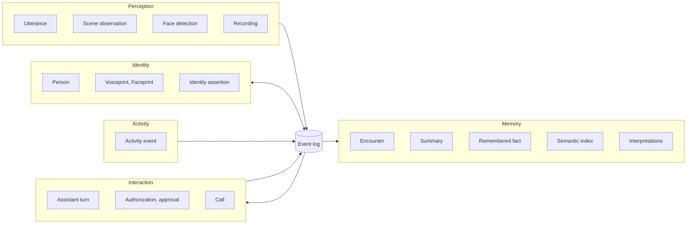
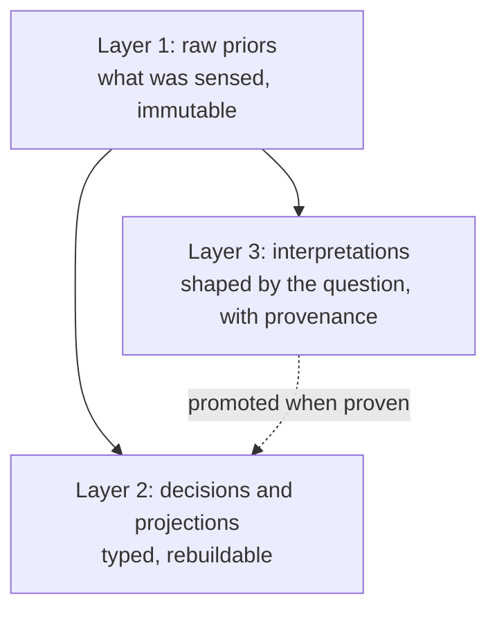
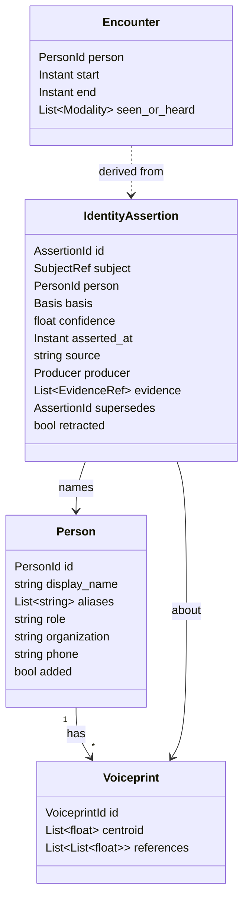
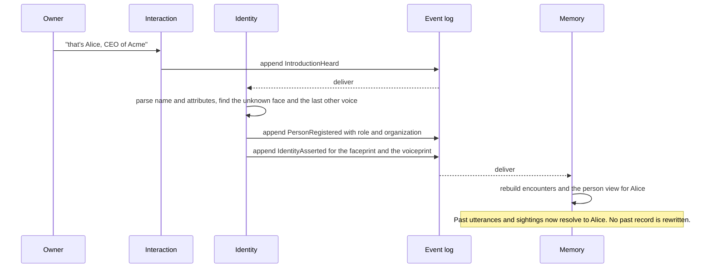

# Domain model

The domain model defines the vocabulary and contracts shared by identity, perception, memory, and interaction.
The pure types live in `src/liberational/domain/`; `domain/kernel.py` is their shared kernel.
[ARCHITECTURE.md](ARCHITECTURE.md) describes the running components and state paths, and
[ROADMAP.md](ROADMAP.md) separates implemented behavior from remaining product work.

The core model is implemented: stable people and identity assertions, transcript views, encounters,
interpretations, and semantic retrieval. The original file-store migration is complete. Activity models produce
observations, but owner agreement and held-out measurement remain distinct, and unverified detections must be
shown as such. This document specifies contracts; it does not claim every proposed event type is a stored stream.

## Ubiquitous language

Use these words in code, docs, and the dashboard. Each has one meaning.

| Term | Meaning |
|---|---|
| Observation | A fact the pack perceived at an instant, from a device. Immutable. Utterances, scene observations, and face detections are observations. |
| Utterance | One stretch of speech with its text, time span, device, and voice match. |
| Scene observation | One camera view at an instant: caption, faces, objects, brightness. |
| Face detection | One face found in a frame, live or in a recording, with its box and embedding. |
| Person | A human the pack knows about. Has an id that never changes, a name, and attributes. |
| Voiceprint | A speaker cluster: a centroid and reference embeddings of one voice. |
| Faceprint | The reference embeddings of one face. |
| Identity assertion | A claim that a voiceprint, faceprint, or observation belongs to a person, with its basis, confidence, and evidence. |
| Encounter | A contiguous period in which a person was seen or heard. Derived, never entered by hand. |
| Presence episode | A per-camera stretch of positive face or body samples. Its start estimates when someone came into view, not a physical entry or a unique person. |
| Activity event | A typed span of time with measured attributes, such as someone sitting down for a while, or a repeated movement and how many times it repeated. |
| Evidence reference | A stable pointer to the source of a claim: a recording and offset, an utterance, a call turn, or a frame. |
| Recording | A video segment from one camera, with a start time and a file. |
| Place | An indoor place, such as a home or an office. The machine makes one from a phone walkthrough or from fixed cameras that see the same space. Its machine view is a chain of revisions, each written once: a point-cloud map, a floorplan, the map's floor plane, the map-to-plan transform, and the fixed cameras registered in that frame. A 3D Gaussian splat sits beside a revision (trained on that revision) and is not a revision of its own. The owner's name and plan corrections are taught state and supersede the machine view without deleting it. Not a camera's view: a camera is an angle, not a room. |
| Visit | A span of time the rig spent in one place, derived from the place signals. |
| Call | One phone call, with its audio and its turns. |
| Summary | Text that condenses a period of events, with links to its evidence. |
| Remembered fact | A fact the owner asked the pack to remember ("remember that ..."). |
| Semantic index | A search index over the meaning of text, built from events. |
| Event | A record that something happened, in the shared envelope below. |
| Projection | A view computed from events, such as "who said this line" or "when was Dana last seen". Can be rebuilt. |
| Layer | One of the three data layers: raw priors, decisions and projections, or interpretations. See [Data layers](#data-layers-and-schema-strategy). |
| Interpretation | A derived result (an extraction, a summary, a vector, a measurement) with its sources, producer, and shape. Layer 3. |
| Shape | The structure a question or a consumer asks for, such as a count, a list, or a summary. |
| Query lens | The steps that turn one question into an answer from layers 1 to 3. It is a function, not a stored object. |
| Promotion | Moving an interpretation into layer 2 as a typed record, once its conditions hold. |
| Embedding index | A vector index built from interpretations of one embedding model. |

## Bounded contexts

Each context owns its words and its records. Contexts talk through events, not through each other's files.

| Context | Owns | Today's code |
|---|---|---|
| Perception | Capturing and recording what the devices sense. Makes observations. Does not decide who anyone is beyond a raw match score. | `listen/`, `speech/` (ASR), `see/`, `vision/`, and `continuum-capture` |
| Identity | People, their voiceprints and faceprints, and the assertions that link observations to them. The only context that decides who someone is. | `people/`, `listen/voices.py`, `vision/faces.py`, and dashboard people routes |
| Activity | Model observations, coverage, and rating-gated activity answers. | `see/actions.py`, `memory/events.py`, and the count readers |
| Memory | Reading the log to answer questions: encounters, summaries, remembered facts, interpretations, the query lens, and search. | `memory/`, `vision/camera_history.py`, `vision/sightings.py` |
| Interaction | The assistant's turns, who may ask for what, and phone calls. | `assistant/`, `phone/` |

The shared kernel holds what every context needs: the instant (a UTC time), identifiers, the event envelope, the evidence reference, and the schema version. It has no input or output, and imports no model, camera, or database library. Context types share the kernel rather than importing each other.

## Data layers and schema strategy

The model has three layers. Each layer is built from the one below it.

| Layer | Holds | Shape | Rule | Today |
|---|---|---|---|---|
| 1. Raw priors | What the devices sensed: utterances, scene observations, face detections, recordings, and calls. | A fixed envelope, with the payload as captured. | Immutable. Never reinterpreted in place. | Segment streams such as `speech.utterance`, `camera.caption`, and `face.match`; broker recordings; call media and transcripts. |
| 2. Decisions and projections | What the system has decided, and what it must answer the same way every time: people, identity assertions, encounters, the timeline, authorization, and forgetting. | A full typed schema, fixed when written. | Rebuildable from layer 1 and the assertions. Never reads layer 3 unless the result is promoted. | Stable people and assertions in `knowledge.sqlite3`, face references in `faces/db.npz`, and reader projections. |
| 3. Interpretations | Anything derived from layer 1 for a question or a job: an extraction, a summary, a re-caption, a new embedding, or a pose analysis. | Any shape. The question or job defines it, and the shape name and version are recorded. | Each one records its sources, its producer (model, version, and prompt), and its shape. Purged with its sources. | The broker memory log: journal entries, facts, summaries, and saved Ask answers, with evidence and producer metadata. |

### Schema-on-write and schema-on-read

There are two ways to decide the structure of data.

- **Schema-on-write.** The structure is fixed when the data is stored. Queries are fast and predictable. A new kind of question can need a new migration.
- **Schema-on-read.** The raw data is stored as it is, and the structure is chosen when it is read. Old data answers new questions. Each read costs more, and results must be stored with their provenance to be reproducible.

The model uses a hybrid. Each concern takes the approach that fits it.

| Concern | Approach | Reason |
|---|---|---|
| Identity, owner checks, whisper names, authorization | Write | Must be fast, deterministic, and auditable. No model call may decide who the owner is. |
| Timeline, encounters, forgetting | Write | Forgetting must be complete. Typed keys (person id and time) make a purge tractable. |
| Raw capture | Write the envelope, keep the payload as captured | Future needs cannot be predicted. Keeping the payload keeps new reads possible. |
| Questions over history, such as "what did we talk about" | Read, then cache as interpretations | The shape of each question is not known in advance. Stored results with provenance are cheap and repeatable. |
| Activity measurement, such as how many times something repeated, or how long it lasted | Read first, promote when proven | It is not yet known which measurements are reliable. Promotion needs a measurement set. |
| Embeddings | Read side, one index per model | Vectors from different models cannot be compared. |

The current Ask gate uses owner activity feedback: a kind needs sufficient distinct-event ratings and Right fraction, with camera-angle overrides when sufficiently rated. Existing counted crossings retain their default until negative feedback demotes them. This is an owner-agreement gate, not proof of unbiased held-out precision, recall, or attribute accuracy; the blinded measurement set is still needed. Owner ratings live in the knowledge store and identify their activity spans. See Architecture and Measurement for current storage and evidence boundaries.

Schema-on-read costs latency, model calls, and reproducibility. That cost is acceptable off the hot path and not on it. Voice replies that need an owner check use layer 2 only, so a question that needs a model never blocks an owner check.

### Promotion

The intended promotion contract requires all three conditions below. The implemented activity-answer gate uses owner ratings, as described above; it is not a completed held-out measurement program.

1. It has been used repeatedly. The threshold must be explicit.
2. Its accuracy has been measured against the measurement set, and the result is recorded.
3. Its producer and version are pinned, so the typed record can be traced back to it.

The promoted record links to its interpretation, and the interpretation stays as provenance. For example, an event detected from pose starts as a versioned pose interpretation. They become an `ActivityEvent` after they are measured.

## Canonical model

### Entities and values

Small value types are not drawn: `Instant`, `EvidenceRef`, `SubjectRef`, and `Producer` (model, version, prompt id, and prompt hash). They are immutable values inside records, not records of their own.

These are the only records with domain types (`liberational.domain`). Observations (utterances, scene captions, detections, tracks, recordings, and calls), interpretations, and measured activity are rows in the segment store and the broker's streams, with their schemas there (docs/CONTINUUM.md); nothing reads them through a domain type, so none is kept.

Notes:

- **Person** is the aggregate root of Identity. A person is referenced by `PersonId` everywhere. A name is an attribute, so a rename touches one record. `role` and `organization` are fields, so "that's Alice, CEO of Acme" parses into a name plus attributes. `phone` is the number the assistant calls, `added` says the owner added the person by hand so they are listed before anything has seen or heard them, and `aliases` are their names before a rename and the names of people merged into them. It is a projection of events such as `PersonRegistered` and `PersonAttributesChanged`, so it carries no time or source of its own (rule 4).
- **Voiceprint** is reference data for matching. A person can have several. They belong to a person only through assertions, so a wrong match can be undone without losing the cluster. It is a projection, so it carries no time or source of its own (rule 4).
- **Identity assertion** is the one place identity is decided. Its `basis` is one of: owner tag, spoken introduction, name badge, embedding match, cluster merge, backfill match, or correction. `subject` is a voiceprint, a faceprint, or a single observation. It records when it was made (`asserted_at`) and what made it (`source`). When a model decided, it also names the model (`producer`).
- **Encounter** is derived from face detections and utterances that resolve to the same person, with gaps under a set limit merged. `memory/timeline.py` joins retained face visits with resolved speech rows.

### Rules (invariants)

1. **Observations are immutable.** An observation is never edited after it is written. A correction is a new assertion, not a rewrite.
2. **Identity is a projection.** "Who said this line" is the result of applying assertions to the utterance's voice match. The rule for choosing between assertions is written down once (see Open decisions). Every identification can show the assertions behind it.
3. **People are referenced by id, never by name string.** Names appear only in `Person` and at the edge, such as spoken input and display.
4. **Every event says when it happened, where it came from, and in which schema version.** The envelope carries an id, an instant, a source, the schema version, and the producer when a model wrote it. The schema version is on the envelope only, per event type. No record repeats it. Beyond that, each kind of record carries what it needs.
   - **Layer 1 records** (utterances, scene observations, face detections, recordings, and calls) have an id and a time: an instant, a span, or for a face detection the frame it was found in. An utterance names its device, and a scene observation and a recording name their camera. Otherwise the source is on the envelope. So is the model behind the record, such as the speech model for an utterance.
   - **Identity assertions** have an id, `asserted_at`, and `source`. `producer` is required when a model decided (an embedding match or a backfill match), and optional otherwise. These are on the record because "newer wins" breaks ties (see Identity precedence below), and "when, and by what, was Alice identified" should not need the envelope.
   - **Interpretations** have an id, `created_at`, `producer`, and `sources` (rule 10).
   - **Activity events** have an id, a span, and a `source` that names what they were promoted from. That is usually an interpretation, which names its producer.
   - **Projections** (people, voiceprints, faceprints, and encounters) are exempt. They are rebuilt from the log (rule 8), so they carry no source or producer, and no time for when they were made. People and prints have an id. An encounter has no id, and its span is the period it covers. The events that build them carry the rest.
5. **One clock.** An instant is a UTC time, represented by the domain instant type; broker and segment timestamps use integer UTC nanoseconds. Local time and call-relative time are for display and for call files only, and are converted at the edge.
6. **Corrections supersede; they do not delete.** An assertion is replaced by a new one that names it in `supersedes`, or withdrawn with `retracted`.
7. **Forgetting is explicit and complete.** Forgetting a person is a recorded event, and each data class has a stated rule (see below).
8. **A projection can always be rebuilt from the log.** Identity views replay owner assertions; enrolled reference media and vectors must also be preserved as owner inputs.
9. **Layer 1 payloads are never reinterpreted in place.** A new meaning is a new interpretation.
10. **Every interpretation names its sources, producer, and shape.** An output without them can be shown to the user, but it is not stored.
11. **Layer 2 never reads an unpromoted interpretation.** Owner checks, identity, the timeline, and forgetting use only layers 1 and 2.
12. **Interpretations are purged with their sources.** Forgetting a person purges every interpretation whose sources include that person's records, including cached answers and vectors. A summary that covers several people is purged when any of them is forgotten, or rebuilt without that person's records.
13. **Model output is labeled as model output.** Each value from a model shows its producer, and an uncertainty where one exists.

### Forgetting

Forgetting is different from recording retention and a catalog reset. It removes the person's identity and
applicable derived evidence through the existing deletion paths, while age-out removes old footage and retains
derived observations. See [People](PEOPLE.md#the-knowledge-store) and
[Continuum](CONTINUUM.md#forgetting) for the store boundaries.

`PersonForgotten` outlives the person's purged events. Its opaque IDs, assertion supersessions, rematch times,
and hashed name history prevent replay from reviving an old assertion or assigning the forgotten person's
lines to someone who later takes the same name. The owner-facing deletion also handles gallery references,
profile media, segment rows, and memory-log interpretations; these stores do not share one transaction.

`people/forgotten.py` keeps a keyed one-way hash of each name (HMAC-SHA256 under a fixed key; a per-install
salt is a follow-up) in the knowledge store's separate `forgotten.names` collection. They recognize a name in a
question without listing forgotten names. Living identities are checked first, and `assistant.forgotten_reply`
controls the response.

## Events

### Envelope

Every event has the same outer shape. The payload differs by type.

| Field | Meaning |
|---|---|
| `event_id` | Unique id. Consumers use it to ignore duplicates. |
| `type` | Past-tense name, such as `UtteranceHeard`. |
| `schema_version` | Integer, per event type. Records do not repeat it (rule 4). |
| `occurred_at` | When it happened (an instant). |
| `recorded_at` | When it was written. Differs from `occurred_at` for backfill. |
| `stream` | The ordering key, such as a device, a camera, or a person id. |
| `source` | Device or process that produced it. |
| `producer` | The model behind it (name, version, and prompt), if any. Optional. |
| `subject` | The person id, if known. Optional. |
| `causation_id`, `correlation_id` | What caused it, and the chain it belongs to. Optional. |
| `evidence` | List of evidence references. |
| `payload` | The type-specific body. |

### Catalog

| Event | Context | Current record or implementation | Main consumers |
|---|---|---|---|
| `UtteranceHeard` | Perception | `speech.utterance` in the segment store | Identity, Memory, Interaction |
| `SceneObserved` | Perception | `camera.caption` in the segment store | Identity, Memory |
| `FaceDetected` | Perception | `face.match` in the segment store | Identity |
| `RecordingSegmentClosed` | Perception | recording chunks and their broker catalog entries | Perception (backfill) |
| `IntroductionHeard` | Interaction | a spoken introduction: the owner's "that's Alice" command in `assistant/voice.py`, and the introduction patterns in `people/identity.py` | Identity |
| `PersonRegistered`, `PersonAttributesChanged` | Identity | people events in the knowledge store | all |
| `IdentityAsserted`, `IdentityRetracted` | Identity | identity events in the knowledge store | Memory, Interaction |
| `UtteranceLabeled` | Identity | a line marked "multiple speakers" or unlabeled in the dashboard | Memory, Interaction |
| `PersonsMerged` | Identity | person merge events in the knowledge store | all |
| `PersonForgotten` | Identity | `delete_person` | all |
| `CardPreferenceSet` | Identity | the owner's choices on a contact card (`card_prefs.json`: the main photo, what is hidden); an undo is a superseding event (`people_undo.json`) | Interaction |
| `InboxSkipped` | Interaction | an inbox item the owner skipped (`inbox_skips.json`) | Interaction |
| `WhisperAnnounced` | Interaction | a name whispered to the owner (`whisper_names.json`) | Interaction |
| `ObjectSighted` | Perception | owner crops in `object.sighting`; worker matches in `object.match` segment rows | Memory |
| `ObjectRemembered`, `ObjectForgotten` | Memory | remembered-object events and crops in the knowledge store | Memory, Interaction |
| `ActivityDetected`, `MeasurementRecorded` | Activity | speech measurements in the knowledge store; model observations in `action.span` and `action.window` | Memory |
| `AssistantSpoke` | Interaction | `assistant.reply` in the segment store | Memory |
| `ApprovalRecorded` | Interaction | a line in `approvals.jsonl` | Interaction |
| `CallEnded` | Interaction | `call.json` | Memory |
| `SummaryWritten` | Memory | `journal.page` on the memory log (a day, week, or month page) | Interaction |
| `InterpretationRecorded` | Memory (layer 3) | journal, fact, and summary payloads on the memory log | Memory, Interaction |
| `InterpretationSuperseded` | Memory (layer 3) | memory-log supersession metadata | Memory |
| `InterpretationPromoted` | Memory (layer 3) | proposed event; activity answers currently use owner-rating policy | Activity, Identity, Memory |

`Encounter` is a projection, not an event.

`UtteranceLabeled` gives a transcript line a label that names nobody: "unknown" (unlabeled) or "multiple speakers". It sits beside the retractions that withdraw the line's person, because a line from a voice with no name has no person to withdraw. A person's label on the line replaces it, and an empty label clears it. It names no person, so it holds nothing to forget.

`PersonRegistered` fires when a person is first known, with any attributes that came with the first tag. `PersonAttributesChanged` fires for every later change, such as a new role or phone number. Its `changes` hold only the fields that changed, and `previous` holds their old values. An empty value clears a field. Both stay at schema version 1: `role`, `organization`, `phone`, and `added` are optional fields, and an event without them reads as before. A merge keeps the survivor's role, organization, and phone number, and fills in the ones the survivor lacks from the person merged into them. So when both have a number, the survivor keeps theirs; the other stays in the log as the merged person's history, and the dashboard says it was not kept. The survivor is marked added if either was, and gains the merged person's names as aliases.

### How a tag flows

This is the conceptual flow. `people/identity.py` and `people/tags.py` implement introductions and attributes; registry assertions supply the speaker view without relabeling raw speech rows.

## Event log port

The contexts depend on a small interface, not on a product. Any adapter that keeps the guarantees below is valid.

| Operation | Meaning |
|---|---|
| `append(events)` | Write events durably. Return their positions. |
| `read(stream, after, limit)` | Return events in order after a position. |
| `subscribe(consumer, filter)` | Deliver events to a named consumer, in order per stream. |
| `ack(consumer, position)` | Record how far a consumer got. The consumer owns its position. |
| `purge(selector)` | Remove events that match, for forgetting and retention. Records that it did. |

Guarantees, kept small on purpose:

- **At least once.** Consumers must ignore duplicates by `event_id`.
- **Order within one stream only.** There is no global order and no transaction across streams.
- **Replay.** A new consumer can read a stream from the start.
- **Events are small and self-describing.** Large media stays in files and is referenced by evidence reference.

The current adapter is `knowledge_eventlog.SQLiteEventLog`, backed by `knowledge.sqlite3`. Identity remains
available without a broker connection. The store supplies immutable IDs, append positions, consumer cursors,
erasure tombstones, and transactional owner writes. The domain port does not require every adapter to expose
all of the store's transaction features.

A queue delivers events; it is not the durable source of truth. A replacement adapter must keep replay,
identity precedence, and erasure behavior, not merely transport the same messages.

## Current storage mapping

| Concept | Store or projection |
|---|---|
| People, identity assertions, remembered objects, and spoken measurements | `knowledge.sqlite3`, through `knowledge_eventlog.py` |
| Owner labels, zones, pet references, activity ratings, and transcript corrections | Knowledge collections |
| Speech, captions, face observations, poses, actions, and coverage | Segment streams, declared in `segment_log.py` and `speech_log.py` |
| Camera and microphone recordings | Broker catalog and tier chunk files |
| Journal entries, facts, summaries, and saved Ask exchanges | Broker memory-log streams, declared in `memory_log.py` |
| Face, voice, and journal search | LanceDB tables maintained by the vector worker |
| Face enrollment | `paths.faces`, preserved with owner inputs |
| Contacts and manually added names | Registry fields, with `contacts.json` and `people_added.json` read models |
| Encounters | `memory/timeline.py`, projected from face visits and resolved speech rows |
| Places and visits | `memory/places.py`: machine revisions under `state/places/` (a point-cloud map, a floorplan, the floor plane, the map-to-plan transform, and registered cameras), plus a splat beside a revision (`<revision>.gs.ply`, `<revision>.sog`, and `<revision>.gs.from`); visits in the `place.visit` segment stream; the owner's names and plan corrections in the knowledge store's `place.named` and `place.plan` |
| Calls | Per-call metadata, audio, and transcripts under `paths.calls` |

[Architecture](ARCHITECTURE.md#state) is the complete state contract.

## How the goals use the model

| Goal | Layer | What it needs |
|---|---|---|
| 1. Identify people after one tag | 2 | `Person` with attributes, `IdentityAssertion`, and the rule that one tag creates assertions for the face and the voice together. Corrections are assertions. Confidence and evidence come from the assertions behind each identification. |
| 2a. When did I last see someone | 2 | `Encounter` from the timeline, keyed by person id and time. Typed and fast, with no model. |
| 2b. What did we talk about | 3 | Retrieve utterances by person and time from layers 1 and 2. The query lens derives the answer as an interpretation. The answer cites evidence references. |
| 3a. How many times did something happen, and how long did it last (for example, repetitions and a spoken weight) | 3, then 2 | Event interpretations from pose and speech first. Promote to `ActivityEvent` once measured. A count is then a query over events, not a text search. |
| 3b. How was something done | 3 | A judgment about an event is an interpretation with a stated uncertainty, until it is measured. |

### Semantic index

The semantic index is an interpretation store with a vector index on top. Each vector is an interpretation. Its producer is the embedding model, and its sources are the records it was computed from.

- **One index per embedding model and version.** Vectors from different models are never compared. A model change starts a new index.
- **Re-embedding is a background job.** It writes a new index beside the old one, and switches over only when it finishes.
- **The index is a cache.** It can always be rebuilt from layer 1, so it is not a source of truth.
- **Embedded adapter.** The vector worker owns LanceDB tables. Broker purges and segment deletions invalidate their corresponding indexed records; storage spans processes rather than one SQLite transaction.

Face and voice observations are indexed in their own model spaces. Confirmed enrollment and calibrated matching gates, not vector similarity alone, decide automatic identity. The default text embedding model is `models.ollama.embedding` (`qwen3-embedding:0.6b`, 1024 dimensions).

### Query lens

The query lens turns one question into one answer. It is a function, not a stored object. For each question it does the following.

1. **Parse** the question into people, a time range, and a shape (a count, a list, a summary, or free text). Today's parser handles one kind of question at a time. The lens must handle a question with several parts.
2. **Answer from layer 2 when the shape is typed.** Encounters and counts over events need no model.
3. **Retrieve evidence.** Filter layers 1 and 2 by person and time, then rank the rest by vector similarity.
4. **Reuse a cached interpretation** whose sources, producer, prompt, and shape all match.
5. **Derive one** when none matches. Send only the retrieved evidence and the requested shape to the model. Store the result if the question is likely to repeat. Otherwise show it without storing. A stored result is invalidated when its sources are purged.
6. **Answer with evidence references** to layer 1 records, and mark the parts the model produced.

The requirement to recontextualize priors with different semantics is step 5 with a different shape or producer. The raw records do not change. The new interpretation is added beside the old one.

## Implementation and remaining work

The domain types and event-log port live in `domain/`; owner events use `knowledge_eventlog.py` and
`people/registry.py`. `people/transcript_view.py` resolves speech identities, `memory/timeline.py` builds
encounters, and `memory/recall.py` retrieves evidence. `people/tags.py` parses explicit names and attributes.
`see/actions.py` supplies model activity observations and coverage; `memory/events.py` applies owner feedback.

The remaining work is measurement and product coverage, not the old file-store migration. The formats and
scorers are in [MEASUREMENT.md](MEASUREMENT.md), and the live queue is on the project board.
[ROADMAP.md](ROADMAP.md) describes the larger goals. Do not infer accuracy from an implemented type or a passing
unit test, or infer absence from missing detector coverage.

Installation and reset procedures belong in [MIGRATING.md](../MIGRATING.md).

## Identity precedence

`domain/identity.py` holds the deciding rule: retraction, then an owner tag, then a confirmed assertion, then a
system match by confidence, with newer `asserted_at` breaking ties. A rematch supersedes earlier system matches
for the subject, even if an earlier score was higher; it never beats an owner tag, confirmation, or retraction.
A superseded assertion does not decide identity. A later owner correction can restore identity, and an undo
withdraws the correction through the same assertion machinery.

Role and organization updates follow the same ownership boundary: only the owner replaces owner-taught
attributes; an unconfirmed introduction fills blanks. A model output cannot grant owner authorization.

The implementation uses UUIDv7 IDs and UTC instants. Stored interpretations remain model evidence, carry their
sources and producer, and follow source deletion. These are the enduring contracts of the original design;
retired file paths, model defaults, and migration steps are not additional requirements.
