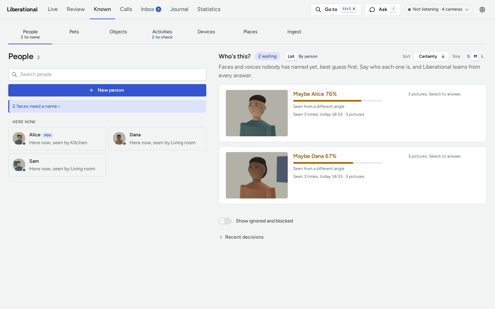
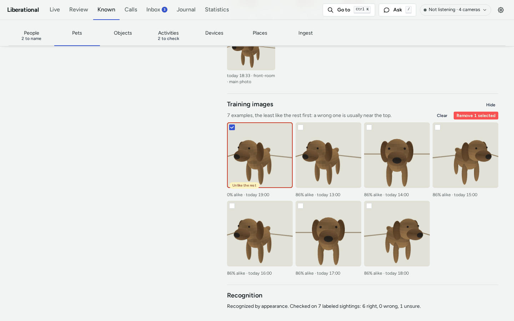

# How to name people and pets

This guide shows you how to tell the pack who a face, a voice, or an animal is, how to answer the naming cards, and
how to take back a wrong answer or a wrong training image. Everything here is done in the dashboard's **Known** tab.
[PEOPLE.md](PEOPLE.md) explains what each answer changes and the thresholds behind the guesses.

## Before you begin

- Teaching is accepted from the machine the pack runs on. To teach from another device, set
  `dashboard.remote_teaching` (see [config/defaults.toml](../config/defaults.toml)) and use the dashboard password.
- A face group or an animal sighting is listed only while it has a saved picture.

## Find what waits for a name

- **Faces and voices**: open Known, then People. The line above the list says how many faces and voices need a name;
  it opens "Who's this?". On Live, "Who's this?" beside "Here now" opens the same list.
- **Animals**: open Known, then Pets, then "Sightings to name". A sighting the pack already named by itself is not
  listed: it is on that pet's card. A sighting that waits says why under its pictures, such as "Appearance is below
  the naming threshold." or "Another animal looks too similar to name this sighting safely."

Each card shows the newest picture (or a clip to play), when and where it was seen or heard, and the best guess with
a score. The score says how sure the guess is. It is not a probability.

## Answer a card of pictures

A face group or a group of animal sightings has two buttons, and which two depends on the guess.

If the card has a guess:

- Press the name (**Y**) when the guess is right. The selected pictures are named as that person or pet.
- Press "Not <name>" (**N**) when it is wrong. That name is never the guess for these pictures again, and they keep
  waiting for another name.

If the card has no guess:

- Pick a name in the name box. For a face, choose a known person or type a new name and add it. For an animal, choose
  the species, then the pet, or "Other…" to add a new pet. Choosing a pet of another species corrects the sighting's
  species.
- Press "Ignore" (**I**) to hide the selected pictures for good. New pictures of the same face or animal are still
  asked about.
- Press "Block" (**B**) to hide the selected pictures and anything very like them from now on. Use it for a poster,
  a face on a screen, or a neighbor's cat. A block hides only what waits for a name: a named person or pet is still
  recognized.

The keys work while the card is selected. The arrow keys move between cards.

## Leave some pictures out of an answer

A card with several pictures is folded, and says "N pictures. Select to answer." where its buttons will be. Selecting
it opens every picture, all selected.

1. Click each picture that does not belong. It is deselected.
2. Answer the card. The answer covers only the pictures still selected.

The pictures you left out stay unnamed and are asked about again as a group of their own.

## Answer many at once

"By person" (in Who's this?) and "By pet" (in Sightings to name) show everything guessed as one name.

1. Pick the name.
2. Click the pictures that are not them.
3. Press the button above the grid. The pictures still picked are named, and the others are recorded as not that
   name.

## Answer a voice

Play the clip, then choose one:

- "Yes, <name>" when the guess is right, or pick a name in the name box.
- "Not <name>" when the guess is wrong. The voice keeps waiting.
- "Multi" when several people talk over each other in the clip. The line is labeled as several speakers and the voice
  stays.
- "Noise" when the clip is not a voice at all. Only that clip is dropped.
- "TV" when the voice is a TV or radio. Its lines stay in the transcript as nobody's, and the voice leaves the list.
- "Ignore" to set the whole voice aside.

## Add someone the pack has not seen

In Known, then People, press "New person" and give a name. On the person's card, add reference photos, audio, or
video. A photo that shows exactly one face teaches that face. Group photos, audio, and video are kept for reference
and teach nothing.

For a pet, use "New pet" in Known, then Pets, and name a group of its sightings.

## Take back an answer

- Right after an answer, press "Undo" in the confirmation that appears.
- To bring back something ignored or blocked, turn on "Show ignored and blocked" under the list, then press
  "Un-ignore" or "Unblock" on the item. It waits for a name again.

## See how well a pet is learned

Open the pet's card (Known, then Pets) and read "Recognition".

- "Recognized by appearance" means new sightings of the pet are named without you, and says how many labeled
  sightings that was checked on, with how many came out right, wrong, and unsure.
- The next line is the check on recent sightings the pack was not taught from: the dates it covers, the share named
  correctly by itself, and how many were wrong or unsure. It covers the days that have such sightings, so it can be
  shorter than the week it looks back over. With none, it says no check is available.
- "Usable teaching examples" is how many of your answers recognition can use. "Earlier taught sightings have no
  usable reference" counts answers given for an earlier model whose pictures are gone; answer more sightings of that
  pet to replace them.

Every answer in "Sightings to name" teaches the pack, and the wrong and unsure counts fall as the pet's examples
cover more of how it looks.

## Remove a wrong training image

A wrong picture among a person's or a pet's examples pulls matches the wrong way.

1. Open the person's card (Known, then People) or the pet's card (Known, then Pets).
2. In "Training images", press "Show". The examples are listed with the least typical first, which is where a
   wrong one usually is. Each says how alike it is to the rest, and one far below the others is marked "Unlike the
   rest".
3. Select each wrong picture and press "Remove N selected".

   

4. Confirm. Removal cannot be undone.

Recognition stops matching against the removed examples at once, with no restart.

## Related

- [PEOPLE.md](PEOPLE.md): how voices and faces are named, and what Ignore, Block, and "Not" store.
- [VISION.md](VISION.md#pets): how pets are told apart.
- [DASHBOARD.md](DASHBOARD.md): the dashboard's server and frontend.
