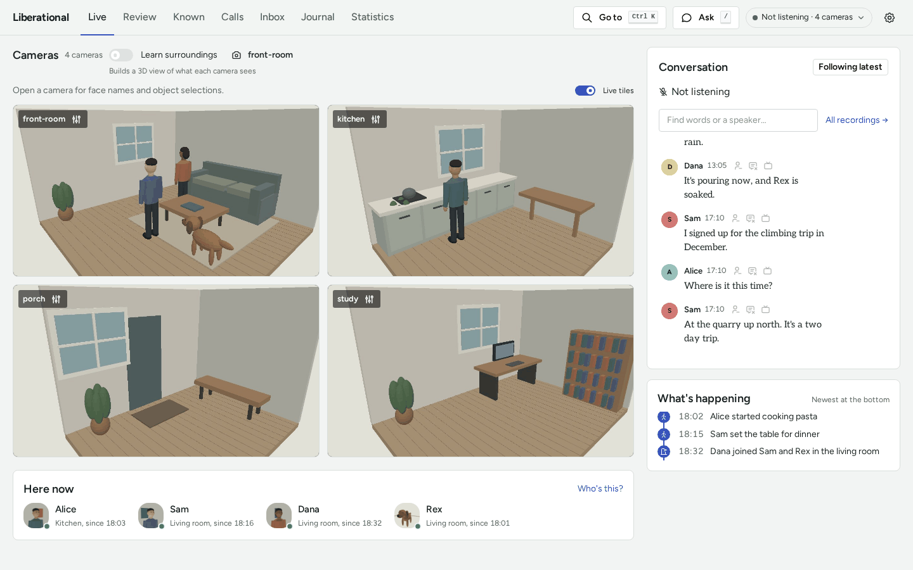
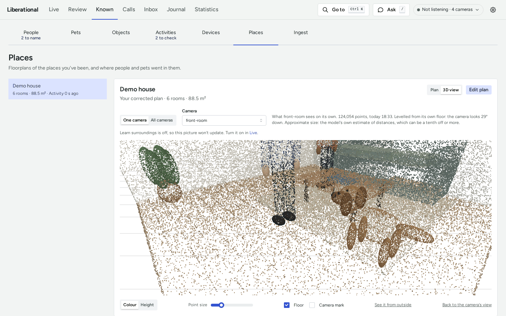
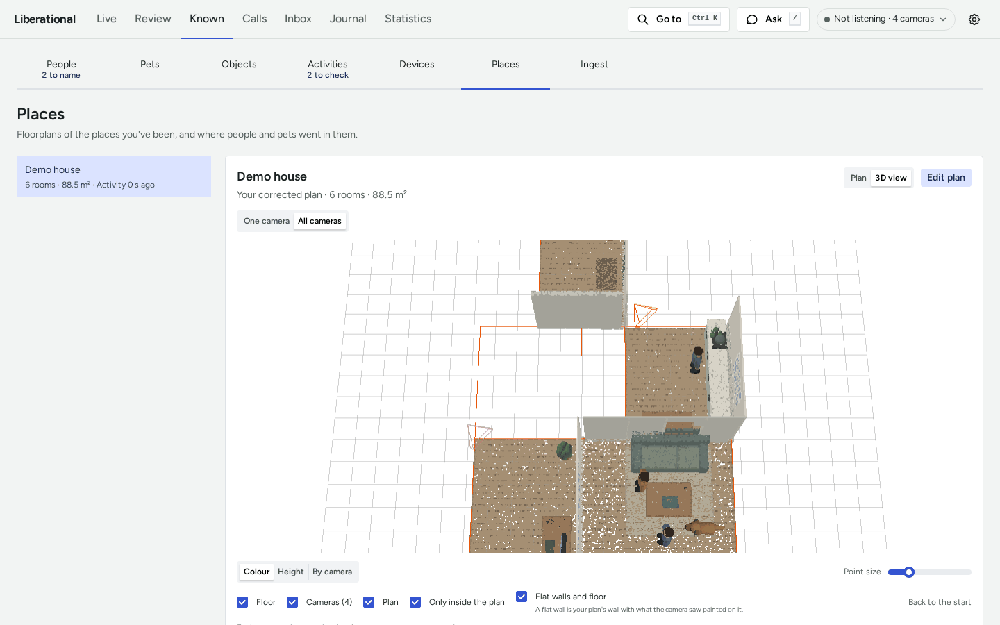

# How to see what each camera sees in 3D and people on a place's plan

This guide takes a pack with fixed cameras to pictures collected from them, a point cloud of what each camera sees,
cameras that have a pose from their spot on the plan, and people drawn on the plan on the Places page. [Spatial memory](SPATIAL.md) explains how each part
works.

## Before you begin

- The place has a plan, drawn in the plan editor ([How to draw and change a place's plan](PLAN-EDITOR.md)).
- The place-recognition model is fetched: `mise run models`.
- The `surroundings` and `positions` services are running. Both are on by default
  ([services/services.toml](../services/services.toml)).
- Use the dashboard on the machine the pack runs on: only that machine can change the Learn surroundings switch.

## Turn on Learn surroundings

1. Open the Live tab and turn on the **Learn surroundings** switch.
2. Open the camera button beside the switch, "Cameras to learn from", and check the cameras to collect pictures from.
   With none checked, the default camera (marked "Used when none is chosen" in the menu) is used.



Each change is saved as it is made, and nothing restarts. Turn the switch off to stop. On another device the switch
and the menu are disabled, and say that only the machine the pack runs on can change them.

## Check what the panel shows

Open Known, then Places. While the switch is on, each place carries a "Learning" badge, and the "Learning
surroundings" panel leads with one state:

| The panel says | Meaning |
|---|---|
| Collecting pictures from N cameras | The sampler is looking at the chosen cameras |
| No camera chosen | None of the chosen cameras is in the device manifest: choose again on the Live tab |
| Not collecting pictures | The switch is off; the pictures already kept stay |

The panel is hidden while the switch is off and nothing is kept. Under the state is "Pictures kept", and a row for
each camera with its newest kept picture (with anyone in view painted over; none is shown without the person detector's
model). A row that says "Keeping pictures" needs nothing. "Nothing new in view", "Person or animal in view", "Too
dark", and "Picture is blurred" say why the camera's recent pictures were passed by: wait, or change what the camera
sees. "Not looked at yet" means no picture of the camera has been judged since the sampler started.

## Look at a camera's point cloud

While Learn surroundings is on, each chosen camera also gets a point cloud of what it sees. It needs MASt3R-SLAM set
up on the machine ([the steps](../MIGRATING.md#each-cameras-own-point-cloud)); without it the view says so.

1. On the Places page, pick the place and switch its view from **Plan** to **3D view**.
2. Pick a camera under **Camera**. The view opens from that camera's own viewpoint and draws its points.
3. Press **See it from outside** to step back from the camera and look at the cloud from elsewhere.



**One camera** shows that camera's cloud by itself. **All cameras** puts every camera's cloud where its camera stands
on your plan ([See every camera's cloud in one scene](#see-every-cameras-cloud-in-one-scene)).

The line beside the picker says how many points the cloud has, when it was made, how it was levelled, and whether
it is fitted to the room: resized and slid so that its walls land on your plan's walls, which makes your plan's
dimensions its measurement. A cloud that isn't fitted says why, and "Approximate size": its distances are the
model's own estimate, which can be a tenth off or more.

For a fitted camera, **Flat walls and floor** is on: the floor and the walls it was fitted to are drawn as flat
surfaces on your plan's walls, with what the camera saw painted on them. Furniture stays as points, and where the
camera saw nothing there is a hole. Clear it to see every point where the cloud has it.

When a camera has no cloud, the view says why:

| It says | Do this |
|---|---|
| Learn surroundings is off, or the camera isn't chosen to learn from | Turn the switch on and choose the camera on the Live tab |
| Waiting for about 20 seconds with nobody in view | Wait |
| Someone was in view each time it looked | Leave the view empty for about 20 seconds |
| The view is too dark, or the camera is in night mode | Light the view |
| The model that makes point clouds isn't set up | Set up MASt3R-SLAM and `spatial.pointmap_runtime` |
| There wasn't enough free GPU memory, or the last try failed | Wait: it tries again in a couple of minutes |
| The model wasn't sure of enough of the picture, or the picture had no depth to speak of | Glare, glass, or a very plain view: change what the camera sees |
| This camera's lens calibration can't be used | Calibrate the lens again ([Cameras](CAMERAS.md#calibrate-a-wide-lens)) |

A cloud is made again when the camera's view changes. While the camera is being carried or turned, no cloud of its own
is made, since one needs a view that holds still: the scene follows the camera from its live frames instead, and its
row says **Tracking** ([See every camera's cloud in one scene](#see-every-cameras-cloud-in-one-scene)). Its next cloud
is made once the view holds still, and is placed from where it came to rest.

## See every camera's cloud in one scene

1. Give each camera a spot with a facing on your plan
   ([Give a camera a spot on the plan](#give-a-camera-a-spot-on-the-plan)).
2. In the 3D view, switch from **One camera** to **All cameras**.



Each camera's cloud is drawn where its camera stands on your plan, and fitted to the room it is in. The clouds are
separate layers and are never blended: each camera shows only what it sees, so expect gaps and seams. With **Flat
walls and floor** on, as it is to begin with, each fitted cloud's floor and walls are drawn flat on your plan's
walls: a flat wall is your plan's wall with what the camera saw painted on it.

The clouds already made are brought up to date when the view opens, with Learn surroundings off too.

Under the view is a row for each camera:

- The checkbox shows or hides its points.
- The colour is its outline in the scene, and its points' tint when the points are coloured **By camera**.
- **Look from** moves the view to where the camera stands.
- The arrow at the end opens the details: how the camera was placed, whether its cloud was levelled from its floor
  or its walls and squared to your plan by its walls, how it was fitted to the room, when its picture was taken, what
  its pictures share with another camera's, and how many of its points fall outside your plan's rooms. "Walls in this
  cloud bend" is the model's depth estimate, not the placement.

The fitted line reads "Fitted to the room", with how much the cloud was resized, how far it was moved, and how many
walls it was matched to. One wall gives its size, not where it stands across that wall. A cloud that isn't fitted
stays as it was, and says why:

| It says | Meaning | Do this |
|---|---|---|
| No wall in view | The camera sees no wall to fit by | Nothing: it is placed from its spot |
| The wall it sees isn't where a wall of your plan is | It may be an island, a half wall, or furniture that the plan doesn't draw | Nothing, or draw the wall on your plan if it is one |
| Its walls ask for more than a fit may do | The fit would resize or move the cloud too far | Check where the camera's spot is |

The word on each row says how the camera is placed:

| It says | Meaning | Do this |
|---|---|---|
| Placed | Placed from its spot on your plan | Nothing |
| Adjusted | Placed from its spot, then adjusted against another camera that sees the same space, by what their pictures share. The details say how far from the spot | Nothing |
| Following | Its view changed, and the scene placed it again by itself: by what its pictures measure, or by the walls it now sees where they fit your plan. The details say how far it is from your spot and what placed it. Your spot and plan are unchanged | Nothing. **Use the plan's spot**, in its details, puts the camera back on your spot, and **Follow it again** takes that back |
| Tracking | It is moving. The scene shows it where its live frames are tracked to, with its path and its last keyframes' points, and the details say how long ago a wall held it to your plan | Nothing |
| Moved | It moved and has come to rest. It keeps that place until it gets its next cloud | Wait: about 20 seconds with nobody in view, and the new cloud is placed from where it came to rest |
| Not placed | Its view changed and it can't be placed with confidence: no wall in view, your plan has no wall to place it by, the walls it sees fit nowhere on the plan, or they fit in more than one place. It isn't drawn and keeps where it last stood | **Use the plan's spot** in its details, or set its spot again in the plan editor |
| No spot | It has no spot on your plan, or its spot has no facing | Press **Set its spot**, which opens the plan editor |

A camera whose spot faces the wrong way is placed again the same way, as **Following**, from the walls it sees: its
pictures need not have changed for that to happen.

**Only inside the plan** leaves out the points that fall outside your plan's rooms, and says how many.

Two cameras are adjusted against each other only when their pictures clearly show the same space. When they see some
of it but their pictures don't agree well enough, they are placed from their spots only. When their pictures put
them far from where their spots do, the details say that one of the two spots is off, and nothing is moved. Pictures
taken at night often don't match, so a pair is first adjusted in daylight; the adjustment then stays.

## Give a camera a spot on the plan

A spot says where a camera is on the plan, how high, which way it faces, and how wide it sees. Set it in the plan
editor: [How to draw and change a place's plan](PLAN-EDITOR.md#give-a-camera-a-spot) has the steps.

A camera places nobody until its spot has a facing. People are placed from a saved spot at the next hourly
`pack-positions` run; the next section runs it at once.

## Check what each camera places

```sh
uv run pack-positions --dry-run
```

It reads the last day (`--hours` changes that), changes nothing, and prints a line for each fixed camera: how many
footprints it saw, how many land on the floor and in a room of the plan, whether it is read through its spot
or its pose in a revision, its fitted tilt and whether the picture's straight edges confirmed it, and what it lacks.
A camera read through "nothing: no spot and no pose" places nobody. What a camera lacks, and what to do:

| It lacks | Do this |
|---|---|
| Height, facing, or field of view | Fill in that field of its spot ([steps](PLAN-EDITOR.md#give-a-camera-a-spot)) |
| A held lens and its spot has no field of view | Give its spot a field of view |
| Tilt: too few people seen walking, and too few straight edges in the picture | Wait: a `pack-positions` run fits the tilt once enough people have walked through the view, and the picture's edges can confirm it |
| Check: people come out the wrong height | Check the spot's height and field of view, and the camera's lens |

A line also says how many people and animals the camera left unplaced behind a wall from its spot. An animal there
is put at the furniture and marked approximate, so these are the animals the fallback could not place (no spot, no
plan to read, or a line the spot cannot see from its start), and any people, whose foot behind a wall is pose error.
The run flags a camera with more than a tenth of its people there: its height, tilt, lens, or spot is off, or the
plan is drawn at another scale.

The `positions` service places people at 20 past each hour. To place them at once:

```sh
uv run pack-positions
```

## Verify

On the Places page, pick the place and a time window: paths are drawn on the plan, and the people and pets seen are
listed under it. A camera that can't place anyone is listed there too, as "`<camera>` can't place anyone yet", with
what it lacks.

## Start again

`pack-reset-places` deletes every place's maps, splats, camera registrations, fitted tilts, and stored positions,
and each camera's point cloud. It keeps the owner's names and plans, spots included, and a place with an owner plan
stays listed with no map. It leaves the kept pictures, and the clouds are made again.

1. Turn Learn surroundings off, and pick a moment that isn't 20 past the hour.
2. See what would go and what would stay, then do it:

   ```sh
   uv run pack-reset-places
   uv run pack-reset-places --yes
   ```

3. Restart the dashboard and the journal, which keep what they read:

   ```sh
   uv run pack-services restart dashboard journal
   ```

## Related

- [How to draw and change a place's plan](PLAN-EDITOR.md): rooms, walls, camera spots, and versions
- [Spatial memory](SPATIAL.md): how pictures are collected, why a spot outranks a registration, and how plans and
  positions fit together
- [config/defaults.toml](../config/defaults.toml), `[spatial]`: the settings behind the switch
- [Upgrading](../MIGRATING.md#resets-and-what-they-keep): the other resets
