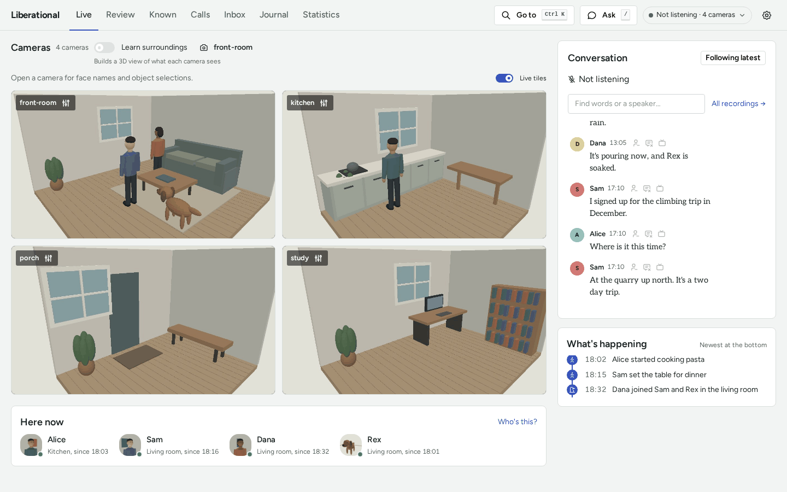
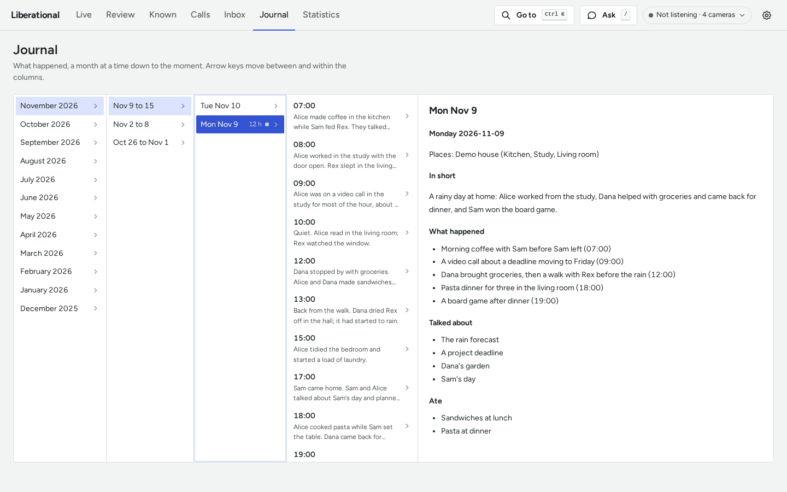
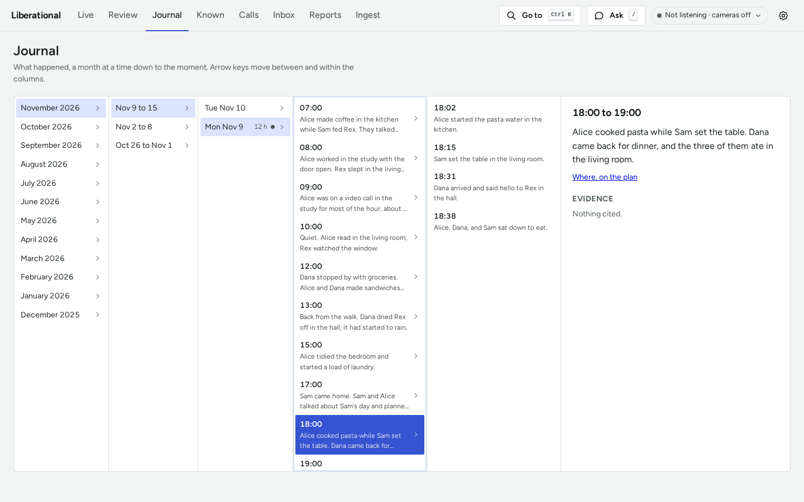
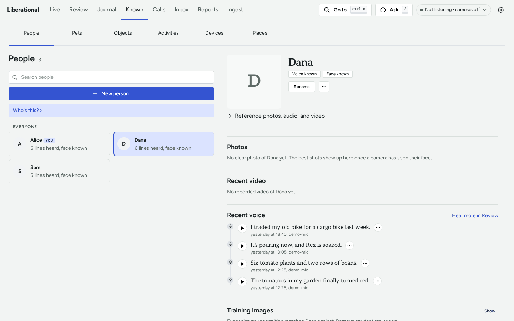
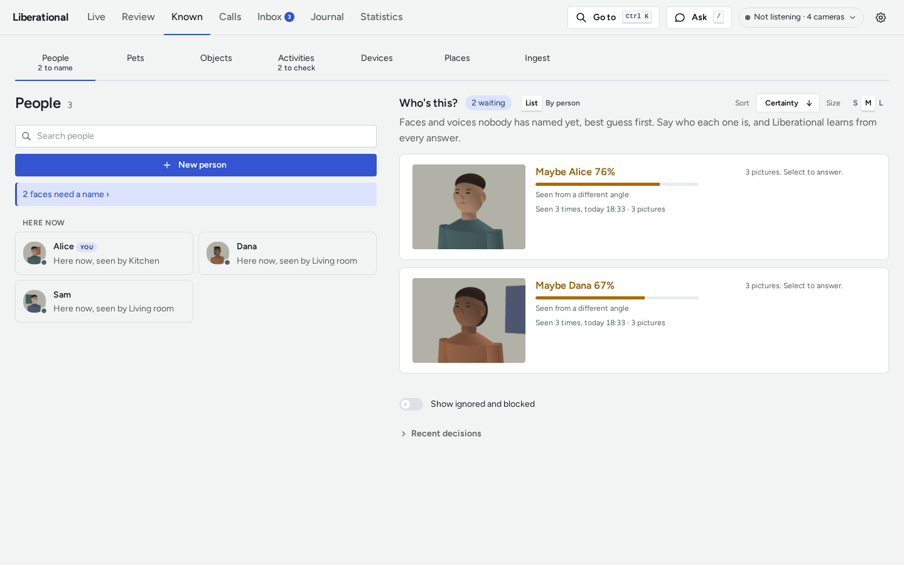
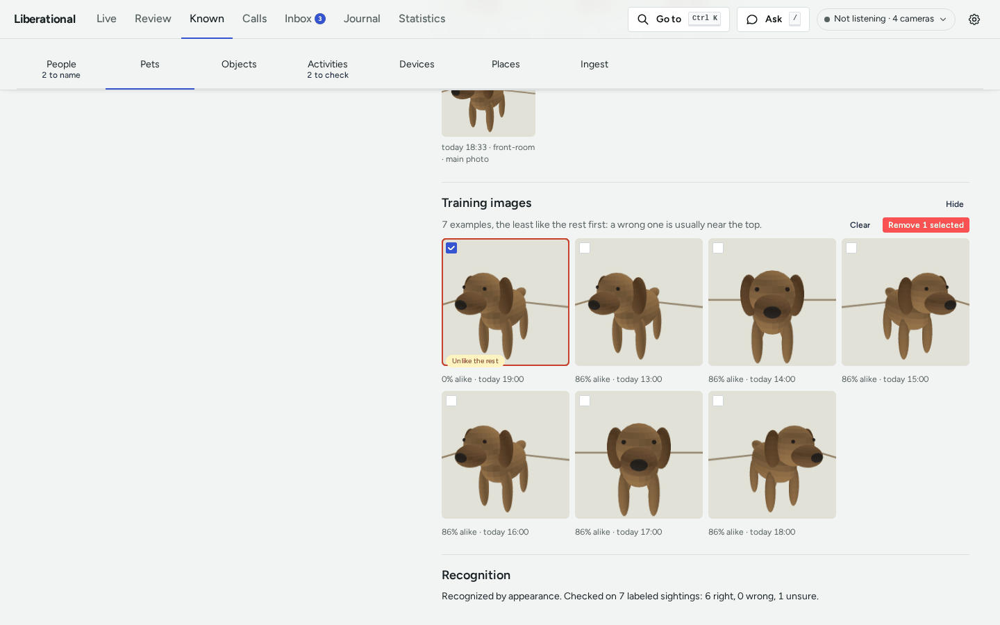
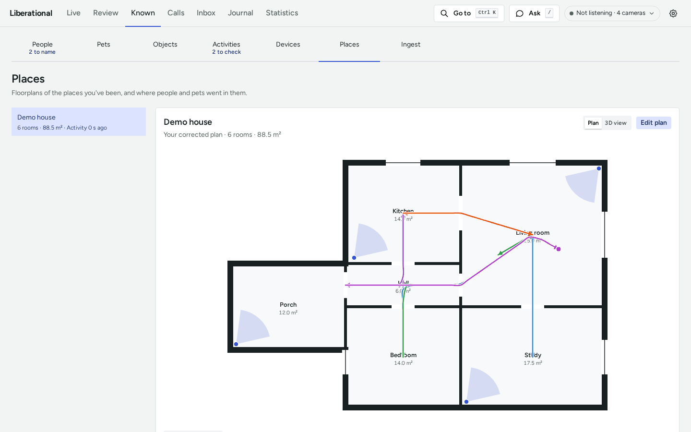

# A first look at the pack

In this tutorial we open the dashboard on a made-up household (Alice, Dana, Sam, and Rex the dog) and see their
home as its cameras do. We read one day of their life in the Journal: the day's page, one hour, and that hour's
events. Then we teach the pack twice, by naming a face it wasn't sure of and by taking out a picture it learned about
Rex by mistake, and find the floorplan of their house. It takes about fifteen minutes.

Everyone here is invented, and so is what the cameras show: the rooms, the people, and the dog are drawings the demo
makes when it starts. The demo keeps its data in a temporary directory of its own and never reads or writes `data/`,
so nothing we do can touch a real recording.

## Before we start

- Finish "Install" in the [install guide](INSTALL.md#install) down to `mise run continuum-release`, or install a
  [release](RELEASES.md#install-with-apt). The demo needs no camera, no microphone, no `pack.toml`, and no running
  Ollama.
- Open a terminal: in the clone, or anywhere for an installed release.

## Step 1: start the demo

Start the demo with `pack-demo`, or with `mise run demo` in a checkout:

```sh
pack-demo
```

Either command prints the same output.

The demo draws its household first, which takes a minute or two. The terminal fills with log lines, and then the
command prints two lines like these (the date is yesterday's, and the directory has a name of its own each time):

```text
pack-demo: seeded the demo household, with a journal and a transcript for 2026-11-08
pack-demo: the demo dashboard is on http://localhost:8780/ (its files are in /tmp/pack-demo-abc123)
```

The address line appears once the dashboard answers, so it is ready to open. Leave the command running, and open
<http://localhost:8780/> in a browser. The terminal keeps logging while the demo
runs: we can ignore it. If the command says port 8780 is taken, it names the port it took, and the address line
has it: open that address.

The dashboard opens on Live. This is the home as it is now:

- Four cameras: front-room, kitchen, porch, and study.
- **Here now**, under the cameras: Alice in the kitchen, and Sam, Dana, and Rex in the living room.
- **Conversation**, on the right: what was said, with who said it.
- **What's happening**: the last few things the cameras saw.



Notice the status at the top right: "Not listening · 4 cameras". The demo plays a day that was prepared for it, so
nothing is being listened to.

If the command stops with `no broker at ...`, the install isn't finished: run `pack-setup` again, or in a checkout
`mise run continuum-release`.

## Step 2: find yesterday in the Journal

Click **Journal** in the row of tabs.

The Journal is a row of columns, with no headings. The first lists months, with this month picked, and the second
lists that month's weeks.

1. In the weeks column, click the top row, this week. It reads like "Nov 9 to 15".
2. A column of days opens. Click yesterday: the one row that reads `12 h`.

If today is a Monday, yesterday is in the next week down. If it is also the 1st, click last month first.

Two things appear. A column of hours lists twelve hours, from 07:00 to 22:00, each with the start of what the pack
wrote about it. On the right is the day's page:

- **Places:** Demo house (Kitchen, Study, Living room)
- **In short:** a rainy day at home
- **What happened:** five lines, each with its hour
- **Talked about** and **Ate**



Notice the dot beside `12 h`: it marks a day whose page is written. The other days have no dot and no hours: the
demo's journal holds one day.

## Step 3: open an hour and its events

1. In the hours column, click **18:00** (scroll the column if it is out of sight).

   A column of events opens with the four things that happened in that hour, at 18:02, 18:15, 18:31, and 18:38. The
   pane on the right shows the hour, "18:00 to 19:00", and its entry: Alice cooked pasta while Sam set the table.

   

   Under the entry is **Evidence**, which reads "Nothing cited." In a pack of our own, this is where the recordings
   an entry came from are listed. The demo's journal cites none.

   The pane also has a link, "Where, on the plan". Leave it for now: we find the plan in Step 7.

2. Click the event at **18:31**. The pane shows that one moment: Dana arrived and said hello to Rex in the hall.

3. Press the Left arrow key, then the Up arrow key.

   The arrow keys move through the columns as the mouse does. Left stepped back to the hours, and Up picked 17:00, so
   the pane shows that hour. The events column reads "No events written for this hour."

We have gone from a month down to one moment of a day. Every level of the Journal works this way.

## Step 4: meet the household

Click **Known** in the row of tabs.

Known has a tab for each kind of thing the pack knows by name: People, Pets, Objects, Activities, Devices, Places,
and Ingest. It opens on People, which lists Alice, Dana, and Sam. Beside the list is "Who's this?", with two faces
waiting for a name. We come back to those in the next step.

Click **Dana**. Her card opens. A card is where everything the pack knows about one person is kept and corrected.
Notice "Voice known" and "Face known" at the top: the pack can tell Dana's voice and face from the others'. Under
"Recent voice" are the last things she said. Further down, the card says it doesn't know her voice yet for a voice
clone, which is a different thing: a voice to speak with.



## Step 5: say who a face is

The pack saw two faces it wasn't sure of. We tell it who one of them is.

1. Above the list of people, click **2 faces need a name**. "Who's this?" comes back, with its two cards: "Maybe
   Alice 76%" and "Maybe Dana 67%". The number says how sure the guess is.

   

2. Click the **Maybe Alice** card. It opens two buttons, **Alice** and **Not Alice**, and says "3 of 3 pictures
   selected": the card holds three pictures of the same face.
3. The guess is right, so click **Alice**.

The card leaves the list, and a message says "Unnamed face 1 tagged as Alice. Liberational will know them from now
on." The count beside "Who's this?" drops to "1 waiting", and the People tab says "1 to name".

That is how the pack learns a face: it guesses, we answer, and it keeps the pictures we confirmed. Leave the second
card as it is.

## Step 6: correct what the pack learned about Rex

1. Click the **Pets** tab, then **Rex**. His card opens, with short videos and sightings of him from the front-room
   camera.
2. Scroll down to **Training images** on the card, and click **Show**.

   The card says "7 examples, the least like the rest first: a wrong one is usually near the top." There are seven
   tiles. The first is marked "Unlike the rest", and the line under it reads "0% alike": it is the one that doesn't
   belong. The other six read "86% alike".

3. Tick the box on the first tile, and click **Remove 1 selected**.

   

4. The dashboard asks "Remove 1 training image from Rex?" Click **Remove**.

The card now says "6 examples", and the tile is gone. Under Recognition, the card says Rex is recognized by
appearance, checked on the six that are left: "6 right, 0 wrong, 0 unsure".

That is how we correct the pack. It recognizes Rex by matching what it sees against these pictures, so we took out
the one that would have misled it.

## Step 7: find the floorplan

Click the **Places** tab.

The list on the left has one place: Demo house, "6 rooms · 88.5 m²". Beside it is the plan of the house, with its
six rooms: Kitchen, Hall, Bedroom, Living room, Study, and Porch.



Notice two things drawn on the plan:

- A blue dot with a fan, in four of the rooms: where a camera is, and which way it looks.
- Coloured lines between the rooms: the paths Alice, Dana, Sam, and Rex took. The names under the plan say whose
  colour is whose.

Now switch the view from **Plan** to **3D view**, at the top right of the plan. The front-room camera's view opens as a
cloud of points: the room, the sofa, and the people and the dog in it, with depth. Press **See it from outside** to step
back from the camera, then switch back to **Plan**.

## Step 8: stop the demo, and start it again

1. In the terminal, press Ctrl-C. The dashboard and the demo's broker stop.
2. Run it again the way you started it (`pack-demo`, or `mise run demo` in a checkout), and wait for the address
   line as before.

3. Reload the browser page (at the new address, if the demo printed a different port), and open **Known**.

"Who's this?" has two faces waiting again, and Rex has seven training images, the first marked "Unlike the rest".
Every start makes a fresh household and drops what we changed, so we can repeat any step here as often as we like.

Press Ctrl-C once more to finish.

## What we did

We opened the pack's dashboard with nothing at stake, saw a home through its cameras, read a day in the Journal from
its page down to one event, opened a person's card, named a face, removed a wrong training image from a pet, and
found a place's floorplan and one camera's view in 3D. A pack of our own has the same pages, filled from its cameras
and microphones.

## Next steps

- Make it yours: [Configure](INSTALL.md#configure) and [First run](INSTALL.md#first-run) in the install guide for a
  checkout, or the release's own [install and first run](RELEASES.md#install-with-apt) for an installed package.
- Why the Journal reads as it does: [Answers](ANSWERS.md).
- How people, voices, faces, and pets are named and corrected: [People](PEOPLE.md).
- How a place gets its plan, and how people are placed on it: [Spatial memory](SPATIAL.md).
- Every document, by what you came to do: the [documentation map](README.md).
